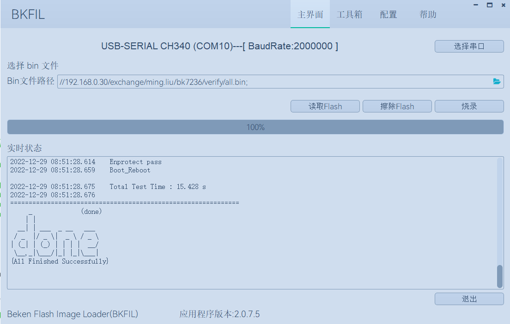

<a id="id1"></a>

# 快速入门

<a id="bk-controller-sdk"></a>

## **BK Controller SDK代码下载**

您可从 gitlab 上下载 BK Controller SDK:

```
mkdir -p ~/armino
cd ~/armino
git clone http://gitlab.bekencorp.com/armino/bk_idk_controller.git
```

您也可从 github 上下载 BK Controller SDK:

```
mkdir -p ~/armino
cd ~/armino
git clone --recurse-submodules https://github.com/bekencorp/bk_idk_controller.git
```

然后切换到稳定分支Tag节点, 如v2.1.1.1:

```
cd ~/armino/bk_idk_controller
git checkout -B your_branch_name v2.1.1.1
git submodule update --init --recursive
ls
```

备注

从官网的gitlab下载的为最近的SDK代码，相关账号找项目上审核申请。

<a id="id2"></a>

## **构建编译环境**

我们提供了一种基于Docker容器的环境部署与编译方案，支持在Linux、macOS及Windows系统上高效完成编译工作。
借助Docker容器化技术，您无需手动安装编译所需的各类库文件及工具链，从而显著简化了部署与编译流程。
该方案适用于熟悉Docker环境并了解其基本使用方法的用户，可帮助您快速实现环境的部署与编译。

对于不熟悉Docker技术或因网络条件限制无法使用Docker环境的用户，我们也提供了基于脚本命令的本地编译部署方案。本地部署方案目前仅支持Linux系统下的编译。

- [本地部署](get-started/env-manual.md)
- [Docker部署](get-started/env-docker.md)

<a id="id3"></a>

## 配置工程

您可以通过工程配置文件来进行更改 Armino 默认配置或者针对不同芯片进行差异化配置:

```
工程配置文件 Override 芯片配置文件 Override 默认配置
如： bk7239/config >> bk7239.defconfig >> KConfig
+ 工程配置文件示例：
    projects/app/config/bk7239/config
+ 芯片配置文件示例：
    middleware/soc/bk7239/bk7239.defconfig
+ KConfig 配置文件示例：
    middleware/arch/cm33/Kconfig
    components/bk_cli/Kconfig
```

<a id="id4"></a>

## 新建工程

BK7239 默认工程为 projects/app，新建工程可参考 projects/app工程

<a id="id5"></a>

## 烧录代码

Armino 支持在 Windows/Linux 平台进行固件烧录, 烧录方法参考烧录工具中指导文档。
以Windows 平台为例， Armino 目前支持 UART 烧录。
app工程在编译完成后，在build/app/bk7239目录下生成all-app.bin，使用此bin文件烧录即可。安全工程首次烧录时，需要先烧录bootloader.bin，再烧录all-app.bin。

<a id="id6"></a>

### 通过串口烧录

备注

Armino 支持 UART 烧录，推荐使用 CH340 串口工具小板进行下载。

串口烧录工具如下图所示:

<a id="id7"></a>


UART

烧录工具（BKFIL）获取：

> <https://dl.bekencorp.com/tools/flash/>
> 在此目录下获取最新版本，如：BEKEN\_BKFIL\_V2.1.6.0\_20231123.zip

BKFIL.exe 界面及相关配置如下图所示：

<a id="id8"></a>



BKFIL GUI

选择烧录串口 DL\_UART0，点击 `烧录` 进行版本烧录, 烧录完成之后掉电重启设备。

如果烧录过程无法获取设备，卡在 `Getting Bus...` 时，可以按一下重启键，恢复cpu状态。

<a id="log-command-line"></a>

## 串口 Log 及 Command Line

目前 BK7239 平台，串口 Log 及 Cli 命令输入在 DL\_UART0 口；可通过 help 命令查看支持命令列表。
