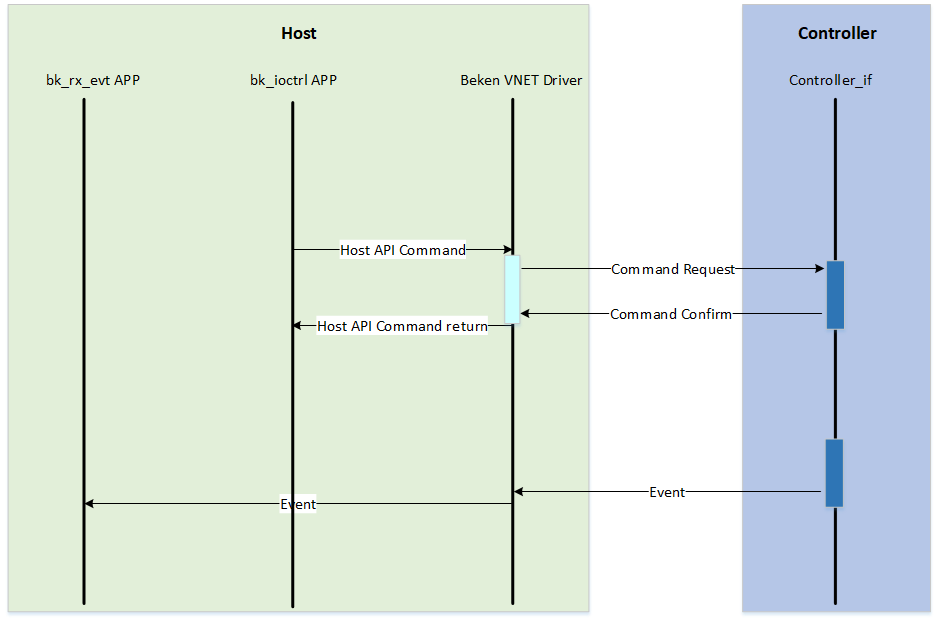
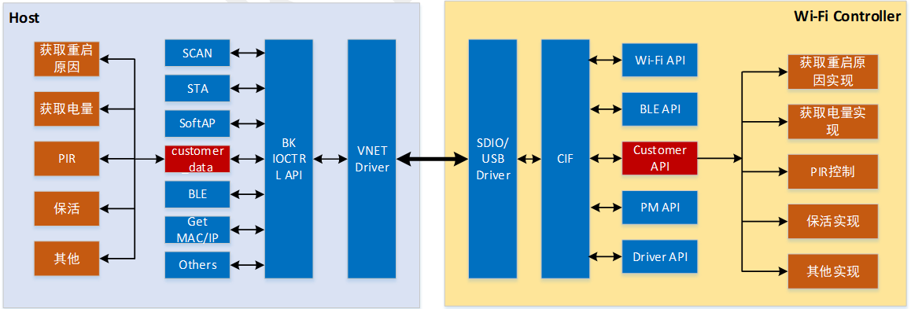

<a id="id1"></a>

# 主控平台开发指南

本章节主要介绍BK7239N主控平台软件开发指南，参考本章节相关接口和demo APP，开发者可完成主控平台软件开发。

<a id="controller"></a>

## **主控与Controller消息交互流程**

主控和Controller之间的消息交互主要分为如下Command和Event。相关流程如下图所示


<a id="command"></a>

### Command消息

Command消息是Host主动向Controller发送的消息，使用这类消息的API接口是 **同步接口**，即调用Command消息接口封装API的进程会被挂起，直到命令发送超时或者收到Confirm后才会恢复执行。
发送Command同时也可以通过Confirm机制向Controller获取数据。如下是几个典型的Command消息说明

**发送数据类型接口**

通过 `int bk_ioctl_set_sta(char *ssid, char *key)` 接口，可以将需要连接路由器的SSID和PASSWORD信息发送给Controller。

**获取数据类型接口**

通过 `int bk_ioctl_get_wlan_status(bk_ioctl_wlan_status_t *status)` 接口，可以查询Controller侧WLAN的信息，并将结果更新到status指针执行的地址，WLAN的信息是通过confirm消息中传递给Host的。

<a id="event"></a>

### Event通知

Event消息是Controller主动向Host发送的单向消息，不需要确认。
目前Host软件提供了Event消息处理的Callback注册接口，通过 `void bk_ioctl_register_callback(bk_ioctl_callback_t callback)` 接口可以将注册event消息的处理函数，
具体实现可以参考bk\_rx\_evt.c中注册函数处理和event处理函数实现。

```
 1 int main(int argc, char *argv[])
 2 {
 3     //printf("beken enter fasync user function.\n");
 4     bk_ioctl_register_callback(bk_rx_msg_cb);
 5     bk_ioctl_init();
 6
 7     while(1) {
 8         sleep(5);
 9     }
10
11     //printf("beken exit fasync user function.\n");
12     return 0;
13 }
```

<a id="bk-ioctl-api"></a>

## **bk\_ioctl API详解**

为了提高开发者效率，BK Controller方案在主控侧提供了必要的API接口，基于这些API开发者可轻松实现配网、低功耗管理和Wi-Fi/蓝牙控制等功能。
相关API接口说明如下表所示

> | 函数名 | 简介 |
> | --- | --- |
> | bk\_ioctl\_scan\_wifi | 执行Wi-Fi网络扫描，返回可用的网络列表。 |
> | bk\_ioctl\_set\_sta | 连接到指定SSID和密码的Wi-Fi网络。 |
> | bk\_ioctl\_disc\_sta | 断开当前连接的Wi-Fi网络。 |
> | bk\_ioctl\_start\_softap | 启用SoftAP模式，创建一个热点。 |
> | bk\_ioctl\_stop\_softap | 停止SoftAP模式，关闭热点功能。 |
> | bk\_ioctl\_get\_wlan\_status | 获取Wi-Fi连接状态信息。 |
> | bk\_ioctl\_wifi\_multimedia\_config | 启用或禁用Wi-Fi多媒体功能。 |
> | bk\_ioctl\_set\_net\_info | 设置网络配置参数。 |
> | bk\_ioctl\_get\_net\_info | 获取当前网络配置信息。 |
> | bk\_ioctl\_get\_rssi | 获取当前信号强度指示（RSSI）。 |
> | bk\_ioctl\_get\_wifi\_info | 获取Wi-Fi相关信息，如连接状态和信号强度。 |
> | bk\_ioctl\_set\_auto\_reconnect | 设置自动重连功能。 |
> | bk\_ioctl\_open\_ble | 初始化并启用BLE功能。 |
> | bk\_ioctl\_close\_ble | 禁用BLE功能并释放资源。 |
> | bk\_ioctl\_set\_mac | 设置设备的MAC地址。 |
> | bk\_ioctl\_get\_mac | 获取设备的MAC地址。 |
> | bk\_ioctl\_enter\_sleep | 进入低功耗睡眠模式。 |
> | bk\_ioctl\_exit\_sleep | 退出睡眠模式，恢复正常工作。 |
> | bk\_ioctl\_send\_at | 发送AT命令到设备。 |
> | bk\_ioctl\_keepalive\_cfg | 配置保持连接的参数。 |
> | bk\_ioctl\_set\_time | 设置系统当前时间。 |
> | bk\_ioctl\_get\_time | 获取系统当前时间。 |
> | bk\_ioctl\_send\_customer\_data | 发送自定义数据并接收响应。 |
> | bk\_ioctl\_start\_ota | 启动固件OTA升级过程。 |
> | bk\_ioctl\_send\_ota\_pkt | 发送OTA数据包进行固件更新。 |
> | bk\_ioctl\_stop\_ota | 停止当前的OTA升级过程。 |
> | bk\_ioctl\_register\_callback | 注册回调函数，处理特定的事件。 |
> | bk\_ioctl\_init | 初始化Ioctl模块，完成必要的设置。 |
> | bk\_ioctl\_deinit | 反初始化Ioctl模块，释放资源。 |

<a id="id2"></a>

## **自定义消息接口**

为了方便开发者传递自定义消息，BK Controller方案提自定义发送Command接口和接收自定义Event接口

<a id="id3"></a>

### 自定义Command消息接口

通过 `int bk_ioctl_send_customer_data(uint8_t *data, uint16_t len, uint8_t *rsp_data, uint16_t rsp_len)` 接口，
开发者可传递自定义消息，比如如下图所示，可将BK Controller方案未定义的消息以customer消息发送，实现自定义消息发送。



需要注意的是，Controller侧需要通过 `ctrl_if_register_customer_msg_handler(cif_customer_msg_cb_t func)` 接口注册对customer消息的处理函数，
同时在消息处理函数中需要对该消息进行确认处理。 `bk_ioctl_send_customer_data` 接口使用方法。
Controller侧可参考 `/bk_idk_controller/project/wifi/controller/customer_msg.c` 文件中 `cifd_cust_msg_handler` 函数实现；
主控侧可参考 `/bk_idk_controller/host/demo_app/bk_ioctrl/bk_ioctl_customer_msg.c` 文件中 `bk_ioctl_customer_transfer` 函数实现。

<a id="id4"></a>

### 自定义Event消息接口

开发者可在Controller侧通过 `ctrl_if_send_customer_event(uint8_t *data, uint16_t len)` 。
主控侧可通过 `bk_rx_handle_customer_event(void *data, uint16_t len)` 接口接收相应的Event消息。
