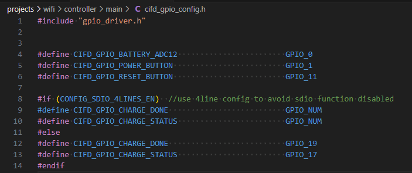
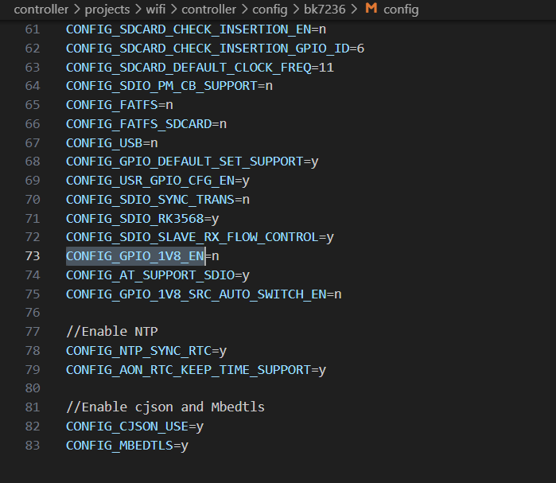

# wifi-controller-4wire

:

## 工程概述

- 工程路径: `projects/wifi/controller_4wire`
- 适用芯片: BK7239N
- 功能定位: 基于 SDIO 4-wire 虚拟网卡模式的 Wi-Fi 方案,提升 SDIO 带宽与稳定性,满足高吞吐需求。

## 工程配置

工程中有两个关键配置需要关注，分别是I/O相关配置和工程相关配置.

### I/O相关配置

IO相关配置主要子如下两个文件中配置： `/projects/wifi/controller/config/bk7239/usr_gpio_config.h`
文件实现GPIO功能配置和关键I/O定义，比如关键的SDIO中断I/O、主控上电控制I/O等

`/projects/wifi/controller/main/cifd_gpio_config.h` 文件定义demo工程功能I/O定义，比如按键和电量检测等

重要

*根据实际硬件情况配置I/O，controller工程为4线SDIO配置，SDIO D1/D2/D3被占用*

### 工程相关配置

工程相关配置通过 `/projects/wifi/controller/config/bk7239/config` 文件实现
该文件主要配置相关宏，其中比较重要的是SDIO 4线配置和I/O供电电压是3.3V配置。
CONFIG\_GPIO\_1V8\_EN\=y用来能1.8V I/O供电，CONFIG\_SDIO\_4LINES\_EN\=y用来使能4线SDIO。

## 编译命令

- `make bk7239 PROJECT=wifi/controller_4wire` (根据芯片替换目标)。

## 参考资料

- 更多细节请查看工程目录下的 `README.md` 文件。

## 模块导航

- [简介](../introduction.md)
- [快速入门](../get-started.md)
- [硬件开发指南](../hw-reference.md)
- [Controller软件开发指南](../controller-guide.md)
- [主控平台软件开发指南](../host-guide.md)
- [工程与示例](../project-example.md)
- [app](app.md)
- [wifi-controller](wifi_controller.md)
- [蓝牙工程](bluetooth.md)
- [开发工具介绍](../dev-tool.md)
- [调测指导](../debug-guide.md)
- [产测指导](../production-test-guide.md)
- [常见问题解答](../faq.md)
