

# Dashboard App 使用指南

## 1 下载

扫描二维码，下载安装。

下载二维码

## 2 简介

通过此app,让开发板播放导航语音，显示导航图片。根据图传方式的不同，分为蓝牙图传和wifi图传。

## 3\. 开发板介绍

以如下开发板举例。

- reset 按键：复位开发板
- K1 按键：清除配网信息并复位开发板

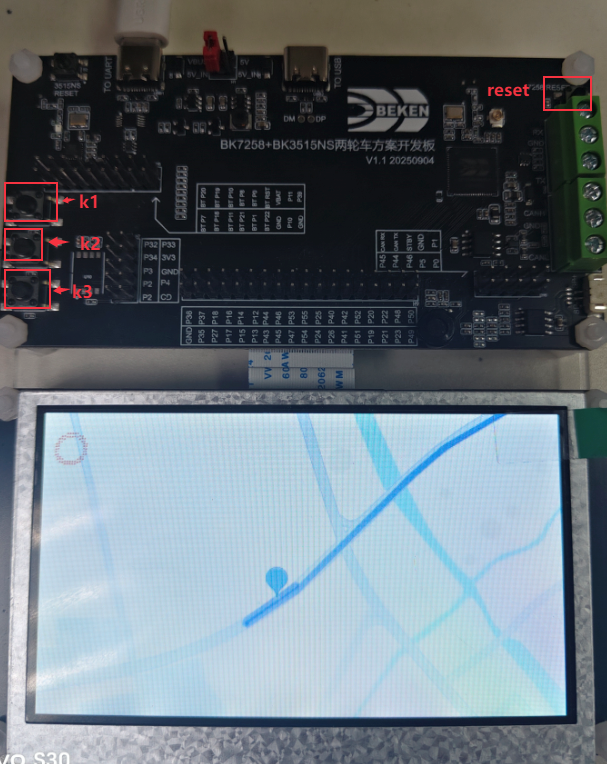

示例开发板

## 4\. WIFI图传使用步骤

通过wifi传输图片,通过经典蓝牙传输语音。

### 4.1 重置开发板

点击K1按键，重置开发板。

### 4.2 配置

根据需要选择配置。

[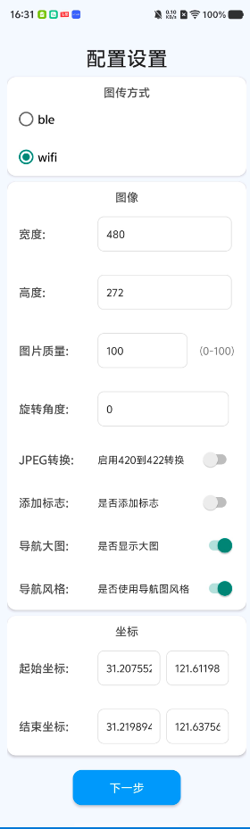](../../../_assets/bf38d546a5f54af1e179-setting.png)

设置

### 4.3 配网

使用BLE进行配网。

[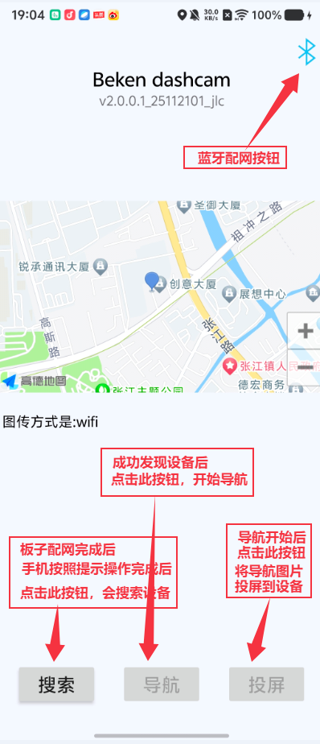](../../../_assets/4088969dccd2cb903d66-wifi_working_page.png)

wifi界面功能介绍

[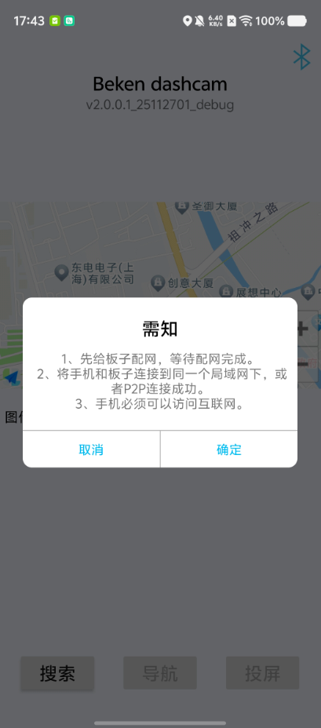](../../../_assets/fe4a4a46e7e2b9a1468a-wifi_tips.png)

配网提示

[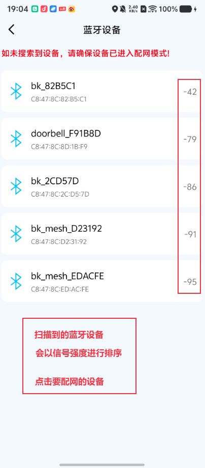](../../../_assets/5bf18dcce31310ec31dd-ble_scan.png)

蓝牙扫描结果

[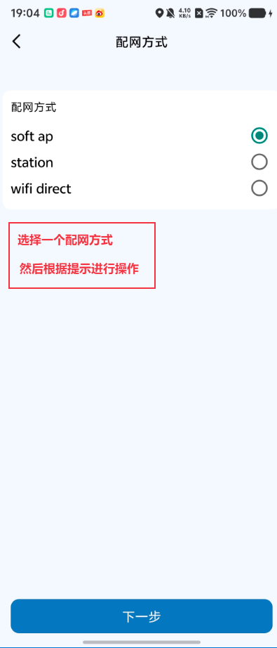](../../../_assets/92e6b80ff078b0ee9c16-wifi_select_type.png)

选择配网类型

[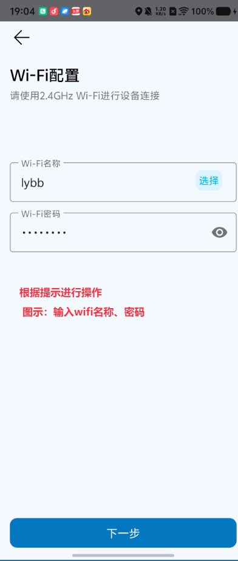](../../../_assets/6f384aa866ab251b256d-wifi_input_pwd.png)

输入配网信息

[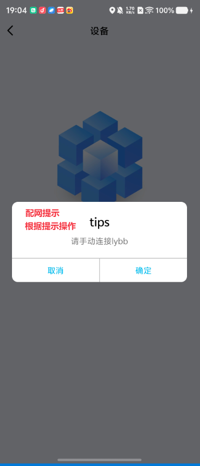](../../../_assets/c81d932ccd0044347acc-wifi_dn_done.png)

配网成功

### 4.4 语音配置

导航语音通过经典蓝牙进行传输。

蓝牙配对

### 4.5 发现设备

点击搜索，选择类型，开始搜索设备。

[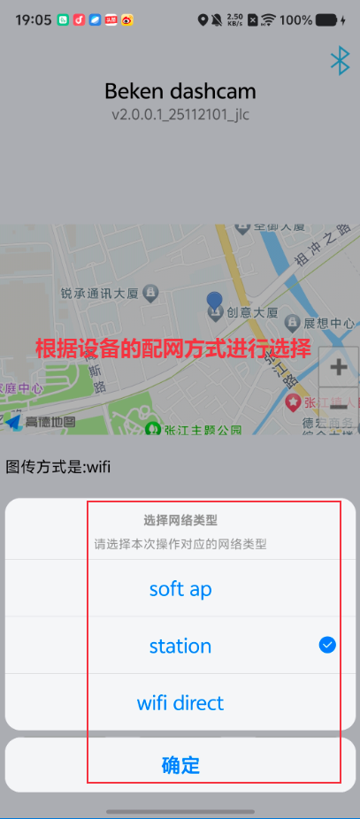](../../../_assets/616989392fa9094ca787-wifi_select_type_discovery.png)

发现设备

[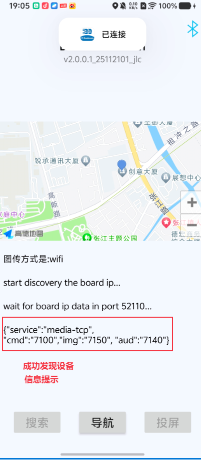](../../../_assets/b332abfdee164add3ef0-wifi_discover_success.png)

发现设备成功

### 4.6 导航与图传

点击导航功能按钮，开始导航。导航开始后，可以点击投屏按钮，开始投屏。

## 5\. 蓝牙图传使用步骤

通过BLE传输图片,通过经典蓝牙传输语音。

### 5.1 重置开发板

点击K1按键，重置开发板。

### 5.2 设置

根据需要选择配置。

设置

### 5.3 选择图传设备

[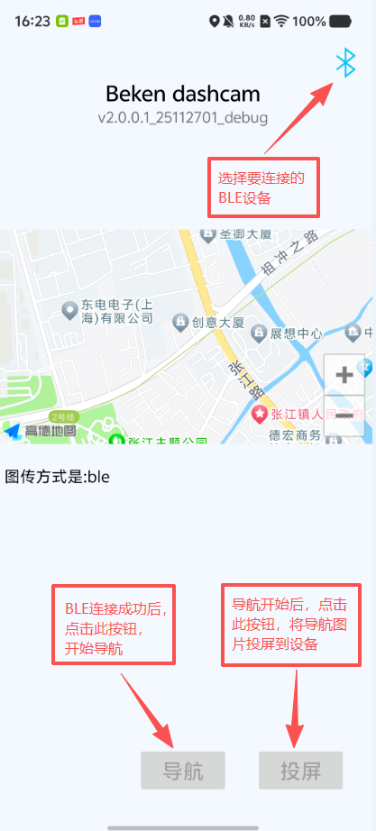](../../../_assets/9ad1e0b278de071894c1-ble_working_page.png)

蓝牙图传界面功能介绍

[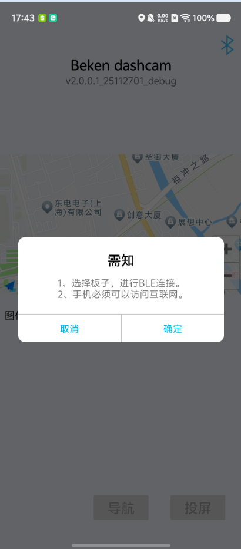](../../../_assets/736f8a75a8603fa37956-ble_tips.png)

蓝牙提示

[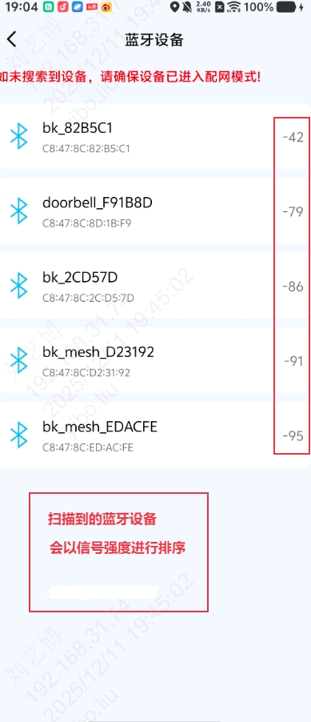](../../../_assets/db0263cb703eb059ba99-ble_scan_ble.jpg)

蓝牙扫描结果

### 5.4 语音配置

导航语音通过经典蓝牙进行传输。

蓝牙配对

### 5.5 导航与图传

点击导航功能按钮，开始导航。导航开始后，可以点击投屏按钮，开始投屏。
