

# Dashboard App 使用指南

## 1 下载

扫描二维码，下载安装。

Android App

iOS App

## 2 简介

通过此app,让开发板播放导航语音，显示导航图片。根据图传方式的不同，分为蓝牙图传和wifi图传。

## 3\. 开发板介绍

以如下开发板举例。

- reset 按键：复位开发板
- 长按下键: 清除配网信息并复位开发板

[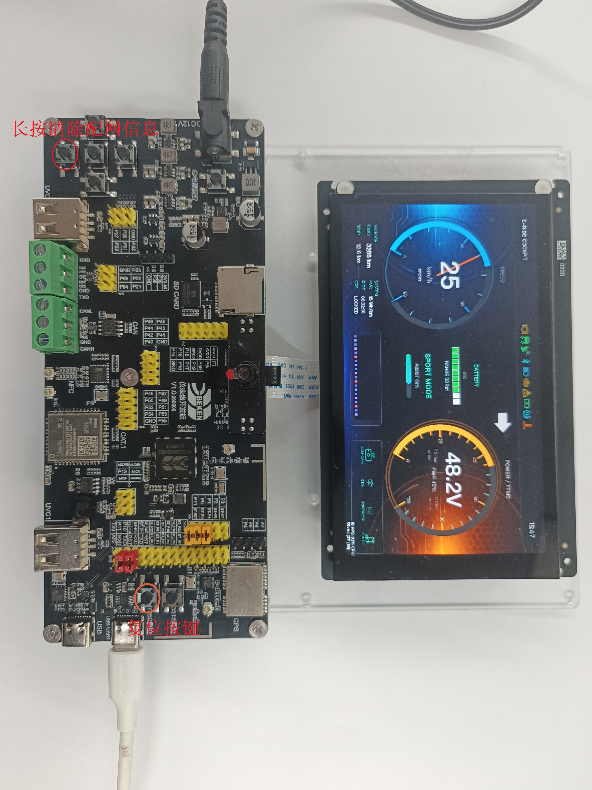](../../../_assets/253a4bb4c299dc72d5d1-dashboard_v1.jpg)

示例开发板

## 4\. WIFI图传使用步骤

通过wifi传输图片,通过经典蓝牙传输语音。

### 4.1 重置开发板

长按下键，重置开发板。

### 4.2 配置

根据需要选择配置，注意宽度和高度需要配成与开发板屏幕尺寸一致。

[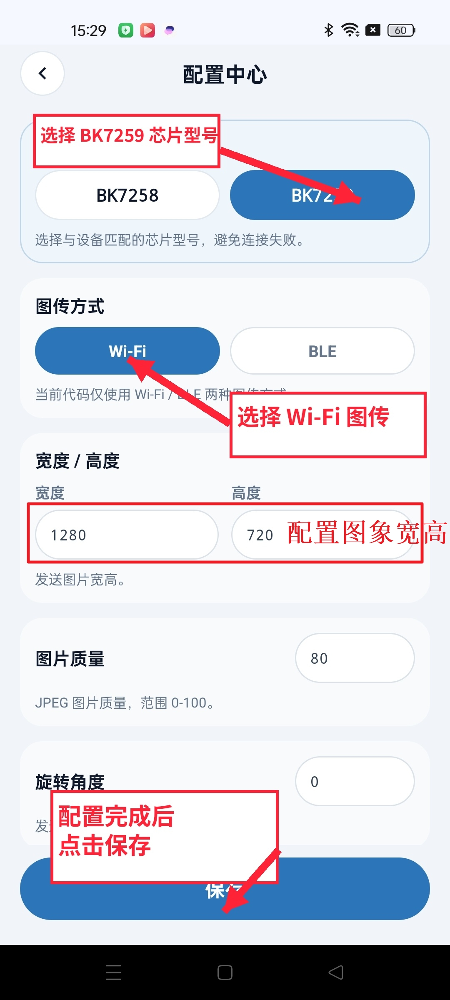](../../../_assets/bc6ee1065ba28161f2f4-config_center_0701.jpg)

配置中心

### 4.3 配网

使用BLE进行配网。

[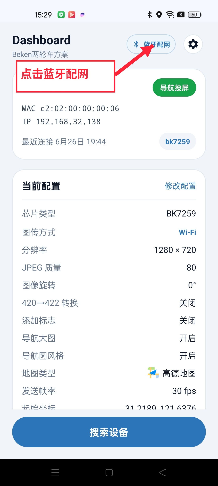](../../../_assets/a0bbdc3b0f9284588e3a-dashboard_home_0701.jpg)

首页与当前配置

[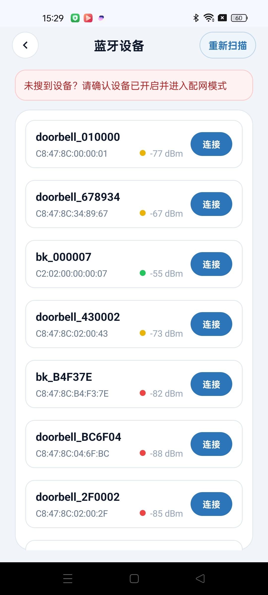](../../../_assets/8d7d71a6b7891116f51c-bluetooth_devices_0701.jpg)

蓝牙设备扫描结果

[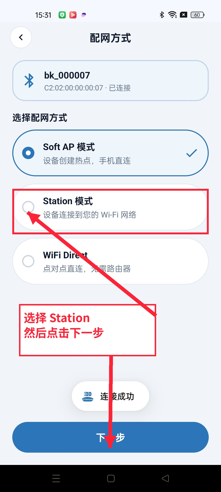](../../../_assets/cf9e32a7feb0433dcf32-provision_type_0701.jpg)

选择配网方式

[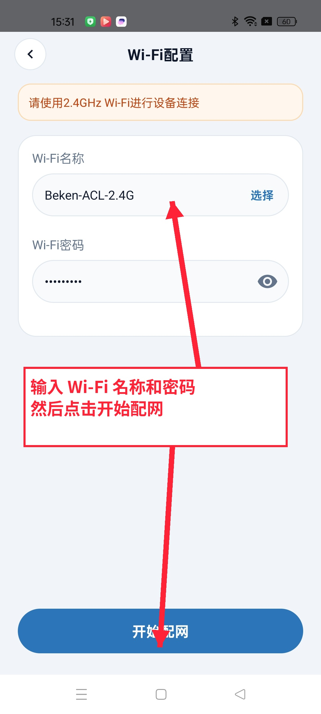](../../../_assets/64408c8f666d8d4dfa9d-wifi_config_0701.jpg)

输入 Wi-Fi 配置信息

[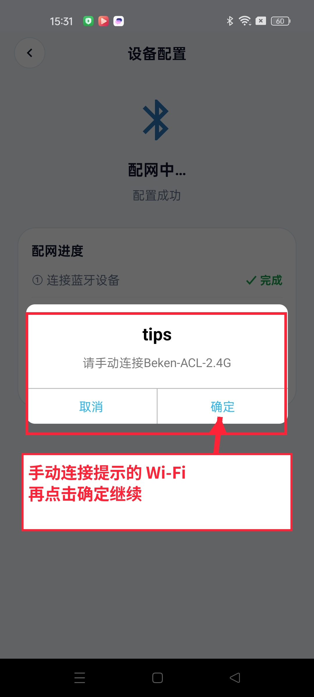](../../../_assets/0d0e4ac14478accdbc54-provision_progress_0701.jpg)

配网进度提示

### 4.4 语音配置

导航语音通过经典蓝牙进行传输。

[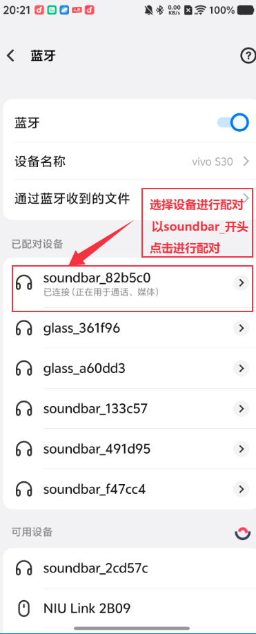](../../../_assets/27a557bcd5e9339549d3-bt_pair.png)

蓝牙配对

### 4.5 发现设备

点击搜索，选择类型，开始搜索设备。

[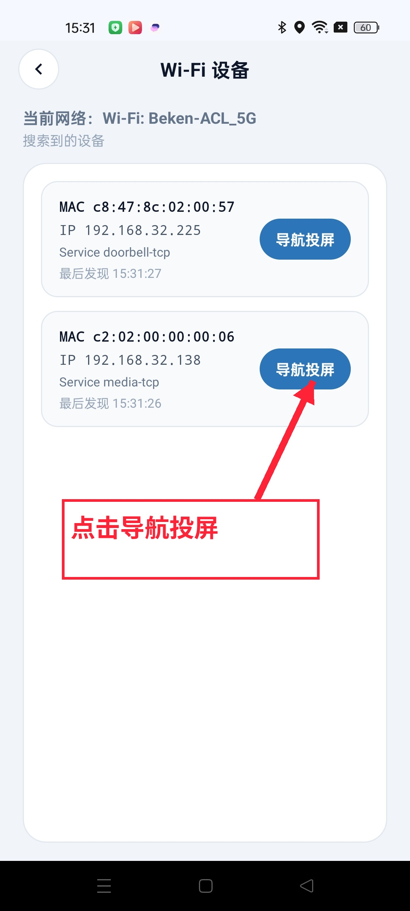](../../../_assets/a4b79cc27fdcec4ad5d2-wifi_devices_0701.jpg)

Wi-Fi 设备列表

### 4.6 导航与图传

点击导航功能按钮，开始导航。导航开始后，可以点击投屏按钮，开始投屏。

[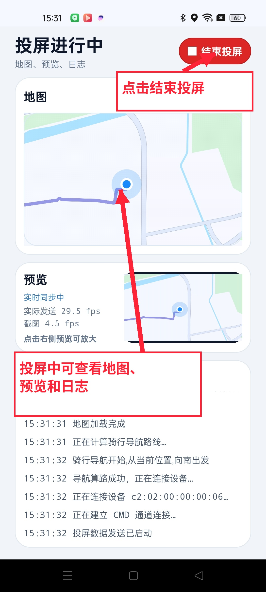](../../../_assets/408acfd9a6696723fa82-casting_running_0701.jpg)

投屏进行中

## 5\. 蓝牙图传使用步骤

通过BLE传输图片,通过经典蓝牙传输语音。

### 5.1 重置开发板

长按下键，重置开发板。

### 5.2 设置

根据需要选择配置。

[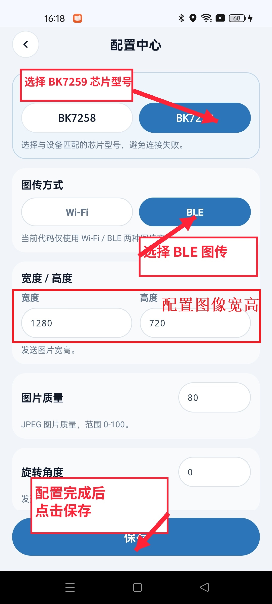](../../../_assets/d420cd0ad6b5e079d757-ble_config_center_0701.jpg)

BLE 图传配置

### 5.3 选择图传设备

[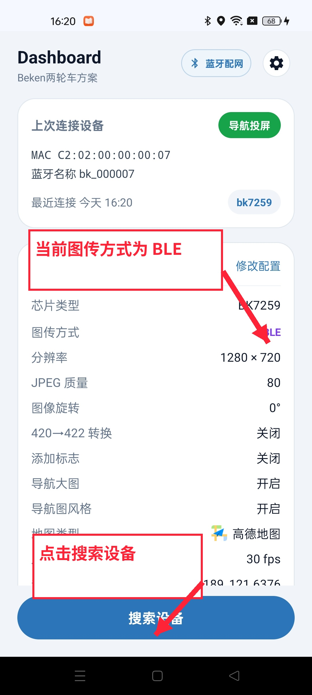](../../../_assets/4e92af44309dd9e5ae09-ble_dashboard_home_0701.jpg)

BLE 图传首页与当前配置

[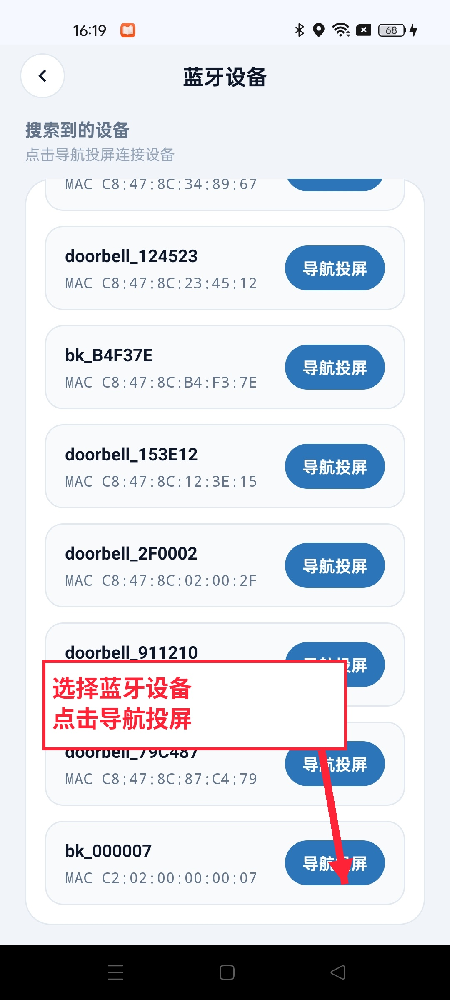](../../../_assets/0da92a3f9a8923e93d00-ble_devices_0701.jpg)

蓝牙设备列表

### 5.4 语音配置

导航语音通过经典蓝牙进行传输。

蓝牙配对

### 5.5 导航与图传

点击导航功能按钮，开始导航。导航开始后，可以点击投屏按钮，开始投屏。

[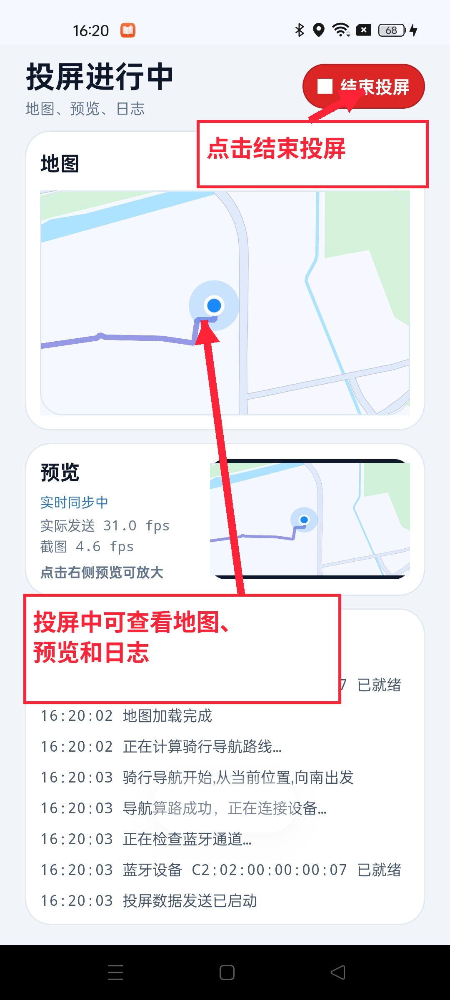](../../../_assets/9da0cec3f1034ee04a46-ble_casting_running_0701.jpg)

BLE 投屏进行中
