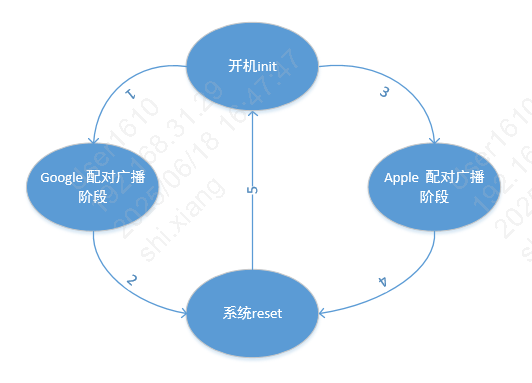

# 测试说明

## 1.Apple\&Google Findmy 模式切换

Apple\&Google Finmdy只能工作在一种Finmdy模式，Apple或者Google，两种模式在配对广播阶段可通过长按按键10s进行切换。

Apple\&Google Finmdy状态图

1.开机后，读取Flash里配置的FindMy type,若配置值为1，则进入Google Finmdy。

2.若Google Findmy Unprovisioned并且处于配对广播阶段，长按按键10s后，更改findmy type值为0，并写入flash后触发reset。

3.开机后，读取Flash里配置的FindMy type,若配置值为0，则进入Apple Finmdy。

4.若Apple Findmy未绑定，处于配对广播阶段，长按按键10s后，更改findmy type值为1，并写入flash后触发reset。

5.reset重启后，重新读取Flash配置值，切换为对应的FindMy模式。

## 2.Apple Findmy 模式

请参考： [Apple FindMy测试说明](apple_test_instruction.md#id1)

备注

- 苹果手机删除设备后，Apple Findmy直接进入配对广播阶段，可直接长按10s触发模式切换。
- Apple Finmdy模式下，获取Serial number需长按按键，当听到第五声哔声后，松开按键，进入该模式。
- Apple Finmdy模式下，删除配对信息需长按按键，当听到第八声哔声后，松开按键，直到听到持续的哔\~\~声音，此时配对信息删除成功。

## 3.Google Findmy 模式

请参考： [Goole FindMy测试说明](google_test_instruction.md#id1)

备注

安卓手机删除设备后，Google Findmy会直接进入Deep Sleep超低功耗状态，需要先按键一次唤醒，唤醒后进入配对广播阶段。

## 模块导航

- [快速入门](../get-started.md)
- [API 参考手册](../api-reference.md)
- [开发者指南](../developer-guide.md)
- [出厂信息配置](factory_config.md)
- [配件信息配置](accessory_information.md)
- [加速度传感器配置](gsensor_config.md)
- [蜂鸣器配置](sounder_config.md)
- [按键配置](key_config.md)
- [OTA](ota.md)
- [Apple UARP升级](apple_uarp.md)
- [Apple FindMy测试说明](apple_test_instruction.md)
- [Google FindMy测试说明](google_test_instruction.md)
- [硬件资料](hw.md)
- [软件常见问题](software_faq.md)
