

# 测试说明

## 1.开发板上电

[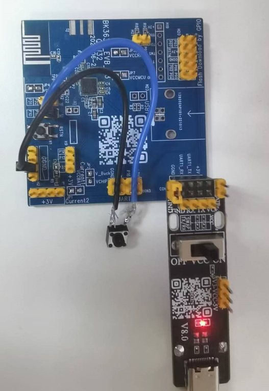](../../../_assets/6576b1bbaabdce732e48-fmna_0.png)

开发板

## 2.手机蓝牙绑定追踪器

1）先打开iPhone的蓝牙功能，再打开iPhone的“查找”应用程序

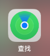

查找应用程序

2）在APP中点击 添加物品-\>其他支持的物品

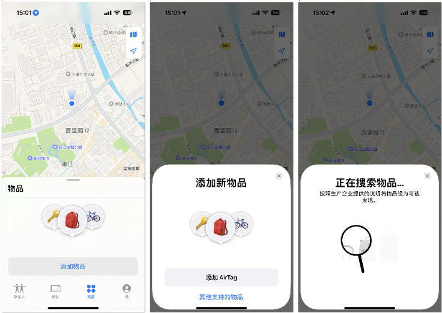

添加其他物品

3）搜索到后，为它取一个名字，并选取一个图标，以方便识别

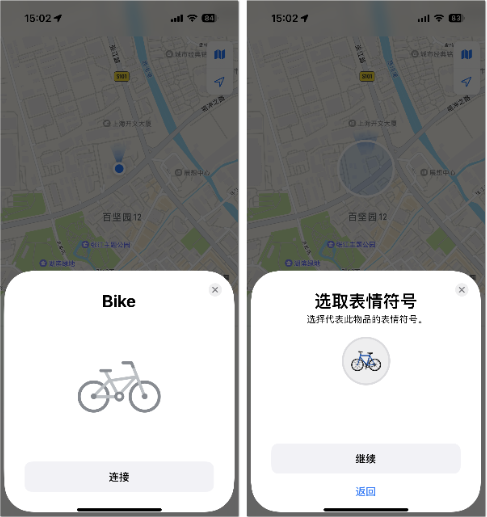

连接

4）阅读并同意设备使用定位协议后，即完成绑定

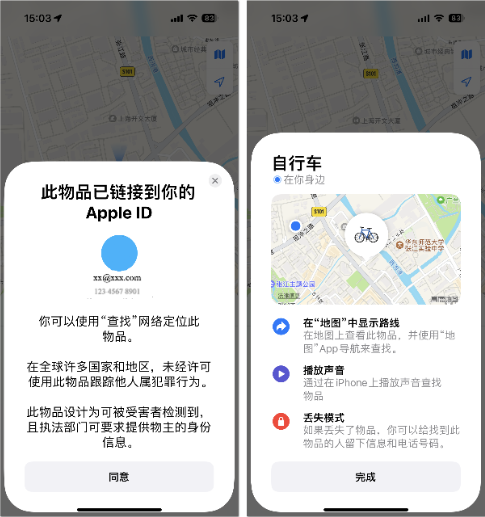

绑定完成

## 3.查找物品功能

> 当你想寻找这个物品时，在物品列表中点击你要查找的物品，并点击“播放声音”，设备就会滴滴响5秒

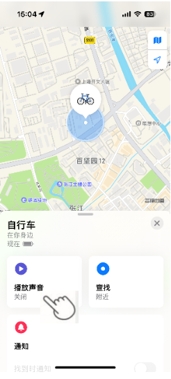

播放声音

## 4.物品遗落通知功能

> 在APP中开启“遗落时通知”功能，当用户离开某区域，不小心把放有追踪器的物品遗落在原地，iPhone将受到该设备被遗落的通知。

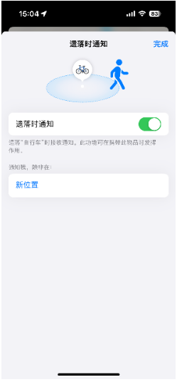

遗落通知

## 5.发现通知

> 在APP中开启“找到时通知”功能，当追踪器已与配对的iPhone断开。当iPhone靠近追踪器时，手机会自动连接到追踪器上，用户将收到物品在附近的即时通知。

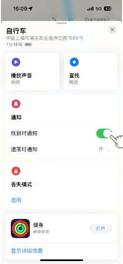

发现通知

## 6.丢失模式——开启丢失模式

> 当物品丢失时，要打开丢失模式，在APP的物品列表里，点击你丢失的物品。找到“丢失模式”，点击“启用”。

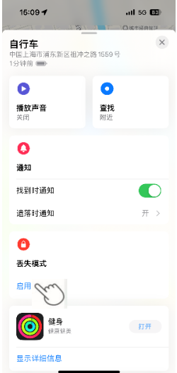

启用丢失模式

> 点击“继续”，输入你的电话号码，然后点击“下一步”。

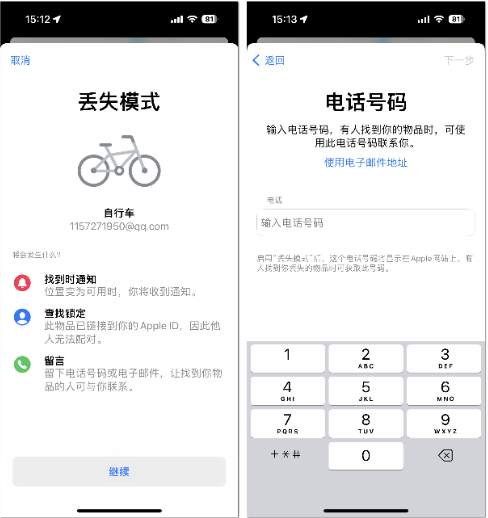

输入电话号码

> 打开“找到时通知”开关-\>”启用”。

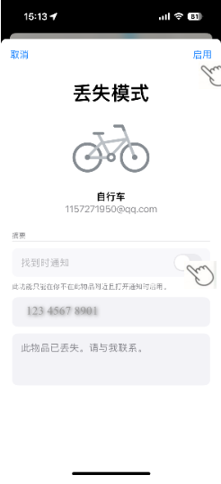

启用找到时通知

## 7.丢失模式——拾物者查询失主信息

1）如果拾到别人的追踪器，打开iPhone的蓝牙功能，并打开APP在“物品”页面点击“识别找到的物品”。

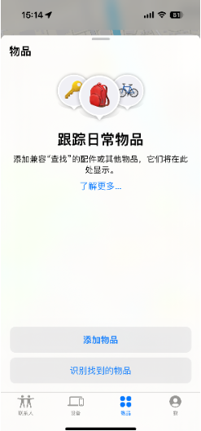

识别找到的物品

2）点击搜索到的物品名称，然后点击“继续”。

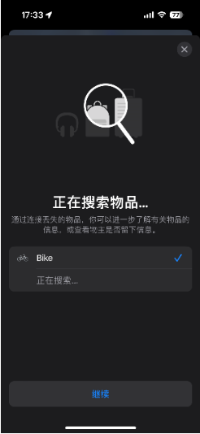

搜索物品

3）按下按键，听到哔的一声后松开按键，等待约几分钟后，点击“在网站上继续”。

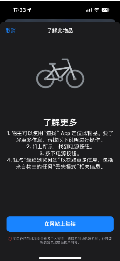

点击在网站上继续

4）查询到失主联系方式。

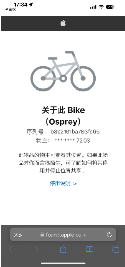

查询到失主联系方式

## 8.运动检测模式

> 在进入分离状态3天后自动开启。追踪器每隔6小时进入到“等待移动”状态，在“等待移动”状态检测到自身有运动就会发出5秒的报警声音。

## 9.移除跟踪器绑定

> - 清除追踪器上的配对
>   :   长按追踪器上按键，当听到三声哔哔声时，继续按住，直到听到响亮的哔哔声。追踪器将恢复到出厂设置，这将清除追踪器配对信息。
> - 手机端移除
>   :   在Find My APP中移除时，需要与苹果设备连接的状态下移除，这样可以同步清除追踪器中的配对信息，如果在未连接的状态下移除，只能在苹果设备上移除，追踪器中的配对信息还在，并不会再发配对广播，所以就不会再被发现并添加。

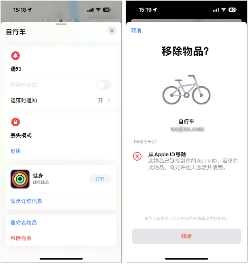

移除跟踪器绑定

备注

关于蜂鸣器的声音
:   - 开机 哔哔两声；
    - 连接成功 哔一声；
    - 移除成功 持续的哔\~\~声音；
    - 获取serial number，按2s, 哔一声；
    - 删除配对信息，长按，当听到哔哔哔三声时，继续按住，直到听到持续的哔\~\~声音，此时配对信息删除成功；
