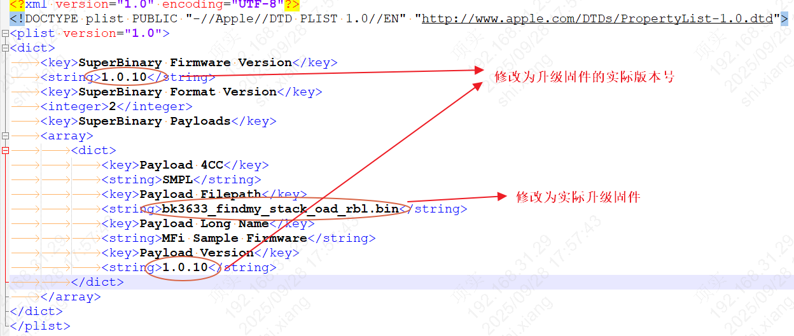
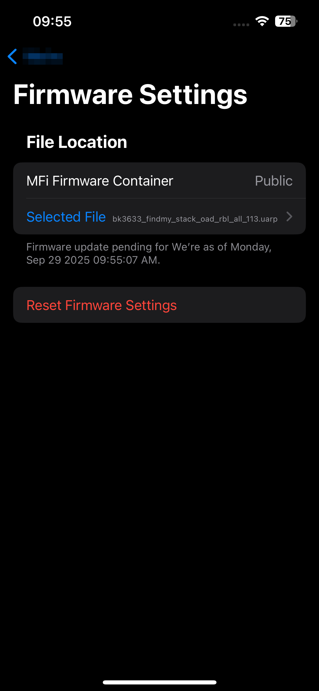
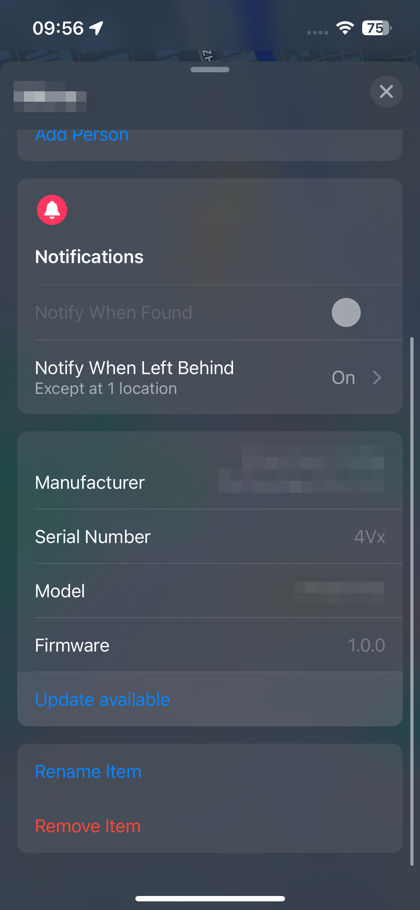

# UARP

## 1、UARP

UARP 是苹果官方提供的升级协议，用于升级苹果设备的固件。版本号由 `FW_VERSION_MAJOR_NUMBER FW_VERSION_MINOR_NUMBER FW_VERSION_REVISION_NUMBER` 控制，

注意：更新文件的版本号要大于当前设备的版本号，否则无法升级。

备注

支持UARP升级需要使用8Mb的flash;

## 2、 FMCA 安装与配置

1. 安装FMCA application

   > 从苹果App Store下载并安装FMCA application。
2. 安装FMCA Configuration profile

   > 从苹果MFI官网下载 FMCA Configuration Profile.zip, 解压后将config文件放到iOS手机文件夹内，点击描述文件，然后进入设置页面，点击进行安装，安装后需要重启iOS手机。

## 3、 使用UARP工具制作升级包

1. 制作工具为mfigr2，将升级固件 bk3633\_findmy\_stack\_oad\_rbl.bin 与mfigr2工具放到同一目录下；
2. 打开mac终端，进入刚才的目录，执行以下命令，生成中间文件：

   > - ./mfigr2 superbinary generate mfiMetaData\=UARPMFiMetaDataTable2.plist
   > - ./mfigr2 superbinary generate mfiPlist\=MyUARPSuperBinary.plist
3. 打开MyUARPSuperBinary.plist文件，修改相关信息：

Config

4. 执行以下命令，生成UARP升级包：

   > ./mfigr2 superbinary compose metaDataFilepath\=UARPMFiMetaDataTable2.plist payloadsFilepath\=. plistFilepath\=MyUARPSuperBinary.plist superBinaryFilepath\=xxx.uarp
5. 将生成的xxx.uarp文件发送到iOS手机上。

## 4、 UARP升级

1. 通过 “Find My” 添加设备后，打开FMCA应用，进入 ”Firmware Settings“ ，通过 “Choose a File” 选择升级的uarp文件，

Firmware Settings

2. 返回 “Find My” 中，重新进入设备页面，可以看到 “有可用更新” 提示，点击 “更新” 即可开始升级。

Update

3. 升级完成后，设备会自动重启，升级完成后，可以看到最新的版本号。

Update Success

|  |  |
| --- | --- |
| [uarp4](../../../_assets/e911769a0090909c3b6a-uarp4.png) | [uarp5](../../../_assets/c35956a50e1de5c614f7-uarp5.png) |
