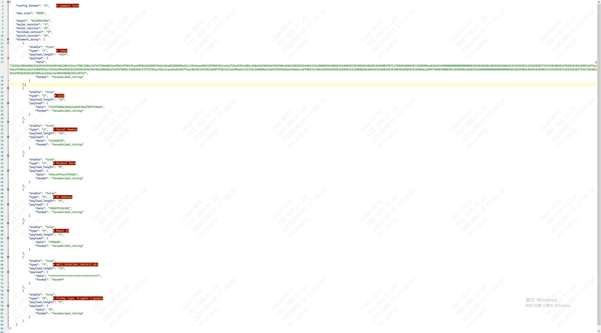
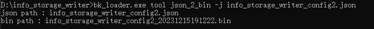
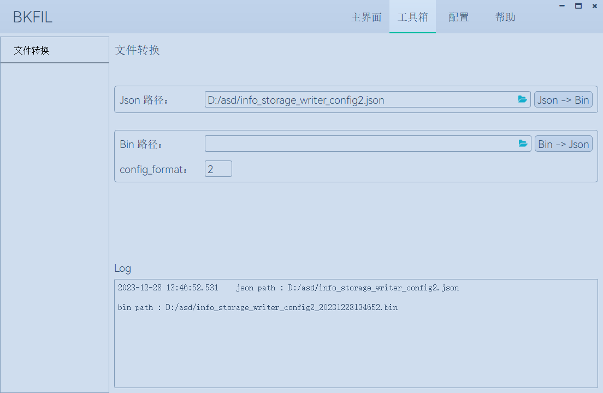
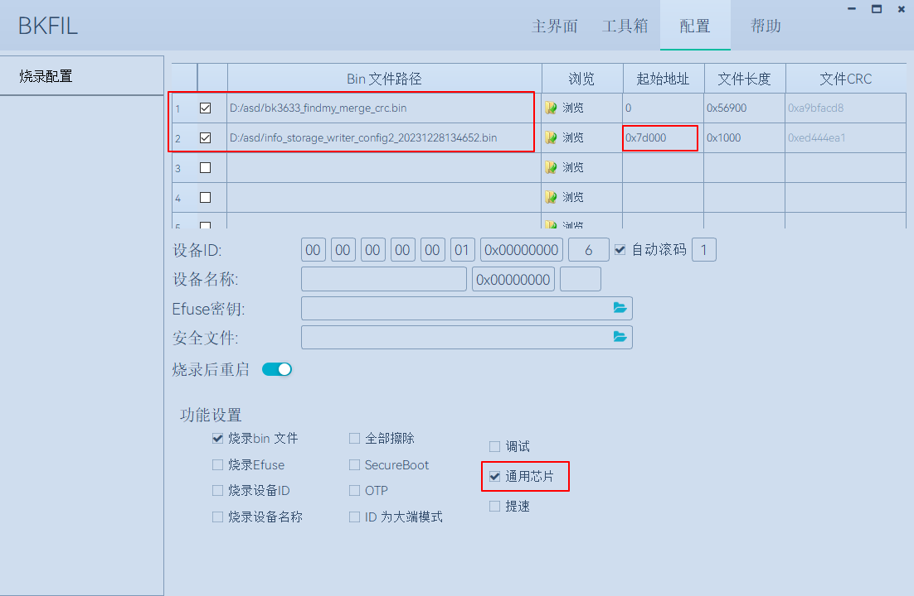

# 出厂信息配置

## 1、出厂配置信息

> > Apple FindMy在出厂时需要配置以下信息才能正常工作：
>
> - BT Address
> - Product Data
> - Token
> - UUID
> - Serial Number
>
> > Google FindMy在出厂时需要配置以下信息才能正常工作：
>
> - Model ID
> - ANTI\_SPOOFINGY\_PRIVATE\_KEY
>
> > Apple\&Google FindMy在出厂时需要配置以下信息才能正常工作：
>
> - BT Address
> - Product Data
> - Token
> - UUID
> - Serial Number
> - Model ID
> - ANTI\_SPOOFINGY\_PRIVATE\_KEY
> - Findmy type

## 2、准备工作

烧录工具获取：

> <http://dl.bekencorp.com/tools/flash/>
> 在此目录下获取BEKEN\_BKFIL\_Vx.x.x.x\_xxxx.zip

备注

支持本工程的BEKEN\_BKFIL最低版本是V2.1.7.0。

配置文件获取：

> <http://dl.bekencorp.com/tools/info_storage_writer/>
> 在此目录下获取最新配置文件，info\_storage\_writer\_config2.json

## 3、配置步骤

1、修改配置文件info\_storage\_writer\_config2.json中的8个配置项的信息（注意：请勿修改配置项type值）

配置项

备注

- Apple FindMy除了Product Data项，其他4项每个设备信息是唯一的，不能相同。
- Google FindMy需要通过宏 `CONFIG_USE_STORAGE_FLASH_VALUE` 使能该配置, 否则使用默认值 `CONFIG_GOOGLE_MODLE_ID CONFIG_GOOGLE_ANTI_SPOOFINGY_PRIVATE_KEY`。
- Apple\&Google Finmdy 通过Findmy type配置配置第一次使用的Findmy类型，0为Apple，1为Google。注意：已与手机绑定的设备请勿直接更改Flash的存储值。

2、生成info\_storage.bin

有两种生成方式：

- 通过命令行方式，执行bk\_loader.exe tool json\_2\_bin -j info\_storage\_writer\_config2.json ，生成info\_storage\_writer\_config2\_xxxxx.bin

命令行方式

- 通过UI方式，选择对应的json文件，点击Json -\> Bin 按钮

UI方式

3、进行配置

> - 运行BEKEN\_BKFIL
> - 设置波特率为1000000
> - 在配置选项卡，分区1设置为主固件.bin，起始地址为0x0，勾选分区1
> - (仅第一次烧写)分区2为info\_storage.bin，起始地址为0x7d000(4Mbit flash)/0xfd000(8Mbit flash)，勾选分区2
> - 勾选通用芯片
>
> 
> 
>
>
> BKFIL配置
>
> - 返回主界面进行烧录操作

备注

1. 每个Apple FindMy设备的uuid和token唯一，多个设备不能烧录同一info\_storage.bin。
2. 每个Apple FindMy备info\_storage.bin只能烧录一次，重复烧录会有token丢失及此组uuid和token作废的风险 !!!。
3. 起始地址绝不能写错。
