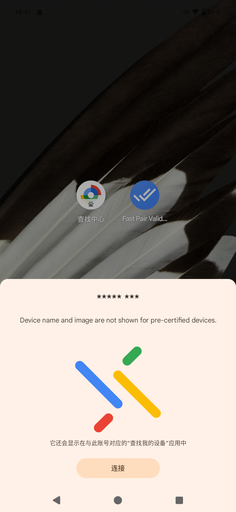
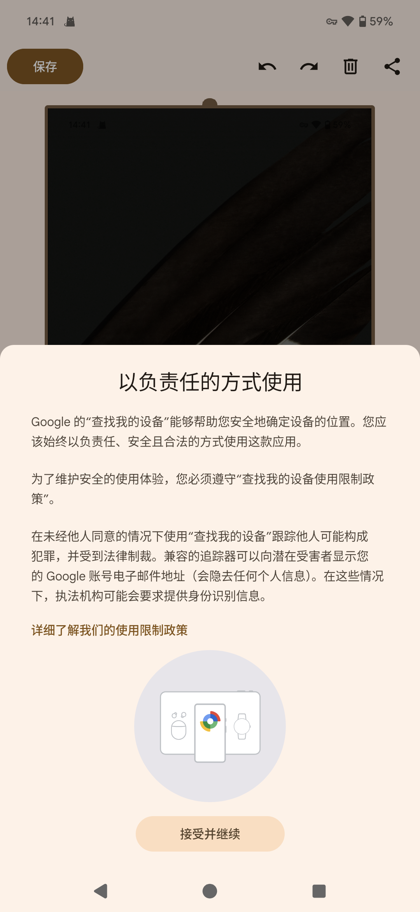
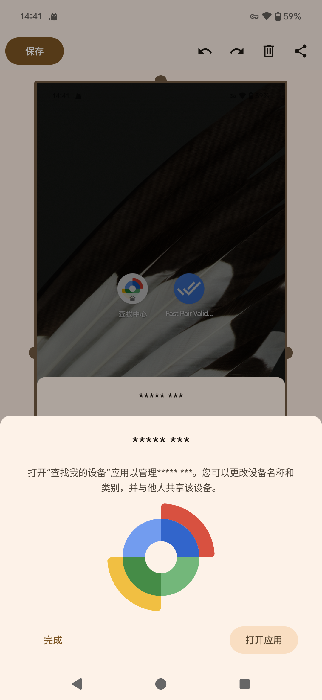
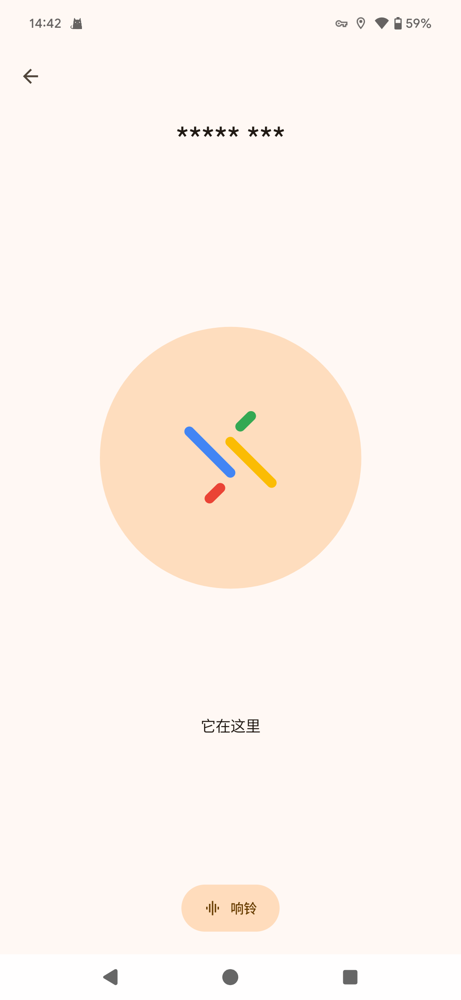
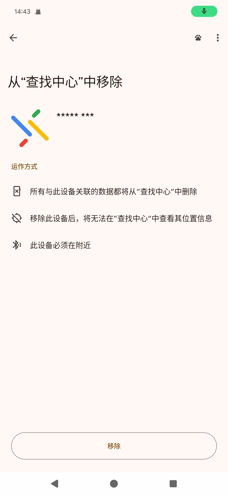
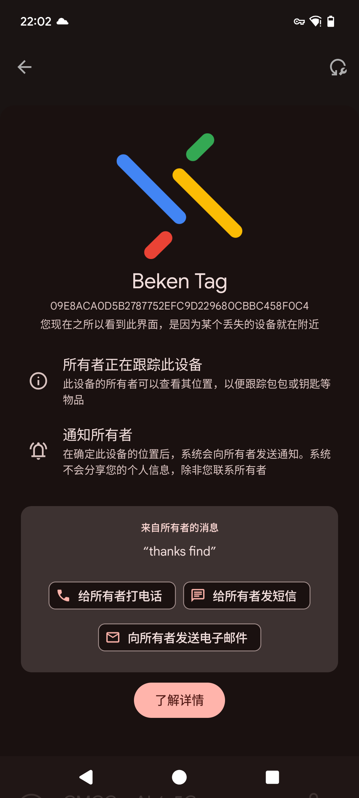
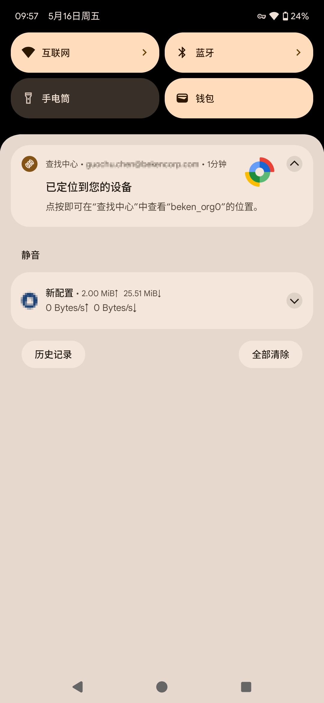

# 测试说明

## 1.开发板上电

开发板

## 2.手机蓝牙绑定定位标签

1）确认Android手机蓝牙功能已开启，网络处于连接状态，将Android手机靠近定位标签。

2）等待Android设备弹出检测到快速配对程序的通知窗口。

快速配对通知

3）通过点击 “连接” 按钮启动连接并触发 “快速配对”过程。该过程完成后，Android设备会弹出一个窗口，包含FindMy Device应用程序的可接受使用策略。

4）点击 “接受并继续”按钮同意该策略。

使用策略

5）等待Android设备的通知，该通知指示绑定流程完成。

绑定完成

6）点击 “打开应用” 按钮，进入FindMy Device应用程序。

7）点击 “查找附近设备” 视图，待连接成功后，点击 “响铃” 按钮，启动标签铃声。响铃成功后，点击 “停止响铃” 停标签止铃声。

响铃

## 3.移除定位标签绑定

> - 清除追踪器上的配对
>   :   长按追踪器上按键，当听到第八声哔声后，松开按键，直到听到响亮的哔哔声。追踪器将恢复到出厂设置，这将清除追踪器配对信息。
> - 手机端移除
>   :   在FindMy Device应用程序中移除时，需要确认为与标签为连接状态下移除，这样可以同步清除标签中的配对信息，如果在未连接的状态下强制移除，只能在Android手机上移除，标签中的配对信息还在，并不会再发配对广播，所以就不会再被发现并添加。

1）返回到FindMy Device应用程序设备试图，通过点击位于地图视图下方名称旁边的齿轮图标打开设备详细信息页。

2）点击屏幕底部 “从查找中心中移除”。

3）点击 弹出的 “移除” 按钮删除设备，等待设备删除完成。

移除定位标签绑定

4）标签被删除成功后，会听到响亮的哔哔声，标签被删除后不会自动发起可配对广播。

5）短按标签按键，标签会发起可配对广播，并且有哔哔声提示音，Android手机可重新进入绑定流程。

## 4.将标签标记为丢失

1）标签丢失后，通过该标签主页的 “标记为丢失” 功能，将标签标记为丢失，可以预留电话号码，电子邮件地址和消息，如果有人发现了该丢失的标签，可以查看到联系方式，以便归还标签。

标记为丢失

|  |  |  |
| --- | --- | --- |
| [test instruction 7](../../../_assets/2d2aac122915024166fc-g_findmy_6.png) | [test instruction 8](../../../_assets/99067e79150a36085cbe-g_findmy_7.png) | [test instruction 9](../../../_assets/e394e0071ea8b91103a6-g_findmy_8.png) |

2）当其他用户拾到该标签，靠近手机后，手机会弹出该丢失标签的信息以及预留的电话号码，电子邮件和消息。

拾到弹窗

3）若”查找我的设备”网络中心检测到丢失标签的位置信息后，会向标签绑定的手机发送通知。

拾到通知

备注

关于蜂鸣器的声音
:   - 开启配对广播，哔哔两声，单击标签按键可开关配对广播。
    - 绑定成功 哔哔两声。
    - 移除成功 持续的哔\~\~声音。
    - 获取Get\_Identifier，长按追踪器上按键，当听到第五声哔声后，松开按键，进入该模式。
    - 删除配对信息，长按标签按键，当听到第八声哔声后，松开按键，直到听到持续的哔\~\~声音，此时配对信息删除成功。
