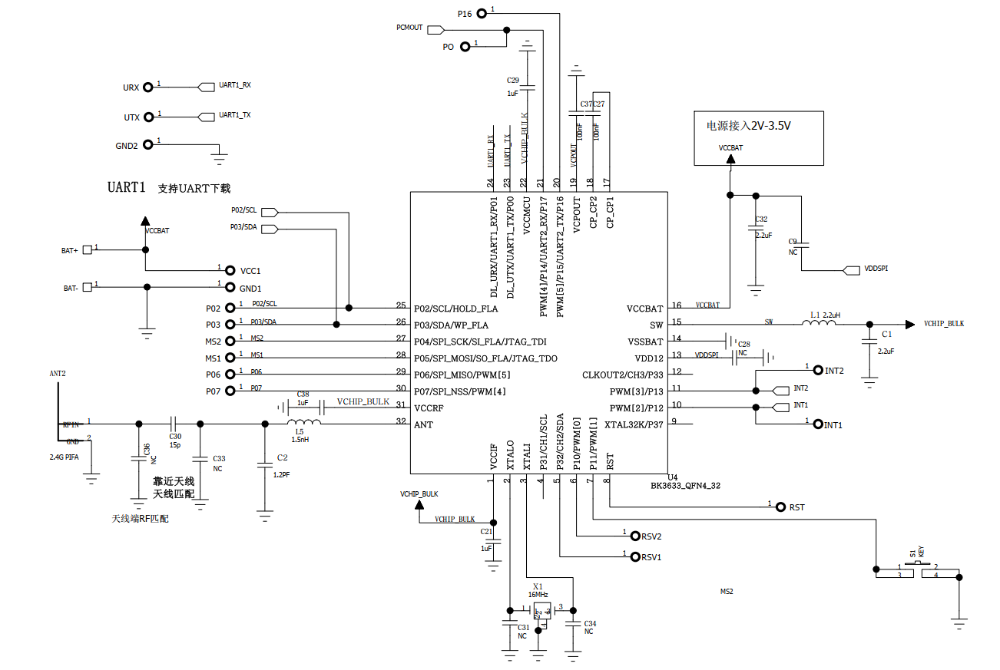
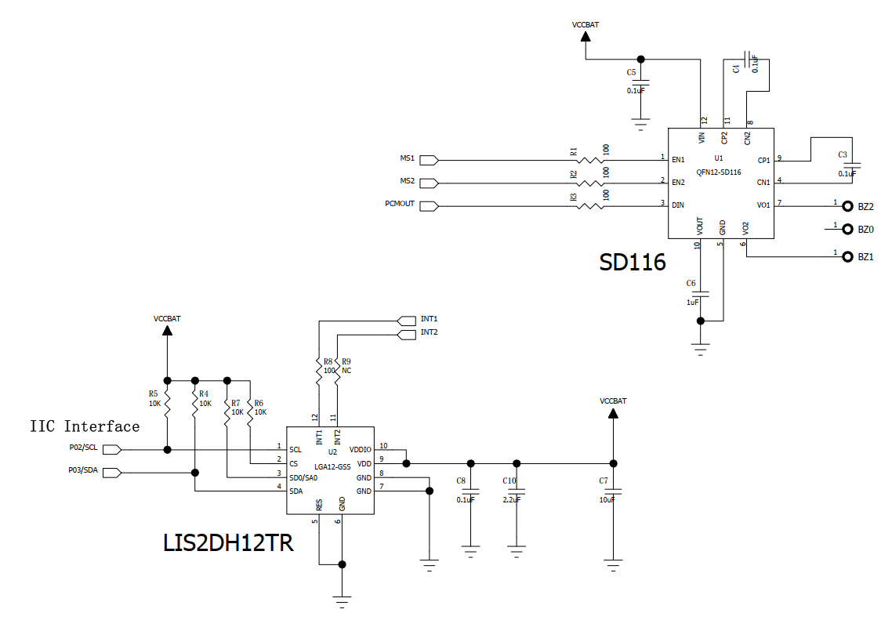
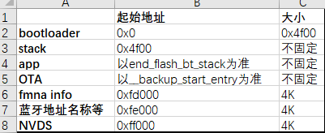

# 硬件资料

## 1、硬件参考设计

图一

图二

> 硬件参考设计获取路径：
> [https://docs.bekencorp.com/HW/BK3633/SCH-BK3633\_iTag.pdf](../../../_assets/773ab4397127a21aca2d-SCH-BK3633_iTag.pdf)

## 2、Datasheet

> Datasheet获取路径：
> [https://docs.bekencorp.com/spec/BK3633/BK3633%20Datasheet.pdf](../../../_assets/824de2fb832c45308437-BK3633-Datasheet.pdf)

## 3、flash布局

flash layout

## 模块导航

- [快速入门](../get-started.md)
- [API 参考手册](../api-reference.md)
- [开发者指南](../developer-guide.md)
- [出厂信息配置](factory_config.md)
- [配件信息配置](accessory_information.md)
- [加速度传感器配置](gsensor_config.md)
- [蜂鸣器配置](sounder_config.md)
- [按键配置](key_config.md)
- [OTA](ota.md)
- [Apple UARP升级](apple_uarp.md)
- [Apple FindMy测试说明](apple_test_instruction.md)
- [Google FindMy测试说明](google_test_instruction.md)
- [Apple&Google FindMy测试说明](apple%26google_test_instruction.md)
- [软件常见问题](software_faq.md)
