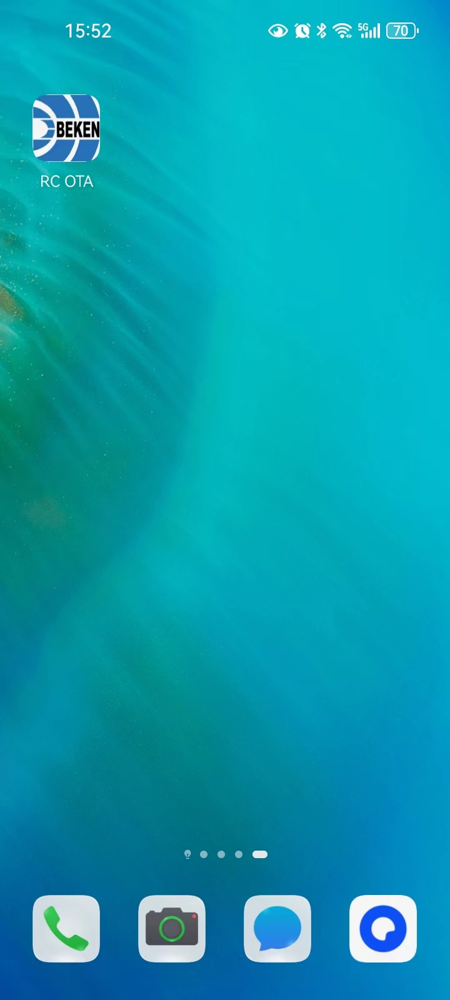
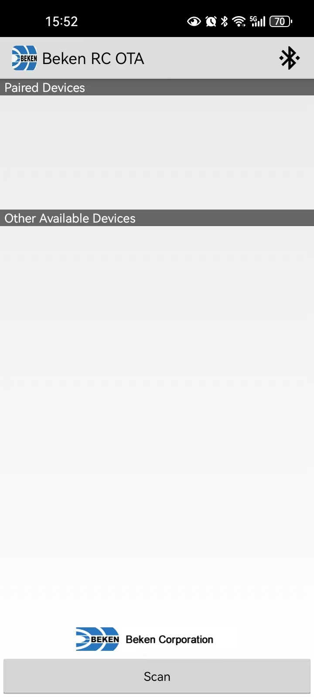
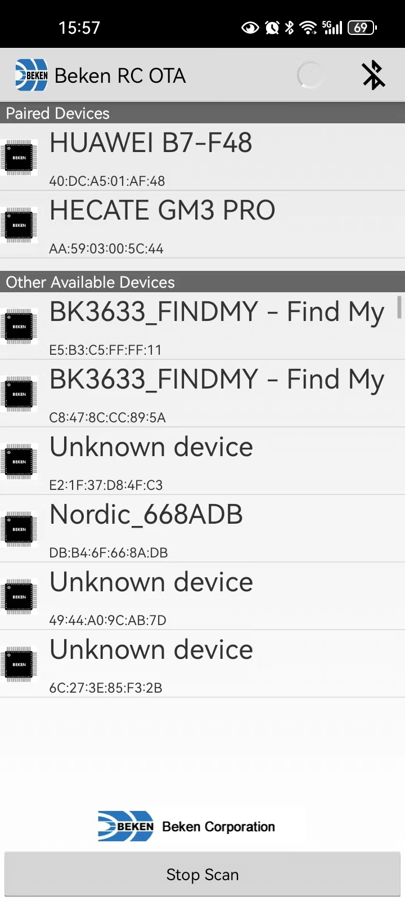
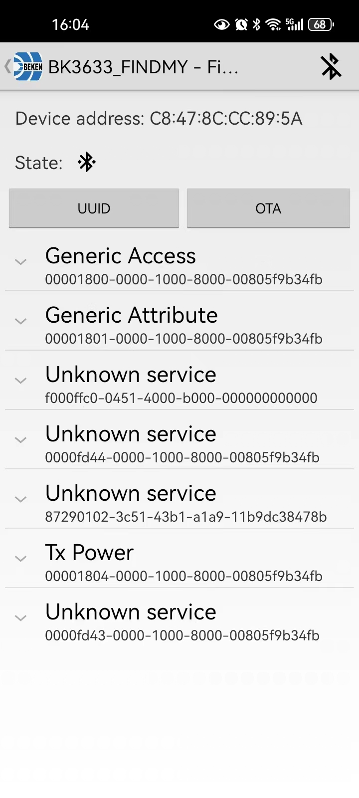
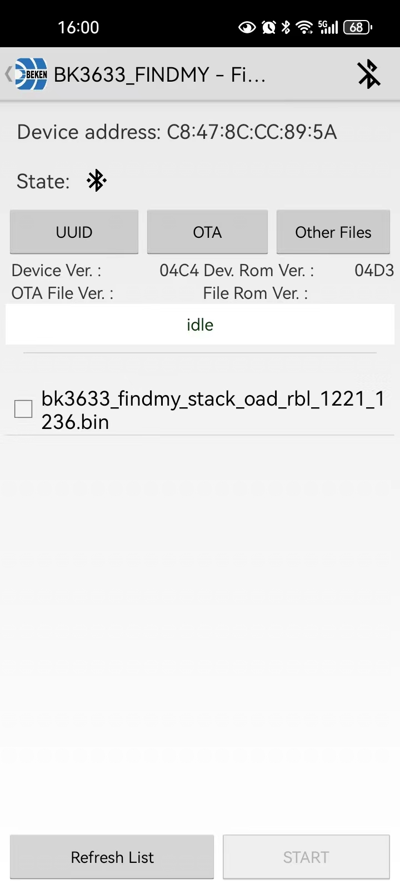
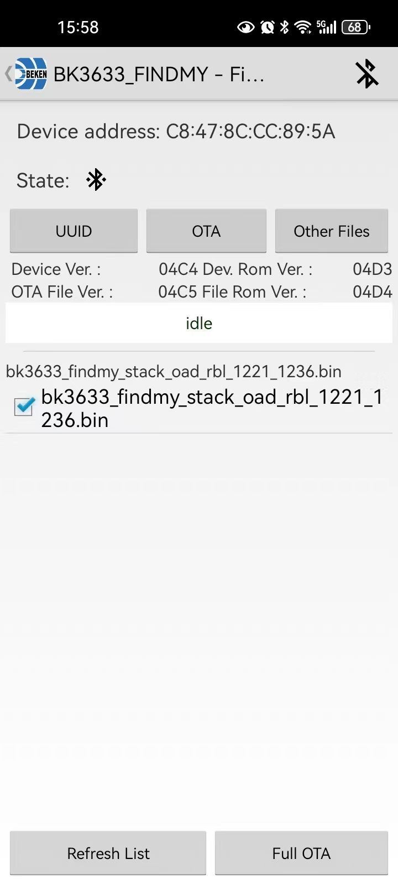
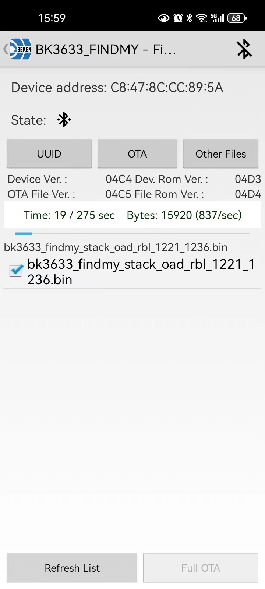

# OTA

## 1、OTA

> 目前 OTA 升级只能使用 Android 设备进行,且需要保证bin文件版本号大于板子固件中版本号;
> 版本号修改 projects/app\_findmy/Makefile 中的APP\_VERSION 和 STACK\_VERSION，升级固件时选择修改后的 bk3633\_findmy\_stack\_oad\_rbl.bin

备注

支持OTA升级需要使用8Mb的flash;

## 2、 OTA升级流程

1.在Android设备上安装Beken\_RC\_OTA\_V3.1.apk应用程序，在代码中tools/ota目录下

2.将待更新的OTA firmware存放在android文件系统的任意目录下，推荐放在/Download文件夹下（程序默认搜索该目录下文件并显示在APP界面）

3.点击手机上RC\_OTA图标，打开APP，分别如一下两张图所示：

手机上显示RC\_OTA图标

APP主界面

4.选择下方的“scan”按钮开始扫描设备，扫描到的BLE设备会显示在列表中，如下：

扫描界面

5.点击对应的设备，进入设备详情页面，如下：

设备详情界面

6.点击“OTA”按钮，进入OTA界面，如果待升级固件存放在/Download目录下，能直接在界面上看到保存的固件，否则需要点击“Other Files”按钮,找到并选择对应固件：

设备详情界面

7.选择需要升级的bin文件，准备OTA升级，当bin文件版本号大于板子固件中版本号才能升级，

OTA文件选择界面

8.点击页面右下方的“Partical OTA”或“Full OTA”按钮，启动OTA流程，如下：

OTA升级过程

9.等待OTA升级成功后，设备会断开与手机的连接，并退回主界面
