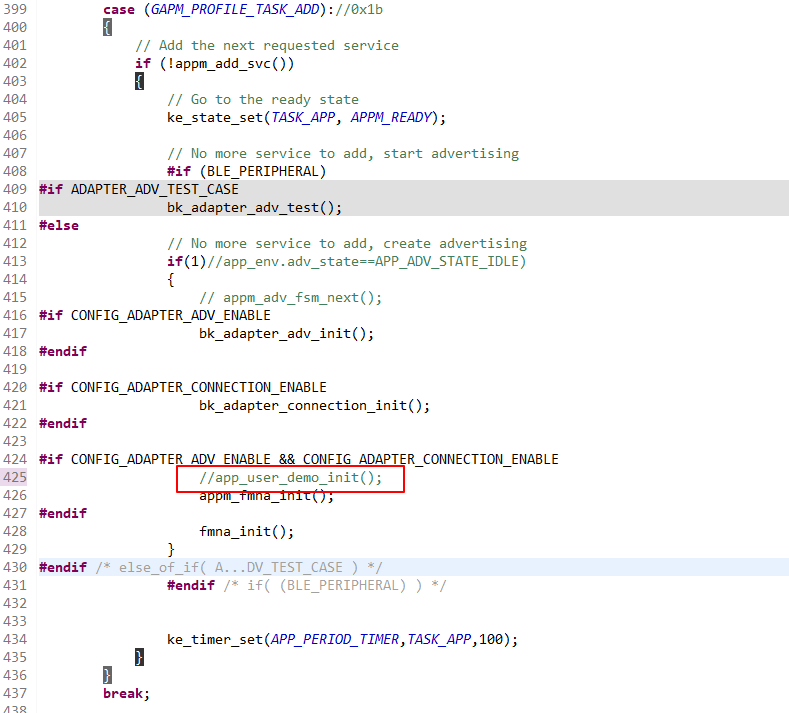

# 软件常见问题

## 1、有没有自定义adv的demo？

> 在gapm\_cmp\_evt\_handler函数里，调用app\_user\_demo\_init，即可开启名为BK3633\_demo\_rsp的广播。具体实现请参考projects/app\_findmy/app/src/app\_user\_demo.c。

app\_user\_demo

## 2、广播与链接如何映射在一起？

> adv被连接时会自动停止（GAPM\_ACTIVITY\_STOPPED\_IND），其中包含链接conn\_handle。目前adapter\_adv.c和adapter\_connection.c将这种关系封装起来，你需要调用以下两个接口：
>
> bk\_adapter\_adv\_enable (注册adapter\_adv回调，设置adv地址、内容，开启广播，返回adapter\_adv\_handle)
>
> bk\_adapter\_connection\_reg\_callback (注册adapter\_connection回调，返回adapter\_connection\_handle)
>
> 如果正确无误的话，会在回调收到ADAPTER\_ADV\_EVT\_START事件。当被连接后，会收到ADAPTER\_ADV\_EVT\_STOP、ADAPTER\_CONNECTION\_EVT\_CONNECTED事件。

## 3、目前同时支持开启几个adv？

> 2个。但是当链路数已满时，不能再开启。

## 4、目前支持几条链路？

> 2条。

## 模块导航

- [快速入门](../get-started.md)
- [API 参考手册](../api-reference.md)
- [开发者指南](../developer-guide.md)
- [出厂信息配置](factory_config.md)
- [配件信息配置](accessory_information.md)
- [加速度传感器配置](gsensor_config.md)
- [蜂鸣器配置](sounder_config.md)
- [按键配置](key_config.md)
- [OTA](ota.md)
- [Apple UARP升级](apple_uarp.md)
- [Apple FindMy测试说明](apple_test_instruction.md)
- [Google FindMy测试说明](google_test_instruction.md)
- [Apple&Google FindMy测试说明](apple%26google_test_instruction.md)
- [硬件资料](hw.md)
