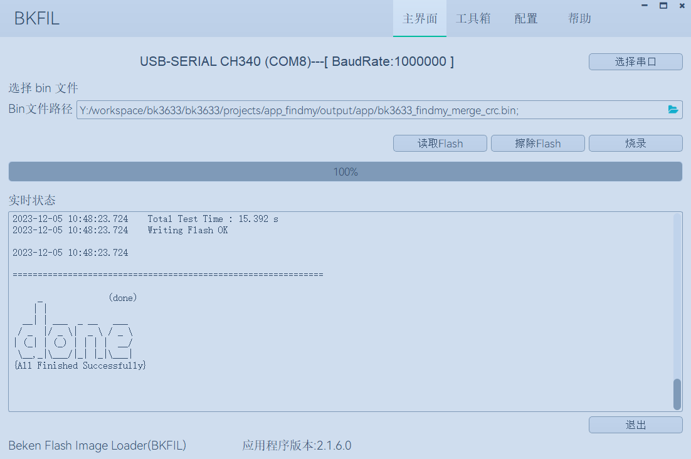
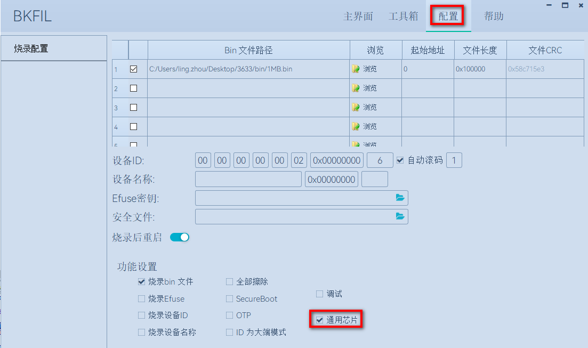

<a id="id1"></a>

# 快速入门

本文档以 BK3633 开发板为例，通过一个简单的示例项目向您展示

> - 如何构建Armino FindMy编译环境；
> - 如何编译、下载固件；

<a id="id2"></a>

## 准备工作

硬件：

> - BK3633 开发板
> - 串口烧录工具
> - 电脑（Windows 或 Ubuntu）

软件：

> - GCC ARM工具链，版本5.4.1；
> - Armino FindMy源代码；
> - 串口烧录软件；

<a id="armino-findmy"></a>

## Armino FindMy代码下载

您可从 gitlab 上下载 Armino FindMy:

```
mkdir -p ~/armino_findmy
cd ~/armino_findmy
git clone https://gitlab.bekencorp.com/armino/bk_findmy.git
```

备注

从官网的gitlab下载的为最近的SDK代码，相关账号找项目上审核申请。

<a id="id3"></a>

## 准备编译环境

当前支持的编译环境：

- Linux
- Windows \+ Cygwin \+ arm gcc

<a id="linux"></a>

### Linux环境搭建

- OS：Ubuntu 20.04 LTS
- BK3633工具链：

  > 工具链下载：
  > <http://dl.bekencorp.com/tools/toolchain/arm>
  > 在此目录下获取最新版本，如：gcc-arm-none-eabi-10.3-2021.10-x86\_64-linux.tar.bz2

工具包下载后解压至 /opt/目录下.

备注

需要将此工具链路径添加到环境变量中:

```
export PATH=/opt/gcc-arm-none-eabi-10.3-2021.10/bin:$PATH
```

<a id="windows-cygwin"></a>

### Windows \+ Cygwin环境搭建

OS: Windows 10

- 1.准备Cygwin环境

可以从 <https://dl.bekencorp.com/tools/bk_cygwin> 下载，也可以自行在官网 <https://www.cygwin.com> 下载安装，下载后请解压，例如解压至d:\\bk\_cygwin

- 2.准备git环境

beken的Cygwin自带git，如果是自行安装的Cygwin，需要在Cygwin内下载安装git。

- 2.准备编译工具链

从 <https://dl.bekencorp.com/tools/toolchain/arm/> 下载编译平台为windows的gcc编译器，例如gcc-arm-none-eabi-10.3-2021.10-win32.zip并解压至Cygwin根目录，opt/arm/gcc-arm-none-eabi-10.3-2021.10路径（没有的话请自行创建）。
全部完成的话，此时gcc路径应该是 \<Cygwin根目录\>/opt/arm/gcc-arm-none-eabi-10.3-2021.10/bin/arm-none-eabi-gcc.exe

- 3.进入Cygwin环境

运行Cygwin根目录下的Cygwin.bat，执行 PATH\=/opt/arm/gcc-arm-none-eabi-10.3-2021.10/bin/:$PATH ，编译环境准备就绪。

备注

每次进入Cygwin环境，都要执行PATH\=/opt/arm/gcc-arm-none-eabi-10.3-2021.10/bin/:$PATH，否则找不到编译器

备注

不要在挂载Linux samba目录里用Cygwin环境编译，否则会提示 BinConvert.exe Permission denied.

备注

Windows目录和Cygwin目录的映射关系是 \<Windows driver letter\>:\\\<Windows path name\> -\> /cygdrive/\<Windows driver letter\>/\<Windows path name\>

备注

Windows的目录分隔符是\\，而Cygwin为/

<a id="id4"></a>

## 文档编译依赖库安装(仅Linux环境)

在终端上输入如下命令安装文档编译所需要的 python 依赖:

```
sudo pip3 install sphinx_rtd_theme future breathe blockdiag sphinxcontrib-seqdiag sphinxcontrib-actdiag sphinxcontrib-nwdiag sphinxcontrib.blockdiag
```

设置Python默认版本:

```
sudo ln -s /usr/bin/python3 /usr/bin/python
```

<a id="id5"></a>

## 编译工程

> Apple findmy工程路径：projects/app\_findmy
>
> Google findmy工程路径：projects/google\_findmy
>
> Apple\&Google findmy工程路径：projects/all\_findmy

- 1.编译bootloader

  > cd projects/boot
  >
  > make
- 2.编译Apple findmy工程

  > cd projects/app\_findmy
  >
  > make
- 3.编译Google findmy工程

  > cd projects/google\_findmy
  >
  > make
- 4. 编译Apple\&Google findmy工程
  > cd projects/all\_findmy
  >
  > make

备注

如果是首次编译，建议编译前修改配件信息。[配件信息配置:](developer-guide/accessory_information.md) 介绍了配件信息配置

备注

编译时可添加参数，传入版本信息，用于版本迭代

- make APP\_VERSION\=100 STACK\_VERSION\=100 FW\_VERSION\_MAJOR\_NUMBER\=1 FW\_VERSION\_MINOR\_NUMBER\=0 FW\_VERSION\_REVISION\_NUMBER\=0
- APP\_VERSION: APP版本，需要大于等于STACK\_VERSION; 默认为100
- STACK\_VERSION: 协议栈版本; 默认为100
- FW\_VERSION\_MAJOR\_NUMBER: 通过FMCA APP进行升级需要配置的版本; 默认为1
- FW\_VERSION\_MINOR\_NUMBER: 通过FMCA APP进行升级需要配置的版本; 默认为0
- FW\_VERSION\_REVISION\_NUMBER: 通过FMCA APP进行升级需要配置的版本; 默认为0

<a id="id7"></a>

## 烧录代码

在 Windows 平台上， Armino 目前支持 UART 烧录。

<a id="id8"></a>

### 通过串口烧录

备注

Armino支持UART烧录，推荐使用 CH340 串口工具小板进行下载。如果是首次烧录，建议配置出厂信息。[出厂信息配置:](developer-guide/factory_config.md) 介绍了出厂信息配置

串口烧录工具如下图所示:

<a id="id10"></a>


UART

烧录工具获取：

> <http://dl.bekencorp.com/tools/flash/>
> 在此目录下获取BEKEN\_BKFIL\_Vx.x.x.x\_xxxx.zip

备注

- 支持本工程的BEKEN\_BKFIL最低版本是V2.1.7.0。
- Apple findmy bin文件路径：projects/app\_findmy/output/app/bk3633\_findmy\_merge\_crc.bin
- Google findmy bin文件路径：projects/google\_findmy/output/app/bk3633\_findmy\_merge\_crc.bin
- Apple\&Google findmy bin文件路径：projects/all\_findmy/output/app/bk3633\_findmy\_merge\_crc.bin
- 请选择对应项目的bin文件烧录

BKFIL.exe 界面及相关配置(勾选通用芯片)如下图所示：

<a id="id11"></a>



BKFIL GUI

<a id="id12"></a>



BKFIL GUI CONFIGURATION

烧录串口UART1，点击\`\`烧录\`\`进行版本烧录, 烧录完成之后掉电重启设备。

<a id="log"></a>

## 串口Log

- 目前BK3633平台，串口Log在UART1口，默认波特率为1M。
