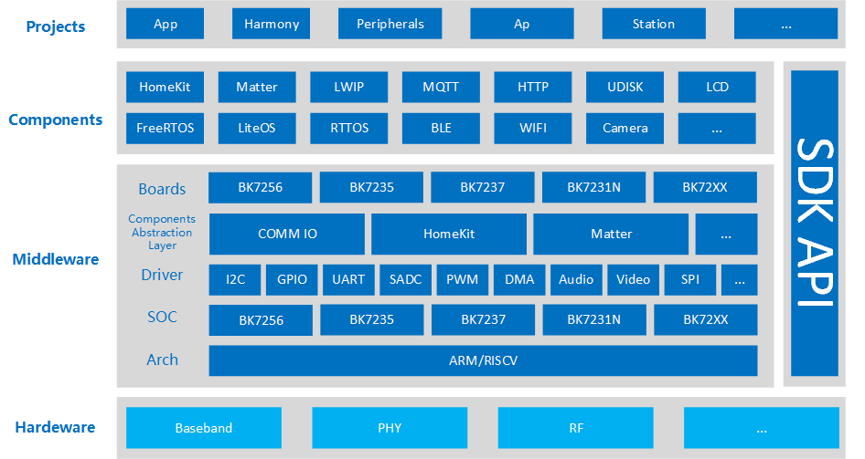
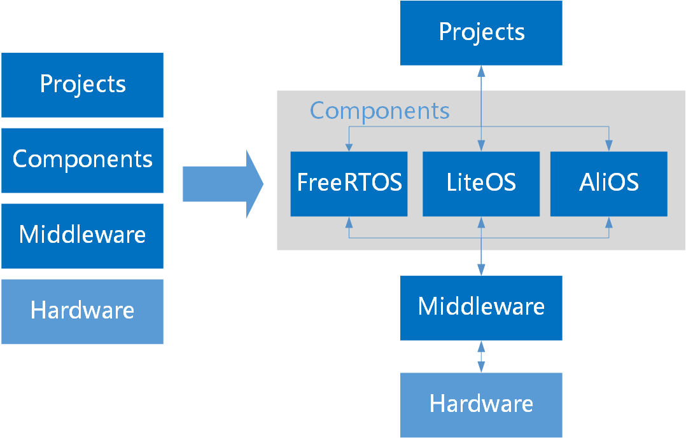
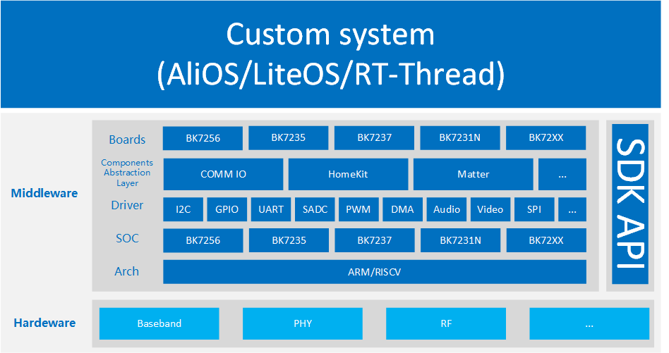
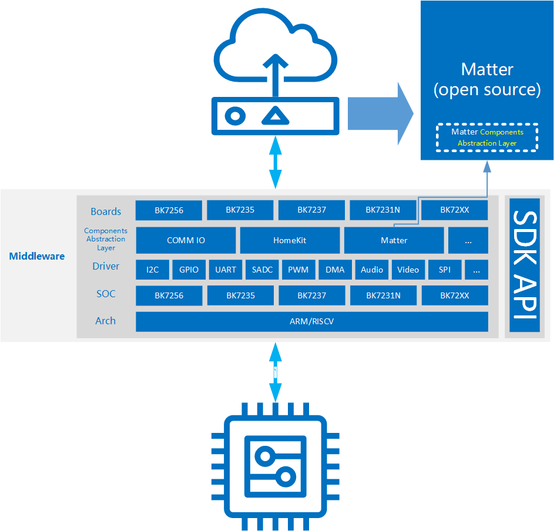

# 软件架构

## 概述

> Armino软件分为中间件层，组件层和应用层。Armino抽象了软件对硬件平台的耦合依赖，实现软件平台货架化。
> 通过这种货架化设计和丰富的SDK API，使SDK开发者能更高效的进行设计和开发。

Architecture Overview

## 软件架构

> Armino SDK能灵活支持不同的产品软件架构。
>
> 一，基于Armino SDK自有软件架构。
> 该解决方案整体框架，参见《Architecture Overview》图例。 该解决方案中，已经实现了对操作系统解耦和适配。
> 当前Armino解决方案支持FreeRTOS，LiteOS。
>
> 二，基于开发者自有软件架构。
> Armino SDK能兼容多种软件生态系统，方便开发者把Armino芯片解决方案集成到自有成熟产品软件架构中。

Armino OS solution

Armino customer solution

## 硬件层

> Hardware层，即硬件层，这里具体指的是BEKEN解决方案的硬件。

## 中间层

> Middleware层，即中间层，它是针对底层硬件及上层组件的一类抽象层。通过中间层，我们在不同的解决方案中，无缝切换。

Armino middleware

如图所示：
:   - arch，包含了芯片架构的相关功能，如arm、riscv，通用中断处理，boot，pmp等。
    - soc，芯片相关特殊处理及相关配置。
    - dirver，驱动层，包含各种外设驱动，如I2C、GPIP、UART等。
    - compal，components abstraction layer，组件适配层。为了让第三方的开源组件，能够功能的运行在armino平台，同时又降低代码耦合度。
    - boards，板级配置相关，覆盖具体项目的一些工程配置。

## 组件层

> Components层，即组件层，它是包含众多第三方开源，或者armino自行开发的服务组件。开发者可以通过在middleware层配置defconfig，开关相关的组件服务。

## 应用层

> 应用层，组织在projects目录下，最后一级CmakeList目录，为一个完整的解决方案的构建入口。它承载着没，不同项目之前的差异化，不同产品解决方案的配置集合。
