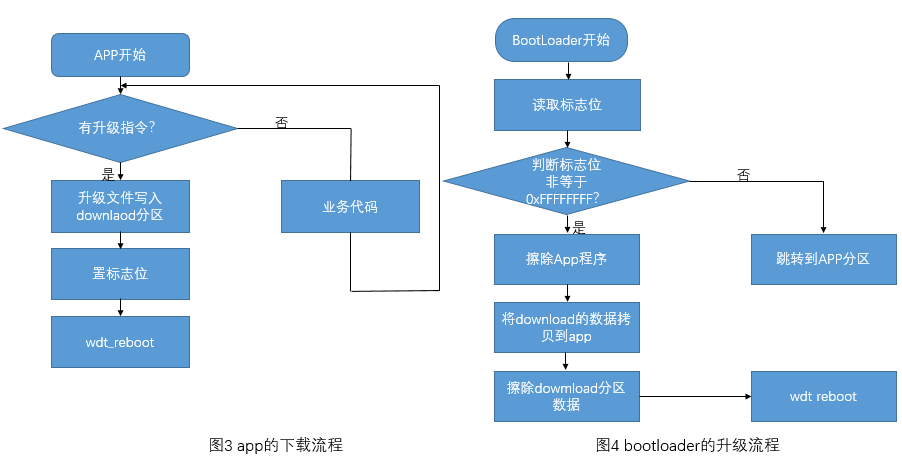
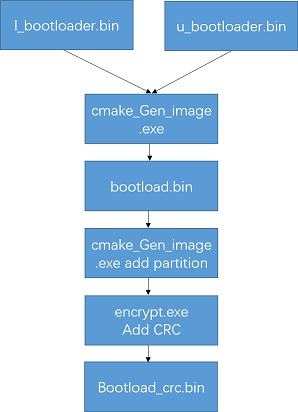
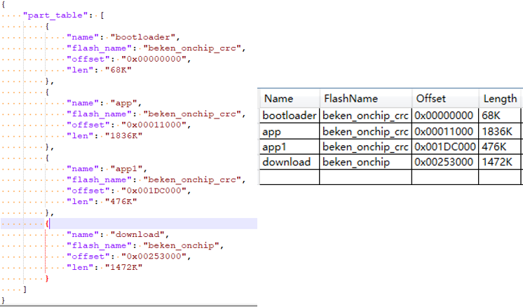
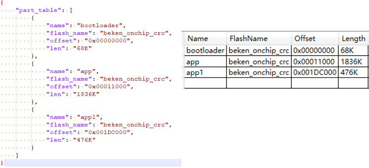

# 非AB方案的Bootloader与OTA简介

## 一.概述

该文档主要介绍系统启动流程，用于指导从事BSP开发和维护的相关工程师理解系统的启动过程，更好分析和解决问题。

## 二.启动模块介绍

启动模块涉及到bootrom, bootloader,applications，启动过程如下:

- 1.CPU启动之后首先跳转到ROM地址上，执行ROM code。
- 2.如果EFUSE中开启了安全boot，则进行验签，验签成功后，设置reboot信号，系统从flash中启动。
- 3.如果EFUSE中没有启动安全boot,则设置reboot信号，系统从flash中启动。
- 4.Flash中先执行bootloader代码。
- 5.Bootloader代码执行完之后跳转到applications代码。

## 三.Bootloader简介

Bootloader分为l\_bootloader和up\_bootloader两个模块，l\_bootloader实现uart下载功能；up\_bootloader实现OTA升级功能。

- 1.Bootloader的两个模块的逻辑地址分布如图1所示：

图1bootloader的逻辑分布

- 2.Bootloader的执行流程如图2所示：

图2 bootloader的执行流程

备注

图2中Download分区标志指的是进行ota升级的时候，会判断OTA数据区是否有数据，即判断是否是0xFFFFFFFF,如果全是的话，证明OTA升级区没有升级数据，
则直接跳转到app区域，如果不是0xFF的话，则进行ota升级。

## 四．l\_bootloader简介

l\_bootloader：主要是uart下载功能，流程图如上图2所示。

- 1.在romcode执行完成之后会跳转到flash的0x0地址执行；
- 2.此时会判断uart rx\_buf中有是否有数据，如果有数据，抢占到uart总线进入数据下载状态，下载完成之后会reboot；
- 3.如果此时uart rx\_buf中没有数据，会循环检测一定次数后会跳转到指定地址（此为逻辑地址）处执行up\_boot。
- 4.系统正常启动后运行在app业务中，uart接收到下载握手信息后会主动reboot进入l\_bootloader下载程序，用户也可以取消此功能。

## 五．up\_bootloader和OTA简介

- 1.up\_bootloader作用：
  实现OTA升级功能。
- 2.OTA升级原理：
  OTA（Over-the-AirTechnology）即空中下载技术，支持网络端远程升级固件。在嵌入式设备OTA 中，通常通过串口或者网络等方式，将升级数据包下载到Flash，然后将下载得到的数据包搬运到MCU 的代码执行区域进行覆盖，以完成设备固件升级更新的功能。
  嵌入式设备的OTA升级一般不基于文件系统，而是通过对Flash划分为不同的功能区域来完成OTA升级功能。在嵌入式系统方案里，要完成一次OTA固件远端升级，通常需要以下三个核心阶段：

  - 1）上传新固件到OTA服务器
  - 2）设备端下载新的OTA固件
  - 3）bootloader对OTA固件进行校验、解密、解压缩和搬运（搬运到对应flash分区）。
- 3.OTA升级过程：

  - 1）采用http协议从服务器下载ota固件，然后写到flash的download分区，成功之后并重启设备，如图3所示，此过程在app线程中完成（具体细节如下）；

    - 1.1）一边从服务器下载固件数据一边写到flash的download分区；（每次写一包1k数据到download分区，然后将刚刚写进download分区的1k数据读出来比较，确保数据的完整性）
    - 1.2）固件下载之后，再次通过hash功能以确保下载数据的完整性；
    - 1.3）升级固件全部下载成功之后，进行reboot，然后从bootrom启动。
  - 2）在重启后up\_bootloader会将download分区的升级文件解压解密后搬运到对应的appcode分区，校验成功后擦除download分区后，跳转到app分区正常执行，如图4所示。

- 4.hash功能验证流程介绍：

  通过hash算法来保证下载数据的完整性，hash功能验证流程分为以下两个步骤：

  - 1）去获取升级固件中的rbl的head信息（rbl信息存放位于升级固件的最后4k位置）；
  - 2）然后通过hash256 算法计算整个固件的hash值，然后和rbl中存放的hash值作比较，若两个hash数值一样，则代表hash通过，固件完整，否则，下载数据不全；

## 六.Bootloader镜像文件生成

- 1.直接编译生成bootloader.bin；具体编译步骤如下：

  - 1）进入bootloader代码目录下；
  - 2）make clean
  - 3）make
  - 4）在PACK目录下执行generate.bat脚本，在generate\_out目录下生成bootloader.bin以及对应的bootloader\_crc.bin
- 2.generate.bat脚本解析如下：

  - 1）打包脚本如下：./tools/cmake\_Gen\_image.exe genfile -injsonfile ./tools/bootloader.json -infile ./bootloader\_l/l\_bootloader.bin ./bootloader\_u/u\_bootloader.bin -outfile ./generate\_out/bootloader.bin -genjson ./tools/partition\_bk7235.json
  - 2）使用打包工具cmake\_Gen\_image.exe根据bootloader.json将l\_bootloader与u\_bootloader连接成一个bootloader.bin（此时该bin不含分区信息）。
  - 3）通过cmake\_Gen\_image.exe将分区表（partition\_bk7235.json）相关信息放在将bootloader.bin后面（此时的
    bootlaoder.bin为实际大小），分区表供OTA升级使用。
  - 4）./tools/encrypt.exe ./generate\_out/bootloader.bin 00000000最后，使用工具encrypt.exe添加crc，生成 bootloader\_crc.bin。
  - 5）bootloader.json存放的是l\_bootloader与u\_bootloader模块的逻辑分配信息；partition\_bk7235.json是boloader、app以及download分区配置信息。（bootloader.json与partition\_bk7235.json均可根据实际开发需求更改）。
  - 6）bootloade\_crc.bin制作如图5所示：

> 
> 
>
>
> 图5 bootloade\_crc.bin制作过程

## 七.Bootloader升级固件制作

- 1.OTA升级固件支持压缩和加密，升级固件已自动制作完毕。在编译app的时候，在目录build/app/bk7235生成app.bin同时，在build/app/bk7235/encrypt/目录下已经生成固件app\_pack.rbl。
- 2.打开Everything-1.4.1.935.x64-Setup.exe，工具-\>选项-\>HTTP服务器，绑定本机ip。使用浏览器打开本机的ip地址，找到本地的升级文件 \*.rbl，拷贝url出来，用于cli命令。

> 
> 
>
>
> 图6 Everything工具页面

- 3.使用串口发送cli命令，例如：
  http\_ota <http://192.168.21.101/D%3A/E/build/app.rbl>

## 八.兼容bootloader无OTA功能需求

- 为兼容客户不需要OTA功能，将download分区做成可适配性（即将downlaod分区删掉，达到无OTA功能的需求）
- 使用tools/env\_tools/rt\_partition\_tool/rt\_partition\_tool.exe工具修改插入新的bootloader的分区表，简要步骤如下：

  - 打开rt\_partition\_tool.exe工具
  - 以bk7256为例，加载middleware/boards/bk7256/bootloader.bin（若bootloader中没有分区表则会提示添加会导入分区表）
  - 导出分区表为bootloader\_orign.json文件见图7.
  - 修改bootloader\_orign.json文件，将download分区删掉，生成bootloader\_update.json文件见图8
  - 导入bootloader\_update.json文件并保存到bootloader
  - 将生成的bootloader.bin放到middleware/boards/bk7256目录下

> 
> 
>
>
> 图7 bootloader\_orign.json
>
> 
> 
>
>
> 图8 bootloader\_update.json

## 九、工程中bootloader.bin文件的编译优先级

- 编译时，如果projects目录文件下有bootloader.bin文件，将使用projects目录文件下的bootloader.bin文件覆盖middleware/boards 目录下的bootloader.bin文件;如果projects目录文件下没有bootloader.bin文件，则使用middleware/boards目录下的bootloader.bin文件。
- case1: 以projects/customization/bk7256\_config1为例：

  当修改的bootloader.bin文件放在projects/customization/bk7256\_config1目录下，编译bk7256\_config1工程时，将会优先编译、打包projects/customization/bk7256\_config1/bootloader.bin，而非是middleware/boards/bk7256/bootloader.bin文件。
- case2: 以projects/customization/bk7256\_config3为例：

  当前projects/customization/bk7256\_config3下面没有bootloader.bin文件，编译bk7256\_config3工程时，将会优先编译、打包middleware/boards/bk7256/bootloader.bin文件。
