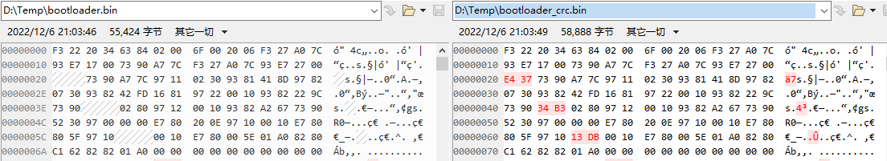
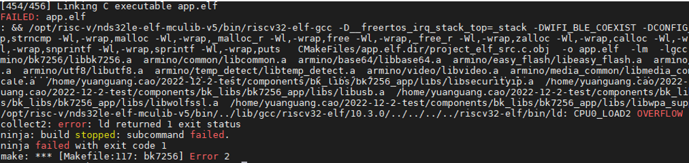
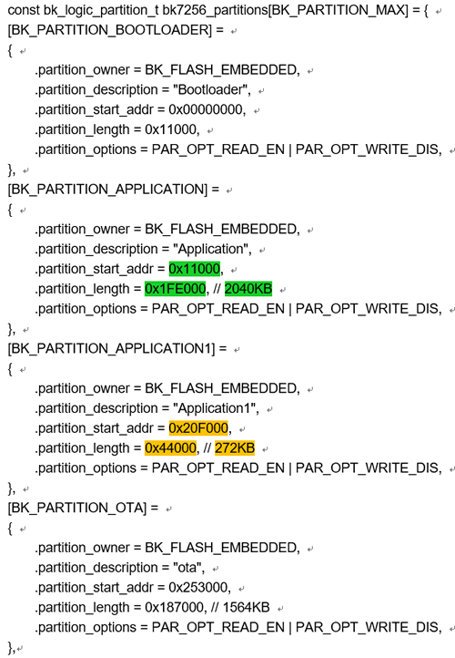
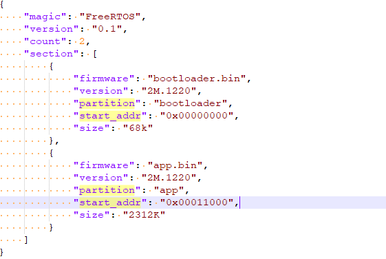
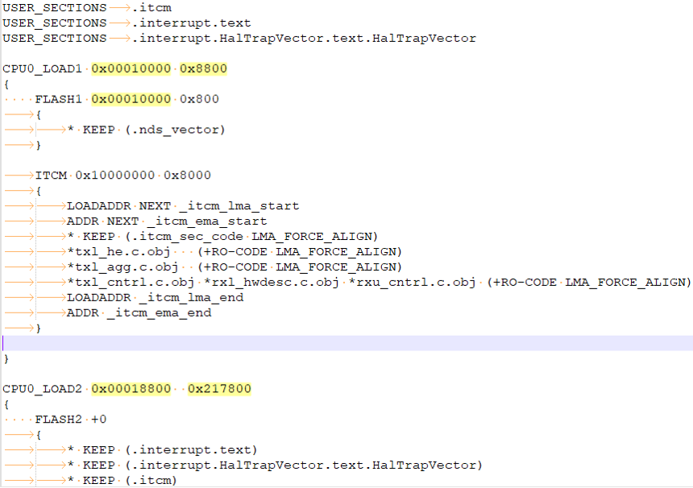
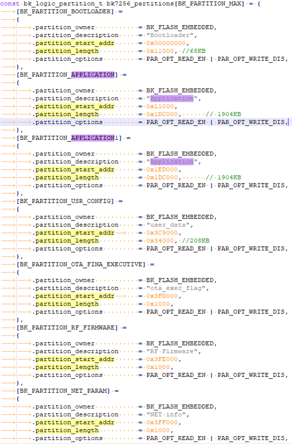
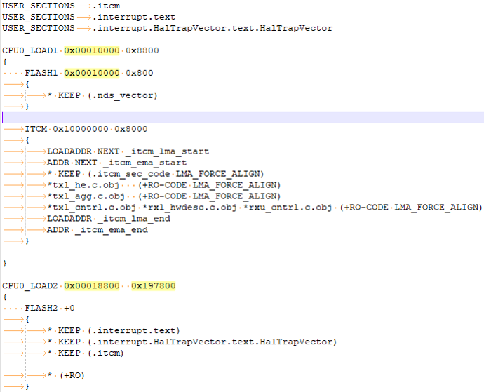
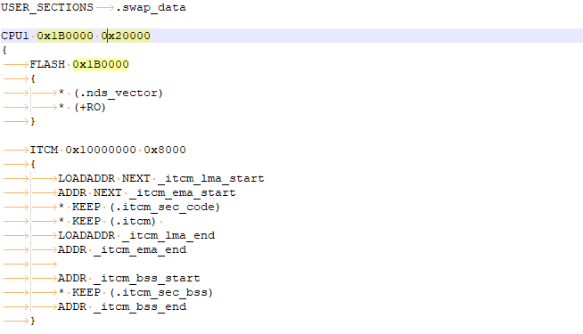
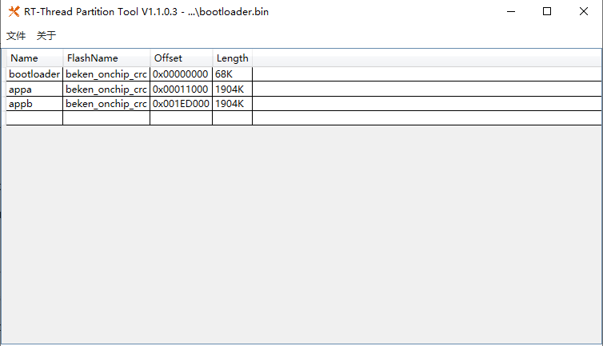

# 分区修改规范

## 一.物理地址与逻辑地址的关系介绍

为确保存储在flash中数据的准确性，每32个字节会增加2个字节crc校验位（crc检验由硬件自动完成），从而构成的物理地址（flash视角）会比逻辑地址（cpu视角）多2个字节，对比关系见下图1：（左侧为cpu视角，右侧为flash视角，红色字体为crc校验）

图1物理地址与逻辑地址的对比

## 二.分区修改的组成

修改分区涉及到四个部分:

重要

- app的分区表制作
- 打包脚本的配置文件
- 链接脚本（ld）的制作
- bootloader的分区表制作

## 三.分区修改作用域

重要

- 制作新的项目工程时，需要重做分区
- 修改分区表时，需要重做分区
- 修改链接脚本（ld）时，需要重做分区

## 四．案例

案例1：以bk7235为例，当用户在SDK基础上加入代码后，出现以下编译错误时见图2，该如何操作？

图2编译报错图示

有两个解决方案：

重要

- 首先可以手动将middleware/soc/bk7235/bk7235\_bsp.ld的对应的size范围增大（ld中最后几行）。
- 方案一：如果超出的code size很小，可关闭一些不需要的功能，即在middleware/soc/bk7235/bk7235.defconfig关闭相应的宏配置，减小code size；如果超出的code size很大，则只能实行方案二。
- 方案二：如果超出的code size很大，则需要重新修改分区表，

备注

建议优先选择方案一，方案二涉及修改的点比较多。

分区表制作步骤如下：

- 1.app分区表制作：

  flash物理总长度为4M，需在middleware/boards/bk7235/vnd\_flash/vnd\_flash.c设定各个分区的partition\_start\_addr(物理地址)和partition\_length(物理长度)见图3黄色区域；

图3分区表(partition)图示

- 2.打包脚本配置：

  将middleware/boards/bk7235/configuration.json中的start\_addr和size根据图3分区表中各分区大小修改即可，（其中start\_addr \= partition\_start\_addr，
  size \= partition\_length）见图4黄色区域；

图4打包脚本配置图示

- 3.链接脚本配置：（bk7235是单核，需配置bk7235\_bsp.sag）

bk7235\_bsp.sag配置如下：

> - middleware/soc/bk7235/bk7235\_bsp.sag的LMA和length根据图3分区表中Application和Application1的partition\_start\_addr和partition\_length计算得出，见图5黄色区域；

图5链接脚本配置(bk7235\_bsp.sag)图示

备注

计算规则：
:   - bk7235\_bsp.sag中CPU0\_LOAD1的LMA（cpu视角0x10000）\= Application的partition\_start\_addr \*32/34;
    - bk7235\_bsp.sag中CPU0\_LOAD1的length（cpu视角0x8800） \= 0x8800;
    - bk7235\_bsp.sag中CPU0\_LOAD2的LMA（cpu视角0x18800）\= CPU0\_LOAD1的LMA \+ 0x8800;
    - bk7235\_bsp.sag中CPU0\_LOAD2的length（cpu视角0x217800） \= (Application的partition\_length \+ Application1的partition\_length)\*32/34 \- 0x8800;

- 4.使用文档《RISC\_V》中关于Andes sag转ld文件方法将bk7235\_bsp.sag和bk7235\_cp1\_bsp.sag转化为对应的ld文件；

备注

该步骤4仅限新建工程；已有工程不需要该步骤,建议直接修改对应ld文件

- 5.(双核需要执行步骤5，单核不需要，此处不需要)——需将middleware/soc/bk7235/bk7235.defconfig中CPU1核的偏移量重置一下 CONFIG\_SLAVE\_CORE\_OFFSET\=1835008 （十进制格式）(CONFIG\_SLAVE\_CORE\_OFFSET 1835008 \=\= 0x1C0000 in bk7235\_cp1\_bsp.sag LMA)

备注

当图3分区表(partition)中ota区域的起始地址没有变化，则步骤6不需要执行。

- 6.使用tools/env\_tools/rt\_partition\_tool/rt\_partition\_tool.exe 工具修改插入新的bootloader的分区表见图7，简要步骤如下：

  - 打开rt\_partition\_tool.exe工具
  - 加载middleware/boards/bk7235/bootloader.bin（若bootloader中没有分区表则会提示添加会导入分区表）
  - 编辑/导入分区表
  - 保存分区表到bootloader.bin
  - 导出分区表到json文件以作备用
  - 步骤四中的bootloader.bin,然后替换middleware/boards/bk7235/bootloader.bin。

图7rt\_partition\_tool图示

- 7.详细步骤可自行参考文档tools/env\_tools/rt\_partition\_tool/rt\_partition\_tool.pdf

案例2：以projects/customization/bk7256\_configa为例，当用户在SDK基础上加入代码后，出现以下编译错误时见图2，该如何操作？

有两个解决方案：

重要

- 首先可以手动将projects/customization/bk7256\_configa/bk7256\_bsp.ld的对应的size范围增大（ld中最后几行）。
- 方案一：如果超出的code size很小，可关闭一些不需要的功能，即在projects/customization/bk7256\_configa/config/bk7256.defconfig关闭相应的宏配置，减小code size；如果超出的code size很大，则只能实行方案二。
- 方案二：如果超出的code size很大，则需要重新修改分区表，

备注

建议优先选择方案一，方案二涉及修改的点比较多。

分区表制作步骤如下：

- 1.app分区表制作：

  flash物理总长度为4M，需在projects/customization/bk7256\_configa/main/vnd\_flash.c设定各个分区的partition\_start\_addr(物理地址)和partition\_length(物理长度)见图8黄色区域；

图8分区表(partition)图示

- 2.打包脚本配置：

  将projects/customization/bk7256\_configa/configuration.json中的start\_addr和size按照图8分区表中各分区大小修改即可，（其中start\_addr \= partition\_start\_addr，
  size \= partition\_length）见图9黄色区域；

图9打包脚本配置图示

- 3.链接脚本配置：（bk7256是双核，需配置bk7256\_bsp.sag和bk7256\_cp1\_bsp.sag）

bk7256\_bsp.sag配置如下：

> - projects/customization/bk7256\_configa/bk7256\_bsp.sag的LMA和length根据图8分区表中Application的partition\_start\_addr和partition\_length计算得出，见图10黄色区域；

图10链接脚本配置(bk7256\_bsp.sag)图示

备注

计算规则：
:   - bk7256\_bsp.sag中CPU0\_LOAD1的LMA（cpu视角0x10000）\= Application的partition\_start\_addr \*32/34;
    - bk7256\_bsp.sag中CPU0\_LOAD1的length（cpu视角0x8800） \= 0x8800;
    - bk7256\_bsp.sag中CPU0\_LOAD2的LMA（cpu视角0x18800）\= CPU0\_LOAD1的LMA \+ 0x8800;
    - bk7256\_bsp.sag中CPU0\_LOAD2的length（cpu视角0x197800） \= Application的partition\_length\*32/34 \- 0x8800;

bk7256\_cp1\_bsp.sag配置如下：

> - projects/customization/bk7256\_configa/bk7256\_cp1\_bsp.sag的LMA和length根据图8分区表中Application1的partition\_start\_addr和partition\_length计算得出，见图11黄色区域；

图11链接脚本配置(bk7256\_cp1\_bsp.sag)图示

备注

计算规则:
:   - bk7256\_cp1\_bsp.sag中CPU1的LMA（cpu视角0x1B0000）\= Application1的partition\_start\_addr \*32/34;
    - bk7256\_cp1\_bsp.sag中CPU1的length（cpu视角0x20000） \= Application1的partition\_length\*32/34;

- 4.使用文档《RISC\_V》中关于Andes sag转ld文件方法将bk7256\_bsp.sag和bk7256\_cp1\_bsp.sag转化为对应的ld文件；

备注

该步骤4仅限新建工程；已有工程不需要该步骤,建议直接修改对应ld文件

- 5.需将projects/customization/bk7256\_configa/properties\_libs/bk7256.defconfig中CPU1核的偏移量重置一下 CONFIG\_SLAVE\_CORE\_OFFSET\=1769472 （十进制格式）
  (CONFIG\_SLAVE\_CORE\_OFFSET 1769472 \=\= 0x1B0000 in bk7256\_cp1\_bsp.sag LMA)
- 6.使用tools/env\_tools/rt\_partition\_tool/rt\_partition\_tool.exe 工具修改插入新的bootloader的分区表见图12，简要步骤如下：

  - 打开rt\_partition\_tool.exe工具
  - 加载projects/customization/bk7256\_configa/bootloader.bin（若bootloader中没有分区表则会提示添加会导入分区表）
  - 编辑/导入分区表
  - 保存分区表到bootloader.bin
  - 导出分区表到json文件以作备用
  - 步骤四中的bootloader.bin,然后替换projects/customization/bk7256\_configa/bootloader.bin。

图12rt\_partition\_tool图示

- 7.详细步骤可自行参考文档tools/env\_tools/rt\_partition\_tool/rt\_partition\_tool.pdf

## 五、分区功能介绍

各分区功能介绍如表格所示

| partition name | start address | length | functional description |
| --- | --- | --- | --- |
| bootloader | 0x00000000 | 0x11000 | Store bootloader |
| app | 0x11000 | 0x1CB000 | Store application image |
| ota | 0x253000 | 0x187000 | store updating image |
| user\_data | 0x3DA000 | 0x24000 | Store customer data |
| RF\_Firmware | 0x3FE000 | 0x1000 | Store calibration parameter |
| NEI\_info | 0x3FF000 | 0x1000 | Store wifi mac address and fast connection parameter |
