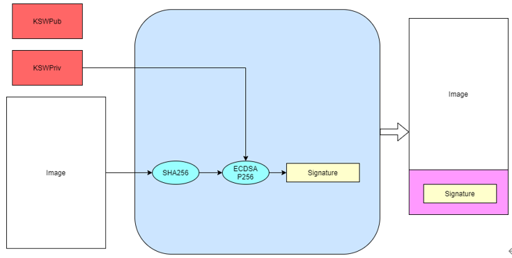
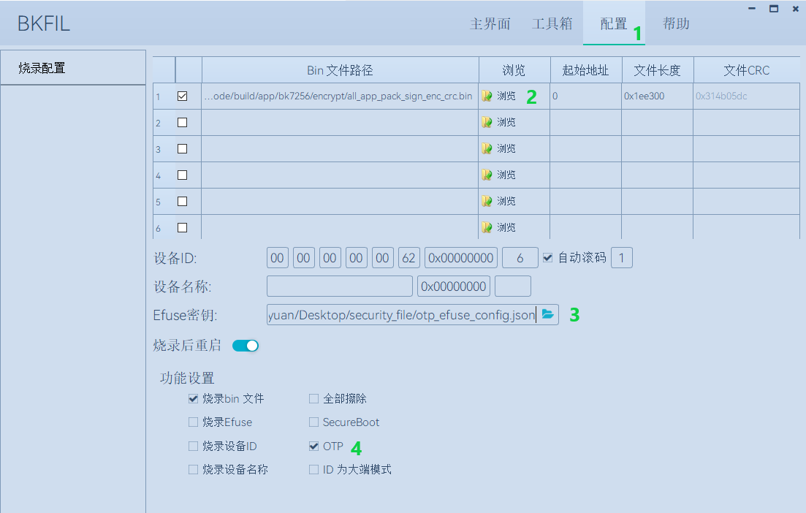

<a id="id1"></a>

# 安全功能应用指南

<a id="id2"></a>

## 一、工具下载

> 相关工具 [下载地址](https://dl.bekencorp.com/tools/flash/)

<a id="id4"></a>

## 二、安全相关配置文件

用于自动化编译生成安全相关镜像的配置文件在middleware/boards/bk7235下：

> 1. security\_ctrl.csv
>
>    该文件控制安全相关镜像是否编译生成。
>
>    “#Project”列对应所编译的project工程名称，”Enable”列对应自动编译状态，配置为”TRUE”时会生成安全相关镜像，配置为”FALSE”时不生成。
>    “#Project”列第一项”security”为总开关，配置为”FALSE”时所有工程都不编译生成安全相关镜像。
>
>    默认”app”工程会生成安全相关的镜像。
>
>    客户自定义project且需要生成安全镜像时，可将project工程名称添加到”#Project”列中并配置为”TRUE”。
>
>    > | #Project | Enable |
>    > | --- | --- |
>    > | security | TRUE |
>    > | app | TRUE |
> 2. key\_pair\_selection.csv
>
>    该文件用于指定bootloader和app签名的密钥对。
>
>    编译系统在对镜像进行签名时，会按照以下路径优先级查找”key\_pair”中指定的密钥对文件，当查找失败时会默认使用tools/env\_tools/beken\_packager下的用于测试的ecdsa384.der密钥对。
>
>    支持bootloader和app使用不同的密钥对进行签名，首先配置”key\_pair”为不同名称如ecdsa384\_bootloader.der和ecdsa384\_app.der，
>    然后使用签名工具生成同名密钥对文件并放置到指定路径下。

<a id="id5"></a>
> > 编译系统查找密钥文件指定路径和优先级：
> >
> > > > 1. projects/”project”/config/bk7235
> > > > 2. middleware/boards/bk7235
> > > > 3. tools/env\_tools/beken\_packager （默认放置了测试使用的密钥文件）
> > >
> > > | firmware | key\_pair |
> > > | --- | --- |
> > > | bootloader | ecdsa384.der |
> > > | app | ecdsa384.der |
>
> 3. version\_anti\_rollback.csv
>
>    该文件用于版本防回滚功能的固件版本管理。
>
>    “version”取值范围为0–255，默认版本号为0.
>    开启安全之后，当前bootloader不支持版本升级，因此bootloader的版本号固定为0.
>
>    > | firmware | version |
>    > | --- | --- |
>    > | bootloader | 0 |
>    > | app | 0 |

<a id="id6"></a>

## 三、安全镜像生成步骤

> 生成安全镜像需要以下四个步骤，为方便开发，以下步骤1到4已经集成到编译系统当中：
>
> - 1.镜像签名
> - 2.镜像打包
> - 3.镜像加密
> - 4.添加CRC

以”app”工程为例，执行”make bk7235”命令编译结束后，会在build/app/bk7235/encrypt路径下生成用于安全的bin文件：

> ```
> all_app_pack_enc_crc.bin      //包含bootloader，用于仅开启flash加密时烧写
> all_app_pack_sign_crc.bin     //包含bootloader，用于仅开启secureboot时首次烧写
> all_app_pack_sign_enc_crc.bin //包含bootloader，用于开启secureboot和flash加密时首次烧写
> app_pack.rbl                  //用于未开启安全后的OTA升级
> app_pack_sign.rbl             //用于开启安全后的OTA升级
> app_pack_sign_enc_crc.bin     //不包含bootloader，用于开启了secureboot和flash加密后通过uart更新app
> bootloader_sign_enc_crc.bin   //经过签名和加密后的bootloader镜像
> ```

<a id="id7"></a>

## 工具使用方法

> 本小节为使用工具手动生成安全镜像的方法，当使用编译系统自动生成安全镜像时只需要关心签名密钥对和flash加密密钥生成方法。

<a id="id8"></a>

### 1\. 镜像签名

<a id="id9"></a>

#### 签名算法

> - ECDSA P384
> - SHA384

<a id="id10"></a>

#### 签名指令

> 提供签名工具SignTool.exe和示例脚本，用于生成ECDSA密钥对和镜像签名，相关指令如下表。

| Command | Options | Value | Description |
| --- | --- | --- | --- |
| sign | -prikey | file.der | File containing ECDSA keypair |
| -infile | infile.img | Input file with the image to sign |
| -outfile | outfile.img | Output file containing the signed image |
| -length | hex | Size of image for ECDSA process |
| getkey | -type | BLKey BLKeyC | As binary or C array |
| -key | file.der | File containing ECDSA keypair (or pubkey) |
| -outfile | outfile | Output file containing exported public key |
| genkeypair | -algo | ecdsa384 | ECDSA bit-length |
| -outfile | outfile.der | Output file containing ECDSA keypair |
| version | To print the current version of this utility | | |
| help | To print this help message | | |

<a id="id11"></a>

#### 签名过程

> - 运行脚本Signtool\_GenKeypair.bat生成ECDSA密钥对。
> - 运行脚本Signtool\_GetKey.bat获取该密钥对中的公钥。
> - 将需要签名的镜像和签名工具放置在同一目录下，运行脚本Signtool\_Sign.bat，使用生成的密钥对对镜像签名。

<a id="id12"></a>
> ```
> //从密钥对中获取到的公钥
> uint32_t secure_boot_public_key[] =
> {
>  /* the Qall value */
>  6ce8840b90c31a00542e07e9d608920eee7b8b363123d706c668bc1127b6b4a6278d2eddb7ccd83d32d6d094b528213e0bf6907209a13d6ecaa312a59c622372bfc511faab9b0f291b2cb7b17a7259c63d8453946a0969e0a070770973bd47e6,
> }
> ```

<a id="id23"></a>



BK\_SignTool

举例说明:

```
生成密钥对：SignTool.exe genkeypair -algo ecdsa384 -outfile ecdsa384.der
获取公钥：SignTool.exe getkey -type BLKeyC -key ecdsa384.der -outfile ecdsa384.c
镜像签名：SignTool.exe sign -prikey ecdsa384.der -infile bootloader.bin  -outfile bootloader_sign.bin -len 0x10000
```

重要

ECDSA密钥对生成脚本执行一次则生成一组密钥对，生成的密钥对请妥善保管；
获取的公钥存储在ecdsa384.c文件中，需要拷贝到otp\_efuse\_config.json中供BKFIL工具烧写密钥到OTP时使用。

客户自定义签名的密钥对时，请将生成的密钥对文件ecdsa384.der放在 [指定路径](#id5) 下，编译系统会按照路径优先级查找密钥对文件；
当系统在指定路径下找不到密钥文件时，默认使用tool下的测试密钥对文件。

<a id="id13"></a>

### 2\. 镜像打包

> 镜像打包是根据flash分区文件configuration.json将2个或者多个镜像打包成一个镜像。

<a id="id14"></a>

#### 镜像打包指令

> 提供镜像打包工具cmake\_Gen\_image.exe用于打包。

| Command | Options | Value | Description |
| --- | --- | --- | --- |
| genfile | -injsonfile | configuration.json | input json file |
| -infile | xx1.bin xx2.bin | input bin file |
| -outfile | all bin | Output all bin file |
| version | To print the current version of this utility | | |
| help | To print this help message | | |

重要

镜像可以在签名之后进行打包，也可以在签名、加密和添加CRC完成后再进行打包；
对没有添加CRC的镜像进行打包，configuration.json文件请使用逻辑地址；
对添加CRC后的镜像进行打包，configuration.json文件请使用物理地址。

举例说明:

```
将bootloader_sign.bin和app_sign.bin打包成all_app.bin：
cmake_Gen_image.exe  genfile -injsonfile configuration.json -infile bootloader_sign.bin app_sign.bin -outfile all_app.bin
```

<a id="id15"></a>

### 3\. 镜像加密

> 镜像加密使用AES-XTS256加密方式，保证镜像的机密性。

<a id="id16"></a>

#### 加密算法

> AES-XTS256

<a id="id17"></a>

#### 加密指令

> 提供加密工具beken\_aes.exe，用于密钥生成和镜像加密。

| Command | Options | Value | Description |
| --- | --- | --- | --- |
| genkey | -outfile | aes\_encrypt\_key.json | falsh encrypt key is saved in aes\_encrypt\_key.json |
| -aes\_cbc | aes\_encrypt\_key.json | Key and IV for OTA are saved in aes\_encrypt\_key.json |
| encrypt | -keyfile | aes\_encrypt\_key.json | File containing AES key |
| -infile | infile | the image to be encrypted |
| -startaddress | Hex | encrypt with logical start address |
| -outfile | outfile | encrypted image |
| version | To print the current version of this utility | | |
| help | To print this help message | | |

<a id="id18"></a>

#### 加密过程

> - 运行脚本genkey\_random.bat，生成用于flash加密的密钥；
> - 将需要加密的镜像和加密工具放置在同一目录下，运行脚本encrypt\_bin\_in\_aes\_file.bat完成对镜像的加密。

举例说明:

```
生成AES密钥：beken_aes.exe genkey -aes_cbc -outfile aes_encrypt_key.json
app镜像加密：beken_aes.exe encrypt -infile app.bin -startaddress 0x10000 -keyfile aes_encrypt_key.json -outfile app_enc.bin
all_app.bin加密：beken_aes.exe encrypt -infile all_app.bin -startaddress 0x0 -keyfile aes_encrypt_key.json -outfile all_app_enc.bin
```

<a id="id19"></a>

生成的密钥内容：

> ```
> {
>     "name":               "aes_key",   //flash加密密钥的密文，将data部分复制到otp_efuse_config.json的Security_data的aes_key的data中
>     "mode":              "write",
>     "start_addr":         "",
>     "last_valid_addr":    "",
>     "byte_len":           "0x20",
>     "data":              "cbdzcdbwdscacjdyccbxbzbwdzducddvbxeeeecjedcgceeeegeecfehclcleacgciebckcledclecefcibobpbpbobibpboeienbgeibjeoejeneobkenepbnbgbten",
>     "data_type":          "ascii",
>     "status":            "true"
> },
> {
>     "name":               "aes_key_plaintext", //flash加密密钥的明文
>     "mode":              "write",
>     "start_addr":         "",
>     "last_valid_addr":    "",
>     "byte_len":           "0x20",
>     "data":              "6d34d08c3756ad0d6dd4b31fdf2d33d61d31e1db38998298ad2b1dbfb0ab258c",
>     "data_type":          "ascii",
>     "status":            "true"
> },
> {
>     "name":               "OTA_key", //用于OTA升级的密钥的密文，将data部分复制到otp_efuse_config.json的Security_data的OTA_key的data中
>     "mode":              "write",
>     "start_addr":         "",
>     "last_valid_addr":    "",
>     "byte_len":           "0x20",
>     "data":              "cbbwbxctcadgbxdibzcjccdicteadsbzejeccicqcqddeachetdyelcucredcuce",
>     "data_type":          "ascii",
>     "status":            "true"
> },
> {
>     "name":               "OTA_key_plaintext", //用于OTA升级的密钥的明文
>     "mode":              "write",
>     "start_addr":         "",
>     "last_valid_addr":    "",
>     "byte_len":           "0x20",
>     "data":              "632C0P5S683PAng4vb4LMXa1qlxCNgD4",
>     "data_type":          "ascii",
>     "status":            "true"
> },
> {
>     "name":               "OTA_IV", ////用于OTA升级的IV的密文，将data部分复制到otp_efuse_config.json的Security_data的OTA_IV的data中
>     "mode":              "write",
>     "start_addr":         "",
>     "last_valid_addr":    "",
>     "byte_len":           "0x10",
>     "data":              "dcemcdcybwcnbydrccckcuccewdwdtcl",
>     "data_type":          "ascii",
>     "status":            "true"
> },
> {
>     "name":               "OTA_IV_plaintext", //用于OTA升级的IV的明文
>     "mode":              "write",
>     "start_addr":         "",
>     "last_valid_addr":    "",
>     "byte_len":           "0x10",
>     "data":              "Sw3H4D7Z38N0xcf7",
>     "data_type":          "ascii",
>     "status":            "true"
> },
> ```

重要

AES-XTS模式加密结果与被加密文件的地址相关，在需要手动单独加密app镜像时-startaddress应设置为该镜像的逻辑地址。

客户自定义flash加密密钥时，请将生成的密钥文件aes\_encrypt\_key.json放在 [指定路径](#id5) 下，编译系统会按照路径优先级查找密钥文件；
当系统在指定路径下找不到密钥文件时，默认使用tool下的测试密钥文件。

<a id="crc"></a>

### 4\. 添加CRC校验

> CPU在读取FLASH上镜像时硬件会进行CRC校验，因此镜像需要添加CRC之后才可以烧写到flash中。
>
> CRC插入规则：每32个字节计算出2个字节的CRC值，插入到该32字节之后；插入CRC之前的地址对应逻辑地址，插入CRC之后的地址对应物理地址。
>
> 上一步镜像加密后会输出对应添加CRC后的版本，可直接用于烧写。
>
> 提供工具cmake\_encrypt\_crc.exe用于添加CRC。

- 将需要添加CRC镜像和工具放置在同一目录下，运行脚本add\_crc.bat即可。

举例说明:

```
添加CRC： cmake_encrypt_crc.exe -crc all_enc.bin
```

<a id="id20"></a>

## 四、烧写安全镜像和密钥，使能安全功能

重要

*Note：OTP和eFuse只能烧写一次，一但烧写后不可更改，需要谨慎操作！*
在使能efuse的secure boot和encrypt之前，请确保flash中烧写有经过加签、加密、加CRC后的镜像，否则该芯片将无法更新镜像。

<a id="otp-efuse-config-json"></a>

### 1\. 配置otp\_efuse\_config.json

生成的密钥对文件和flash加密密钥文件，除了用于生成安全镜像，还需要烧写到芯片的OTP中。

将3.1节生成的 [ecdsa384.c](#id12) 中的publickey和3.3节生成的 [aes\_encrypt\_key.json](#id19) 中的aes\_key、OTA\_key、OTA\_IV拷贝到otp\_efuse\_config.json的安全数据配置区，方法见 [OTP和eFuse的配置及读写方法](bk_OTP_and_eFuse_usermenu.md) 中安全数据配置区参数说明。

BKFIL.exe会根据配置文件otp\_efuse\_config.json，将其中的签名的公钥、加密的密钥烧写到OTP中，并根据eFuse的配置来使能安全功能。

<a id="id21"></a>

### 2\. 烧写安全镜像并使能安全

> - 1.BKFIL工具选择配置界面
> - 2.选择第一次烧写对应的安全镜像
> - 3.选择”eFuse密钥”文件选择按钮,选择配置好的otp\_efuse\_config.json
> - 4.勾选”OTP”或者”烧录eFuse”选项
> - 5.BKFIL工具选择主界面，点击”烧录”按钮

<a id="id24"></a>



首次烧写安全镜像

<a id="id22"></a>

## 四、开启安全后镜像升级方式

> 开启安全后，当前bootloader将不可更新，只能对app镜像进行更新升级。
>
> > - 方式一：使用BKFIL.exe工具将build/app/project/encrypt下的app\_pack\_sign\_enc\_crc.bin烧写到对应的物理分区上。
> > - 方式二: 使用OTA升级方式，使用build/app/project/encrypt下的app\_pack\_sign.rbl升级，升级方法和非安全版本一样，见OTA升级。
