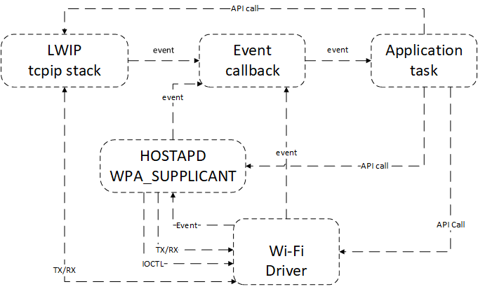
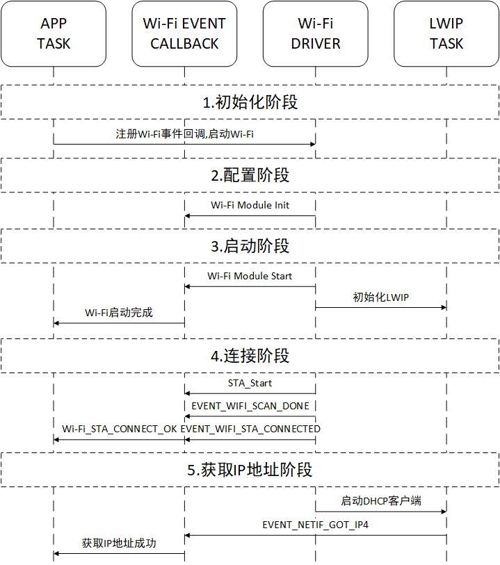
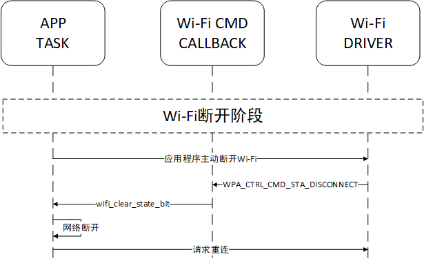

<a id="armino-wi-fi"></a>

# Armino Wi-Fi说明

<a id="id1"></a>

## Armino Wi-Fi功能列表

- 兼容IEEE802.11 b/g/n/ax 2.4GHz标准
- 支持HT20 and HT40
- 支持802.11N MCS0-7
- 支持STA、AP and Direct Modes
- 支持Concurrent AP\+STA
- 支持WPA、WPA2及WPA3等加密方式
- 支持AMPDU、QoS
- Station模式下支持低功耗休眠

<a id="id2"></a>

## Armino Wi-Fi编程模型



Wi-Fi驱动程序作为和上层代码(如TCP/IP协议栈、Application Task等)的隔离组件,通常由用户应用程序代码负责调用Wi-Fi初始化及进行必要的配置,Wi-Fi驱动程序接收并处理API请求的数据,并将相关事件通知到应用程序处理.

<a id="id3"></a>

## Armino Wi-Fi事件描述

<a id="event-wifi-scan-done"></a>

### EVENT\_WIFI\_SCAN\_DONE

扫描完成事件,通常由STA模式连接过程中扫描空中所有信道完成,收到此事件后,应用程序的事件回调函数可以调用bk\_wifi\_scan\_get\_result获取扫描结果.

<a id="event-wifi-sta-connected"></a>

### EVENT\_WIFI\_STA\_CONNECTED

STA已经成功连接目标AP的事件,接收到此事件后,Wi-Fi驱动程序根据应用程序响应返回结果决定是否启动DHCP服务获取IP地址或者使用静态IP地址.

<a id="event-wifi-sta-disconnected"></a>

### EVENT\_WIFI\_STA\_DISCONNECTED

STA与AP断开事件,接收到此事件后,一般需要通知针对基于套接字编写的客户端应用程序关闭套接字.如果此事件不是用户希望的,可以启动重连流程.

<a id="armino-wi-fi-station"></a>

## Armino Wi-Fi station模式正常连接场景示例


<a id="wi-fi"></a>

### Wi-Fi初始化阶段

- app任务调用app\_wifi\_init接口,初始化bk\_event\_init、bk\_netif\_init、bk\_wifi\_init

<a id="id4"></a>

### Wi-Fi配置阶段

- 进入Wi-Fi初始化阶段后,初始化workqueue、Wi-Fi MAC、PHY等

<a id="id5"></a>

### Wi-Fi启动阶段

- Wi-Fi驱动执行bk\_wifi\_sta\_start
- 用户可以在该函数中进行Wi-Fi初始化前的一些配置,如通信速率配置、当前模式等
- 初始化LwIP协议栈、初始化wpa\_supplicant

<a id="id6"></a>

### Wi-Fi连接阶段

- Wi-Fi驱动启动后根据最新的配置(模式、SSID、密码等),进入对应的模式,默认为STA模式
- 根据命令执行扫描、连接的过程
- 根据扫描结果,上报EVENT\_WIFI\_SCAN\_DONE事件
- 连接AP成功之后,Wi-Fi驱动返回EVENT\_WIFI\_STA\_CONNECTED事件
- Wi-Fi事件回调函数将EVENT\_WIFI\_STA\_CONNECTED发送到应用程序任务

<a id="wi-fiip"></a>

### Wi-Fi获取IP地址阶段

- 启动LWIP的DHCP客户端获取IP地址
- 获取IP地址之后,通过SM\_DHCP\_DONE\_IND消息发送出去
- 应用程序收到通知后,可以创建TCP/UDP Socket进行连接服务器的操作

<a id="wi-fi-station"></a>

### Wi-Fi Station连接命令示范

```
net sta enable
net sta scan once
net sta scan result
net sta config SSID PW  //keep PW NULL when OPEN Mode
net sta connect
```

<a id="id7"></a>

## Armino Wi-Fi station模式断开连接场景示例



- Wi-Fi Station已成功连接至AP的情况下,应用程序调用 `bk_wifi_sta_disconnect` 主动断开连接.
- 当Wi-Fi因为主动断开、AP离线、RSSI弱等原因断开连接,Wi-Fi事件回调函数引发 `EVENT_WIFI_STA_DISCONNECTED`
- 应用程序接收到网络断开事件后,进行网络应用程序的清除,例如关闭TCP/UDP客户端套接字等
- 通常由于非期待的原因导致Wi-Fi断开,应用程序会发起重新连接

<a id="armino-wi-fi-stationwi-fi"></a>

## Armino Wi-Fi station模式关闭Wi-Fi场景示例

与上述station模式断开连接场景类似,不再赘述.

<a id="armino-wi-fi-ap"></a>

## Armino Wi-Fi AP模式场景示例

BEKEN SoftAP应用场景可以参考API开发指导中的 `bk_wifi_ap_start` ,接入AP的STA信息,由 `bk_wifi_ap_get_sta_list` 获取.

<a id="id8"></a>

## Armino Wi-Fi失败代码原因


<a id="armino-wi-fi-mac"></a>

## Armino Wi-Fi MAC地址配置

Wi-Fi MAC地址配置源码位于 `bk_system\mac.c` ,分为base\_mac、sta\_mac、ap\_mac,BEKEN Wi-Fi MAC地址整体设计如下:

- 包含三个功能宏:CONFIG\_NEW\_MAC\_POLICY、CONFIG\_RANDOM\_MAC\_ADDR、CONFIG\_BK\_MAC\_ADDR\_CHECK这三个宏都是默认配置y
- CONFIG\_NEW\_MAC\_POLICY定义MAC地址默认存放在NET\_Param分区(3ff000)的前六个字节;如该地址前6字节为空,则使用随机MAC地址
- CONFIG\_RANDOM\_MAC\_ADDR,在NET\_Param前6个字节为空,且使能该宏时,随机生成MAC地址,并写入NET\_Param分区的MAC地址区域,同时该随机MAC地址会符合BK\_MAC\_ADDR\_CHECK即C8:47:8C
- CONFIG\_BK\_MAC\_ADDR\_CHECK用于判断客户配置的MAC地址是否符合BEKEN规则C8:47:8C.如不需要,直接在defconfig文件中置为n
- 上述三个宏定义位于 `middleware\soc\bk7235\bk7235.defconfig` ,默认值均为y
- 使用\[MAC地址配置工具\]:bk\_writer烧写MAC地址到flash,如果全擦flash会导致MAC地址丢失,从而使用随机MAC
- 使用mac命令写入flash,使用方式如下:

```
mac c8478caabbcc
```
