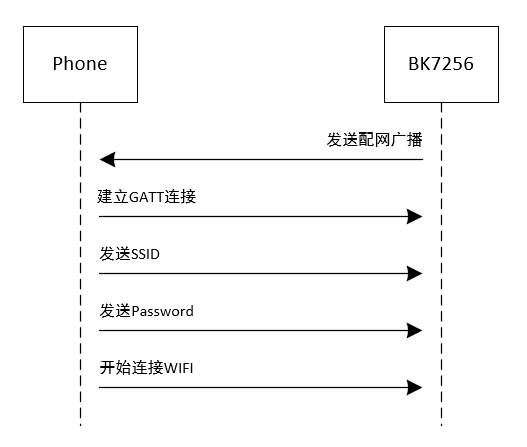
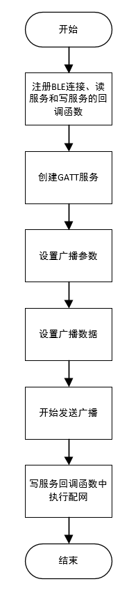

<a id="id1"></a>

# 蓝牙配网

<a id="id2"></a>

## 概述

蓝牙配网就是通过蓝牙功能将未配网设备加入网络，使其成为网络中的节点的过程。该功能主要定义了使用蓝牙的GATT Service来实现蓝牙Master(通常为手机APP或小程序)传入配网过程中WIFI连接所需的SSID和PASSWORD，从而实现未配网设备获取到连接网络的信息去进行WIFI连接。
本小节将通过蓝牙配网demo来介绍蓝牙配网的使用。

<a id="demo"></a>

## demo简介

1、蓝牙配网demo工程的主要设计思想是：

> 1. 蓝牙设备发出蓝牙配网广播；
> 2. 手机搜索蓝牙设备并进行蓝牙连接；
> 3. 手机通过GATT Service将要连接的WIFI SSID和PASSWORD发送到待配网设备；
> 4. 蓝牙设备获得WIFI连接需要的SSID和PASSWORD后进行WIFI连接，配网成功。
>
> demo工程的设计流程图如下图所示：

<a id="id7"></a>



Figure 1\. ble boarding demo work flow chart

2、该蓝牙demo所需软件工具: nRF Connect APK、SSCOM、char转hex工具

3、GATT服务:

> 1. Service UUID: 0xFFFF
> 2. SSID characteristic UUID: 0x9ABC
> 3. PASSWORD characteristic UUID: 0xDEF0

<a id="id3"></a>

## demo示例

> - 蓝牙配网demo使用的API接口详细说明请参考 `/api-reference/bluetooth/ble.html`
> - 蓝牙配网demo具体的示例代码详见 `demo/bluetooth/ble_boarding/ble_boarding_demo.c`

<a id="id4"></a>

## demo工作流程

<a id="id8"></a>



Figure 2\. ble boarding demo software design flow chart

<a id="id5"></a>

## demo操作说明

> 1. 通过SSCOM软件发送命令： `AT+BLE=BOARDING,0201060908373235365f424c45,D` ;
> 2. 手机打开nRF Connect APP进行scan，找到设备名为7256\_BLE的设备并点击连接按钮;
> 3. 设备连接上之后找到service UUID为0xFFFF的服务并点击;
> 4. 在服务下找到UUID为0x9ABC的characteristic，写入配网所需的WIFI SSID的hex数据并点击send;
> 5. 在服务下找到UUID为0xDEF0的characteristic，写入配网所需的WIFI PASSWORD的hex数据并点击send;
> 6. 在SSCOM中会输出显示配网成功并获得IP的log;
> 7. 在SSOCM中输入 `ping 192.xxx.xxx.xxx` 的命令去ping所连路由器的IP地址检查是否配网成功。

<a id="id6"></a>

## 注意事项

> 1. demo中通过nRF Connect软件发送配网所需的WIFI SSID和PASSWORD需要通过char转hex工具转换为hex数据进行输入。
> 2. 手机与设备连接成功后设备就会停止发送广播，此时无法扫描到该设备，也无法在断开连接后点击connect进行重新连接。若有断开连接可以重连的需求，则需要在断开连接上报消息的函数中重新使能广播即可。具体可在ble\_at\_notice\_cb()函数的BLE\_5\_DISCONNECT\_EVENT案例中添加以下代码。

```
uint8_t actv_idx = bk_ble_find_actv_state_idx_handle(AT_ACTV_ADV_CREATED);

if (actv_idx == AT_BLE_MAX_ACTV) {
        os_printf("ble adv not created!\n");
} else {
        bk_ble_start_advertising(actv_idx, 0, NULL);
}
```
