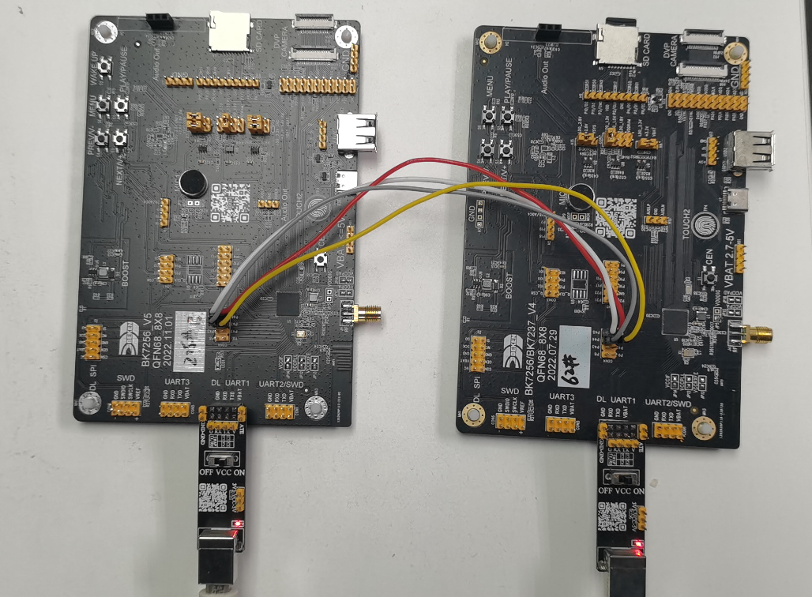

<a id="spi"></a>

# spi

<a id="id1"></a>

## 1 功能概述

> bk7256具有2路SPI控制器，对应三组SPI引脚。介绍SPI接口的cli命令使用。

<a id="id2"></a>

## 2 代码路径

> demo路径：`components\bk_cli\cli_spi.c`

<a id="cli"></a>

## 3 cli命令简介

demo运行依赖的宏配置：

> | NAME | Description | File | value |
> | --- | --- | --- | --- |
> | CONFIG\_SPI\_DMA | SPI support DMA | `middleware\soc\bk7256\bk7256.defconfig` | y |
> | CONFIG\_SPI\_SLAVE | support SPI slave mode | `middleware\soc\bk7256\bk7256.defconfig` | y |
> | CONFIG\_SPI\_MASTER | support SPI master mode | `middleware\soc\bk7256\bk7256.defconfig` | y |
> | CONFIG\_SPI\_STATIS | support SPI statistic func | `middleware\soc\bk7256\bk7256.defconfig` | y |
> | CONFIG\_SPI\_SUPPORT\_TX\_FIFO\_WR\_READY | support tx write ready | `middleware\soc\bk7256\bk7256.defconfig` | y |

demo支持的命令如下表：

> | Command | | Param | Description |
> | --- | --- | --- | --- |
> | spi\_driver {init\|deinit} | | {init\|deinit}: | init/deinit the spi resoure common |
> | spi {id} init \[role\] \[bit\_width\]  \[polarity\] \[phase\] \[wire\_mode\]  \[baud\_rate\] \[bit\_order\] \[dma\_mode\] | | {id}:spi id,value range 0 \~ 1 | init spi and set working parameters |
> | {role}:master or slave |
> | {bit\_width}: support 8 or 16 bits |
> | {polarity}: CPOL support 0 or 1 |
> | {phase}:CPHA support 0 or 1 |
> | {wire\_mode}: support 3 or 4 wire mode |
> | {baud\_rate}:spi baud rate |
> | {bit\_order}: support LSB or MSB |
> | {dma\_mode}: support DMA |
> | spi\_config  {id} | baud\_rate {value} | {value}:support baud rate | set spi working parameters |
> | mode {value} | {value}:spi spi mode 0\~3 |
> | bit\_width {value} | {value}: support 8 or 16 bits |
> | wire\_mode {value} | {value}:support 3 or 4 wire mode |
> | bit\_order {value} | {value}:support LSB or MSB |
> | spi {id} {read\|write}  {length} | | {id}:spi id,value range 0 \~ 1 | read specified length of data through spi |
> | {read\|write}: read\|write operation |
> | {length}: length to be read\|write |

SPI 支持的波特率如下：

> ```
> static const uint32_t s_spi_clk_list[] = {
> 26000000, /**< DIV1 */
> 13000000, /**< DIV2 */
> 6500000,  /**< DIV4 */
> 5200000,  /**< DIV5 */
> 3250000,  /**< DIV8 */
> 2600000,  /**< DIV10 */
> 2000000,  /**< DIV13 */
> 1625000,  /**< DIV16 */
> 1300000,  /**< DIV20 */
> 1040000,  /**< DIV25 */
> 1000000,  /**< DIV26 */
> };
> ```

SPI模式和极性、相位的对应关系

> | Command | CPOL | CPHA |
> | --- | --- | --- |
> | 0\[00\] | 0 | 0 |
> | 0\[01\] | 0 | 1 |
> | 0\[10\] | 1 | 0 |
> | 0\[11\] | 1 | 1 |

<a id="id3"></a>

## 4 演示介绍

> 1、bk7256开发板在con4中将SPI引出，使用2块bk7256开发板，按照下图进行连接

<a id="id4"></a>



Figure 1\. 将2块开发板通过SPI对接

对应的GPIO：

> | GPIO | FUNC |
> | --- | --- |
> | P44 | SCK |
> | P45 | CSN |
> | P46 | MOSI |
> | P47 | MISO |

2、启动开发板，对2块开发板分别输入初始化命令，分别设置为master和slave

master： spi 0 init master 8 1 1 4 10000000 MSB 1 //主机输入命令

> ```
> [15:47:52.552]发→◇spi_driver init
>
> [15:47:52.567]收←◆spi_driver init
> cli:I(87880284):spi driver init
> $
> [15:47:52.661]收←◆
> $
> [15:50:51.443]发→◇spi 0 init master 8 1 1 4 10000000 MSB 1
> □
> [15:50:51.443]收←◆spi 0 init master 8 1 1 4 10000000 MSB 1
> hal:I(88059168):spi select src_clk xtal
> cli:I(88059168):spi init, spi_id=0
> ```

slave： spi 0 init master 8 1 1 4 10000000 MSB 1 //从机输入命令

> ```
> [15:47:48.942]发→◇spi_driver init
> [15:47:48.957]收←◆spi_driver init
> cli:I(1085932):spi driver init
> $
> [15:47:49.051]收←◆
> $
> [15:52:33.910]发→◇spi 0 init slave 8 1 1 4 10000000 MSB 1
> □
> [15:52:33.910]收←◆spi 0 init slave 8 1 1 4 10000000 MSB 1
> hal:I(1370886):spi select src_clk xtal
> cli:I(1370888):spi init, spi_id=0
> ```

3、 从机进入接收状态，主机发送数据

slave：spi 0 read 1024

master：spi 0 write 1024

> ```
> [15:54:01.239]发→◇spi 0 write 1024
> □
> [15:54:01.255]收←◆spi 0 write 1024
> cli:I(88248974):spi write bytes, spi_id=0, data_len=1024
>
> $cli:I(88248984):spi Tx finish! UART send OK!
> ```

4、从机接收到数据

> ```
> I(1458228):spi read, spi_id=0, size:1024
> cli:I(1458228):recv_buffer[0]=0x0
> cli:I(1458230):recv_buffer[1]=0x1
> cli:I(1458230):recv_buffer[2]=0x2
> cli:I(1458230):recv_buffer[3]=0x3
> ......
> cli:I(1458230):recv_buffer[3]=0xff
> ```
