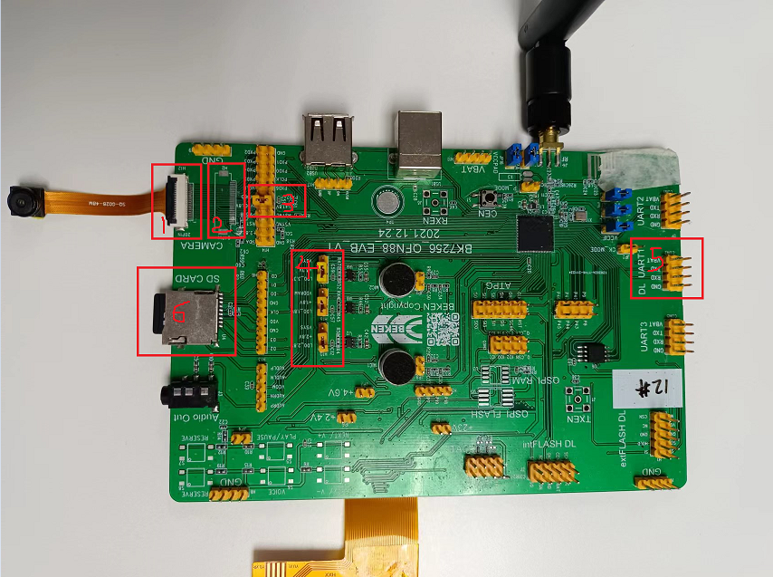
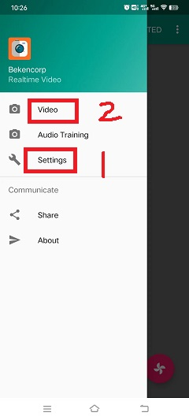
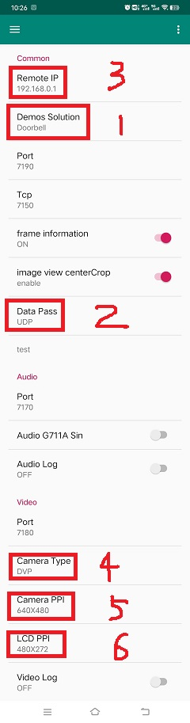
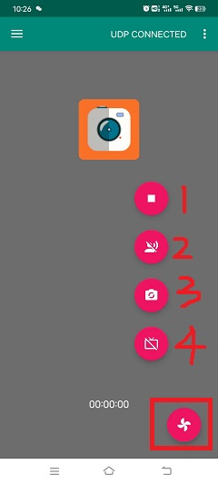
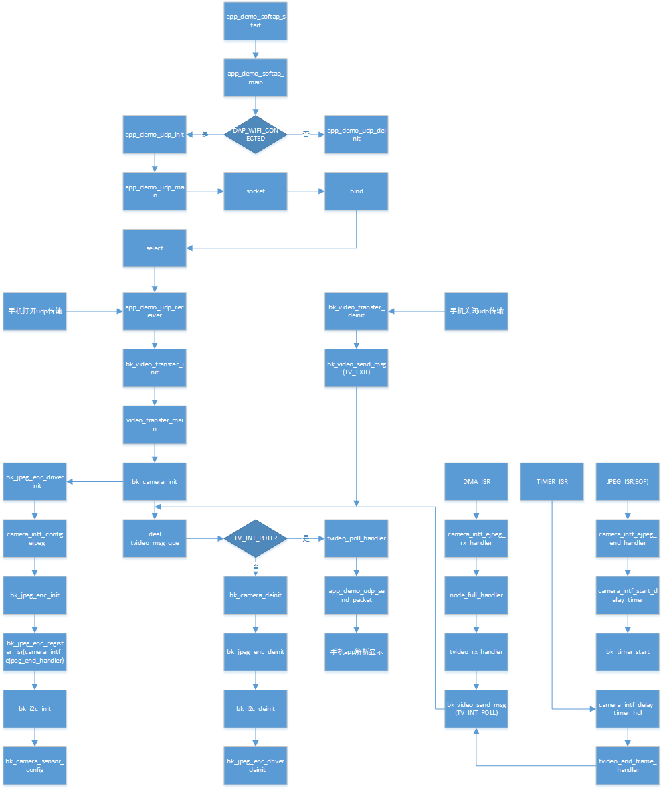
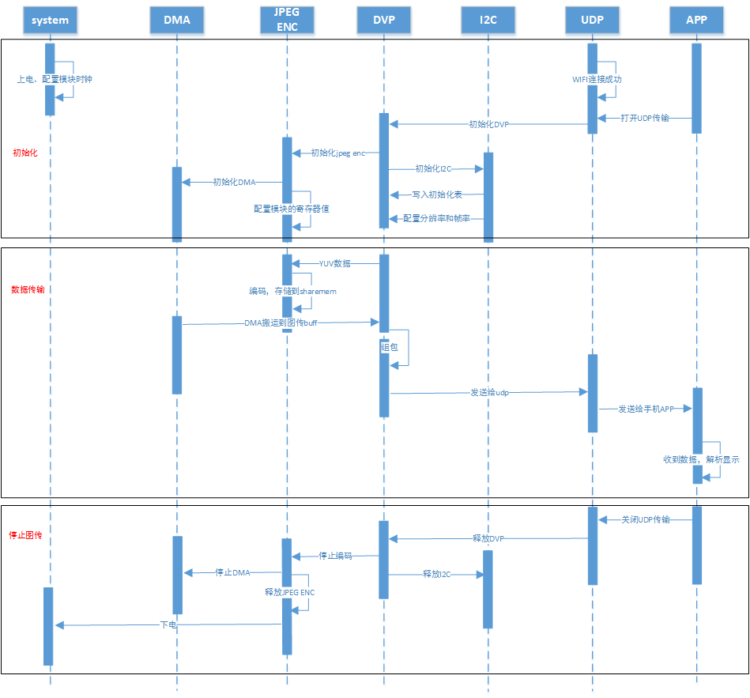

# DVP Video\_transfer

## 1 功能概述

> 图传的作用主要是将dvp/uvc sensor采集的原始数据，经jpeg encode模块压缩编码后，以WiFi连接的方式，将数据发送给手机，手机的图传应用（app）接收到数据后，会对数据包进行解析，然后实时显示编码之后的视频数据流。

## 2 代码路径

> demo路径：`./components/demos/media/video/video_transfer/video_transfer.c`

## 3 cli命令简介

> demo支持的命令如下表：
>
> | Command | Param | Description |
> | --- | --- | --- |
> | video\_transfer param1 param2 param3  param4 param5 param6 | param1:connect method | 芯片与手机的连接方式 |
> | param2:ssid | 路由的名字 |
> | param3:ssid\_key | 连接的密钥 |
> | param4:camera\_type | 摄像头类型和输出类型 |
> | param5:resolution | 摄像头输出分辨率 |
> | param6:frame\_rate | 摄像头输出帧率 |
> | video\_transfer start | param:NULL | 开始图传 |
> | video\_transfer stop | param:NULL | 停止图传 |
>
> demo运行依赖的宏配置：
>
> | NAME | Description | File | value |
> | --- | --- | --- | --- |
> | CONFIG\_JPEG\_ENCODE | 配置是否支持硬件编码 | `middleware\soc\bk7256\bk7256.defconfig` | y |
> | CONFIG\_CAMERA | 配置是否使用dvp camera | `middleware\soc\bk7256\bk7256.defconfig` | y |
> | CONFIG\_USE\_APP\_DEMO\_VIDEO\_TRANSSER | 配置是否使用图传应用 | `middleware\soc\bk7256\bk7256.defconfig` | y |
> | CONFIG\_NET\_WORK\_VIDEO\_TRANSFER | 配置是否支持网络图传 | `middleware\soc\bk7256\bk7256.defconfig` | y |
> | CONFIG\_COMPONENTS\_P2P | 配置是否使用p2p传输 | `middleware\soc\bk7256\bk7256.defconfig` | n |
> | CONFIG\_CAMERA\_USE\_I2C1 | 配置是否使用I2C1通信 | `middleware\soc\bk7256\bk7256.defconfig` | y |

## 4 演示介绍

> demo执行的步骤如下：
>
> 1、准备好dvp摄像头，连接方式如图1所示：
>
> > 图中位置1所用的摄像头是gc0328c(20-pin), 支持输出的分辨率有很多类型，例如640X480, 480X272, 320X480等，另外图中位置2也是dvp摄像头的接口(24-pin)
>
> 2、顺序发送下面命令：(分辨率和帧率可以省略，默认640X480和20)
>
> > video\_transfer -a test 12345678
> >
> > 如果测试dvp摄像头的图传: video\_transfer -a test 12345678 dvp\_jpg 640X480 25
> >
> > 如果测试dvp摄像头h264的图传: video\_transfer -a test 12345678 dvp\_h264 640X480 20 (需要dvp支持h264格式的压缩数据输出，app支持h264数据解码)
> >
> > 如果测试uvc摄像头的图传: video\_transfer -a test 12345678 uvc\_jpg 640X480 20
> >
> > 如果测试uvc摄像头h264的图传: video\_transfer -a test 12345678 uvc\_h264 640X480 20 (需要uvc支持h264格式的压缩数据输出，app支持h264数据解码)
>
> 3、手机wifi连接上test名字的路由, 密码为: 12345678
>
> 4、连接成功后打开图传的app即可，图2为app示意图，app操作如图3-6所示。
>
> 以下流程以板子作为softap为例，介绍apk的使用，在手机连接到板子使能的ap后：
>
> 5.图3为app的主界面
>
> > 其中，选择1可以看到图4
> >
> > - 1：设置菜单；
> > - 2：更新apk和回退apk菜单；
>
> 6.图4为设置界面菜单
>
> > 其中：
> >
> > - 1：为设置界面如图5所示；
> > - 2：为返回主界面按钮；
>
> 7.图5为真正的设置界面
>
> > 其中，设置说明如下，设置完成后返回图3主界面
> >
> > - 1：设置解决方案，当前支持video\_transfer和doorbell，此处选择video\_transfer；
> > - 2：设置数据传输模式，当前仅支持UDP，默认选择UDP；
> > - 3：设置对端的ip地址，ap模式下默认为\`\`192.168.0.1\`\`不用修改，sta模式下设置为对端的ip地址；
> > - 4：设置摄像头类型，当前支持DVP和UVC，根据自己使用摄像头类型进行设置；
> > - 5：设置摄像头的输出分辨率；
> > - 6：设置LCD输出的分辨率，根据自己使用的LCD屏幕分辨率进行设置；
>
> 5.图6为功能使能设置界面
>
> > 其中，功能使能说明如下所示：
> >
> > - 1：开关视频图传；
> > - 2：开关语音；
> > - 3：拍照开关，当前暂不支持；
> > - 4：开关LCD屏幕显示；

备注

在图4中设置对端IP地址，当板子为softap时，默认为\`\`192.168.0.1\`\`，当板子作为staion时，手机和板子连接同一个ap，填入的IP地址可以通过命令\`\`ip\`\`获得。
另外该app还支持手机图传功能，即命令\`\`video\_transfer -a\|s ssid key\`\`，但是必须将图4步骤1设置为\`\`video\_transfer\`\`模式。
apk的下载地址如下：<http://dl.bekencorp.com/apk/RealtimeVideo.apk>

Figure 1\. sensor connect evb

Figure 2\. doorbell apk

Figure 3\. RealtimeVideo\_app Main screen

Figure 4\. RealtimeVideo\_app Set menu

Figure 5\. RealtimeVideo\_app set

Figure 6\. RealtimeVideo\_function set

## 5 详细配置及其说明

> 1、设置参数：video\_transfer -s\|a ssid \[key\] \[camera\_type\] \[ppi\] \[fps\]
>
> 上述参数\[\]包括的可以省略，camera\_type默认是dvp摄像头，且输出的是JPEG数据；ppi默认是640X480；fps默认是25帧
>
> -s\|a: 设备作为station或softap.
>
> ssid: station或softap的名字.
>
> key: station或softap的连接密码，可选填
>
> camera\_type: 参考 `media_camera_type_t`
> :   - “dvp\_jpg”表示：使用dvp摄像头，且输出的是JPEG数据；
>     - “dvp\_h264”表示：使用dvp摄像头，且输出的是H264数据，当前BK7256系列芯片不支持
>     - “uvc\_jpg”表示：使用uvc摄像头，且输出的是JPEG数据；
>     - “uvc\_h264”表示：使用uvc摄像头，且输出的是H264数据；
>
> ppi:分辨率，表示摄像头期望输出的分辨率，参考：`media_ppi_t`.
>
> > GC0328C: 640X480, 480X272, 480X320
> >
> > HM\_1055: 1280X720
> >
> > GC2145: 1280X720, 800X600, 640X480
>
> fps:帧率，表示摄像头期望输出的帧率，参考：`sensor_fps_t`
>
> > GC0328C：5、10、20、25
> >
> > HM\_1055：5、10、15、20
> >
> > GC2145: 10、15、20、25
>
> 2、设置wifi连接方式
>
> > 1.video\_transfer -a ssid key
> >
> > - 将开发板作为一个AP，手机去连接这个AP，做法与手机连接其他wifi设备类似。
> >
> > 2.video\_transfer -s ssid key
> >
> > - 将开发板作为一个station，去连接手机，手机需要开启wifi热点，此时手机相当于一个路由器。
> >
> > 3.video\_transfer -p ssid key
> >
> > - 采用手机直连的方式，与AP类似，做法是在手机上：WLAN–\>高级设置–\>WLAN直连，搜索到板子的设备后，点击连接。

备注

注意：第一种方式可能存在板子的带宽不够，显示的视频不够清晰；第二种方式，图传的效果最好，因为手机的带宽非常充足；第三种方式当前还未实现。

3、支持动态设置分辨率和帧率，不支持设置更换dvp设备

- 在退出图传之后，发送video\_transfer -s\|a ssid \[key\] \[camera\_type\] \[ppi\] \[fps\]命令，只有camera\_type，ppi和fps可以修改。

4、可测试的方案
:   - dvp图传：video\_transfer -a name\_test 12345678
    - dvp图传：video\_transfer -s name\_station key dvp\_jpg 640X480 25
    - uvc图传：video\_transfer -s name\_station key uvc\_jpg 800X480 20
    - uvc图传：video\_transfer -s name\_station key uvc\_h264 800X480 20
    - 支持关闭图传后，再次发送上面的进行摄像头参数的重设，包括摄像头类型、输出分辨率、和帧率。

5、图传软件流程

Figure 7\. video transfer function call

> 6、图传模块间调用

Figure 8\. video transfer modules communicate
