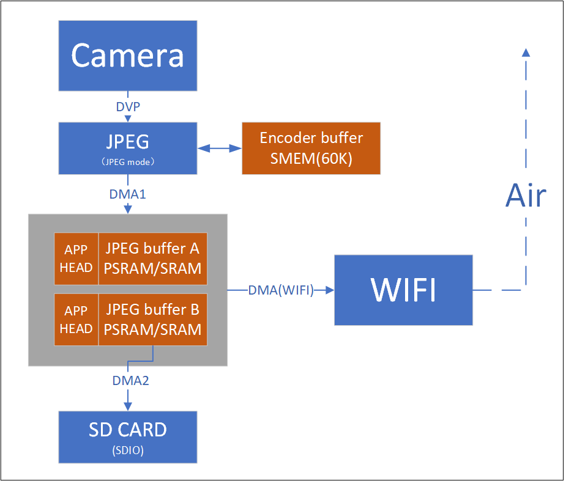

# 视频方案

## 芯片功能

1x 8-bit CIS DVP camera interface

## 软件推荐方案

|  | 图传 | 航拍 | 门锁 | 门铃 |
| --- | --- | --- | --- | --- |
| BK7235 | Y | Y |  |  |

## 图传

图传

## 航拍

航拍

## 模块导航

- [简介](../introduction.md)
- [快速入门](../get-started.md)
- [H/W 参考手册](../hw-reference.md)
- [API 参考手册](../api-reference.md)
- [开发者指南](../developer-guide.md)
- [OS 相关参考](../os.md)
- [样例演示](../examples.md)
- [应用开发](../application.md)
- [产品解决方案](../projects.md)
- [物联网(IoT)方案](iot.md)
- [开发与贡献代码流程](../process.md)
- [云平台](../clounds.md)
- [版本](../release-notes.md)
