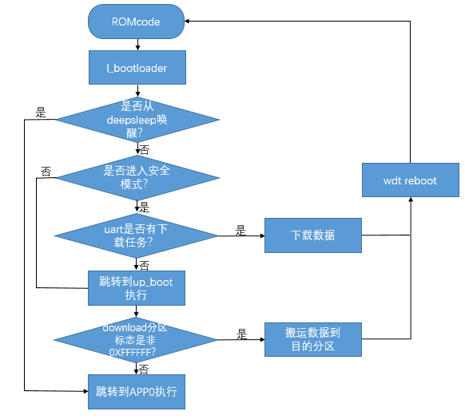

# Bootloader和常规Ota简介

## 一.概述

该文档主要介绍系统启动和OTA流程，用于指导从事BSP开发和维护的相关工程师理解系统的启动和OTA过程，更好分析和解决问题。

## 二.启动模块介绍

启动模块涉及到bootrom, bootloader,applications，启动过程如下:

- 1.CPU启动之后首先跳转到ROM地址上，执行ROM code。
- 2.如果EFUSE中开启了安全boot，则进行验签，验签成功后，设置reboot信号，系统从flash中启动。
- 3.如果EFUSE中没有启动安全boot,则设置reboot信号，系统从flash中启动。
- 4.Flash中先执行bootloader代码。
- 5.Bootloader代码执行完之后跳转到applications代码。

## 三.Bootloader简介

Bootloader分为l\_bootloader和up\_bootloader两个模块，l\_bootloader实现uart下载功能；up\_bootloader实现OTA升级功能。

- 1.Bootloader的两个模块的逻辑地址分布如图1所示：

图1bootloader的逻辑分布

- 2.Bootloader的执行流程如图2所示：

图2 bootloader的执行流程

备注

图2中Download分区标志指的是进行ota升级的时候，会判断OTA数据区是否有数据，即判断是否是0xFFFFFFFF,如果全是的话，证明OTA升级区没有升级数据，
则直接跳转到app区域，如果不是0xFF的话，则进行ota升级。

## 模块导航

- [简介](../../../introduction.md)
- [快速入门](../../../get-started.md)
- [H/W 参考手册](../../../hw-reference.md)
- [API 参考手册](../../../api-reference.md)
- [开发者指南](../../../developer-guide.md)
- [软件架构与分层](../../architecture.md)
- [构建](../../build_config.md)
- [配置与工具](../../config_tools.md)
- [低功耗与电源管理](../../power_save.md)
- [内存与性能](../../memory_perf.md)
- [设备管理框架](../../driver_model.md)
- [外设与驱动](../../peripheral.md)
- [事件机制](../../event.md)
- [出错与日志](../../error_log.md)
- [系统调试](../../debug_trace.md)
- [Wi-Fi](../../wifi.md)
- [Bluetooth](../../bluetooth.md)
- [HTTP](../../http.md)
- [OS 抽象层](../../os_abstraction.md)
- [Bootloader与Ota](../../bootloader_ota.md)
- [bootloader和常规ota](../bootloader_and_ota.md)
- [L_bootloader介绍](bk_l_bootloader.md)
- [UP_bootloader和ota介绍](bk_up_bootloader_and_ota.md)
- [Bootloader镜像生成介绍](bk_bootloader_image_generate.md)
- [ota升级固件介绍](bk_ota_upgrade_image.md)
- [Bootloader镜像更新说明](bk_bootloader_imag_update.md)
- [ab位置无关升级](../ab_position_independent_ota.md)
- [安全ota升级](../bk_security_ota.md)
- [用例编写](../../examples.md)
- [文档系统](../../documentation.md)
- [安全](../../../security.md)
- [OS 相关参考](../../../os.md)
- [购买 BK7236 开发板](../../../boards.md)
- [工程与示例](../../../projects/projects.md)
- [样例 CLI 演示](../../../examples.md)
- [开发与贡献代码流程](../../../process.md)
