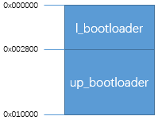

# Bootloader和常规Ota简介[](#bootloaderota "永久链接至标题")

## 一.概述[](#id1 "永久链接至标题")

该文档主要介绍系统启动和OTA流程，用于指导从事BSP开发和维护的相关工程师理解系统的启动和OTA过程，更好分析和解决问题。

## 二.启动模块介绍[](#id2 "永久链接至标题")

启动模块涉及到bootrom, bootloader,applications，启动过程如下:

- 1.CPU启动之后首先跳转到ROM地址上，执行ROM code。

- 2.如果EFUSE中开启了安全boot，则进行验签，验签成功后，设置reboot信号，系统从flash中启动。

- 3.如果EFUSE中没有启动安全boot,则设置reboot信号，系统从flash中启动。

- 4.Flash中先执行bootloader代码。

- 5.Bootloader代码执行完之后跳转到applications代码。

## 三.Bootloader简介[](#bootloader "永久链接至标题")

Bootloader分为l_bootloader和up_bootloader两个模块，l_bootloader实现uart下载功能；up_bootloader实现OTA升级功能。

- 1.Bootloader的两个模块的逻辑地址分布如图1所示：

图1bootloader的逻辑分布[](#id3 "永久链接至图片")

- 2.Bootloader的执行流程如图2所示：

图2 bootloader的执行流程[](#id4 "永久链接至图片")

备注

图2中Download分区标志指的是进行ota升级的时候，会判断OTA数据区是否有数据，即判断是否是0xFFFFFFFF,如果全是的话，证明OTA升级区没有升级数据，
则直接跳转到app区域，如果不是0xFF的话，则进行ota升级。
