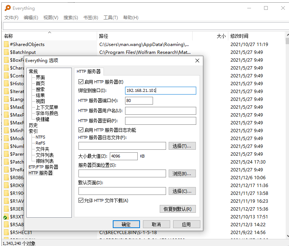

# 五.Bootloader升级固件相关info

- 1.升级固件制作有两种方式：

  - 1）方式一：通过工具手动生成；
  - 2）方式二：由编译打包的时候自动化生成；（首选方式二）
- 2.升级固件路径为：

重要

在build/app/bk7236/encrypt/app\_pack.rbl

- 3.打开Everything-1.4.1.935.x64-Setup.exe，工具-\>选项-\>HTTP服务器，绑定本机ip。使用浏览器打开本机的ip地址，找到本地的升级文件 \*.rbl，拷贝url出来，用于cli命令。

> 
> 
>
>
> 图6 Everything工具页面

- 4.使用串口发送cli命令，例如：
  http\_ota <http://192.168.21.101/D%3A/E/build/app_pack.rbl>

## 模块导航

- [简介](../../../introduction.md)
- [快速入门](../../../get-started.md)
- [H/W 参考手册](../../../hw-reference.md)
- [API 参考手册](../../../api-reference.md)
- [开发者指南](../../../developer-guide.md)
- [软件架构与分层](../../architecture.md)
- [构建](../../build_config.md)
- [配置与工具](../../config_tools.md)
- [低功耗与电源管理](../../power_save.md)
- [内存与性能](../../memory_perf.md)
- [设备管理框架](../../driver_model.md)
- [外设与驱动](../../peripheral.md)
- [事件机制](../../event.md)
- [出错与日志](../../error_log.md)
- [系统调试](../../debug_trace.md)
- [Wi-Fi](../../wifi.md)
- [Bluetooth](../../bluetooth.md)
- [HTTP](../../http.md)
- [OS 抽象层](../../os_abstraction.md)
- [Bootloader与Ota](../../bootloader_ota.md)
- [bootloader和常规ota](../bootloader_and_ota.md)
- [Bootloader简介](bk_bootloader_brief_introduction.md)
- [L_bootloader介绍](bk_l_bootloader.md)
- [UP_bootloader和ota介绍](bk_up_bootloader_and_ota.md)
- [Bootloader镜像生成介绍](bk_bootloader_image_generate.md)
- [Bootloader镜像更新说明](bk_bootloader_imag_update.md)
- [ab位置无关升级](../ab_position_independent_ota.md)
- [安全ota升级](../bk_security_ota.md)
- [用例编写](../../examples.md)
- [文档系统](../../documentation.md)
- [安全](../../../security.md)
- [OS 相关参考](../../../os.md)
- [购买 BK7236 开发板](../../../boards.md)
- [工程与示例](../../../projects/projects.md)
- [样例 CLI 演示](../../../examples.md)
- [开发与贡献代码流程](../../../process.md)
