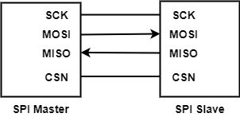

<a id="project-spi-master"></a>

|  |  |
| --- | --- |
| Supported Targets | **BK7236** |

<a id="spi-master"></a>

# SPI\_MASTER

<a id="overview"></a>

## Overview

This project is used for demonstrating [SPI User Guide](https://docs.bekencorp.com/armino/bk7236/en/latest/developer-guide/peripheral/bk_spi.html) .

**The SPI function of BK7236 is still under development and improvement, please note the following restrictions**

> - This project only supports running on 8M FLASH.

<a id="hardware-requirements"></a>

## Hardware Requirements

- BK7236 development board with 8MB FLASH and 40MHz crystal.(e.g., [BK7236\_V1 QFN80\_8X8 2022.10.18](https://docs.bekencorp.com/armino/bk7236/en/latest/get-started/bk7236.html)).
- BK7236 download firmware with uart board, such as BEKEN 20221108 UART\_V8.

备注

How to download firmware please reference this doc [Burn Code](https://docs.bekencorp.com/armino/bk7236/en/latest/get-started/index.html#hurn-code)

- BK7236 SPI project need 2 boards at least, and all of them need to support SPI function.And they connection is shown as Figure **SPI Connection** below.

<a id="id1"></a>



**SPI Connection**

备注

SPI project should be consist of only one SPI\_mater device and one SPI\_slave at least.If the SPI system just consist of two devices, so they must be one master and one slave.

<a id="software-requirements"></a>

## Software Requirements

- [Armino SDK](https://github.com/bekencorp/armino).

备注

You can clone Armino SDK by referring to this doc [Armino SDK Code download](https://docs.bekencorp.com/armino/bk7236/en/latest/get-started/index.html#armino-sdk-code-download) step by step.

<a id="configure-and-build"></a>

## Configure and Build

<a id="configure"></a>

### Configure

The SPI master device should be configured as follows:

> - SPI ID
> - SPI\_BAUD\_RATE
> - SPI\_BUF\_LEN
> - SPI\_TX\_TIMEOUT
> - SPI\_RX\_TIMEOUT
> - UART\_ID
> - SPI\_ROLE
> - SPI\_BIT\_WIDTH
> - SPI\_POLARITY\_MODE
> - SPI\_PHASE\_MODE
> - SPI\_WIRE\_MODE
> - SPI\_BIT\_ORDER\_MODE
> - DMA\_MODE

备注

The configuration of SPI master device is almost the same as that configuration of SPI slave device.The only difference is the configuration of **SPI\_ROLE** which will be **SPI\_master\_role** or **SPI\_slave\_role**.

<a id="build"></a>

### Build

Enter the following command in Armino root directory to compile:

`make bk7236 PROJECT=examples/peripherals/spi/spi_master`

For preparation such as toolchain installation, please refer to [Quick Start](https://docs.bekencorp.com/armino/bk7236/en/latest/get-started/index.html).

<a id="connect-uart"></a>

### Connect UART

UART0 is used for:

> - BKFIL to download images
> - Logging and CLI

<a id="flash-all-app-bin"></a>

### FLASH *all-app.bin*

Burn *Armino/build/spi\_master/bk7236/app-app.bin* to the board using BKFIL.

<a id="running-and-output"></a>

## Running and Output

<a id="case-1-spi-master-send-data"></a>

### Case 1 \- SPI\_master Send data

<a id="spi-master-device-send-operation"></a>

#### SPI\_master\_device Send Operation

**Case 1.1** edit the function of main() in *spi\_master\_main.c*, and you will send 0\~1023 to SPI\_slave\_device.

```
 1int main(void)
 2{
 3     BK_LOG_ON_ERR(bk_spi_driver_init());
 4     BK_LOG_ON_ERR(spi_example_send_data());
 5  // BK_LOG_ON_ERR(spi_example_dma_send_data());
 6  // BK_LOG_ON_ERR(spi_example_recv_data());
 7  // BK_LOG_ON_ERR(spi_example_dma_recv_data());
 8
 9     return 0;
10}
```

**Case 1.2** edit the function of main() in *spi\_master\_main.c*, and you will send 0\~1023 to SPI\_slave\_device through DMA which write data to SPI regesiter.

```
 1int main(void)
 2{
 3     BK_LOG_ON_ERR(bk_spi_driver_init());
 4  // BK_LOG_ON_ERR(spi_example_send_data());
 5     BK_LOG_ON_ERR(spi_example_dma_send_data());
 6  // BK_LOG_ON_ERR(spi_example_recv_data());
 7  // BK_LOG_ON_ERR(spi_example_dma_recv_data());
 8
 9     return 0;
10}
```

<a id="case-2-spi-master-receive-data"></a>

### Case 2 \- SPI\_master Receive data

<a id="spi-master-device-receive-operation"></a>

#### SPI\_master\_device Receive Operation

**Case 2.1** edit the function of main() in *spi\_master\_main.c*, and you will receive data from SPI\_slave\_device.

```
 1int main(void)
 2{
 3     BK_LOG_ON_ERR(bk_spi_driver_init());
 4  // BK_LOG_ON_ERR(spi_example_send_data());
 5  // BK_LOG_ON_ERR(spi_example_dma_send_data());
 6     BK_LOG_ON_ERR(spi_example_recv_data());
 7  // BK_LOG_ON_ERR(spi_example_dma_recv_data());
 8
 9     return 0;
10}
```

**Case 2.2** edit the function of main() in *spi\_master\_main.c*, and you will receive data from SPI\_slave\_device through DMA which read data from SPI regesiter.

```
 1int main(void)
 2{
 3     BK_LOG_ON_ERR(bk_spi_driver_init());
 4  // BK_LOG_ON_ERR(spi_example_send_data());
 5  // BK_LOG_ON_ERR(spi_example_dma_send_data());
 6  // BK_LOG_ON_ERR(spi_example_recv_data());
 7     BK_LOG_ON_ERR(spi_example_dma_recv_data());
 8
 9     return 0;
10}
```
