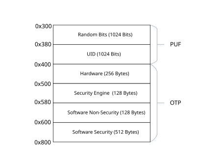

# OTP

## 概述

BK7236 片内 OTP 基于 PUF（Physical-Unclonable-Function，物理不可克隆）技术，为系统提供片内密钥，安全存储及真随机数。
可以通过 [BKFIL](../developer-guide/config_tools/bk_tool_bkfil.md#bk-tool-bkfil) 配置 OTP，详情请参考 [OTP 配置](../developer-guide/config_tools/bk_config_otp_efuse.md#bk-config-otp-efuse)。

OTP 主要有 OTP，PUF，OTP2 三块区域：

> - PUF \- 大小 64x32 Bits (2KB):
>
>   - 前 1Kbits 为 UID (Unique Identification Numbers)，当 PUF 注册之后，UID 即确定，每块板子唯五。PUF 中 UID 用作 [BK7236 唯一 ID](bk_security_uid.md#security-uid)，随机密钥等。
>   - 后 1Kbits 为随机数的熵池，[安全引擎](bk_security_enginee.md#security-enginee) 使用熵池产生真随机数。
> - OTP \- 大小 256x32 Bits (8KB)，其中主要存放与系统安全相关的信息。在代码中可调用 [安全引擎](bk_security_enginee.md#security-enginee) OTP 访问 API 间接访问，同时可通过 SPI 经由 System APB 接口进行配置。
> - OTP2 \- 大小 768x32 Bits (24KB)。主用供应用程序使用。

本节仅关注与系统安全相关的存储空间，即 PUF 与 OTP。

备注

PUF/OTP 通常用于系统，应用程序不应该使用，应用程序建议使用 OTP2。

## OTP 布局

OTP/PUF 布局如下图所示：

### PUF/熵池区

偏移 0x300\~0x380 为 1 Kbits 熵池区(Random Bits) 主要用于持续不断产生随机比特流，用于 [安全引擎](bk_security_enginee.md#security-enginee) 产生真随机数。

### PUF/UID 区

偏移 0x380\~0x400 为 1 Kbits UID 区，用途如下：

| 偏移 | 长度(字节) | 用途 |
| --- | --- | --- |
| 0x380 | 16 | 产生系统唯一 ID，共 128 Bits |
| 0x390 | 32 | 产生板子唯一 FLASH AES KEY (暂时未被使用，预留为未来扩展用) |
| 0x3b0 | 80 | 未使用 |

### OTP/硬件区

OTP 硬件区地址规划如下：

| 偏移 | 长度(字节) | 用途 |
| --- | --- | --- |
| 0x400 | 96 | 存放 memcheck 纠错信息，每个纠错地址占用 2 字节，可存放 48 个纠错地址。 |
| 0x460 | 32 | 存放 FLASH AES KEY。 |
| 0x480 | 128 | 预留给硬件扩展。 |

### OTP/安全引擎区

OTP 安全引擎区地址规划如下：

| 偏移 | 长度(字节) | 用途 |
| --- | --- | --- |
| 0x500 | 40 | 安全引擎预留，其他模块不能使用 |
| 0x528 | 32 | 存放 BL1 ROTPK HASH。 |
| 0x548 | 32 | 存放 BL2 ROTPK HASH。 |
| 0x568 | 4 | 存放生命周期。 |
| 0x56c | 20 | 安全引擎预留，其他模块不能使用。 |

#### OTP/软件非安全区

OTP 软件非安全区地址规划如下：

| 偏移 | 长度(字节) | 用途 |
| --- | --- | --- |
| 0x580 | 8 | 预留，其他模块不能使用 |
| 0x588 | 4 | BL2 安全计数器，存放防止版本回滚的计数器。 |
| 0x58c | 116 | 未使用。 |

### OTP/软件安全区

OTP 软件安全区地址规划如下：

| 偏移 | 长度(字节) | 用途 |
| --- | --- | --- |
| 0x600 | 64 | 应用程序安全计数器，存放防止版本回滚的计数器。 |
| 0x640 | 448 | 未使用。 |
