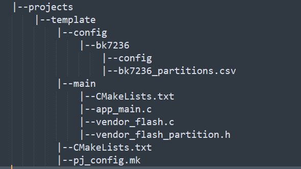
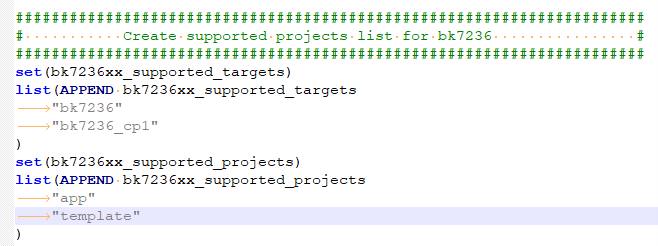
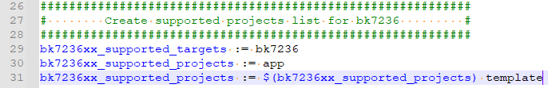
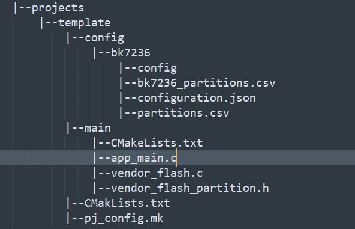

# 自动化分区配置

备注

本节旨在介绍如何为新增工程适配自动化分区

## 自动化分区配置表

自动化分区配置表为 csv 文件，以下为一个配置示例

| #Name | Offset | Size | Type | Read | Write |
| --- | --- | --- | --- | --- | --- |
| bootloader |  | 68k | code | TRUE | FALSE |
| app |  | 2312k | code | TRUE | FALSE |
| download |  | 1564k | data | TRUE |  |
| usr\_config |  | 136k | data | TRUE |  |
| easyflash | 0x3fc000 | 8k | data | TRUE |  |
| rf\_firmware | 0x3fe000 | 4k | data | TRUE |  |
| net\_param | 0x3ff000 | 4k | data | TRUE |  |

分区表固定为六列：

> - `Name` \- 必选项，表示分区名字。
>
>   - **分区名必须唯一**。构建系统会依据分区名字来生成一组宏，只有分区名字唯一才能确保生成宏不会重复定义。
>   - binname 表示分区中放置的二进制文件名字，Type被配置为code的分区对应构建系统中生成的二进制文件。
>     例如，bootloader分区中放置的二进制文件为bootloader.bin; app分区中放置的二进制文件为app.bin。
>   - 保留分区，保留分区为 Armino 已有特定用途的分区：
>
>     - bootloader \- Type被配置为code，对应构建系统编译出来bootloader.bin，Size为bootloader.bin的实际大小的34/32倍
>     - app \- Type被配置为code，对应构建系统编译出来app.bin, Size为app.bin的实际大小的34/32倍
>     - download \- Armino 中特有分区，ota会用到这个分区，当不需要ota功能时，该分区Size可以保留配置为4K
>     - usr\_config \- Armino 中特有分区，文件系统会用到这个分区，该分区Size可以以4K为单位适当增减
>     - easyflash \- Armino 中特有分区，Size和Offset固定不可自定义变更
>     - rf\_firmware，net\_param \- Armino 中特有分区，RF 校准，Wi-Fi/TCPIP 会用到这两个分区。Size和Offset固定不可自定义变更
> - `Offset` \- 可选项。表示分区在 FLASH 的物理偏移量。
> - `Size` \- 必选项。表示分区大小，单位 k/K 表示 Kbytes，m/M 表示 Mbytes，通常建议 4K 对齐。
>
>   - 当分区 Type 域被配置为code时，size建议68k对齐
> - `Type` \- 必选项。配置为code时，表示分区为可执行的代码区。配置为data时，表示分区为不可执行的数据区。
> - `Read` \- 可选项。分区可读权限，不配置时，表不可读。
> - `Write` \- 可选项。分区可写权限，不配置时，表不可写。

以bk7239n芯片为例，参考/projects/app，新建工程/projects/template，工程目录结构如下：

> 

若有修改分区的需求，为修改方便，通常需要遵循以下步骤：

> - 基于自动化分区CSV表 config/bk7239n/bk7239n\_partitions.csv 进行分区信息修改
>
>   - 保留分区需要遵循保留分区的修改规则
>   - 新增分区建议加在user\_config和easyflash分区之间，且需要的Size建议通过缩减user\_config分区Size获得
>   - 所有分区的Size总和不得超过所用flash的实际Size
> - 在config/bk7239n/config文件中配置宏 CONFIG\_OVERRIDE\_FLASH\_PARTITION\=y
> - 找到ARMINO分区自动化支持组件，将新建的工程名 template 添加到 components/part\_table/CMakeLists.txt 和
>   components/part\_table/part\_table.mk 文件所定义的支持列表中，如下图所示：
>
>   components/part\_table/CMakeLists.txt文件修改如下：
>
>   
>
>   components/part\_table/part\_table.mk文件修改如下：
>
>   
> - 编译工程template \- 编译服务器shell终端输入make bk7239n PROJECT\=template
>   编译完成后，工程/projects/template的目录结构如下：
>
>   
>
>   可以看到工程目录中新增了文件config/bk7239n/configuration.json和config/bk7239n/partitions.csv，同时
>   main/vendor\_flash.c和main/vendor\_flash\_partition.h文件的内容会同步更新
