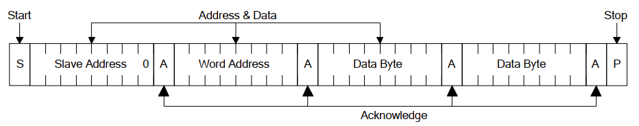

# I2C 使用指南[](#i2c "永久链接至标题")

## 概述[](#id1 "永久链接至标题")

I2C 是一种串行同步半双工通信协议，总线上可以同时挂载多个主机和从机。I2C 总线由串行数据线 (SDA) 和串行时钟线 (SCL) 线构成。这些线都需要上拉电阻。

I2C 具有简单且制造成本低廉等优点，主要用于低速外围设备的短距离通信（一英尺以内）。

I2C Connection[](#id5 "永久链接至图片")

上图为 I2C 硬件连接，其中：

> - SCL：时钟信号, 提供传输数据的时钟，用来同步数据传输；
> - SDA：用于传输数据。

Beken 芯片通常具有 2 个 I2C 控制器，BK7236N 支持 3 个 I2C (I2C0、I2C1和I2C2)。

## I2C 使用方法[](#id2 "永久链接至标题")

Beken I2C 既可工作在主机模式下，也可工作在从机模式下。无论主机还是从机，读写之前需要先调用 bk_i2c_init() 配置 I2C。
bk_i2c_init() 主要配置 I2C SCL 的时钟频率，如果工作在从机模式下，还需要配置 Beken I2C 的器件地址。

备注

对于 bk7231n/bk7251，由于 I2C_ID_1(对应 address_mapping 上的 I2C2) 与 UART2 共用 GPIO，因此当 I2C_ID_1 使能时，UART2 无法使用。

### I2C 主机模式下通信[](#id3 "永久链接至标题")

调用 bk_i2c_master_write() 写入数据到从设备，bk_i2c_master_read() 读取数据。
针对 eeprom 这类内存设备，Beken 提供 bk_i2c_memory_write()/bk_i2c_memory_read() 接口，可以指定到从设备内部的地址去执行读写操作。

I2C memory write[](#id6 "永久链接至图片")

I2C memory read[](#id7 "永久链接至图片")

### I2C 从机模式下通信[](#id4 "永久链接至标题")

针对从机模式下，Beken 提供 bk_i2c_slave_write()/bk_i2c_slave_read()，用于发送/接收数据。
