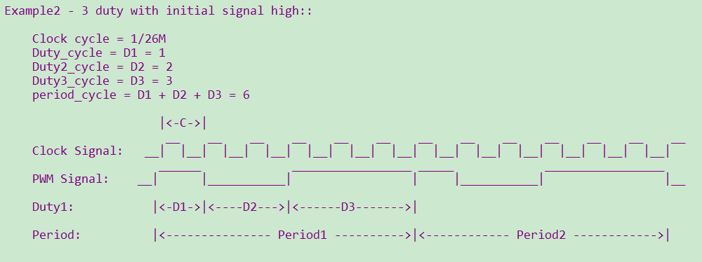
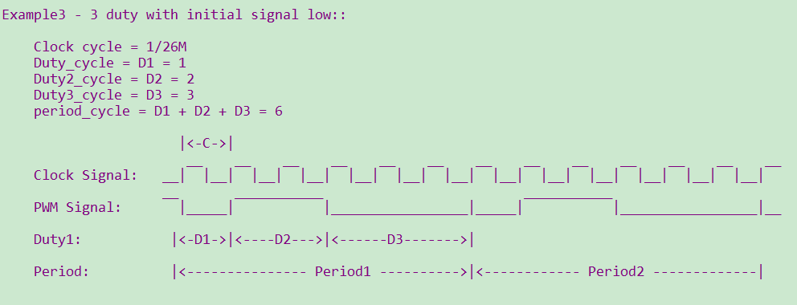
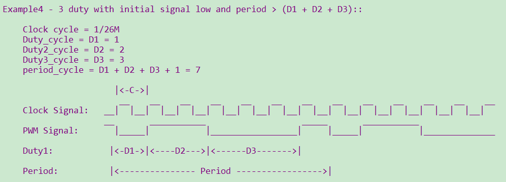
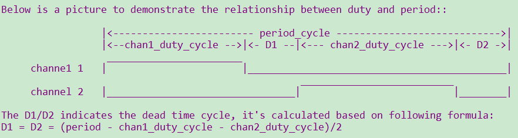

<a id="pwm"></a>

# PWM

<a id="id1"></a>

## 1 功能概述

> 介绍的PWM模块包含三部分，分别为独立输出模式、互补输出模式以及PWM输入信号捕捉三个模式，
> 其中独立输出与互补输出都是芯片信号输出，信号捕捉是获得外部信号。
>
> bk7236n具有12路PWM输出，输出时其时钟源选择的是26M，每一路的周期及占空比都可以单独配置，channel如下:
>
> | channel | GPIO | channel | GPIO |
> | --- | --- | --- | --- |
> | 0 | GPIO6 | 6 | GPIO32 |
> | 1 | GPIO7 | 7 | GPIO33 |
> | 2 | GPIO8 | 8 | GPIO34 |
> | 3 | GPIO9 | 9 | GPIO35 |
> | 4 | GPIO24 | 10 | GPIO36 |
> | 5 | GPIO25 | 11 | GPIO37 |

<a id="id2"></a>

## 2 代码路径

> demo路径：`components\bk_cli\cli_pwm.c`

<a id="cli"></a>

## 3 cli命令简介

> demo运行依赖的宏配置：
>
> | NAME | Description | File | value |
> | --- | --- | --- | --- |
> | CONFIG\_PWM | support PWM | `middleware\soc\bk7236n\bk7236n.defconfig` | y |
>
> demo支持的命令如下表：
>
> | Command | Param | Description |
> | --- | --- | --- |
> | pwm\_driver init {26M\|DCO} | 26M\|DCO:clk source,default 26M | init the resoure common to all PWM channels |
> | pwm\_driver deinit | none | free all resource related to pwm |
> | pwm {chan} init {period\_v} {duty\_v}  \[duty2\_v\]\[duty3\_v\] | chan: pwm channel | power up and config the pwm channel, set the period and duty cycle  note: this chip supports 3 duty cycle , parameter duty2\_v and duty3\_v are optional |
> | period\_v:pwm periord |
> | duty\_v: duty cycle |
> | duty2\_v: second level reversal |
> | duty3\_v: third level reversal |
> | pwm {chan} duty {period\_v} {duty\_v}  \[duty2\_v\] \[duty3\_v\] | chan: pwm channel | configure the period and duty cycle.  note: parameter duty2\_v and duty3\_v are option. |
> | period\_v:pwm periord |
> | duty\_v: duty cycl |
> | duty2\_v: second level reversal |
> | duty3\_v: third level reversal |
> | pwm {chan} {start\|stop\|deinit} | chan: pwm channel | read data\_size bytes of data from |
> | start\|stop\|deinit: |
> | pwm {chan} signal {low\|high} | chan: pwm channel | set the initial signal to high\|low |
> | low\|high: initial signal level |
> | pwm\_group init {chan1} {chan2}  {period} {chan1\_duty} {chan2\_duty} | chan1: pwm channel | init the PWM group  The PWM group is a channel pair that has following attributes: -The period is same -The initial signal level is opposite -Start and stop at the same time |
> | chan2: pwm channel |
> | period: pwm periord |
> | chan1\_duty: chan1 duty cycle |
> | chan2\_duty: chan2 duty cycle |
> | pwm\_group {start\|stop\|deinit} | chan: pwm channel | start\|stop\|deinit the PWM group |
> | start\|stop\|deinit: |
> | pwm\_group config {group} {period}  {chan1\_duty} {chan2\_duty} | group: pwm channel | Configure the duty and period of a PWM group |
> | period: pwm periord |
> | chan1\_duty: chan1 duty cycle |
> | chan2\_duty: chan2 duty cycle |
> | pwm\_capture {chan} init {pos\|neg\|edge} | chan: pwm channel | calculate the cycles between two different pos-edge\|neg-edge\|edges |
> | pos\|neg\|edge: counting mode |
> | pwm\_capture {chan} {start\|stop\|deinit} | chan: pwm channel | start\|stop\|deinit pwm capture func |
> | start\|stop\|deinit |

<a id="id3"></a>

## 4 演示介绍

> demo执行的步骤如下：

1、准备好逻辑分析仪，连接方式如下：

> ```
> pwm通道0----GPIO6
>
> pwm通道1----GPIO7
> ```

2、PWM独立输出模式

> 对PWM驱动进行初始化：
>
> > ```
> > pwm_driver init
> > ```

2.1 普通输出

> ```
> pwm 0 init 5 3 0 0  //占空比60%
> pwm 0 start
> ```

波形如下：

<a id="id4"></a>


Figure 1\. 输出60%占空比的PWM

2.2 一个周期内3次翻转电平

> ```
> pwm 0 duty 6 1 2 3
> pwm 0 start
> ```

波形如下：

<a id="id5"></a>



Figure 2\. 一个周期内3次翻转电平，初始电平为高

2.3 设置初始电平为低

> ```
> pwm 0 signal low
> pwm 0 duty 6 1 2 3
> pwm 0 start
> ```

波形如下：

<a id="id6"></a>



Figure 3\. 一个周期内3次翻转电平，初始电平为低

2.4 period \> (D1\+D2\+D3)

> ```
> pwm 0 duty 7 1 2 3
> ```

波形如下：

<a id="id7"></a>



Figure 4\. period \> (D1\+D2\+D3)

3、PWM互补模式

> 互补模式可以避免死区产生的问题。互补输出其作用是为了避免关闭前一个设备和打开后一个设备时
> 因为开关速度的问题出现同时开启状态而增加负荷的情况（在没有彻底关闭前打开了后一个设备），
> 尤其是电流过大时容易造成短路等损坏设备。
>
> > 依次执行以下命令：
> >
> > > ```
> > > pwm_driver init
> > > pwm_group init 0 1 15 5 6
> > > pwm_group start
> > > ```

波形如下：

<a id="id8"></a>



Figure 5\. 互补输出\+死区控制

4、输入捕获模式

> PWM输入捕获模式是普通输入模式一种特殊应用，是将TIMx输入映射了两个Cx信号(输入捕获装置C1和C2)，
> 其中一个捕获上升沿，另一个捕获下降沿。这样可以在中断中去读上升沿和下降沿对应寄存器中的计数，从而得出周期和占空比。
> 其中一个捕获通道计算两次都是上升沿的时间，即周期T；而另一个通道则计算一次下降沿和之前上升沿之差，这样得到高电平时长，
> 从而可以求得周期T和占空比。
>
> > 将外部1k Hz信号接入GPIO6，依次输入以下命令：
> >
> > > ```
> > > pwm_driver init
> > > pwm_capture 0 init
> > > pwm_capture 0 init pos
> > > pwm_capture 0 start
> > > ```

在中断函数中计算出计数值 value\=658f，以上升沿或者下降沿计数，则输入信号频率约为 26M/0x658f \= 1k

> 输入命令：
>
> > ```
> > pwm_capture 0 init edge
> > pwm_capture 0 start
> > ```

在中断函数中会计算出计数值 value\=32c7，以边沿计数，则输入信号频率约为 26M/0x32c7 \= 2k

备注

注意：根据参数的配置，在相同周期内，占空比可以进行调整。但每次调整配置都在下一个周期才会生效；
在PWM进行init和duty设置时，必须 period \> (D1\+D2\+D3)。
