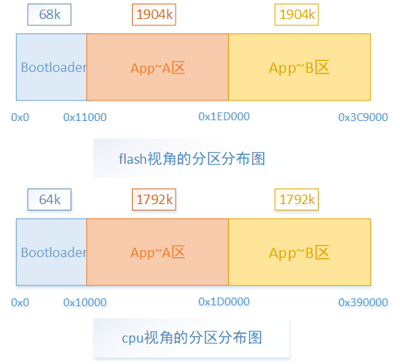

# AB分区位置无关OTA介绍

## 一、概述

> - AB分区位置无关方案是指将程序镜像存放在bootloader分区之后的flash的任何位置，程序均可以运行起来。假设存在两个执行区（A区和B区），当程序运行在A区时，通过OTA将升级镜像成功下载到B区之后并进行reboot；在bootloader里面通过设置flash相关控制寄存器bit位来决定执行哪个区，若该bit位值1，则程序将运行到B区；若该bit位值0，则程序将运行到A区。AB分区对应的flash视角、cpu视角分布如下图1所示（仅包含Bootloader、app（A/B）等三个分区，user以及RF、Net未列出，请知悉）。

图1 flash视角\&cpu视角的分区

## 模块导航

- [简介](../../../introduction.md)
- [快速入门](../../../get-started.md)
- [H/W 参考手册](../../../hw-reference.md)
- [API 参考手册](../../../api-reference.md)
- [开发者指南](../../../developer-guide.md)
- [软件架构与分层](../../architecture.md)
- [构建](../../build_config.md)
- [配置与工具](../../config_tools.md)
- [低功耗与电源管理](../../power_save.md)
- [设备管理框架](../../driver_model.md)
- [外设与驱动](../../peripheral.md)
- [事件机制](../../event.md)
- [出错与日志](../../error_log.md)
- [系统调试](../../debug_trace.md)
- [Wi-Fi](../../wifi.md)
- [Bluetooth](../../bluetooth.md)
- [HTTP](../../http.md)
- [OS 抽象层](../../os_abstraction.md)
- [Bootloader与Ota](../../bootloader_ota.md)
- [bootloader和常规ota](../bootloader_and_ota.md)
- [ab位置无关升级](../ab_position_independent_ota.md)
- [AB分区位置无关升级原理](bk_upgrade_principle_introduction.md)
- [AB分区位置无关工程介绍](bk_ab_position_independent_project_introduction.md)
- [AB分区位置无关的编译命令介绍](bk_compile_command_introduction.md)
- [AB分区位置无关的升级镜像路径](bk_upgrade_image_route_introduction.md)
- [AB分区位置无关的优势](bk_upgrade_advantage_introduction.md)
- [AB分区位置无关的升级流程介绍](bk_upgrade_process_introduction.md)
- [AB分区位置无关的相关接口介绍](bk_upgrade_api_introduction.md)
- [AB分区位置无关的hash功能验证流程介绍](bk_hash_process_introduction.md)
- [AB的bootloader镜像更新介绍](bk_ab_bootloader_imag_update_introduction.md)
- [增加AB分区功能或建立AB工程的介绍](bk_introduce_ab_functionality_or_establishing_ab_project.md)
- [安全ota升级](../bk_security_ota.md)
- [用例编写](../../examples.md)
- [文档系统](../../documentation.md)
- [安全](../../../security.md)
- [OS 相关参考](../../../os.md)
- [购买 BK7239 开发板](../../../boards.md)
- [样例 CLI 演示](../../../examples.md)
- [开发与贡献代码流程](../../../process.md)
