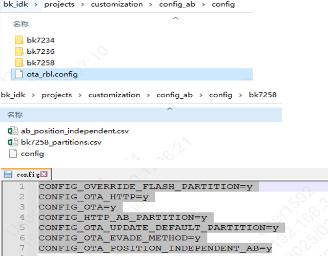
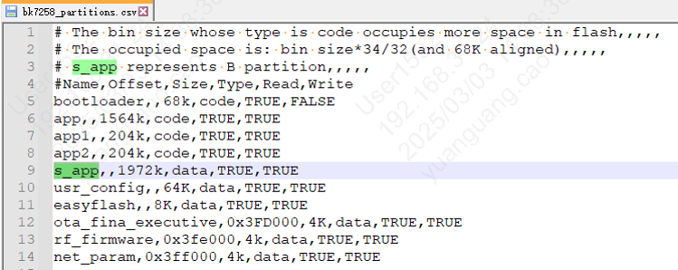
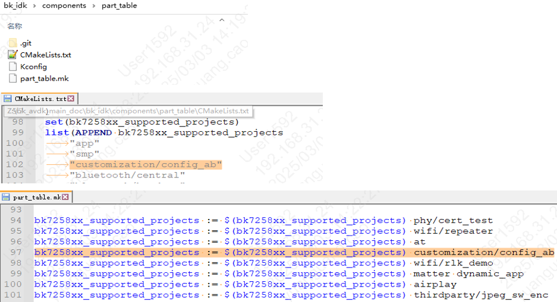
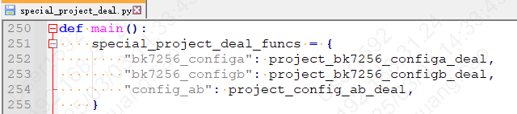
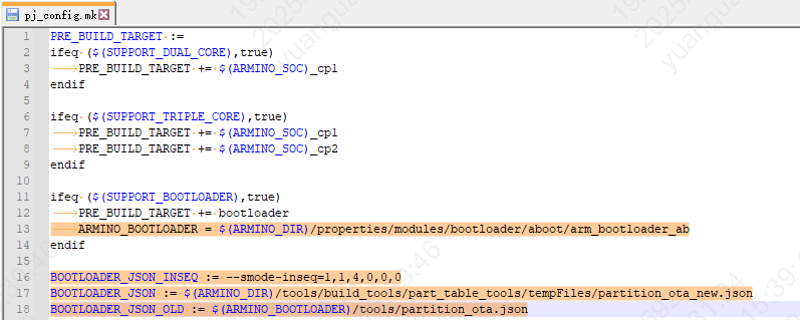

# 增加AB分区功能或建立AB工程的介绍

> 一、在新工程中增加AB功能或新建AB工程的修改主要分为以下几点：
>
> - 1、首先，规划AB分区的分区表，增加AB功能相关的宏配置，以及修改ab\_position\_independent.csv的值，确保开启AB功能；
> - 2、其次，确认该工程是否已加入到自动化例表中（在组件part\_table添加）；
> - 3、然后，确认该工程是否已加入到ab分区相关脚本处理中（special\_project\_deal.py）；
> - 4、最后，配置pj\_config.mk文件（配置bootloader的路径以及自动化编译所需的参数）
> - 5、具体步骤见下述描述。
>
> 二、新增AB分区功能具体步骤如下，以bk\_idk/projects/customization/config\_ab/config/bk7258工程为例（可当作example）：
>
> - 1、AB分区的分区表、宏配置如下：
>   :   - 1）需要有ota\_rbl.config ，该配置文件是制作AB升级固件时所需的配置；（可直接复制该文件，且该文件位置放置在config目录文件下）；
>       - 2）然后需要有ab\_position\_independent.csv，该配置文件用于打包时所需（可直接复制该.csv文件）;
>       - 3）配置分区表，以bk7258\_partitions.csv为例：
>         :   - a)app、app1、app2的size均需为68k的倍数；
>             - b)所需s\_app的大小等于三个app分区和的大小；（若app只有一个，则s\_app的大小等于该app的大小）；
>             - c)所需ota\_fina\_executive分区，该分区为存储AB分区升级时的flag；
>       - 4）将该config文件中的配置宏，拷贝到对应过程中的配置文件中；
>
> 
> 
>
>
> 图1 AB分区config配置
>
> 
> 
>
>
> 图2 AB的分区表配置

备注

- 1.app、app1、app2的size均需为68k的倍数；
- 2.s\_app的大小等于三个app分区和的大小;

- 2、AB功能的工程需加入到自动化例表中 （customization/config\_ab为例）：
  :   - 1）在 part\_table/cmakelists中 bk7258xx\_supported\_projects例表中，增加 customization/config\_ab；
      - 2）在 part\_table/part\_table.mk中 bk7258xx\_supported\_projects 中，增加 customization/config\_ab；

  
  

  图3 将AB工程加入到自动化例表
- 3、将AB工程加入到special\_project\_deal.py脚本处理中，路径：bk\_idk/tools/build\_tools/part\_table\_tools/otherScript

  
  

  图4 加入到special\_project\_deal
- 4、需要pj\_config.mk(路径是：bk\_idk/projects/customization/config\_ab) 配置所需的bootloaer路径，以及自动化例表所需的参数

  
  

  图5 project\_config配置
