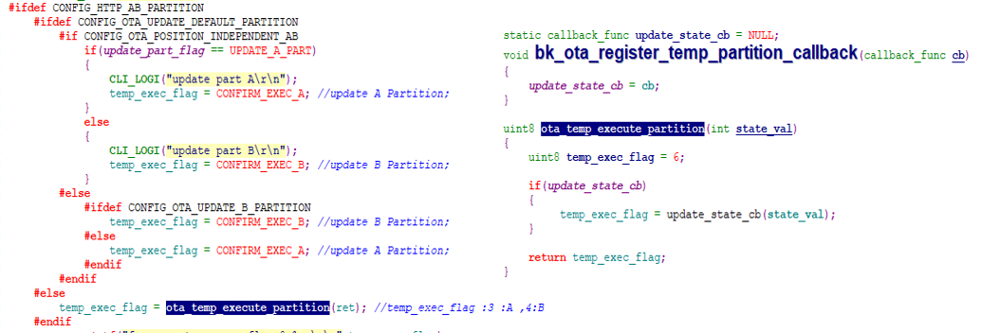
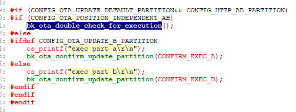

# AB分区位置无关的升级性格接口介绍

- 1 获取当前的执行分区；

  > uint8 bk\_ota\_get\_current\_partition(void);
  >
  > 备注
  >
  > 返回值简介：
  > 0： means current execute A partition.
  > 1： means current execute B partition.
- 2 当app镜像下载成功之后，客户需要调用该接口，返回将升级的的分区；

  > void bk\_ota\_register\_temp\_partition\_callback(callback\_func cb);
  >
  > 备注
  >
  > 返回值简介：
  > 3： means temporary execute A partition.
  > 4： means temporary execute B partition.
- 3 当执行完升级重启之后，客户需要在app中，确认当前的升级分区ok.

  > void bk\_ota\_double\_check\_for\_execution(void);
- 4 当前发布的SDK版本中，上述（2，3）为方便自测试，已实现（被CONFIG\_OTA\_UPDATE\_DEFAULT\_PARTITION控制），客户需要在（projects/customization/config\_ab/config/bk7239n/config）将CONFIG\_OTA\_UPDATE\_DEFAULT\_PARTITION 这个宏定义关闭。
- app下载镜像成功之后，需要客户返回需要临时执行的分区；见下图1

图1 临时执行分区的接口

- app升级镜像成功之后，需要客户在app中确认当前升级分区ok，调用bk\_ota\_double\_check\_for\_execution；（参考components/bk\_init见下图2）

图2 确认执行分区的接口

## 模块导航

- [简介](../../../introduction.md)
- [快速入门](../../../get-started.md)
- [H/W 参考手册](../../../hw-reference.md)
- [API 参考手册](../../../api-reference.md)
- [开发者指南](../../../developer-guide.md)
- [软件架构与分层](../../architecture.md)
- [构建](../../build_config.md)
- [配置与工具](../../config_tools.md)
- [低功耗与电源管理](../../power_save.md)
- [设备管理框架](../../driver_model.md)
- [外设与驱动](../../peripheral.md)
- [事件机制](../../event.md)
- [出错与日志](../../error_log.md)
- [系统调试](../../debug_trace.md)
- [Wi-Fi](../../wifi.md)
- [Bluetooth](../../bluetooth.md)
- [HTTP](../../http.md)
- [OS 抽象层](../../os_abstraction.md)
- [Bootloader与Ota](../../bootloader_ota.md)
- [bootloader和常规ota](../bootloader_and_ota.md)
- [ab位置无关升级](../ab_position_independent_ota.md)
- [AB分区位置无关ota概述](bk_ab_position_independent_ota_overview.md)
- [AB分区位置无关升级原理](bk_upgrade_principle_introduction.md)
- [AB分区位置无关工程介绍](bk_ab_position_independent_project_introduction.md)
- [AB分区位置无关的编译命令介绍](bk_compile_command_introduction.md)
- [AB分区位置无关的升级镜像路径](bk_upgrade_image_route_introduction.md)
- [AB分区位置无关的优势](bk_upgrade_advantage_introduction.md)
- [AB分区位置无关的升级流程介绍](bk_upgrade_process_introduction.md)
- [AB分区位置无关的hash功能验证流程介绍](bk_hash_process_introduction.md)
- [AB的bootloader镜像更新介绍](bk_ab_bootloader_imag_update_introduction.md)
- [增加AB分区功能或建立AB工程的介绍](bk_introduce_ab_functionality_or_establishing_ab_project.md)
- [安全ota升级](../bk_security_ota.md)
- [用例编写](../../examples.md)
- [文档系统](../../documentation.md)
- [安全](../../../security.md)
- [OS 相关参考](../../../os.md)
- [购买 BK7239 开发板](../../../boards.md)
- [样例 CLI 演示](../../../examples.md)
- [开发与贡献代码流程](../../../process.md)
