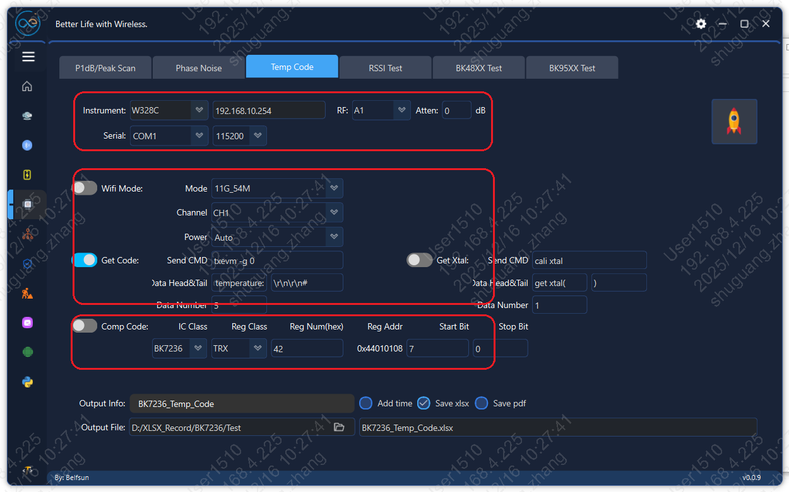
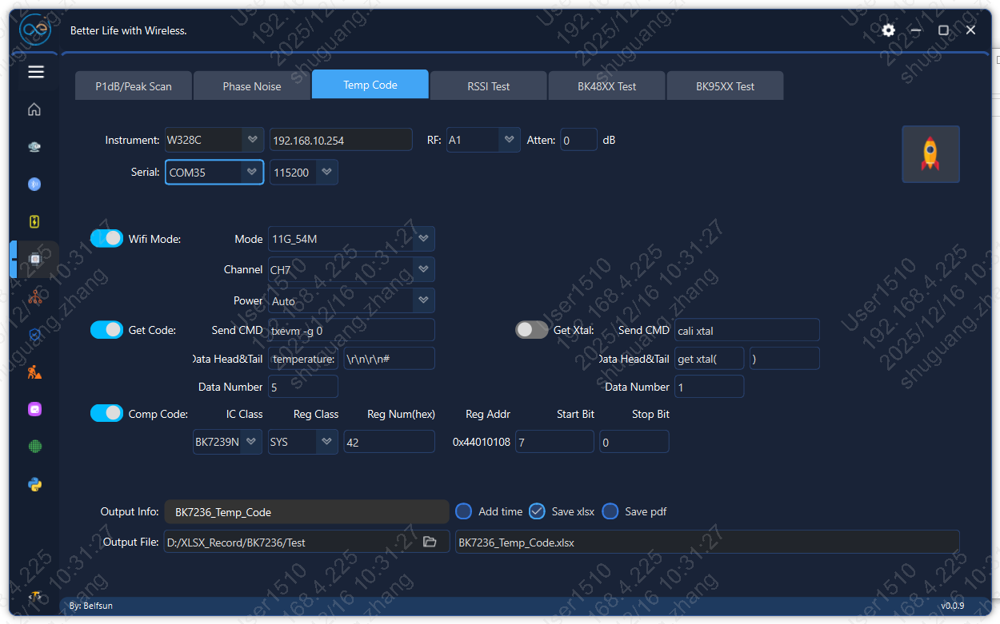
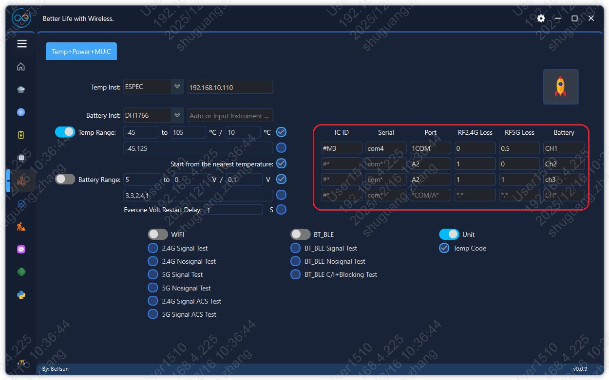
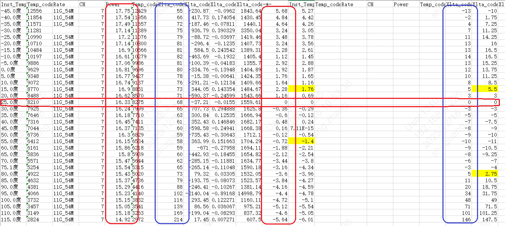
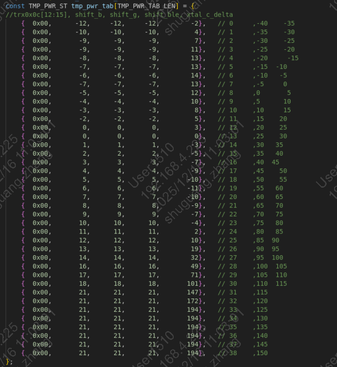

<a id="vnd-cal"></a>

# VND\_CAL

<a id="id1"></a>

## 1、概述

> 为了方便客户理解vnd\_cal.c里的参数，这里对vnd\_cal.c里参数进行说明。

<a id="id2"></a>

## 2、代码路径

> 路径: `\middleware\boards\bk7236(bk7236n\bk7239n\bk7258\bk7259)\vnd_cal\vnd_cal.c`

<a id="id3"></a>

## 3、功率校准参数

系统会按如下优先级使用功率数据（高 → 低）：

1. **仪器校准功率**：来自仪器校准结果，通常保存在 FLASH 或 OTP（具体介质由产品配置 `CONFIG_PHY_RECALI_TO_OTP` 决定）。
2. **FT 校准功率**：来自工厂 FT 写入的功率数据（保存在 OTP）。
3. **默认功率**：来自 `vnd_cal.c` 中的默认功率配置（本文件可配置）。

当设备已有仪器校准或 FT 校准数据时，`vnd_cal.c` 中的“默认功率表”可能不会生效（被更高优先级覆盖）。当缺少校准数据时，默认功率会作为兜底生效。

<a id="id4"></a>

### 3.1 仪器校准

<a id="id5"></a>

#### 3.1.1 校准流程

仪器校准通常用于获得“更贴近实测的功率”，建议流程如下：

<a id="id27"></a>

校准开始


| 步骤 | 命令 | 说明(校准开始) |
| --- | --- | --- |
| 1 | `txevm -e 1` | 关闭温度检测 |
| 2 | `txevm -g 0` | 获取当前温度，校准过程中不要再发送此命令，会影响校准状态 |
| 3 | `txevm -x 61` | 设置晶体电容补偿 |

<a id="id28"></a>

校准 2G


| 步骤 | 命令 | 说明(校准2G) |
| --- | --- | --- |
| 4 | `txevm -s 11 1 38` | 设置11B制式1信道的功率索引38，信道\[1,13\]，最多可校准四个信道，必须校准 |
| 5 | `txevm -s 54 1 68` | 设置11G制式1信道的功率索引68，信道\[1,13\]，最多可校准四个信道，必须校准 |
| 6 | `txevm -s 86 1 55` | 设置AX20制式1信道的功率索引55，信道\[1,13\]，最多可校准四个信道，可不校准 |
| 7 | `txevm -s 135 1 58` | 设置N40制式1信道的功率索引58，信道\[1,13\]，最多可校准四个信道，可不校准 |
| 8 | `txevm -s 158 1 40` | 设置BLE制式1信道的功率索引40，信道\[1,40\]，最多可校准四个信道，可不校准 |
| 9 | `txevm -e 6 11 18.0` | 设置11B的目标功率，将会更新到 `target_pwr_11b` |
| 10 | `txevm -e 6 54 15.0` | 设置11G的目标功率，将会更新到 `target_pwr_11g` |

<a id="id29"></a>

校准 5G


| 步骤 | 命令 | 说明(校准5G) |
| --- | --- | --- |
| 11 | `txevm -s 54 5036 61` | 设置11A制式36信道（加上5000偏移，下同，见说明）的功率索引61，信道\[1,177\]，最多可校准八个信道，必须校准 |
| 12 | `txevm -s 137 5040 58` | 设置AX20\_5G制式40信道的功率索引58，信道\[1,177\]，最多可校准八个信道，可不校准 |
| 13 | `txevm -s 128 5064 51` | 设置N40\_5G制式64信道的功率索引51，信道\[1,177\]，最多可校准八个信道，可不校准 |
| 14 | `txevm -e 6 -band 5 -b 0 54 14.0` | 设置11A的目标功率，将会更新到 `target_pwr_11a` |

<a id="id30"></a>

数据保存


| 步骤 | 命令 | 说明(数据保存) |
| --- | --- | --- |
| 15 | `txevm -e 2` | 保存校准数据 |
| 16 | `txevm -e 4 1` | 使能校准数据 |

**说明：**

- **信道**：5xxx表示5G，同理2xxx表示2G（2G可省略前缀），xxx表示信道
- **设定目标功率（dBm）** 比如：在 `vnd_cal.c` 中配置 `target_pwr_11b` （见下文），作为各制式/带宽的目标
- **执行仪器校准**：无论是保存到FLASH还是OTP中，校准流程是统一的，但是二者有一点区别——如果将校准结果保存在FLASH，则重新校准的次数仅受FLASH擦写次数限制；如果将校准结果保存在OTP，则最多可以重新校准4次
- **验证**：复测多个信道与多种速率，确认功率与 EVM指标满足要求，建议验证后再执行上述步骤16
- 上述命令参考极致汇仪中的FLOW得到，但是未包含全部指令

<a id="id6"></a>

#### 3.1.2 未校准信道的功率拟合

仪器校准一般只覆盖少量“关键信道点”。未覆盖的信道会通过内部策略进行\*\*拟合/补点\*\*，说明如下：

- 对于2G，每个制式可以最多校准4个任意信道；对于5G，每个制式可以最多校准8个信道
- 11信道为特定信道，如果\`\`11B/11G\`\`都校准了11信道，则工作时默认使用SRRC功率策略——13信道发射功率会降低以满足SRRC要求
- 在校准功率时，需要将目标功率传入，从而让\`\`bk\_wifi\_get\_tx\_power\`\`和\`\`bk\_wifi\_set\_tx\_power\`\`正常工作
- 对于未校准信道，会使用其左右的校准信道功率档位进行线性拟合

<a id="id7"></a>

#### 3.1.3 未校准制式的功率偏移

从3.1.1的校准流程中可以看出，AX20、N40、BLE是可以不用校准的，N20、AC是不校准的，所以这些制式需要从已校准制式偏移出对应的功率表（1LSB代表0.25dB）：

<a id="id31"></a>

未校准制式功率偏移


| 制式 | 变量 | 说明 |
| --- | --- | --- |
| N20 | `g_dif_g_n20` | N20与11G的档位偏移：`pwr_idx_n20 = pwr_idx_g + g_dif_g_n20` |
| N40 | `g_dif_g_n40` | N40与11G的档位偏移：`pwr_idx_n40 = pwr_idx_g + g_dif_g_n40` |
| AX20 | `g_dif_g_ax20` | AX20与11G的档位偏移：`pwr_idx_ax20 = pwr_idx_g + g_dif_g_ax20` |
| BLE | `g_dif_g_ble_ch*` | BLE与11G的档位偏移：`pwr_idx_ble = pwr_idx_g - g_dif_g_ble_ch*` |
| N20\_5G | `g_dif_a_n20` | N20\_5G与11A的档位偏移：`pwr_idx_n20_5g = pwr_idx_a + g_dif_a_n20` |
| N40\_5G | `g_dif_a_n40` | N40\_5G与11A的档位偏移：`pwr_idx_n40_5g = pwr_idx_a + g_dif_a_n40` |
| AX20\_5G | `g_dif_a_ax20` | AX20\_5G与11A的档位偏移：`pwr_idx_ax20_5g = pwr_idx_a + g_dif_a_ax20` |

<a id="id8"></a>

#### 3.1.4 未校准速率的功率偏移

即使做了仪器校准，通常也只会选择少量代表性速率作为校准基准；其他速率的功率通过“速率功率偏置表”进行调整（1LSB代表0.25dB）：

<a id="id32"></a>

未校准速率功率偏移


| 制式 | 变量 | 说明 |
| --- | --- | --- |
| 11B | `shift_tab_b` | 以11M为基准，依次为：11M、5.5M、2M、1M |
| 11G | `shift_tab_g` | 以54M为基准，依次为：54M、48M、36M、24M、18M、12M、9M、6M |
| N20 | `shift_tab_n20` | 以MCS7为基准，依次为：MCS9、MCS8、MCS7、MCS6、MCS5、MCS4、MCS3、MCS2、MCS1、MCS0；（MCS9、MCS8未使用） |
| N40 | `shift_tab_n40` | 以MCS7为基准，依次为：MCS9、MCS8、MCS7、MCS6、MCS5、MCS4、MCS3、MCS2、MCS1、MCS0；（MCS9、MCS8未使用） |
| AX20 | `shift_tab_ax20` | 以MCS7为基准，依次为：MCS9、MCS8、MCS7、MCS6、MCS5、MCS4、MCS3、MCS2、MCS1、MCS0 |
| 11A | `shift_tab_a` | 以54M为基准，依次为：54M、48M、36M、24M、18M、12M、9M、6M |
| N20\_5G | `shift_tab_n20_5g` | 以MCS7为基准，依次为：MCS9、MCS8、MCS7、MCS6、MCS5、MCS4、MCS3、MCS2、MCS1、MCS0；（MCS9、MCS8未使用） |
| N40\_5G | `shift_tab_n40_5g` | 以MCS7为基准，依次为：MCS9、MCS8、MCS7、MCS6、MCS5、MCS4、MCS3、MCS2、MCS1、MCS0；（MCS9、MCS8未使用） |
| AX20\_5G | `shift_tab_ax20_5g` | 以MCS7为基准，依次为：MCS9、MCS8、MCS7、MCS6、MCS5、MCS4、MCS3、MCS2、MCS1、MCS0 |

建议做法：

- 若某些速率 EVM 更敏感，可对该速率适当“降功率”（提高线性裕量）。
- 若某些速率功率明显偏低，可对该速率适当“加功率”（注意电流/温升/法规裕量）。

<a id="ft"></a>

### 3.2 FT校准

FT 校准通常在 OTP 内保存少量信道点位的功率信息，用于量产一致性。

客户可配置项：

- **目标功率（dBm）** 比如：`target_pwr_11b` （用于统一目标）
- **FT 信道偏置（0.25 dB/LSB）** 比如：`shift_pwr_idx_b_ch1` （用于信道级微调）

<a id="id9"></a>

#### 3.2.1 FT校准功率微调

当 FT 校准结果整体偏高/偏低或存在“边信道偏差”时，可按以下表格进行微调：

<a id="id33"></a>

FT 校准功率微调


| 制式 | 目标功率变量 | 信道偏置变量 | 支持信道 | 微调说明 |
| --- | --- | --- | --- | --- |
| 11B | `target_pwr_11b` | `shift_pwr_idx_b_ch1`  `shift_pwr_idx_b_ch7`  `shift_pwr_idx_b_ch13` | ch1, ch7, ch13 | 整体偏差调整目标功率；边信道偏差调整对应信道偏置（1 LSB \= 0.25 dB） |
| 11G | `target_pwr_11g` | `shift_pwr_idx_g_ch1`  `shift_pwr_idx_g_ch7`  `shift_pwr_idx_g_ch13` | ch1, ch7, ch13 | 整体偏差调整目标功率；边信道偏差调整对应信道偏置（1 LSB \= 0.25 dB） |
| 11A | `target_pwr_11a` | `shift_pwr_idx_a_ch36`  `shift_pwr_idx_a_ch64`  `shift_pwr_idx_a_ch100`  `shift_pwr_idx_a_ch132`  `shift_pwr_idx_a_ch165` | ch36, ch64, ch100, ch132, ch165 | 整体偏差调整目标功率；边信道偏差调整对应信道偏置（1 LSB \= 0.25 dB） |

**微调建议：**

- 通过功率验证（不需要功率校准）的方式统计若干模组\`\`11B/G/A\`\`在上述信道的功率
- 通过晶体频偏校准的方式统计电容补偿值并更新到\`\`DEFAULT\_TXID\_XTAL\`\`
- 根据统计数据，得到\`\`11B/G/A\`\`在上述信道的平均功率，比如： `actual_pwr_11b`
- 通过公式，比如： `shift_pwr_idx_b_ch1 = 4 × (target_pwr_11b - actual_pwr_11b)` 来更新上述变量
- 使用更新后的固件再次验证功率是否满足要求

<a id="id10"></a>

#### 3.2.2 未校准信道的功率拟合

同3.1.2章节

<a id="id11"></a>

#### 3.2.3 未校准制式的功率偏移

同3.1.3章节

<a id="id12"></a>

#### 3.2.4 未校准速率的功率偏移

同3.1.4章节

<a id="id13"></a>

### 3.3 默认功率

当设备缺少仪器/FT 校准数据时，系统会使用 `vnd_cal.c` 内的默认功率作为兜底。

客户可配置项：

- **目标功率（dBm）** 比如：`target_pwr_11b` （用于统一目标）
- **默认功率 strip 表** （按信道给 `power_index` ）：
  \- `gtxpwr_tab_def_b` （2.4G 11B）
  \- `gtxpwr_tab_def_g` （2.4G 11G）
  \- `gtxpwr_tab_def_strip_a` （5G 11A）
  \- `gtxpwr_tab_def_ble` （BLE）

注意：

- `power_index` 是内部功率表索引（不是 dBm），1 LSB \= 0.25 dB。
- 默认表只包含少量信道点位，其他信道会通过内部策略拟合/补点。

<a id="id14"></a>

#### 3.3.1 默认功率更新

当设备缺少仪器/FT 校准数据时，系统会使用 vnd\_cal.c 中的默认功率表。客户可以根据实际测试结果更新这些默认值，以提高未校准设备的功率准确性。

**更新建议：**

- 通过功率校准的方式统计若干模组\`\`11B/G/A\`\`在上述信道的功率索引和电容补偿值
- 根据统计数据，将\`\`11B/G/A\`\`在上述信道的平均功率索引，更新到默认功率表中
- 根据统计数据，将电容补偿平均值，更新到\`\`DEFAULT\_TXID\_XTAL\`\`
- 使用更新后的固件再次验证功率是否满足要求

<a id="id15"></a>

#### 3.3.2 未校准信道的功率拟合

同3.1.2章节

<a id="id16"></a>

#### 3.3.3 未校准制式的功率偏移

同3.1.3章节

<a id="id17"></a>

#### 3.3.4 未校准速率的功率偏移

同3.1.4章节

<a id="id18"></a>

## 4、温度补偿参数

温度变化会引起 PA 增益/线性与晶振频偏变化。vnd\_cal.c 提供了温度点对应的补偿表，用于在不同温度下修正功率与晶振相关参数。

<a id="id19"></a>

### 4.1 补偿表

`vnd_cal.c` 中的温度补偿表 `tmp_pwr_tab`，以常温（25度）时的功率和晶体频偏为基准，即前一章节中的校准值（对于晶体电容，如果没有校准，会使用默认值 `DEFAULT_TXID_XTAL` ）。

- `tmp_pwr_tab` 表共有39项，覆盖温度范围从-40度到150度
- 每一项中包含四类功率补偿值（1LSB代表0.25dB）：
  \- `shift_a` 表示 `5G OFDM（11A/11AC/11N_5G/11AX_5G）` 的功率补偿值
  \- `shift_b` 表示 `2G DSSS（11B）` 的功率补偿值
  \- `shift_g` 表示 `2G OFDM（11G/11N_2G/11AX_2G）` 的功率补偿值
  \- `shift_ble` 表示 `BLE` 的功率补偿值
- `xtal_c_delta` 表示晶体电容的补偿值

<a id="id20"></a>

### 4.2 补偿表更新

推荐更新流程：

- 通过功率校准的方式，在常温（25度）下将若干模组校准到目标功率
- 将模组放入温箱，通过功率验证的方式（建议通过 `txevm -e 1` 关闭温度补偿），从-40\~120度统计发射功率和电容补偿数据
- 根据统计数据更新温度补偿表 `tmp_pwr_tab`
- 更新固件后重新验证功率和晶体频偏

<a id="ae-super-tools-exe"></a>

#### 4.2.1 打开AE\_Super\_Tools.exe

<a id="unit-test-temp-code"></a>

#### 4.2.2 选择Unit Test-\>Temp Code



第一个框：选择仪器和串口

第二个框：设置测试项

第三个框：设置测试结果、文件名及文件地址

火箭按钮是测试启动按键

<a id="id21"></a>

#### 4.2.3 测试设置：



Wifi Mode：选择用哪个速率发射

Get Code：获取温度码

Comp Code：补偿晶体的寄存器地址

<a id="id22"></a>

#### 4.2.4 设置完参数，先点击火箭，检查业务能不能正常运行

<a id="id23"></a>

#### 4.2.5 在业务上进行温度循环测试：



ESPEC温箱：填入温箱的IP地址（首先Ping一下，是否成功通信）

打开Temp Rang，填写温度范围

红色框里填入多个板子的信息，最大支持4个同时测试，Bettery信息可空

打开Unit 勾选 Temp Code

<a id="temp-range"></a>

#### 4.2.6 设置完信息后，先关闭Temp Range，点击火箭启动测试，确认每路都能正常工作

<a id="id24"></a>

#### 4.2.7 确认硬件连接正常后，再打开Temp Range，点击火箭启动测试

<a id="id25"></a>

#### 4.2.8 数据使用：会生成一个这样的表格



以25度的值为基准，计算每块板子跟每个温度跟25度的功率差和晶体code差值

取4块板子的平均值对应补偿到代码里面，注意功率的code单位

填到代码里面如下位置：



<a id="id26"></a>

## 5、其它参数简介

参数如下:

> 1.默认晶体值
> :   - #define DEFAULT\_TXID\_XTAL (0x3a)
>     - 功能说明：用来配置晶体默认值，为了优化频偏。
>
> 2.vnd\_cal版本信息
> :   - vnd\_cal\_version \= “24-04-10 00:00:00”
>     - 功能说明：记录vnd\_cal版本信息。
>
> 3.11B gain基值与功率gain表
> :   - 1.const UINT32 pwr\_gain\_base\_gain\_b \= 0x18ab7c00
>     - 2.#define TPC\_PAMAP\_TAB\_LEN (128)
>     - 3.const PWR\_REGS cfg\_tab\[TPC\_PAMAP\_TAB\_LEN\]
>     - 功能说明：1是发包功率基值; 2是功率gain表长度; 3是11B发包pregain表。发包功率基值与pregain组合后为发包的具体功率值。11B为0.5dB一个step。
>
> 4.11G gain基值与功率gain表
> :   - 1.const UINT32 pwr\_gain\_base\_gain\_g \= 0x98ab7c00
>     - 2.#define TPC\_PAMAP\_TAB\_LEN (128)
>     - 3.const PWR\_REGS cfg\_tab\[TPC\_PAMAP\_TAB\_LEN\]
>     - 功能说明：1是发包功率基值; 2是功率gain表长度; 3是11G发包pregain表。发包功率基值与pregain组合后为发包的具体功率值。11G为0.25dB一个step。
>
> 5.BLE发包功率范围选择
> :   - 宏 CONFIG\_BLE\_USE\_HIGH\_POWER\_LEVEL
>     - 功能说明：选择BLE发包功率支持的范围，打开宏BLE支持高功率。
>
> 6.BLE gain基值与功率gain表
> :   - 1.const UINT32 pwr\_gain\_base\_gain\_ble \= 0x18a94c00
>     - 2.#define TPC\_PAMAP\_TAB\_LEN (128)
>     - 3.const PWR\_REGS cfg\_tab\[TPC\_PAMAP\_TAB\_LEN\]
>     - 功能说明：1是发包功率基值; 2是功率gain表长度; 3是BLE发包pregain表。发包功率基值与pregain组合后为发包的具体功率值。BLE为0.25dB一个step。
>
> 7.发包功率index表
> :   - const TXPWR\_ST gtxpwr\_tab\_def\_b\[TXPWR\_CAL\_2G\_MAX\]
>     - const TXPWR\_ST gtxpwr\_tab\_def\_g\[TXPWR\_CAL\_2G\_MAX\]
>     - const TXPWR\_ST gtxpwr\_tab\_def\_strip\_a\[TXPWR\_CAL\_5G\_MAX\]
>     - const TXPWR\_ST gtxpwr\_tab\_def\_ble\[TXPWR\_CAL\_2G\_MAX\]
>     - 功能说明：11B，11G，11A与BLE默认发包功率index表。开发板按照指定的发包功率校准后，会得出以上4张表。表中的值，为第4,5,7条pregain表中值的index。
>
> 8.温补表
> :   - const TMP\_PWR\_ST tmp\_pwr\_tab\[TMP\_PWR\_TAB\_LEN\]
>     - 功能说明：温补表，根据温度调节发包功率与频偏。表的第2列为11B发包功率随温度变化的偏移值，第3列为11G、11N与11AX发包功率随温度变化的偏移值,第4列为BLE发包功率随温度变化的偏移值。第5列为频偏随温度变化的偏移值。
>
> 9.不同rate发包功率偏移表
> :   - const INT16 shift\_tab\_b\[4\]
>     - const INT16 shift\_tab\_g\[8\]
>     - const INT16 shift\_tab\_n20\[10\]
>     - const INT16 shift\_tab\_ax20\[10\]
>     - const INT16 shift\_tab\_n40\[10\]
>     - 功能说明：不同rate发包功率偏移表。功率校准是以11B 11M,11G 54M,11N 40M MCS7进行校准,其他rate发包功率是在校准使用的rate功率进行偏移得出。11B 0.5dB一个step,其他为0.25dB一个step。例如11B希望整体降低1dB,const INT16 shift\_tab\_b\[4\] \= {-1, -1, -1, -1};11N 40整体提升1dB,const INT16 shift\_tab\_n40\[10\] \= {-6, -2, 4, 4, 4, 4, 4, 4, 4, 4/*4*/}
>
> 10.FCC与SRRC认证时提升或降低不同rate发包功率
> :   - const INT16 shift\_tab\_b\_fcc\[WLAN\_2\_4\_G\_CHANNEL\_NUM\]
>     - const INT16 shift\_tab\_g\_fcc\[WLAN\_2\_4\_G\_CHANNEL\_NUM\]
>     - const INT16 shift\_tab\_n20\_fcc\[WLAN\_2\_4\_G\_CHANNEL\_NUM\]
>     - const INT16 shift\_tab\_n40\_fcc\[WLAN\_2\_4\_G\_CHANNEL\_NUM\]
>     - const INT16 shift\_tab\_b\_srrc\[WLAN\_2\_4\_G\_CHANNEL\_NUM\]
>     - const INT16 shift\_tab\_g\_srrc\[WLAN\_2\_4\_G\_CHANNEL\_NUM\]
>     - const INT16 shift\_tab\_n20\_srrc\[WLAN\_2\_4\_G\_CHANNEL\_NUM\]
>     - const INT16 shift\_tab\_n40\_srrc\[WLAN\_2\_4\_G\_CHANNEL\_NUM\]
>     - 功能说明：客户在FCC与SRRC认证时调整不同rate发包功率偏移表。调整方式与第9条一致。
>
> 11.配置自动功率校准参数到代码
> :   - vnd\_cal\_set\_auto\_pwr\_thred(auto\_pwr);
>     - 功能说明：将第9条的参数配置到代码，7239N与7236N不支持。
>
> 12.配置外部PA使用的GPIO
> :   - vnd\_cal\_set\_epa\_config(1, GPIO\_28, GPIO\_26, pwr\_gain\_base\_gain\_b, pwr\_gain\_base\_gain\_g);
>     - vnd\_cal\_set\_epa\_config(0, GPIO\_28, GPIO\_26, pwr\_gain\_base\_gain\_b, pwr\_gain\_base\_gain\_g);
>     - 功能说明：配置GPIO打开或关闭外PA功能,7239N与7236N不支持此方式，可直接配置IOMX打开外部PA功能：
>
>     ```
>     void test_fem(void) {
>         bk_printf("FEM info: TX_EN-P22, RX_EN-P21, LNA_EN-P20\r\n");
>         REG_WRITE(SOC_IOMX_REG_BASE + (0x40 + 22) * 4, 0x5E000000);
>         REG_WRITE(SOC_IOMX_REG_BASE + (0x40 + 21) * 4, 0x5D000000);
>         REG_WRITE(SOC_IOMX_REG_BASE + (0x40 + 20) * 4, 0x1D000000);
>     }
>     ```
>
> 13.开机打印vnd\_cal版本信息
> :   - vnd\_cal\_version\_log(vnd\_cal\_version);
>     - 功能说明：打印vnd\_cal.c版本信息。
>
> 14.CCA门限
> :   - vnd\_cal\_set\_cca\_level(0);
>     - 功能说明：SRRC自适应测试不同实验室要求不同,开放CCA门限。
