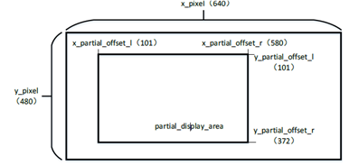

<a id="display-apis"></a>

# Display APIs

<a id="lcd-display-interface"></a>

## LCD Display Interface

The BK LCD Display Driver supports following interfaces:

> - i8080 LCD interface
>   :   1. 项目中使用的屏幕Driving IC 为ST7796S.
>       2. 8080 接口的数据传输为8位
>       3. 接口支持的数据为RGB565
> - RGB interface
>   :   1. 项目中支持的屏幕有Driving IC ST7282，HX8282, GC9503V.
>       2. 接口支持的数据包括RGB565,YUYV,UYVY,YYUV,UVYY,VUYY

<a id="lcd-api-categories"></a>

## LCD API Categories

<a id="lcd-8080-config"></a>

## LCD 8080 Config

<a id="id2"></a>


Figure 1\. 8080 lcd config flow

<a id="lcd-rgb-config"></a>

## LCD RGB Config

<a id="id3"></a>


Figure 2\. rgb lcd config flow

<a id="lcd-parcical-display"></a>

## LCD parcical display

<a id="id4"></a>


Figure 3\. rgb lcd config flow

局部显示参数配置

<a id="id5"></a>



Figure 4\. rgb lcd config flow

<a id="api-reference"></a>

## API Reference

<a id="header-file"></a>

### Header File

- [lcd.h](http://192.168.0.46/gerrit/plugins/gitiles/iot/wcn/projects/+/refs/heads/armino_main/components/lcd.h)

<a id="functions"></a>

### Functions

<a id="_CPPv418bk_lcd_driver_init9lcd_clk_t"></a>

<a id="_CPPv318bk_lcd_driver_init9lcd_clk_t"></a> <a id="_CPPv218bk_lcd_driver_init9lcd_clk_t"></a> <a id="bk_lcd_driver_init__lcd_clk_t"></a> <a id="lcd_8h_1a2e36311f44162eb042e7349246b37ef0"></a> [bk\_err\_t](../system/os.md#_CPPv48bk_err_t "bk_err_t") bk\_lcd\_driver\_init([lcd\_clk\_t](#_CPPv49lcd_clk_t "lcd_clk_t") clk)
:   LCD API.

    This API select LCD module clk source

    - config video power
    - open lcd sys interrupt/clk enable

    BK\_OK: succeed

    - others: other errors.

    返回

<a id="_CPPv416bk_lcd_8080_init8uint16_t8uint16_t14pixel_format_t"></a>

<a id="_CPPv316bk_lcd_8080_init8uint16_t8uint16_t14pixel_format_t"></a> <a id="_CPPv216bk_lcd_8080_init8uint16_t8uint16_t14pixel_format_t"></a> <a id="bk_lcd_8080_init__uint16_t.uint16_t.pixel_format_t"></a> <a id="lcd_8h_1a817fd48bd4ce08ac3a75fc60e4572859"></a> [bk\_err\_t](../system/os.md#_CPPv48bk_err_t "bk_err_t") bk\_lcd\_8080\_init(uint16\_t x\_pixel, uint16\_t y\_pixel, pixel\_format\_t input\_data\_format)
:   This API init the 8080 lcd interface.

    - Set lcd display mode is 8080 interface
    - init 8080 lcd gpio
    - enable 8080 display -enable 8080 end of frame interrupt
    - if you want enable start of frame interrupt, please use API bk\_lcd\_8080\_int\_enable

    参数
    :   **x\_pixel** – user can set by any value, can be lcd size x or picture size x

        - y\_pixel user can set by any value, can be lcd size y or picture size y
        - input\_data\_format, lcd module input data format, can be rgb565, yuyv, uvyy or other pixel\_format\_t member

    返回
    :   - BK\_OK: succeed
        - others: other errors.

<a id="_CPPv418bk_lcd_8080_deinitv"></a>

<a id="_CPPv318bk_lcd_8080_deinitv"></a> <a id="_CPPv218bk_lcd_8080_deinitv"></a> <a id="bk_lcd_8080_deinit__void"></a> <a id="lcd_8h_1ad5dc2b7dae2b96524819369529c2037c"></a> [bk\_err\_t](../system/os.md#_CPPv48bk_err_t "bk_err_t") bk\_lcd\_8080\_deinit(void)
:   8080 lcd interface reg deinit

    ```
    - This API reset all lcd reg include power 
    - close 8080 lcd enable and display
    - reset x pixel and y pixel zero
    - unregister lcd isr
    ```

    返回
    :   - BK\_OK: succeed
        - others: other errors.

<a id="_CPPv419bk_lcd_pixel_config8uint16_t8uint16_t"></a>

<a id="_CPPv319bk_lcd_pixel_config8uint16_t8uint16_t"></a> <a id="_CPPv219bk_lcd_pixel_config8uint16_t8uint16_t"></a> <a id="bk_lcd_pixel_config__uint16_t.uint16_t"></a> <a id="lcd_8h_1ad80b1677dba001f164e30f796bcd7119"></a> [bk\_err\_t](../system/os.md#_CPPv48bk_err_t "bk_err_t") bk\_lcd\_pixel\_config(uint16\_t x\_pixel, uint16\_t y\_pixel)
:   This API config lcd display x size and y size.

    参数
    :   **x\_pixel** – user can set by any value, can be lcd size x or picture size x

        - y\_pixel user can set by any value, can be lcd size y or picture size y

    返回
    :   - BK\_OK: succeed
        - others: other errors.

<a id="_CPPv422bk_lcd_8080_int_enablebb"></a>

<a id="_CPPv322bk_lcd_8080_int_enablebb"></a> <a id="_CPPv222bk_lcd_8080_int_enablebb"></a> <a id="bk_lcd_8080_int_enable__b.b"></a> <a id="lcd_8h_1a3a595ed1a18001b4324b27eb86065161"></a> [bk\_err\_t](../system/os.md#_CPPv48bk_err_t "bk_err_t") bk\_lcd\_8080\_int\_enable(bool is\_sof\_en, bool is\_eof\_en)
:   This API config 8080 lcd interrupt.

    **Attention**
    :   8080 end of frame int is open in API bk\_lcd\_8080\_init

    参数
    :   **is\_sof\_en** – enable start of frame interrupt

        - is\_eof\_en enable end of frame interrupt

    返回
    :   - BK\_OK: succeed
        - others: other errors.

<a id="_CPPv426bk_lcd_8080_start_transferb"></a>

<a id="_CPPv326bk_lcd_8080_start_transferb"></a> <a id="_CPPv226bk_lcd_8080_start_transferb"></a> <a id="bk_lcd_8080_start_transfer__b"></a> <a id="lcd_8h_1a92bfa60273a838d1db5f0f4c48f59127"></a> [bk\_err\_t](../system/os.md#_CPPv48bk_err_t "bk_err_t") bk\_lcd\_8080\_start\_transfer(bool start)
:   This API start mcu 8080 lcd transfer data to display.

    参数
    :   **start\_transfer** –

        - 1:data start transfer to lcd display on;
        - 0:stop transfer

    返回
    :   - BK\_OK: succeed
        - others: other errors.

<a id="_CPPv417bk_lcd_rgb_deinitv"></a>

<a id="_CPPv317bk_lcd_rgb_deinitv"></a> <a id="_CPPv217bk_lcd_rgb_deinitv"></a> <a id="bk_lcd_rgb_deinit__void"></a> <a id="lcd_8h_1ac42bbb0b6ddb6cebb0778f84363e123f"></a> [bk\_err\_t](../system/os.md#_CPPv48bk_err_t "bk_err_t") bk\_lcd\_rgb\_deinit(void)
:   rgb lcd interface reg deinit

    ```
          - This API reset all lcd reg include power 
          - close rgb lcd enable and display
          - reset x pixel and y pixel zero
          - unregister lcd isr
    ```

    返回
    :   - BK\_OK: succeed
        - others: other errors.

<a id="_CPPv421bk_lcd_rgb_display_enb"></a>

<a id="_CPPv321bk_lcd_rgb_display_enb"></a> <a id="_CPPv221bk_lcd_rgb_display_enb"></a> <a id="bk_lcd_rgb_display_en__b"></a> <a id="lcd_8h_1aecb7ee937ac1c1c5101d59390b8687c5"></a> [bk\_err\_t](../system/os.md#_CPPv48bk_err_t "bk_err_t") bk\_lcd\_rgb\_display\_en(bool en)
:   enable rgb lcd enable

    参数
    :   **bool** – en

        - 1: enable rgb display
        - 0: disable rgb display

    返回
    :   - BK\_OK: succeed
        - others: other errors.

<a id="_CPPv421bk_lcd_rgb_int_enablebb"></a>

<a id="_CPPv321bk_lcd_rgb_int_enablebb"></a> <a id="_CPPv221bk_lcd_rgb_int_enablebb"></a> <a id="bk_lcd_rgb_int_enable__b.b"></a> <a id="lcd_8h_1a36b3f2404598c342f9e05f6310f9fa20"></a> [bk\_err\_t](../system/os.md#_CPPv48bk_err_t "bk_err_t") bk\_lcd\_rgb\_int\_enable(bool is\_sof\_en, bool is\_eof\_en)
:   This API config rgb lcd interrupt.

    **Attention**
    :   rgb end of frame int is open in API bk\_lcd\_rgb\_init

    参数
    :   **is\_sof\_en** – enable start of frame interrupt

        - is\_eof\_en enable end of frame interrupt

    返回
    :   - BK\_OK: succeed
        - others: other errors.

<a id="_CPPv419bk_lcd_isr_register9lcd_isr_t"></a>

<a id="_CPPv319bk_lcd_isr_register9lcd_isr_t"></a> <a id="_CPPv219bk_lcd_isr_register9lcd_isr_t"></a> <a id="bk_lcd_isr_register__lcd_isr_t"></a> <a id="lcd_8h_1a1aab1d28035f4c08995d015ce75a09fd"></a> [bk\_err\_t](../system/os.md#_CPPv48bk_err_t "bk_err_t") bk\_lcd\_isr\_register([lcd\_isr\_t](#_CPPv49lcd_isr_t "lcd_isr_t") lcd\_isr)
:   This API register lcd isr, user should check int status in isr function, and clear status.

    参数
    :   **isr, :** – isr function

    返回
    :   - BK\_OK: succeed
        - others: other errors.

<a id="_CPPv421bk_lcd_int_status_getv"></a>

<a id="_CPPv321bk_lcd_int_status_getv"></a> <a id="_CPPv221bk_lcd_int_status_getv"></a> <a id="bk_lcd_int_status_get__void"></a> <a id="lcd_8h_1a31d8d69414778dcb756ac2a438ecf7af"></a> uint32\_t bk\_lcd\_int\_status\_get(void)
:   This API used to get lcd int status.

    8080 Usage example: if (bk\_lcd\_int\_status\_get()\&I8080\_OUTPUT\_EOF \=\= 1), present 8080 eof int triggerd if (bk\_lcd\_int\_status\_get()\&RGB\_OUTPUT\_EOF \=\= 1), present rgb eof int triggerd

    返回
    :   - status value.

<a id="_CPPv423bk_lcd_int_status_clear14lcd_int_type_t"></a>

<a id="_CPPv323bk_lcd_int_status_clear14lcd_int_type_t"></a> <a id="_CPPv223bk_lcd_int_status_clear14lcd_int_type_t"></a> <a id="bk_lcd_int_status_clear__lcd_int_type_t"></a> <a id="lcd_8h_1a15a42b1eb910abcb2bbeb13796c58853"></a> [bk\_err\_t](../system/os.md#_CPPv48bk_err_t "bk_err_t") bk\_lcd\_int\_status\_clear([lcd\_int\_type\_t](#_CPPv414lcd_int_type_t "lcd_int_type_t") int\_type)
:   This API used to clr lcd int status.

    参数
    :   **int\_type** – value.

    返回
    :   - BK\_OK: succeed
        - others: other errors.

<a id="_CPPv415bk_lcd_rgb_init15lcd_device_id_t8uint16_t8uint16_t14pixel_format_t"></a>

<a id="_CPPv315bk_lcd_rgb_init15lcd_device_id_t8uint16_t8uint16_t14pixel_format_t"></a> <a id="_CPPv215bk_lcd_rgb_init15lcd_device_id_t8uint16_t8uint16_t14pixel_format_t"></a> <a id="bk_lcd_rgb_init__lcd_device_id_t.uint16_t.uint16_t.pixel_format_t"></a> <a id="lcd_8h_1a861ff62e3e6eb8c90763ba5fc1991976"></a> [bk\_err\_t](../system/os.md#_CPPv48bk_err_t "bk_err_t") bk\_lcd\_rgb\_init([lcd\_device\_id\_t](#_CPPv415lcd_device_id_t "lcd_device_id_t") id, uint16\_t x\_pixel, uint16\_t y\_pixel, pixel\_format\_t input\_data\_format)
:   This API init the rgb lcd interface.

    - Set lcd display mode is rgb interface
    - init rgb lcd gpio
    - enable rgb display
    - enable rgb end of frame interrupt

    参数
    :   **lcd\_device\_id\_t, :** – lcd type select from lcd\_device\_id\_t

        - x\_pixel
        - y\_pixel
        - input\_data\_format: input\_data\_format select rgb565 data, yuyv, yyuv or other yuv \* mode from struct pixel\_format\_t

    返回
    :   - BK\_OK: succeed
        - others: other errors.

<a id="_CPPv420bk_lcd_8080_send_cmd7uint8_t8uint32_tP8uint32_t"></a>

<a id="_CPPv320bk_lcd_8080_send_cmd7uint8_t8uint32_tP8uint32_t"></a> <a id="_CPPv220bk_lcd_8080_send_cmd7uint8_t8uint32_tP8uint32_t"></a> <a id="bk_lcd_8080_send_cmd__uint8_t.uint32_t.uint32_tP"></a> <a id="lcd_8h_1a939d3d14330afb4bdea703963d618e28"></a> [bk\_err\_t](../system/os.md#_CPPv48bk_err_t "bk_err_t") bk\_lcd\_8080\_send\_cmd(uint8\_t param\_count, uint32\_t command, uint32\_t \*param)
:   This API used send 8080 lcd init cmd.

    Usage example:

    #define COMMAND\_1 0xf uint32\_t param\_command1\[2\] \= {0xc3, 0x29}; bk\_lcd\_8080\_send\_cmd(2, COMMAND\_1, param\_command1);

    参数
    :   **param\_count, :** – cmd parameter number

        - command: command
        - param: the cmd parameter

    返回
    :   - BK\_OK: succeed
        - others: other errors.

<a id="_CPPv428bk_lcd_get_display_base_addrv"></a>

<a id="_CPPv328bk_lcd_get_display_base_addrv"></a> <a id="_CPPv228bk_lcd_get_display_base_addrv"></a> <a id="bk_lcd_get_display_base_addr__void"></a> <a id="lcd_8h_1aba50c1b127c8aaaf01e09a8394270d8e"></a> uint32\_t bk\_lcd\_get\_display\_base\_addr(void)
:   This API used get lcd display base addr.

    返回
    :   lcd display addr

<a id="_CPPv427bk_lcd_set_partical_displayb8uint16_t8uint16_t8uint16_t8uint16_t"></a>

<a id="_CPPv327bk_lcd_set_partical_displayb8uint16_t8uint16_t8uint16_t8uint16_t"></a> <a id="_CPPv227bk_lcd_set_partical_displayb8uint16_t8uint16_t8uint16_t8uint16_t"></a> <a id="bk_lcd_set_partical_display__b.uint16_t.uint16_t.uint16_t.uint16_t"></a> <a id="lcd_8h_1aa65989b93a68fcf705a4a7cc67599f4b"></a> [bk\_err\_t](../system/os.md#_CPPv48bk_err_t "bk_err_t") bk\_lcd\_set\_partical\_display(bool en, uint16\_t partial\_clum\_l, uint16\_t partial\_clum\_r, uint16\_t partial\_line\_l, uint16\_t partial\_line\_r)
:   This API used for display partical area.

    8080 Usage example:

    #define PARTICAL\_XS 101 #define PARTICAL\_XE 220 #define PARTICAL\_YS 101 #define PARTICAL\_YE 380 bk\_lcd\_set\_partical\_display(EDGE\_PARTICAL\_XS, EDGE\_PARTICAL\_XE, EDGE\_PARTICAL\_YS, EDGE\_PARTICAL\_YE); bk\_lcd\_8080\_send\_cmd(2, COMMAND\_1, param\_command1);

    参数
    :   **partial\_clum\_l, :** –

        - partial\_clum\_r:
        - partial\_line\_l:
        - partial\_line\_r:

    返回
    :   - BK\_OK: succeed
        - others: other errors.

<a id="_CPPv421bk_lcd_8080_ram_write8uint32_t"></a>

<a id="_CPPv321bk_lcd_8080_ram_write8uint32_t"></a> <a id="_CPPv221bk_lcd_8080_ram_write8uint32_t"></a> <a id="bk_lcd_8080_ram_write__uint32_t"></a> <a id="lcd_8h_1acb0c15f81460c5c084d307f7b0e4273a"></a> [bk\_err\_t](../system/os.md#_CPPv48bk_err_t "bk_err_t") bk\_lcd\_8080\_ram\_write(uint32\_t cmd)
:   This API used for 8080 mcu lcd 0x2c/0x3c. ram write cmd send.

    返回
    :   - BK\_OK: succeed
        - others: other errors.

<a id="_CPPv415lcd_driver_initPK12lcd_config_t"></a>

<a id="_CPPv315lcd_driver_initPK12lcd_config_t"></a> <a id="_CPPv215lcd_driver_initPK12lcd_config_t"></a> <a id="lcd_driver_init__lcd_config_tCP"></a> <a id="lcd_8h_1a903d7a4b14df46365453fb7e8cfddc61"></a> [bk\_err\_t](../system/os.md#_CPPv48bk_err_t "bk_err_t") lcd\_driver\_init(const [lcd\_config\_t](#_CPPv412lcd_config_t "lcd_config_t") \*config)
:   This API used for init lcd.

    Usage example: [lcd\_config\_t](#structlcd__config__t) lcd\_config; lcd\_config.device \= get\_lcd\_device\_by\_id(LCD\_DEVICE\_ST7282); lcd\_config.complete\_callback \= lcd\_complete\_callback; lcd\_config.fmt \= VUYY\_DATA; lcd\_config.pixel\_x \= 640; lcd\_config.pixel\_y \= 480; lcd\_driver\_init(\&lcd\_config);

    参数
    :   **lcd\_config\_t** –

    返回
    :   - BK\_OK: succeed
        - others: other errors.

<a id="_CPPv420get_lcd_device_by_id15lcd_device_id_t"></a>

<a id="_CPPv320get_lcd_device_by_id15lcd_device_id_t"></a> <a id="_CPPv220get_lcd_device_by_id15lcd_device_id_t"></a> <a id="get_lcd_device_by_id__lcd_device_id_t"></a> <a id="lcd_8h_1adbc92366182f9fa5fd32316b11f26b97"></a> const [lcd\_device\_t](#_CPPv412lcd_device_t "lcd_device_t") \*get\_lcd\_device\_by\_id([lcd\_device\_id\_t](#_CPPv415lcd_device_id_t "lcd_device_id_t") id)
:   this api used to get lcd device interface

    参数
    :   **select** – lcd\_device\_id\_t member

    返回
    :   lcd device infermation, include: .id \= LCD\_DEVICE\_HX8282, .name \= “hx8282”, .type \= LCD\_TYPE\_RGB565, .ppi \= PPI\_1024X600, .rgb \= \&lcd\_rgb .init \= NULL,

<a id="_CPPv420get_lcd_devices_listv"></a>

<a id="_CPPv320get_lcd_devices_listv"></a> <a id="_CPPv220get_lcd_devices_listv"></a> <a id="get_lcd_devices_list__void"></a> <a id="lcd_8h_1a456f0e62446a514d290c638c9c2fc1ca"></a> const [lcd\_device\_t](#_CPPv412lcd_device_t "lcd_device_t") \*\*get\_lcd\_devices\_list(void)
:   get lcd device list

    返回
    :   - devices list

<a id="_CPPv419get_lcd_devices_numv"></a>

<a id="_CPPv319get_lcd_devices_numv"></a> <a id="_CPPv219get_lcd_devices_numv"></a> <a id="get_lcd_devices_num__void"></a> <a id="lcd_8h_1a4b898acd227b35f89f9e5040ea0dee29"></a> uint32\_t get\_lcd\_devices\_num(void)
:   get lcd device number

    返回
    :   - devices number

<a id="_CPPv425lcd_driver_backlight_init7uint8_t7uint8_t"></a>

<a id="_CPPv325lcd_driver_backlight_init7uint8_t7uint8_t"></a> <a id="_CPPv225lcd_driver_backlight_init7uint8_t7uint8_t"></a> <a id="lcd_driver_backlight_init__uint8_t.uint8_t"></a> <a id="lcd_8h_1a8fce5e927f44ce063839cbd4d6327659"></a> [bk\_err\_t](../system/os.md#_CPPv48bk_err_t "bk_err_t") lcd\_driver\_backlight\_init(uint8\_t pwm\_id, uint8\_t percent)
:   this api used to init lcd backlight

    参数
    :   **pwm\_id** – gpio7\&#8212;\>PWM\_ID\_1 gpio8\&#8212;\>PWM\_ID\_2

        - percent: from 0\~100

    返回
    :   - BK\_OK: succeed
        - others: other errors.

<a id="_CPPv427lcd_driver_backlight_deinit7uint8_t"></a>

<a id="_CPPv327lcd_driver_backlight_deinit7uint8_t"></a> <a id="_CPPv227lcd_driver_backlight_deinit7uint8_t"></a> <a id="lcd_driver_backlight_deinit__uint8_t"></a> <a id="lcd_8h_1ac567a50e944b4884947640b5c170bbe9"></a> [bk\_err\_t](../system/os.md#_CPPv48bk_err_t "bk_err_t") lcd\_driver\_backlight\_deinit(uint8\_t pwm\_id)
:   this api used to deinit lcd backlight

    参数
    :   **pwm\_id** – gpio7\&#8212;\>PWM\_ID\_1 gpio8\&#8212;\>PWM\_ID\_2

    返回
    :   - BK\_OK: succeed
        - others: other errors.

<a id="_CPPv424lcd_driver_set_backlight7uint8_t"></a>

<a id="_CPPv324lcd_driver_set_backlight7uint8_t"></a> <a id="_CPPv224lcd_driver_set_backlight7uint8_t"></a> <a id="lcd_driver_set_backlight__uint8_t"></a> <a id="lcd_8h_1ad378af6a1478ac7653c9d23f8c48fef5"></a> [bk\_err\_t](../system/os.md#_CPPv48bk_err_t "bk_err_t") lcd\_driver\_set\_backlight(uint8\_t percent)
:   this api used to set lcd backlight

    参数
    :   **percent** – rang from 0\~100

    返回
    :   - BK\_OK: succeed
        - others: other errors.

<a id="_CPPv425lcd_driver_display_enablev"></a>

<a id="_CPPv325lcd_driver_display_enablev"></a> <a id="_CPPv225lcd_driver_display_enablev"></a> <a id="lcd_driver_display_enable__void"></a> <a id="lcd_8h_1adc140f7491898b349b51f0e83fe44712"></a> [bk\_err\_t](../system/os.md#_CPPv48bk_err_t "bk_err_t") lcd\_driver\_display\_enable(void)
:   this api used to enable lcd display

    返回
    :   - BK\_OK: succeed
        - others: other errors.

<a id="_CPPv427lcd_driver_display_continuev"></a>

<a id="_CPPv327lcd_driver_display_continuev"></a> <a id="_CPPv227lcd_driver_display_continuev"></a> <a id="lcd_driver_display_continue__void"></a> <a id="lcd_8h_1a40a23ea4f2c0ce58940bee9a1b0227a1"></a> [bk\_err\_t](../system/os.md#_CPPv48bk_err_t "bk_err_t") lcd\_driver\_display\_continue(void)
:   this api used to clear eof int and diaplay continue

    返回
    :   - BK\_OK: succeed
        - others: other errors.

<a id="_CPPv432lcd_driver_set_display_base_addr8uint32_t"></a>

<a id="_CPPv332lcd_driver_set_display_base_addr8uint32_t"></a> <a id="_CPPv232lcd_driver_set_display_base_addr8uint32_t"></a> <a id="lcd_driver_set_display_base_addr__uint32_t"></a> <a id="lcd_8h_1afc3cea1743ab798086b8ea697049aedc"></a> [bk\_err\_t](../system/os.md#_CPPv48bk_err_t "bk_err_t") lcd\_driver\_set\_display\_base\_addr(uint32\_t disp\_base\_addr)
:   this api used to set lcd display addr

    参数
    :   **disp\_base\_addr** – sram or psram

    返回
    :   - BK\_OK: succeed
        - others: other errors.

<a id="_CPPv417lcd_driver_deinitv"></a>

<a id="_CPPv317lcd_driver_deinitv"></a> <a id="_CPPv217lcd_driver_deinitv"></a> <a id="lcd_driver_deinit__void"></a> <a id="lcd_8h_1a59f098a1a4c22020cd124ecbb716fafa"></a> [bk\_err\_t](../system/os.md#_CPPv48bk_err_t "bk_err_t") lcd\_driver\_deinit(void)
:   this api used to close lcd

    返回
    :   - BK\_OK: succeed
        - others: other errors.

<a id="_CPPv417bk_lcd_fill_color15lcd_device_id_tP19lcd_disp_framebuf_t8uint32_t"></a>

<a id="_CPPv317bk_lcd_fill_color15lcd_device_id_tP19lcd_disp_framebuf_t8uint32_t"></a> <a id="_CPPv217bk_lcd_fill_color15lcd_device_id_tP19lcd_disp_framebuf_t8uint32_t"></a> <a id="bk_lcd_fill_color__lcd_device_id_t.lcd_disp_framebuf_tP.uint32_t"></a> <a id="lcd_8h_1a5047fb2f5eb9e212195e879968ec961e"></a> [bk\_err\_t](../system/os.md#_CPPv48bk_err_t "bk_err_t") bk\_lcd\_fill\_color([lcd\_device\_id\_t](#_CPPv415lcd_device_id_t "lcd_device_id_t") id, [lcd\_disp\_framebuf\_t](#_CPPv419lcd_disp_framebuf_t "lcd_disp_framebuf_t") \*lcd\_disp, uint32\_t color)
:   lcd fill color

    参数
    :   **lcd\_disp** –

    返回
    :   - BK\_OK: succeed
        - others: other errors.

<a id="_CPPv416bk_lcd_fill_data15lcd_device_id_tP19lcd_disp_framebuf_t"></a>

<a id="_CPPv316bk_lcd_fill_data15lcd_device_id_tP19lcd_disp_framebuf_t"></a> <a id="_CPPv216bk_lcd_fill_data15lcd_device_id_tP19lcd_disp_framebuf_t"></a> <a id="bk_lcd_fill_data__lcd_device_id_t.lcd_disp_framebuf_tP"></a> <a id="lcd_8h_1a6a206000d0a09c0c52a46ec161953025"></a> [bk\_err\_t](../system/os.md#_CPPv48bk_err_t "bk_err_t") bk\_lcd\_fill\_data([lcd\_device\_id\_t](#_CPPv415lcd_device_id_t "lcd_device_id_t") id, [lcd\_disp\_framebuf\_t](#_CPPv419lcd_disp_framebuf_t "lcd_disp_framebuf_t") \*lcd\_disp)
:   lcd fill data, adapt large amount of data transfer

    参数
    :   **lcd\_disp** –

    返回
    :   - BK\_OK: succeed
        - others: other errors.

<a id="_CPPv417bk_lcd_draw_point15lcd_device_id_t8uint16_t8uint16_t8uint16_t"></a>

<a id="_CPPv317bk_lcd_draw_point15lcd_device_id_t8uint16_t8uint16_t8uint16_t"></a> <a id="_CPPv217bk_lcd_draw_point15lcd_device_id_t8uint16_t8uint16_t8uint16_t"></a> <a id="bk_lcd_draw_point__lcd_device_id_t.uint16_t.uint16_t.uint16_t"></a> <a id="lcd_8h_1af02e76e133ec34701f7863498f7f5251"></a> [bk\_err\_t](../system/os.md#_CPPv48bk_err_t "bk_err_t") bk\_lcd\_draw\_point([lcd\_device\_id\_t](#_CPPv415lcd_device_id_t "lcd_device_id_t") id, uint16\_t x, uint16\_t y, uint16\_t pixel)
:   this api used to draw point or adapt small amount of data

    参数
    :   **disp\_base\_addr** – sram or psram

    返回
    :   - BK\_OK: succeed
        - others: other errors.

<a id="_CPPv424lcd_driver_display_frameP14frame_buffer_t"></a>

<a id="_CPPv324lcd_driver_display_frameP14frame_buffer_t"></a> <a id="_CPPv224lcd_driver_display_frameP14frame_buffer_t"></a> <a id="lcd_driver_display_frame__frame_buffer_tP"></a> <a id="lcd_8h_1a8fea92f6625b3e38891a2b74948905ed"></a> [bk\_err\_t](../system/os.md#_CPPv48bk_err_t "bk_err_t") lcd\_driver\_display\_frame(frame\_buffer\_t \*frame)
:   push lcd display frame

    参数
    :   **lcd** – frame include addr, format, width, hight etc.

    返回
    :   - BK\_OK: succeed
        - others: other errors.

<a id="_CPPv421get_lcd_device_by_ppi11media_ppi_t"></a>

<a id="_CPPv321get_lcd_device_by_ppi11media_ppi_t"></a> <a id="_CPPv221get_lcd_device_by_ppi11media_ppi_t"></a> <a id="get_lcd_device_by_ppi__media_ppi_t"></a> <a id="lcd_8h_1aff92a31ec482588831c5e44367d1c8f5"></a> const [lcd\_device\_t](#_CPPv412lcd_device_t "lcd_device_t") \*get\_lcd\_device\_by\_ppi(media\_ppi\_t ppi)
:   get lcd device struct by ppi

    参数
    :   **lcd** – ppi

    返回
    :   - return true is [lcd\_device\_t](#structlcd__device__t) member
        - or not find device, return NULL.

<a id="_CPPv422get_lcd_device_by_namePc"></a>

<a id="_CPPv322get_lcd_device_by_namePc"></a> <a id="_CPPv222get_lcd_device_by_namePc"></a> <a id="get_lcd_device_by_name__cP"></a> <a id="lcd_8h_1a42b4344eacd049b097e7c12e2f124470"></a> const [lcd\_device\_t](#_CPPv412lcd_device_t "lcd_device_t") \*get\_lcd\_device\_by\_name(char \*name)
:   get lcd device struct by device name

    参数
    :   **lcd** – name

    返回
    :   - return true is [lcd\_device\_t](#structlcd__device__t) member
        - or not find device, return NULL.

<a id="_CPPv424lcd_driver_decoder_frameP14frame_buffer_t"></a>

<a id="_CPPv324lcd_driver_decoder_frameP14frame_buffer_t"></a> <a id="_CPPv224lcd_driver_decoder_frameP14frame_buffer_t"></a> <a id="lcd_driver_decoder_frame__frame_buffer_tP"></a> <a id="lcd_8h_1ad98db0c077592c902b2b70f15d9d98f9"></a> frame\_buffer\_t \*lcd\_driver\_decoder\_frame(frame\_buffer\_t \*frame)
:   push jpeg frame to decode

    参数
    :   **jpeg** – frame, include addr, format, width, hight,size etc.

    返回
    :   - BK\_OK: succeed
        - others: other errors.

<a id="_CPPv423lcd_driver_resize_frameP14frame_buffer_t11media_ppi_t"></a>

<a id="_CPPv323lcd_driver_resize_frameP14frame_buffer_t11media_ppi_t"></a> <a id="_CPPv223lcd_driver_resize_frameP14frame_buffer_t11media_ppi_t"></a> <a id="lcd_driver_resize_frame__frame_buffer_tP.media_ppi_t"></a> <a id="lcd_8h_1a51b5225c0206b5cf947205c6eaa634c8"></a> frame\_buffer\_t \*lcd\_driver\_resize\_frame(frame\_buffer\_t \*frame, media\_ppi\_t ppi)
:   for resize yuv image, like decode image is 640X480, you can resize other ppi

    参数
    :   - **yuv** – image, include addr, format, width, hight,size etc.
        - **the** – output ppi, like 320X480.

    返回
    :   - BK\_OK: succeed
        - others: other errors.

<a id="_CPPv423lcd_driver_rotate_frameP14frame_buffer_t"></a>

<a id="_CPPv323lcd_driver_rotate_frameP14frame_buffer_t"></a> <a id="_CPPv223lcd_driver_rotate_frameP14frame_buffer_t"></a> <a id="lcd_driver_rotate_frame__frame_buffer_tP"></a> <a id="lcd_8h_1a273b76612cfc2b1f39db1d6ff7e9f856"></a> frame\_buffer\_t \*lcd\_driver\_rotate\_frame(frame\_buffer\_t \*frame)
:   push decode complete frame to rotate

    参数
    :   **jpeg** – decode frame, include addr, format, width, hight,size etc.

    返回
    :   - BK\_OK: succeed
        - others: other errors.

<a id="_CPPv425lcd_driver_rodegree_frameP14frame_buffer_t14media_rotate_t"></a>

<a id="_CPPv325lcd_driver_rodegree_frameP14frame_buffer_t14media_rotate_t"></a> <a id="_CPPv225lcd_driver_rodegree_frameP14frame_buffer_t14media_rotate_t"></a> <a id="lcd_driver_rodegree_frame__frame_buffer_tP.media_rotate_t"></a> <a id="lcd_8h_1a19878c15a121e314f004ef936305e4f7"></a> frame\_buffer\_t \*lcd\_driver\_rodegree\_frame(frame\_buffer\_t \*frame, media\_rotate\_t rotate)

<a id="_CPPv427lcd_driver_rotate_frame_ppiP14frame_buffer_t11media_ppi_t"></a>

<a id="_CPPv327lcd_driver_rotate_frame_ppiP14frame_buffer_t11media_ppi_t"></a> <a id="_CPPv227lcd_driver_rotate_frame_ppiP14frame_buffer_t11media_ppi_t"></a> <a id="lcd_driver_rotate_frame_ppi__frame_buffer_tP.media_ppi_t"></a> <a id="lcd_8h_1a28c51c9cba55a2123d92595a7d3f2f9d"></a> frame\_buffer\_t \*lcd\_driver\_rotate\_frame\_ppi(frame\_buffer\_t \*frame, media\_ppi\_t ppi)
:   for rotate local area, like decode image is 640X480, can only rotate centre 320X480 area

    参数
    :   - **jpeg** – decode frame, include addr, format, width, hight,size etc.
        - **the** – local area ppi, like 320X480.

    返回
    :   - BK\_OK: succeed
        - others: other errors.

<a id="_CPPv416lcd_driver_blendP11lcd_blend_t"></a>

<a id="_CPPv316lcd_driver_blendP11lcd_blend_t"></a> <a id="_CPPv216lcd_driver_blendP11lcd_blend_t"></a> <a id="lcd_driver_blend__lcd_blend_tP"></a> <a id="lcd_8h_1a12a26a6ce69eb16184c393fc4891d04d"></a> [bk\_err\_t](../system/os.md#_CPPv48bk_err_t "bk_err_t") lcd\_driver\_blend([lcd\_blend\_t](#_CPPv411lcd_blend_t "lcd_blend_t") \*lcd\_blend)
:   this api for lcd blend foreground logo

    参数
    :   **lcd\_blend\_t** – config blend background/foreground addr, data format, addr offset and orther params

    返回
    :   - BK\_OK: succeed
        - others: other errors.

<a id="_CPPv421lcd_driver_font_blendP17lcd_font_config_t"></a>

<a id="_CPPv321lcd_driver_font_blendP17lcd_font_config_t"></a> <a id="_CPPv221lcd_driver_font_blendP17lcd_font_config_t"></a> <a id="lcd_driver_font_blend__lcd_font_config_tP"></a> <a id="lcd_8h_1a39cfc3cce73ad2dffd8c329458b97c7f"></a> [bk\_err\_t](../system/os.md#_CPPv48bk_err_t "bk_err_t") lcd\_driver\_font\_blend([lcd\_font\_config\_t](#_CPPv417lcd_font_config_t "lcd_font_config_t") \*lcd\_font)
:   this api for lcd blend font

    参数
    :   **lcd\_font** – config blend background addr, addr offset and orther params

    返回
    :   - BK\_OK: succeed
        - others: other errors.

<a id="_CPPv420lcd_ldo_power_enable7uint8_t"></a>

<a id="_CPPv320lcd_ldo_power_enable7uint8_t"></a> <a id="_CPPv220lcd_ldo_power_enable7uint8_t"></a> <a id="lcd_ldo_power_enable__uint8_t"></a> <a id="lcd_8h_1acb8886f7b34110df3dd73b84364fe13c"></a> [bk\_err\_t](../system/os.md#_CPPv48bk_err_t "bk_err_t") lcd\_ldo\_power\_enable(uint8\_t enable)
:   this api for lcd power

    参数
    :   **enable** – enable/disable lcd power: 1/0

    返回
    :   - BK\_OK: succeed
        - others: other errors.

<a id="_CPPv428lcd_backlight_control_enable7uint8_t"></a>

<a id="_CPPv328lcd_backlight_control_enable7uint8_t"></a> <a id="_CPPv228lcd_backlight_control_enable7uint8_t"></a> <a id="lcd_backlight_control_enable__uint8_t"></a> <a id="lcd_8h_1a441230a24c61b039eafef175de93839f"></a> [bk\_err\_t](../system/os.md#_CPPv48bk_err_t "bk_err_t") lcd\_backlight\_control\_enable(uint8\_t enable)
:   this api for lcd backlight control

    1\. this function must enable lcd power, for api lcd\_ldo\_power\_enable

    参数
    :   **enable** – enable/disable lcd backlight: 1/0

    返回
    :   - BK\_OK: succeed
        - others: other errors.

<a id="api-typedefs"></a>

## API Typedefs

<a id="id1"></a>

### Header File

- [lcd\_types.h](http://192.168.0.46/gerrit/plugins/gitiles/iot/wcn/projects/+/refs/heads/armino_main/components/lcd_types.h)

<a id="structures"></a>

### Structures

<a id="_CPPv410lcd_rect_t"></a>

<a id="_CPPv310lcd_rect_t"></a> <a id="_CPPv210lcd_rect_t"></a> <a id="lcd_rect_t"></a> <a id="structlcd__rect__t"></a> struct lcd\_rect\_t

<a id="_CPPv419lcd_disp_framebuf_t"></a>

<a id="_CPPv319lcd_disp_framebuf_t"></a> <a id="_CPPv219lcd_disp_framebuf_t"></a> <a id="lcd_disp_framebuf_t"></a> <a id="structlcd__disp__framebuf__t"></a> struct lcd\_disp\_framebuf\_t

<a id="_CPPv49lcd_rgb_t"></a>

<a id="_CPPv39lcd_rgb_t"></a> <a id="_CPPv29lcd_rgb_t"></a> <a id="lcd_rgb_t"></a> <a id="structlcd__rgb__t"></a> struct lcd\_rgb\_t
:   rgb interface config param

    <a id="breathe-section-title-public-members"></a>

    Public Members

    <a id="_CPPv4N9lcd_rgb_t3clkE"></a>

    <a id="_CPPv3N9lcd_rgb_t3clkE"></a> <a id="_CPPv2N9lcd_rgb_t3clkE"></a> <a id="lcd_rgb_t::clk__lcd_clk_t"></a> <a id="structlcd__rgb__t_1af836dffc8079a7f484f9bbb9e72379e7"></a> [lcd\_clk\_t](#_CPPv49lcd_clk_t "lcd_clk_t") clk
    :   config lcd clk

    <a id="_CPPv4N9lcd_rgb_t17data_out_clk_edgeE"></a>

    <a id="_CPPv3N9lcd_rgb_t17data_out_clk_edgeE"></a> <a id="_CPPv2N9lcd_rgb_t17data_out_clk_edgeE"></a> <a id="lcd_rgb_t::data_out_clk_edge__rgb_out_clk_edge_t"></a> <a id="structlcd__rgb__t_1a6376610d3bf354f4e9e7dd5e886cda4a"></a> [rgb\_out\_clk\_edge\_t](#_CPPv418rgb_out_clk_edge_t "rgb_out_clk_edge_t") data\_out\_clk\_edge
    :   rgb data output in clk edge, should refer lcd device spec

    <a id="_CPPv4N9lcd_rgb_t16hsync_back_porchE"></a>

    <a id="_CPPv3N9lcd_rgb_t16hsync_back_porchE"></a> <a id="_CPPv2N9lcd_rgb_t16hsync_back_porchE"></a> <a id="lcd_rgb_t::hsync_back_porch__uint16_t"></a> <a id="structlcd__rgb__t_1ac9d4a37676b80c717efcf95769f73202"></a> uint16\_t hsync\_back\_porch
    :   rang 0\~0xFF (0\~255), should refer lcd device spec

    <a id="_CPPv4N9lcd_rgb_t17hsync_front_porchE"></a>

    <a id="_CPPv3N9lcd_rgb_t17hsync_front_porchE"></a> <a id="_CPPv2N9lcd_rgb_t17hsync_front_porchE"></a> <a id="lcd_rgb_t::hsync_front_porch__uint16_t"></a> <a id="structlcd__rgb__t_1a4f124c59d970ca95b1c200188b95c57d"></a> uint16\_t hsync\_front\_porch
    :   rang 0\~0x3F (0\~127), should refer lcd device spec

    <a id="_CPPv4N9lcd_rgb_t16vsync_back_porchE"></a>

    <a id="_CPPv3N9lcd_rgb_t16vsync_back_porchE"></a> <a id="_CPPv2N9lcd_rgb_t16vsync_back_porchE"></a> <a id="lcd_rgb_t::vsync_back_porch__uint16_t"></a> <a id="structlcd__rgb__t_1a9c54c00c91d44285c214ed62918bc6fe"></a> uint16\_t vsync\_back\_porch
    :   rang 0\~0x1F (0\~31), should refer lcd device spec

    <a id="_CPPv4N9lcd_rgb_t17vsync_front_porchE"></a>

    <a id="_CPPv3N9lcd_rgb_t17vsync_front_porchE"></a> <a id="_CPPv2N9lcd_rgb_t17vsync_front_porchE"></a> <a id="lcd_rgb_t::vsync_front_porch__uint16_t"></a> <a id="structlcd__rgb__t_1abaded1c38f9c42ba6d9f337f20b84164"></a> uint16\_t vsync\_front\_porch
    :   rang 0\~0x7F (0\~127), should refer lcd device spec

    <a id="_CPPv4N9lcd_rgb_t17hsync_pulse_widthE"></a>

    <a id="_CPPv3N9lcd_rgb_t17hsync_pulse_widthE"></a> <a id="_CPPv2N9lcd_rgb_t17hsync_pulse_widthE"></a> <a id="lcd_rgb_t::hsync_pulse_width__uint8_t"></a> <a id="structlcd__rgb__t_1a6daa82777c10336129700f5b1f5571bd"></a> uint8\_t hsync\_pulse\_width
    :   rang 0\~0x7 (0\~7), should refer lcd device spec

    <a id="_CPPv4N9lcd_rgb_t17vsync_pulse_widthE"></a>

    <a id="_CPPv3N9lcd_rgb_t17vsync_pulse_widthE"></a> <a id="_CPPv2N9lcd_rgb_t17vsync_pulse_widthE"></a> <a id="lcd_rgb_t::vsync_pulse_width__uint8_t"></a> <a id="structlcd__rgb__t_1ab6b4ac49b710ca21d139760dcfd02b10"></a> uint8\_t vsync\_pulse\_width
    :   rang 0\~0x7 (0\~7), should refer lcd device spec

<a id="_CPPv49lcd_mcu_t"></a>

<a id="_CPPv39lcd_mcu_t"></a> <a id="_CPPv29lcd_mcu_t"></a> <a id="lcd_mcu_t"></a> <a id="structlcd__mcu__t"></a> struct lcd\_mcu\_t
:   mcu interface config param

    <a id="breathe-section-title-public-members"></a>

    Public Members

    <a id="_CPPv4N9lcd_mcu_t3clkE"></a>

    <a id="_CPPv3N9lcd_mcu_t3clkE"></a> <a id="_CPPv2N9lcd_mcu_t3clkE"></a> <a id="lcd_mcu_t::clk__lcd_clk_t"></a> <a id="structlcd__mcu__t_1a160d778e6342e8fad3f54ef82ef7b68e"></a> [lcd\_clk\_t](#_CPPv49lcd_clk_t "lcd_clk_t") clk
    :   config lcd clk

    <a id="_CPPv4N9lcd_mcu_t16set_display_areaE"></a>

    <a id="_CPPv3N9lcd_mcu_t16set_display_areaE"></a> <a id="_CPPv2N9lcd_mcu_t16set_display_areaE"></a> <a id="structlcd__mcu__t_1a9871103cae7a97fe2c5f697795403337"></a> void (\*set\_display\_area)(uint16 xs, uint16 xe, uint16 ys, uint16 ye)
    :   if lcd size is smaller then image, and set api bk\_lcd\_pixel\_config is image x y, should set partical display

<a id="_CPPv412lcd_device_t"></a>

<a id="_CPPv312lcd_device_t"></a> <a id="_CPPv212lcd_device_t"></a> <a id="lcd_device_t"></a> <a id="structlcd__device__t"></a> struct lcd\_device\_t
:   <a id="breathe-section-title-public-members"></a>

    Public Members

    <a id="_CPPv4N12lcd_device_t2idE"></a>

    <a id="_CPPv3N12lcd_device_t2idE"></a> <a id="_CPPv2N12lcd_device_t2idE"></a> <a id="lcd_device_t::id__lcd_device_id_t"></a> <a id="structlcd__device__t_1abee04f3f3491d5a22ecd90dff900801b"></a> [lcd\_device\_id\_t](#_CPPv415lcd_device_id_t "lcd_device_id_t") id
    :   lcd device type, user can add if you want to add another lcd device

    <a id="_CPPv4N12lcd_device_t4nameE"></a>

    <a id="_CPPv3N12lcd_device_t4nameE"></a> <a id="_CPPv2N12lcd_device_t4nameE"></a> <a id="lcd_device_t::name__cP"></a> <a id="structlcd__device__t_1a0716f79f1dd6160e43b60071c2fb0fed"></a> char \*name
    :   lcd device name

    <a id="_CPPv4N12lcd_device_t4typeE"></a>

    <a id="_CPPv3N12lcd_device_t4typeE"></a> <a id="_CPPv2N12lcd_device_t4typeE"></a> <a id="lcd_device_t::type__lcd_type_t"></a> <a id="structlcd__device__t_1ab8e8b834216105f6b698413cb68ebe87"></a> [lcd\_type\_t](#_CPPv410lcd_type_t "lcd_type_t") type
    :   lcd device hw interface

    <a id="_CPPv4N12lcd_device_t3ppiE"></a>

    <a id="_CPPv3N12lcd_device_t3ppiE"></a> <a id="_CPPv2N12lcd_device_t3ppiE"></a> <a id="lcd_device_t::ppi__media_ppi_t"></a> <a id="structlcd__device__t_1a596b6053b342ae89bf9dc3946a2543a2"></a> media\_ppi\_t ppi
    :   lcd device x y size

    <a id="_CPPv4N12lcd_device_t3rgbE"></a>

    <a id="_CPPv3N12lcd_device_t3rgbE"></a> <a id="_CPPv2N12lcd_device_t3rgbE"></a> <a id="lcd_device_t::rgb__lcd_rgb_tCP"></a> <a id="structlcd__device__t_1a54bf0e055bf00eb1e66436d4bd09a6a1"></a> const [lcd\_rgb\_t](#_CPPv49lcd_rgb_t "lcd_rgb_t") \*rgb
    :   RGB interface lcd device config

    <a id="_CPPv4N12lcd_device_t3mcuE"></a>

    <a id="_CPPv3N12lcd_device_t3mcuE"></a> <a id="_CPPv2N12lcd_device_t3mcuE"></a> <a id="lcd_device_t::mcu__lcd_mcu_tCP"></a> <a id="structlcd__device__t_1abad62e6438452bdf022ae391a7a8ec22"></a> const [lcd\_mcu\_t](#_CPPv49lcd_mcu_t "lcd_mcu_t") \*mcu
    :   MCU interface lcd device config

    <a id="_CPPv4N12lcd_device_t14backlight_openE"></a>

    <a id="_CPPv3N12lcd_device_t14backlight_openE"></a> <a id="_CPPv2N12lcd_device_t14backlight_openE"></a> <a id="structlcd__device__t_1a692c3969d53f7b3d327490991a24a66a"></a> void (\*backlight\_open)(void)
    :   lcd device initial function

    <a id="_CPPv4N12lcd_device_t13backlight_setE"></a>

    <a id="_CPPv3N12lcd_device_t13backlight_setE"></a> <a id="_CPPv2N12lcd_device_t13backlight_setE"></a> <a id="structlcd__device__t_1a1f0d58e7029efc4feaf113b782149b14"></a> void (\*backlight\_set)(uint8\_t)
    :   lcd device initial function

    <a id="_CPPv4N12lcd_device_t4initE"></a>

    <a id="_CPPv3N12lcd_device_t4initE"></a> <a id="_CPPv2N12lcd_device_t4initE"></a> <a id="structlcd__device__t_1ad806dcb2e7a975fd2189907fe60c0263"></a> void (\*init)(void)
    :   lcd device initial function

    <a id="_CPPv4N12lcd_device_t15backlight_closeE"></a>

    <a id="_CPPv3N12lcd_device_t15backlight_closeE"></a> <a id="_CPPv2N12lcd_device_t15backlight_closeE"></a> <a id="structlcd__device__t_1a2bbe2a125004c6e0fd6e21545d803a63"></a> void (\*backlight\_close)(void)
    :   lcd device initial function

    <a id="_CPPv4N12lcd_device_t7lcd_offE"></a>

    <a id="_CPPv3N12lcd_device_t7lcd_offE"></a> <a id="_CPPv2N12lcd_device_t7lcd_offE"></a> <a id="structlcd__device__t_1a91ce2799a7bd72d0bacab0b09b8051f1"></a> [bk\_err\_t](../system/os.md#_CPPv48bk_err_t "bk_err_t") (\*lcd\_off)(void)
    :   lcd off

<a id="_CPPv412lcd_config_t"></a>

<a id="_CPPv312lcd_config_t"></a> <a id="_CPPv212lcd_config_t"></a> <a id="lcd_config_t"></a> <a id="structlcd__config__t"></a> struct lcd\_config\_t
:   <a id="breathe-section-title-public-members"></a>

    Public Members

    <a id="_CPPv4N12lcd_config_t8yuv_addrE"></a>

    <a id="_CPPv3N12lcd_config_t8yuv_addrE"></a> <a id="_CPPv2N12lcd_config_t8yuv_addrE"></a> <a id="lcd_config_t::yuv_addr__uint8_tP"></a> <a id="structlcd__config__t_1a5e67f46f2d0548133c356ae736dff2f5"></a> uint8\_t \*yuv\_addr
    :   blend yuv\_data addr

    <a id="_CPPv4N12lcd_config_t11rgb565_addrE"></a>

    <a id="_CPPv3N12lcd_config_t11rgb565_addrE"></a> <a id="_CPPv2N12lcd_config_t11rgb565_addrE"></a> <a id="lcd_config_t::rgb565_addr__uint8_tP"></a> <a id="structlcd__config__t_1a5073a1f5d4cca3c34d009289360dba3e"></a> uint8\_t \*rgb565\_addr
    :   blend rgb\_data addr

    <a id="_CPPv4N12lcd_config_t6deviceE"></a>

    <a id="_CPPv3N12lcd_config_t6deviceE"></a> <a id="_CPPv2N12lcd_config_t6deviceE"></a> <a id="lcd_config_t::device__lcd_device_tCP"></a> <a id="structlcd__config__t_1a61d06cb1c9e4db4c785e69228dcf5311"></a> const [lcd\_device\_t](#_CPPv412lcd_device_t "lcd_device_t") \*device
    :   lcd device config

    <a id="_CPPv4N12lcd_config_t3fmtE"></a>

    <a id="_CPPv3N12lcd_config_t3fmtE"></a> <a id="_CPPv2N12lcd_config_t3fmtE"></a> <a id="lcd_config_t::fmt__pixel_format_t"></a> <a id="structlcd__config__t_1a13ee94691c4df7a58eeccd734913737f"></a> pixel\_format\_t fmt
    :   display module input data format

    <a id="_CPPv4N12lcd_config_t17complete_callbackE"></a>

    <a id="_CPPv3N12lcd_config_t17complete_callbackE"></a> <a id="_CPPv2N12lcd_config_t17complete_callbackE"></a> <a id="structlcd__config__t_1a290eb8520f2e77d02eb1bcf27e94d456"></a> void (\*complete\_callback)(void)
    :   lcd display a frame complete callbace

<a id="_CPPv410yuv_data_t"></a>

<a id="_CPPv310yuv_data_t"></a> <a id="_CPPv210yuv_data_t"></a> <a id="yuv_data_t"></a> <a id="structyuv__data__t"></a> struct yuv\_data\_t

<a id="_CPPv411lcd_blend_t"></a>

<a id="_CPPv311lcd_blend_t"></a> <a id="_CPPv211lcd_blend_t"></a> <a id="lcd_blend_t"></a> <a id="structlcd__blend__t"></a> struct lcd\_blend\_t
:   lcd blend config

    <a id="breathe-section-title-public-members"></a>

    Public Members

    <a id="_CPPv4N11lcd_blend_t8pfg_addrE"></a>

    <a id="_CPPv3N11lcd_blend_t8pfg_addrE"></a> <a id="_CPPv2N11lcd_blend_t8pfg_addrE"></a> <a id="lcd_blend_t::pfg_addr__voidP"></a> <a id="structlcd__blend__t_1ae00a34a53dee4e9c0efaca62a0dabfe2"></a> void \*pfg\_addr
    :   lcd blend background addr

    <a id="_CPPv4N11lcd_blend_t8pbg_addrE"></a>

    <a id="_CPPv3N11lcd_blend_t8pbg_addrE"></a> <a id="_CPPv2N11lcd_blend_t8pbg_addrE"></a> <a id="lcd_blend_t::pbg_addr__voidP"></a> <a id="structlcd__blend__t_1a0e5ea617b5c6f0f54734f43adac88635"></a> void \*pbg\_addr
    :   lcd blend foregound addr

    <a id="_CPPv4N11lcd_blend_t8bg_widthE"></a>

    <a id="_CPPv3N11lcd_blend_t8bg_widthE"></a> <a id="_CPPv2N11lcd_blend_t8bg_widthE"></a> <a id="lcd_blend_t::bg_width__uint16_t"></a> <a id="structlcd__blend__t_1a84ad21b34863687d5720265b213deb6b"></a> uint16\_t bg\_width
    :   background img width

    <a id="_CPPv4N11lcd_blend_t9bg_heightE"></a>

    <a id="_CPPv3N11lcd_blend_t9bg_heightE"></a> <a id="_CPPv2N11lcd_blend_t9bg_heightE"></a> <a id="lcd_blend_t::bg_height__uint16_t"></a> <a id="structlcd__blend__t_1afa877763967d6d79e8504b142de087de"></a> uint16\_t bg\_height
    :   background img height

    <a id="_CPPv4N11lcd_blend_t10fg_offlineE"></a>

    <a id="_CPPv3N11lcd_blend_t10fg_offlineE"></a> <a id="_CPPv2N11lcd_blend_t10fg_offlineE"></a> <a id="lcd_blend_t::fg_offline__uint32_t"></a> <a id="structlcd__blend__t_1a5281fec14fcb31f2df863e762bfc4c4a"></a> uint32\_t fg\_offline
    :   foregound addr offset

    <a id="_CPPv4N11lcd_blend_t10bg_offlineE"></a>

    <a id="_CPPv3N11lcd_blend_t10bg_offlineE"></a> <a id="_CPPv2N11lcd_blend_t10bg_offlineE"></a> <a id="lcd_blend_t::bg_offline__uint32_t"></a> <a id="structlcd__blend__t_1ae85453fba4c13d0f242d7443e46bbfff"></a> uint32\_t bg\_offline
    :   background addr offset

    <a id="_CPPv4N11lcd_blend_t5xsizeE"></a>

    <a id="_CPPv3N11lcd_blend_t5xsizeE"></a> <a id="_CPPv2N11lcd_blend_t5xsizeE"></a> <a id="lcd_blend_t::xsize__uint32"></a> <a id="structlcd__blend__t_1a1bdea2bfb28af4277f94614e0b0c573d"></a> uint32 xsize
    :   lcd blend logo width

    <a id="_CPPv4N11lcd_blend_t5ysizeE"></a>

    <a id="_CPPv3N11lcd_blend_t5ysizeE"></a> <a id="_CPPv2N11lcd_blend_t5ysizeE"></a> <a id="lcd_blend_t::ysize__uint32"></a> <a id="structlcd__blend__t_1a76cb7e9c65f08c12881bb658a1df029a"></a> uint32 ysize
    :   lcd blend logo height

    <a id="_CPPv4N11lcd_blend_t14fg_alpha_valueE"></a>

    <a id="_CPPv3N11lcd_blend_t14fg_alpha_valueE"></a> <a id="_CPPv2N11lcd_blend_t14fg_alpha_valueE"></a> <a id="lcd_blend_t::fg_alpha_value__uint8_t"></a> <a id="structlcd__blend__t_1ae206cdd9df37ff80af7d2633bf0d0563"></a> uint8\_t fg\_alpha\_value
    :   foregound logo alpha value,depend on alpha\_mode

    <a id="_CPPv4N11lcd_blend_t14bg_alpha_valueE"></a>

    <a id="_CPPv3N11lcd_blend_t14bg_alpha_valueE"></a> <a id="_CPPv2N11lcd_blend_t14bg_alpha_valueE"></a> <a id="lcd_blend_t::bg_alpha_value__uint8_t"></a> <a id="structlcd__blend__t_1a1fb65e2bfb1ce210d46c6fd686b54971"></a> uint8\_t bg\_alpha\_value
    :   background logo alpha value,depend on alpha\_mode

    <a id="_CPPv4N11lcd_blend_t14fg_data_formatE"></a>

    <a id="_CPPv3N11lcd_blend_t14fg_data_formatE"></a> <a id="_CPPv2N11lcd_blend_t14fg_data_formatE"></a> <a id="lcd_blend_t::fg_data_format__data_format_t"></a> <a id="structlcd__blend__t_1a250815c886e1cf48f6facb80a1887380"></a> [data\_format\_t](#_CPPv413data_format_t "data_format_t") fg\_data\_format
    :   foregound data format

    <a id="_CPPv4N11lcd_blend_t14bg_data_formatE"></a>

    <a id="_CPPv3N11lcd_blend_t14bg_data_formatE"></a> <a id="_CPPv2N11lcd_blend_t14bg_data_formatE"></a> <a id="lcd_blend_t::bg_data_format__pixel_format_t"></a> <a id="structlcd__blend__t_1a439cf935d20c4469c80092898fa2683b"></a> pixel\_format\_t bg\_data\_format
    :   background data format

    <a id="_CPPv4N11lcd_blend_t4flagE"></a>

    <a id="_CPPv3N11lcd_blend_t4flagE"></a> <a id="_CPPv2N11lcd_blend_t4flagE"></a> <a id="lcd_blend_t::flag__uint8_t"></a> <a id="structlcd__blend__t_1a94842a5e25346084961874e918fb74c5"></a> uint8\_t flag
    :   background data format

<a id="_CPPv410font_str_t"></a>

<a id="_CPPv310font_str_t"></a> <a id="_CPPv210font_str_t"></a> <a id="font_str_t"></a> <a id="structfont__str__t"></a> struct font\_str\_t
:   <a id="breathe-section-title-public-members"></a>

    Public Members

    <a id="_CPPv4N10font_str_t3strE"></a>

    <a id="_CPPv3N10font_str_t3strE"></a> <a id="_CPPv2N10font_str_t3strE"></a> <a id="font_str_t::str__cCP"></a> <a id="structfont__str__t_1a86e442ee37620a16cd996ac53c2c0413"></a> const char \*str
    :   background data format

    <a id="_CPPv4N10font_str_t10font_colorE"></a>

    <a id="_CPPv3N10font_str_t10font_colorE"></a> <a id="_CPPv2N10font_str_t10font_colorE"></a> <a id="font_str_t::font_color__font_colot_t"></a> <a id="structfont__str__t_1a158f5c6631514604064e42b7c4f9b889"></a> font\_colot\_t font\_color
    :   1: white; 0:black

    <a id="_CPPv4N10font_str_t15font_digit_typeE"></a>

    <a id="_CPPv3N10font_str_t15font_digit_typeE"></a> <a id="_CPPv2N10font_str_t15font_digit_typeE"></a> <a id="font_str_t::font_digit_type__gui_font_digit_structCP"></a> <a id="structfont__str__t_1a66eb30ec97c9daf5b4e26e132bae7cc6"></a> const gui\_font\_digit\_struct \*font\_digit\_type
    :   lcd blend logo width

    <a id="_CPPv4N10font_str_t5x_posE"></a>

    <a id="_CPPv3N10font_str_t5x_posE"></a> <a id="_CPPv2N10font_str_t5x_posE"></a> <a id="font_str_t::x_pos__i"></a> <a id="structfont__str__t_1a4eff380e2c265c4fa4bdb48a7518661c"></a> int x\_pos
    :   based on param xsize, to config really draw pos, value 0 is draw in start xsize

    <a id="_CPPv4N10font_str_t5y_posE"></a>

    <a id="_CPPv3N10font_str_t5y_posE"></a> <a id="_CPPv2N10font_str_t5y_posE"></a> <a id="font_str_t::y_pos__i"></a> <a id="structfont__str__t_1ad6336993d3b30ff809df8e4be2162e58"></a> int y\_pos
    :   based on param ysize, to config really draw pos, value 0 is draw in start xsize

<a id="_CPPv417lcd_font_config_t"></a>

<a id="_CPPv317lcd_font_config_t"></a> <a id="_CPPv217lcd_font_config_t"></a> <a id="lcd_font_config_t"></a> <a id="structlcd__font__config__t"></a> struct lcd\_font\_config\_t
:   <a id="breathe-section-title-public-members"></a>

    Public Members

    <a id="_CPPv4N17lcd_font_config_t8pbg_addrE"></a>

    <a id="_CPPv3N17lcd_font_config_t8pbg_addrE"></a> <a id="_CPPv2N17lcd_font_config_t8pbg_addrE"></a> <a id="lcd_font_config_t::pbg_addr__voidP"></a> <a id="structlcd__font__config__t_1a8dc0568fa97ad280ce939b4e3a133875"></a> void \*pbg\_addr
    :   lcd draw font foregound addr

    <a id="_CPPv4N17lcd_font_config_t10bg_offlineE"></a>

    <a id="_CPPv3N17lcd_font_config_t10bg_offlineE"></a> <a id="_CPPv2N17lcd_font_config_t10bg_offlineE"></a> <a id="lcd_font_config_t::bg_offline__uint32_t"></a> <a id="structlcd__font__config__t_1a2b54172172b5cae9f9e1d8c2fec77284"></a> uint32\_t bg\_offline
    :   background addr offset

    <a id="_CPPv4N17lcd_font_config_t8bg_widthE"></a>

    <a id="_CPPv3N17lcd_font_config_t8bg_widthE"></a> <a id="_CPPv2N17lcd_font_config_t8bg_widthE"></a> <a id="lcd_font_config_t::bg_width__uint16_t"></a> <a id="structlcd__font__config__t_1a1e90db9f48a51a1d1204cf740676a5bf"></a> uint16\_t bg\_width
    :   background img width

    <a id="_CPPv4N17lcd_font_config_t9bg_heightE"></a>

    <a id="_CPPv3N17lcd_font_config_t9bg_heightE"></a> <a id="_CPPv2N17lcd_font_config_t9bg_heightE"></a> <a id="lcd_font_config_t::bg_height__uint16_t"></a> <a id="structlcd__font__config__t_1ae2fa5aa6ed3cd330e98e45c2b43b4cca"></a> uint16\_t bg\_height
    :   background img height

    <a id="_CPPv4N17lcd_font_config_t14bg_data_formatE"></a>

    <a id="_CPPv3N17lcd_font_config_t14bg_data_formatE"></a> <a id="_CPPv2N17lcd_font_config_t14bg_data_formatE"></a> <a id="lcd_font_config_t::bg_data_format__pixel_format_t"></a> <a id="structlcd__font__config__t_1ac4cb36c48d1bd98d1ae2be2ec6a6ddfe"></a> pixel\_format\_t bg\_data\_format
    :   background data format

    <a id="_CPPv4N17lcd_font_config_t5xsizeE"></a>

    <a id="_CPPv3N17lcd_font_config_t5xsizeE"></a> <a id="_CPPv2N17lcd_font_config_t5xsizeE"></a> <a id="lcd_font_config_t::xsize__uint32"></a> <a id="structlcd__font__config__t_1a14464f693027316b16d0307cd0c7aebe"></a> uint32 xsize
    :   lcd draw font logo width

    <a id="_CPPv4N17lcd_font_config_t5ysizeE"></a>

    <a id="_CPPv3N17lcd_font_config_t5ysizeE"></a> <a id="_CPPv2N17lcd_font_config_t5ysizeE"></a> <a id="lcd_font_config_t::ysize__uint32"></a> <a id="structlcd__font__config__t_1a97e7a8c297a51b446bb1fe58e4a01e17"></a> uint32 ysize
    :   lcd draw font logo height

<a id="macros"></a>

### Macros

<a id="c.USE_LCD_REGISTER_CALLBACKS"></a>

<a id="lcd__types_8h_1a17da68dea3768aa8086fafa2133695cc"></a> USE\_LCD\_REGISTER\_CALLBACKS

<a id="c.USE_DMA2D_BLEND_ISR_CALLBACKS"></a>

<a id="lcd__types_8h_1a3d5a3d7ff53b6bc063adc49268c77f35"></a> USE\_DMA2D\_BLEND\_ISR\_CALLBACKS

<a id="type-definitions"></a>

### Type Definitions

<a id="_CPPv49lcd_isr_t"></a>

<a id="_CPPv39lcd_isr_t"></a> <a id="_CPPv29lcd_isr_t"></a> <a id="lcd_isr_t"></a> <a id="lcd__types_8h_1a0600f95d54d86526430954724acc1bc3"></a> typedef void (\*lcd\_isr\_t)(void)

<a id="enumerations"></a>

### Enumerations

<a id="_CPPv415lcd_device_id_t"></a>

<a id="_CPPv315lcd_device_id_t"></a> <a id="_CPPv215lcd_device_id_t"></a> <a id="lcd__types_8h_1a37e8eb517a35d12737857d17c5c3f3ce"></a> enum lcd\_device\_id\_t
:   *Values:*

    <a id="_CPPv4N15lcd_device_id_t17LCD_DEVICE_UNKNOWE"></a>

    <a id="_CPPv3N15lcd_device_id_t17LCD_DEVICE_UNKNOWE"></a> <a id="_CPPv2N15lcd_device_id_t17LCD_DEVICE_UNKNOWE"></a> <a id="lcd__types_8h_1a37e8eb517a35d12737857d17c5c3f3ceac8710938e1091c0a603fac3ce915356e"></a> enumerator LCD\_DEVICE\_UNKNOW

    <a id="_CPPv4N15lcd_device_id_t17LCD_DEVICE_ST7282E"></a>

    <a id="_CPPv3N15lcd_device_id_t17LCD_DEVICE_ST7282E"></a> <a id="_CPPv2N15lcd_device_id_t17LCD_DEVICE_ST7282E"></a> <a id="lcd__types_8h_1a37e8eb517a35d12737857d17c5c3f3cea7574ff30a446118a9f0456850b05abc6"></a> enumerator LCD\_DEVICE\_ST7282
    :   480X270 RGB

    <a id="_CPPv4N15lcd_device_id_t17LCD_DEVICE_HX8282E"></a>

    <a id="_CPPv3N15lcd_device_id_t17LCD_DEVICE_HX8282E"></a> <a id="_CPPv2N15lcd_device_id_t17LCD_DEVICE_HX8282E"></a> <a id="lcd__types_8h_1a37e8eb517a35d12737857d17c5c3f3ceaf3a82abe4fe462cb469e330e45f05f7c"></a> enumerator LCD\_DEVICE\_HX8282
    :   1024X600 RGB

    <a id="_CPPv4N15lcd_device_id_t18LCD_DEVICE_GC9503VE"></a>

    <a id="_CPPv3N15lcd_device_id_t18LCD_DEVICE_GC9503VE"></a> <a id="_CPPv2N15lcd_device_id_t18LCD_DEVICE_GC9503VE"></a> <a id="lcd__types_8h_1a37e8eb517a35d12737857d17c5c3f3cea553dfd0dd3d872a813e791b92027a384"></a> enumerator LCD\_DEVICE\_GC9503V
    :   480X800 RGB

    <a id="_CPPv4N15lcd_device_id_t18LCD_DEVICE_ST7796SE"></a>

    <a id="_CPPv3N15lcd_device_id_t18LCD_DEVICE_ST7796SE"></a> <a id="_CPPv2N15lcd_device_id_t18LCD_DEVICE_ST7796SE"></a> <a id="lcd__types_8h_1a37e8eb517a35d12737857d17c5c3f3cea598c1bb50724f94841de83d16266b01b"></a> enumerator LCD\_DEVICE\_ST7796S
    :   320X480 MCU

    <a id="_CPPv4N15lcd_device_id_t18LCD_DEVICE_NT35512E"></a>

    <a id="_CPPv3N15lcd_device_id_t18LCD_DEVICE_NT35512E"></a> <a id="_CPPv2N15lcd_device_id_t18LCD_DEVICE_NT35512E"></a> <a id="lcd__types_8h_1a37e8eb517a35d12737857d17c5c3f3cea0865e8af0f57b7bcac7f4df3d6162d5f"></a> enumerator LCD\_DEVICE\_NT35512
    :   480X800 MCU

    <a id="_CPPv4N15lcd_device_id_t18LCD_DEVICE_NT35510E"></a>

    <a id="_CPPv3N15lcd_device_id_t18LCD_DEVICE_NT35510E"></a> <a id="_CPPv2N15lcd_device_id_t18LCD_DEVICE_NT35510E"></a> <a id="lcd__types_8h_1a37e8eb517a35d12737857d17c5c3f3cea2c361b1aecc3b18d32c64f068009e76d"></a> enumerator LCD\_DEVICE\_NT35510
    :   480X854 RGB

    <a id="_CPPv4N15lcd_device_id_t22LCD_DEVICE_NT35510_MCUE"></a>

    <a id="_CPPv3N15lcd_device_id_t22LCD_DEVICE_NT35510_MCUE"></a> <a id="_CPPv2N15lcd_device_id_t22LCD_DEVICE_NT35510_MCUE"></a> <a id="lcd__types_8h_1a37e8eb517a35d12737857d17c5c3f3cea197885af012f5ab8e811428af702d908"></a> enumerator LCD\_DEVICE\_NT35510\_MCU
    :   480X800 MCU

    <a id="_CPPv4N15lcd_device_id_t18LCD_DEVICE_H050IWVE"></a>

    <a id="_CPPv3N15lcd_device_id_t18LCD_DEVICE_H050IWVE"></a> <a id="_CPPv2N15lcd_device_id_t18LCD_DEVICE_H050IWVE"></a> <a id="lcd__types_8h_1a37e8eb517a35d12737857d17c5c3f3ceaeac8b66a1b1a716cfc7f0e43fa8d20e0"></a> enumerator LCD\_DEVICE\_H050IWV
    :   800X480 RGB

    <a id="_CPPv4N15lcd_device_id_t18LCD_DEVICE_MD0430RE"></a>

    <a id="_CPPv3N15lcd_device_id_t18LCD_DEVICE_MD0430RE"></a> <a id="_CPPv2N15lcd_device_id_t18LCD_DEVICE_MD0430RE"></a> <a id="lcd__types_8h_1a37e8eb517a35d12737857d17c5c3f3cea21467a5195bfa0ce300d5688e7f6b63c"></a> enumerator LCD\_DEVICE\_MD0430R
    :   800X480 RGB

    <a id="_CPPv4N15lcd_device_id_t18LCD_DEVICE_MD0700RE"></a>

    <a id="_CPPv3N15lcd_device_id_t18LCD_DEVICE_MD0700RE"></a> <a id="_CPPv2N15lcd_device_id_t18LCD_DEVICE_MD0700RE"></a> <a id="lcd__types_8h_1a37e8eb517a35d12737857d17c5c3f3cead8bcbfdc1a08f0805a9b8b3728fe5b0b"></a> enumerator LCD\_DEVICE\_MD0700R
    :   1024X600 RGB

    <a id="_CPPv4N15lcd_device_id_t18LCD_DEVIDE_ST7710SE"></a>

    <a id="_CPPv3N15lcd_device_id_t18LCD_DEVIDE_ST7710SE"></a> <a id="_CPPv2N15lcd_device_id_t18LCD_DEVIDE_ST7710SE"></a> <a id="lcd__types_8h_1a37e8eb517a35d12737857d17c5c3f3cea4834d4ed1a8dfe39d436ba3fa69dae40"></a> enumerator LCD\_DEVIDE\_ST7710S
    :   480X800 RGB

    <a id="_CPPv4N15lcd_device_id_t18LCD_DEVICE_ST7701SE"></a>

    <a id="_CPPv3N15lcd_device_id_t18LCD_DEVICE_ST7701SE"></a> <a id="_CPPv2N15lcd_device_id_t18LCD_DEVICE_ST7701SE"></a> <a id="lcd__types_8h_1a37e8eb517a35d12737857d17c5c3f3ceaa67ac66b9b32fcea2e6c4fa6f8c62a16"></a> enumerator LCD\_DEVICE\_ST7701S
    :   480X480 RGB

    <a id="_CPPv4N15lcd_device_id_t21LCD_DEVICE_ST7701S_LYE"></a>

    <a id="_CPPv3N15lcd_device_id_t21LCD_DEVICE_ST7701S_LYE"></a> <a id="_CPPv2N15lcd_device_id_t21LCD_DEVICE_ST7701S_LYE"></a> <a id="lcd__types_8h_1a37e8eb517a35d12737857d17c5c3f3cea34780a69556d7ef3ae9267f77d250519"></a> enumerator LCD\_DEVICE\_ST7701S\_LY
    :   480X480 RGB

    <a id="_CPPv4N15lcd_device_id_t21LCD_DEVICE_SN5ST7701SE"></a>

    <a id="_CPPv3N15lcd_device_id_t21LCD_DEVICE_SN5ST7701SE"></a> <a id="_CPPv2N15lcd_device_id_t21LCD_DEVICE_SN5ST7701SE"></a> <a id="lcd__types_8h_1a37e8eb517a35d12737857d17c5c3f3cea50ce9f189be124f299bdd3e965128966"></a> enumerator LCD\_DEVICE\_SN5ST7701S
    :   480X480 RGB

<a id="_CPPv410lcd_type_t"></a>

<a id="_CPPv310lcd_type_t"></a> <a id="_CPPv210lcd_type_t"></a> <a id="lcd__types_8h_1af4b71961185e1fa00ee5962123a349ae"></a> enum lcd\_type\_t
:   *Values:*

    <a id="_CPPv4N10lcd_type_t15LCD_TYPE_RGB565E"></a>

    <a id="_CPPv3N10lcd_type_t15LCD_TYPE_RGB565E"></a> <a id="_CPPv2N10lcd_type_t15LCD_TYPE_RGB565E"></a> <a id="lcd__types_8h_1af4b71961185e1fa00ee5962123a349aea58f49d69ae81d4124f7ce76cae70557f"></a> enumerator LCD\_TYPE\_RGB565
    :   lcd devicd output data hardware interface is RGB565 format

    <a id="_CPPv4N10lcd_type_t16LCD_TYPE_MCU8080E"></a>

    <a id="_CPPv3N10lcd_type_t16LCD_TYPE_MCU8080E"></a> <a id="_CPPv2N10lcd_type_t16LCD_TYPE_MCU8080E"></a> <a id="lcd__types_8h_1af4b71961185e1fa00ee5962123a349aea402c4ac8e222467f5e1b0fd05231d165"></a> enumerator LCD\_TYPE\_MCU8080
    :   lcd devicd output data hardware interface is MCU 8BIT format

<a id="_CPPv414lcd_int_type_t"></a>

<a id="_CPPv314lcd_int_type_t"></a> <a id="_CPPv214lcd_int_type_t"></a> <a id="lcd__types_8h_1a28f44ddb3274b941067b3e958614328b"></a> enum lcd\_int\_type\_t
:   *Values:*

    <a id="_CPPv4N14lcd_int_type_t14RGB_OUTPUT_EOFE"></a>

    <a id="_CPPv3N14lcd_int_type_t14RGB_OUTPUT_EOFE"></a> <a id="_CPPv2N14lcd_int_type_t14RGB_OUTPUT_EOFE"></a> <a id="lcd__types_8h_1a28f44ddb3274b941067b3e958614328ba115f811dd33a03546139c3f478f79fe9"></a> enumerator RGB\_OUTPUT\_EOF
    :   reg end of frame int,

    <a id="_CPPv4N14lcd_int_type_t14RGB_OUTPUT_SOFE"></a>

    <a id="_CPPv3N14lcd_int_type_t14RGB_OUTPUT_SOFE"></a> <a id="_CPPv2N14lcd_int_type_t14RGB_OUTPUT_SOFE"></a> <a id="lcd__types_8h_1a28f44ddb3274b941067b3e958614328bac24da633a70504b462ee0137cc60b3c7"></a> enumerator RGB\_OUTPUT\_SOF
    :   reg display output start of frame

    <a id="_CPPv4N14lcd_int_type_t16I8080_OUTPUT_SOFE"></a>

    <a id="_CPPv3N14lcd_int_type_t16I8080_OUTPUT_SOFE"></a> <a id="_CPPv2N14lcd_int_type_t16I8080_OUTPUT_SOFE"></a> <a id="lcd__types_8h_1a28f44ddb3274b941067b3e958614328bafa88660b5cef16a11250153649d7b927"></a> enumerator I8080\_OUTPUT\_SOF
    :   8080 display output start of frame

    <a id="_CPPv4N14lcd_int_type_t16I8080_OUTPUT_EOFE"></a>

    <a id="_CPPv3N14lcd_int_type_t16I8080_OUTPUT_EOFE"></a> <a id="_CPPv2N14lcd_int_type_t16I8080_OUTPUT_EOFE"></a> <a id="lcd__types_8h_1a28f44ddb3274b941067b3e958614328ba5a580bf2cfac1f0ca1f7aaa844f651c8"></a> enumerator I8080\_OUTPUT\_EOF
    :   8080 display output end of frame

<a id="_CPPv49lcd_clk_t"></a>

<a id="_CPPv39lcd_clk_t"></a> <a id="_CPPv29lcd_clk_t"></a> <a id="lcd__types_8h_1a2a759d8f610763ee03ee3bee67b3e94c"></a> enum lcd\_clk\_t
:   rgb lcd clk select, infulence pfs, user should select according to lcd device spec

    *Values:*

    <a id="_CPPv4N9lcd_clk_t8LCD_320ME"></a>

    <a id="_CPPv3N9lcd_clk_t8LCD_320ME"></a> <a id="_CPPv2N9lcd_clk_t8LCD_320ME"></a> <a id="lcd__types_8h_1a2a759d8f610763ee03ee3bee67b3e94ca0e376f988900b92325dead4c0f4f1027"></a> enumerator LCD\_320M
    :   diaplay module clk config 320MHz

    <a id="_CPPv4N9lcd_clk_t8LCD_160ME"></a>

    <a id="_CPPv3N9lcd_clk_t8LCD_160ME"></a> <a id="_CPPv2N9lcd_clk_t8LCD_160ME"></a> <a id="lcd__types_8h_1a2a759d8f610763ee03ee3bee67b3e94cad472efc1b59a818bfe700e22328aca01"></a> enumerator LCD\_160M

    <a id="_CPPv4N9lcd_clk_t8LCD_120ME"></a>

    <a id="_CPPv3N9lcd_clk_t8LCD_120ME"></a> <a id="_CPPv2N9lcd_clk_t8LCD_120ME"></a> <a id="lcd__types_8h_1a2a759d8f610763ee03ee3bee67b3e94ca0bf113318d20fd0a01bc92cee7a42a26"></a> enumerator LCD\_120M

    <a id="_CPPv4N9lcd_clk_t7LCD_80ME"></a>

    <a id="_CPPv3N9lcd_clk_t7LCD_80ME"></a> <a id="_CPPv2N9lcd_clk_t7LCD_80ME"></a> <a id="lcd__types_8h_1a2a759d8f610763ee03ee3bee67b3e94cab97fb30150141ea72edb5f9215cc7861"></a> enumerator LCD\_80M

    <a id="_CPPv4N9lcd_clk_t7LCD_60ME"></a>

    <a id="_CPPv3N9lcd_clk_t7LCD_60ME"></a> <a id="_CPPv2N9lcd_clk_t7LCD_60ME"></a> <a id="lcd__types_8h_1a2a759d8f610763ee03ee3bee67b3e94cab1aee5d1dbb15720fc5ccf14120b87ff"></a> enumerator LCD\_60M

    <a id="_CPPv4N9lcd_clk_t7LCD_54ME"></a>

    <a id="_CPPv3N9lcd_clk_t7LCD_54ME"></a> <a id="_CPPv2N9lcd_clk_t7LCD_54ME"></a> <a id="lcd__types_8h_1a2a759d8f610763ee03ee3bee67b3e94cae3d96ee8a2728755ccf7f16ff78aa863"></a> enumerator LCD\_54M

    <a id="_CPPv4N9lcd_clk_t7LCD_40ME"></a>

    <a id="_CPPv3N9lcd_clk_t7LCD_40ME"></a> <a id="_CPPv2N9lcd_clk_t7LCD_40ME"></a> <a id="lcd__types_8h_1a2a759d8f610763ee03ee3bee67b3e94cafa7a466e8f78d5a69fa3e1a601387b03"></a> enumerator LCD\_40M

    <a id="_CPPv4N9lcd_clk_t7LCD_32ME"></a>

    <a id="_CPPv3N9lcd_clk_t7LCD_32ME"></a> <a id="_CPPv2N9lcd_clk_t7LCD_32ME"></a> <a id="lcd__types_8h_1a2a759d8f610763ee03ee3bee67b3e94ca7eb44b642493f447e151e6626e862b1e"></a> enumerator LCD\_32M

    <a id="_CPPv4N9lcd_clk_t7LCD_30ME"></a>

    <a id="_CPPv3N9lcd_clk_t7LCD_30ME"></a> <a id="_CPPv2N9lcd_clk_t7LCD_30ME"></a> <a id="lcd__types_8h_1a2a759d8f610763ee03ee3bee67b3e94ca63321aa0b04d8e106b6410008283138c"></a> enumerator LCD\_30M

    <a id="_CPPv4N9lcd_clk_t7LCD_26ME"></a>

    <a id="_CPPv3N9lcd_clk_t7LCD_26ME"></a> <a id="_CPPv2N9lcd_clk_t7LCD_26ME"></a> <a id="lcd__types_8h_1a2a759d8f610763ee03ee3bee67b3e94cabe590184b02fe4e435e26d15fb1d513e"></a> enumerator LCD\_26M

    <a id="_CPPv4N9lcd_clk_t7LCD_20ME"></a>

    <a id="_CPPv3N9lcd_clk_t7LCD_20ME"></a> <a id="_CPPv2N9lcd_clk_t7LCD_20ME"></a> <a id="lcd__types_8h_1a2a759d8f610763ee03ee3bee67b3e94ca1d773daa19c63d9fab3cdf9a51592ac4"></a> enumerator LCD\_20M

    <a id="_CPPv4N9lcd_clk_t7LCD_12ME"></a>

    <a id="_CPPv3N9lcd_clk_t7LCD_12ME"></a> <a id="_CPPv2N9lcd_clk_t7LCD_12ME"></a> <a id="lcd__types_8h_1a2a759d8f610763ee03ee3bee67b3e94ca0e52477003dc52e87641450bfe80c4ab"></a> enumerator LCD\_12M

    <a id="_CPPv4N9lcd_clk_t7LCD_10ME"></a>

    <a id="_CPPv3N9lcd_clk_t7LCD_10ME"></a> <a id="_CPPv2N9lcd_clk_t7LCD_10ME"></a> <a id="lcd__types_8h_1a2a759d8f610763ee03ee3bee67b3e94cafb13e6644df84ded5e6a84a52261a8a6"></a> enumerator LCD\_10M

    <a id="_CPPv4N9lcd_clk_t6LCD_8ME"></a>

    <a id="_CPPv3N9lcd_clk_t6LCD_8ME"></a> <a id="_CPPv2N9lcd_clk_t6LCD_8ME"></a> <a id="lcd__types_8h_1a2a759d8f610763ee03ee3bee67b3e94ca2165418b3d183b1e333224e72599f321"></a> enumerator LCD\_8M

<a id="_CPPv418rgb_out_clk_edge_t"></a>

<a id="_CPPv318rgb_out_clk_edge_t"></a> <a id="_CPPv218rgb_out_clk_edge_t"></a> <a id="lcd__types_8h_1aa5f0b3766c01d0133b2cb106c31f5177"></a> enum rgb\_out\_clk\_edge\_t
:   rgb data output in clk rising or falling

    *Values:*

    <a id="_CPPv4N18rgb_out_clk_edge_t14POSEDGE_OUTPUTE"></a>

    <a id="_CPPv3N18rgb_out_clk_edge_t14POSEDGE_OUTPUTE"></a> <a id="_CPPv2N18rgb_out_clk_edge_t14POSEDGE_OUTPUTE"></a> <a id="lcd__types_8h_1aa5f0b3766c01d0133b2cb106c31f5177a005de0101234af3f0d8c3dafb47e773a"></a> enumerator POSEDGE\_OUTPUT
    :   output in clk falling

    <a id="_CPPv4N18rgb_out_clk_edge_t14NEGEDGE_OUTPUTE"></a>

    <a id="_CPPv3N18rgb_out_clk_edge_t14NEGEDGE_OUTPUTE"></a> <a id="_CPPv2N18rgb_out_clk_edge_t14NEGEDGE_OUTPUTE"></a> <a id="lcd__types_8h_1aa5f0b3766c01d0133b2cb106c31f5177ac1a22fd926be61d730c8d8531a32a328"></a> enumerator NEGEDGE\_OUTPUT
    :   output in clk rising

<a id="_CPPv413data_format_t"></a>

<a id="_CPPv313data_format_t"></a> <a id="_CPPv213data_format_t"></a> <a id="lcd__types_8h_1a5bf8652e0ba6d33572895efc752f5b8c"></a> enum data\_format\_t
:   *Values:*

    <a id="_CPPv4N13data_format_t8ARGB8888E"></a>

    <a id="_CPPv3N13data_format_t8ARGB8888E"></a> <a id="_CPPv2N13data_format_t8ARGB8888E"></a> <a id="lcd__types_8h_1a5bf8652e0ba6d33572895efc752f5b8caf540c373a71dee269827b0d12026de80"></a> enumerator ARGB8888
    :   ARGB8888 DMA2D color mode

    <a id="_CPPv4N13data_format_t6RGB888E"></a>

    <a id="_CPPv3N13data_format_t6RGB888E"></a> <a id="_CPPv2N13data_format_t6RGB888E"></a> <a id="lcd__types_8h_1a5bf8652e0ba6d33572895efc752f5b8cacbcf87c79628b8c7fed02f39f7cbd15f"></a> enumerator RGB888
    :   RGB888 DMA2D color mode

    <a id="_CPPv4N13data_format_t6RGB565E"></a>

    <a id="_CPPv3N13data_format_t6RGB565E"></a> <a id="_CPPv2N13data_format_t6RGB565E"></a> <a id="lcd__types_8h_1a5bf8652e0ba6d33572895efc752f5b8ca183737a1f19f772782bc5e24cfd662e7"></a> enumerator RGB565
    :   RGB565 DMA2D color mode

    <a id="_CPPv4N13data_format_t4YUYVE"></a>

    <a id="_CPPv3N13data_format_t4YUYVE"></a> <a id="_CPPv2N13data_format_t4YUYVE"></a> <a id="lcd__types_8h_1a5bf8652e0ba6d33572895efc752f5b8ca0105757557d0eed9bac6f9f1c0185a0b"></a> enumerator YUYV
