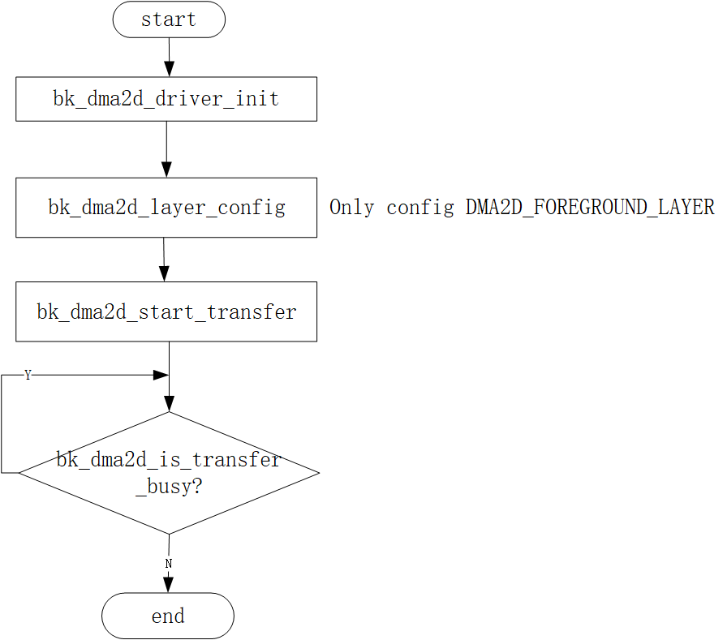
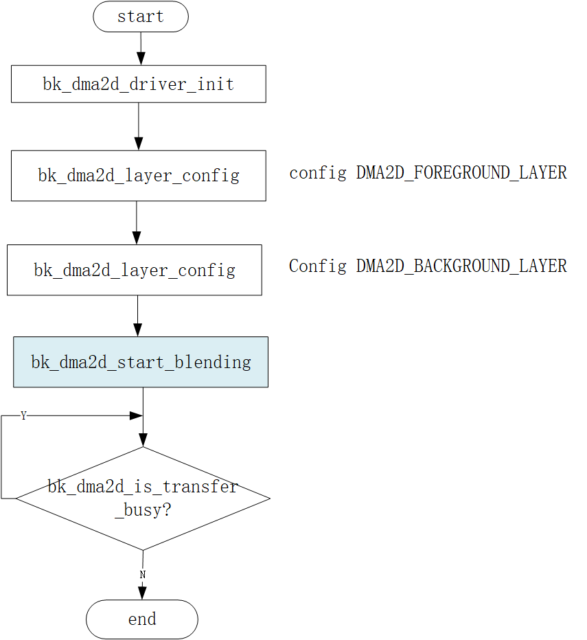

<a id="dma2d-apis"></a>

# DMA2D APIs

<a id="dma2d-interface"></a>

## DMA2D Interface

<a id="dma2d-features"></a>

## DMA2D Features

> - fill specific color
>   :   Fill part or all of the target image with a specific color
> - mem to mem copy
>   :   Copy part or all of the source image to part or all of the target image
> - mem to mem with pixel conversion
>   :   Copy part or all of the source image to part or all of the target image through pixel format conversion
> - mem to mem with pixel conversionwith and blending
>   :   Part or all of the two source images with different pixel formats are mixed,
>       and the result is copied to the part or the entire target :image with different color formats

<a id="dma2d-api-categories"></a>

## DMA2D API Categories

| DMA2D API | Description |
| --- | --- |
| [`bk_dma2d_driver_init()`](#_CPPv420bk_dma2d_driver_initv "bk_dma2d_driver_init") | initializes the DMA2D |
| [`bk_dma2d_init()`](#_CPPv413bk_dma2d_initP14dma2d_config_t "bk_dma2d_init") | config the DMA2D |
| [`bk_dma2d_driver_deinit()`](#_CPPv422bk_dma2d_driver_deinitv "bk_dma2d_driver_deinit") | Deinitializes the DMA2D peripheral |
| [`bk_dma2d_layer_config()`](#_CPPv421bk_dma2d_layer_configP14dma2d_config_t8uint32_t "bk_dma2d_layer_config") | Configure the background or foreground Layer |
| [`bk_dma2d_start_transfer()`](#_CPPv423bk_dma2d_start_transferP14dma2d_config_t8uint32_t8uint32_t8uint32_t8uint32_t "bk_dma2d_start_transfer") | Start the DMA2D Transfer |
| [`bk_dma2d_start_blending()`](#_CPPv423bk_dma2d_start_blendingP14dma2d_config_t8uint32_t8uint32_t8uint32_t8uint32_t8uint32_t "bk_dma2d_start_blending") | Start the multi-source DMA2D Transfer |
| [`bk_dma2d_is_transfer_busy()`](#_CPPv425bk_dma2d_is_transfer_busyv "bk_dma2d_is_transfer_busy") | check dma2d is transfer busy or not |
| [`bk_dma2d_int_enable()`](#_CPPv419bk_dma2d_int_enable16dma2d_int_type_tb "bk_dma2d_int_enable") | clear dma2d int status |
| [`bk_dma2d_int_status_clear()`](#_CPPv425bk_dma2d_int_status_clear18dma2d_int_status_t "bk_dma2d_int_status_clear") | Lcd transfer pixel config |

| DMA2D Register ISR API | Description |
| --- | --- |
| [`bk_dma2d_isr_register()`](#_CPPv421bk_dma2d_isr_register11dma2d_isr_t "bk_dma2d_isr_register") | register dma2d cpu int isr |
| `bk_dma2d_register_int_callback_isr()` | register dma2d int type isr |

<a id="dma2d-work-config"></a>

## DMA2D Work Config

1、fill specific color

<a id="id2"></a>


Figure 1\. dma2d\_fill\_color

2、mem to mem copy

<a id="id3"></a>



Figure 2\. dma2d\_mem\_to\_mem

3、mem to mem with pixel conversion

> The Figure API is the same as dma2d\_mem\_to\_mem
> please reference the API Reference for the different config

4、mem to mem with pixel conversion and blending

<a id="id4"></a>



Figure 3\. dma2d\_mem\_to\_mem\_with\_pixel\_conversion\_and\_blending

<a id="api-reference"></a>

## API Reference

<a id="header-file"></a>

### Header File

- [dma2d.h](http://192.168.0.46/gerrit/plugins/gitiles/iot/wcn/projects/+/refs/heads/armino_main/components/dma2d.h)

<a id="functions"></a>

### Functions

<a id="_CPPv420bk_dma2d_driver_initv"></a>

<a id="_CPPv320bk_dma2d_driver_initv"></a> <a id="_CPPv220bk_dma2d_driver_initv"></a> <a id="bk_dma2d_driver_init__void"></a> <a id="group__DMA2D_1gacd4677f0907e52e4bd4dd0a6952db102"></a> [bk\_err\_t](../system/os.md#_CPPv48bk_err_t "bk_err_t") bk\_dma2d\_driver\_init(void)
:   initializes the DMA2D system and peripheral registers

    ```
         - open dma2d sys interrupt enable
    ```

    **Attention**
    :   you can reference cli\_dma2d.c for all API usage

    参数
    :   **dma2d\_config** – pointer to a [dma2d\_config\_t](#structdma2d__config__t) structure that contains the configuration information for the DMA2D.

    返回
    :   - BK\_OK: succeed
        - others: other errors.

<a id="_CPPv413bk_dma2d_initP14dma2d_config_t"></a>

<a id="_CPPv313bk_dma2d_initP14dma2d_config_t"></a> <a id="_CPPv213bk_dma2d_initP14dma2d_config_t"></a> <a id="bk_dma2d_init__dma2d_config_tP"></a> <a id="group__DMA2D_1ga61013f9a5fe504956da3bf61b3b8f7c7"></a> [bk\_err\_t](../system/os.md#_CPPv48bk_err_t "bk_err_t") bk\_dma2d\_init([dma2d\_config\_t](#_CPPv414dma2d_config_t "dma2d_config_t") \*dma2d)
:   config dma2d work mode/ data format/ offset etc.

    Usage example:

    ```
           dma2d_config_t dma2d_config = {0};
           dma2d_config.init.mode = DMA2D_R2M;                     Mode Register to Memory 
           dma2d_config.init.color_mode = DMA2D_OUTPUT_RGB565;       DMA2D Output color mode is ARGB4444 (16 bpp)
           dma2d_config.init.output_offset = 0;            No offset in output 
           dma2d_config.init.red_blue_swap = DMA2D_RB_REGULAR;       No R&B swap for the output image 
           dma2d_config.init.alpha_inverted = DMA2D_REGULAR_ALPHA;   No alpha inversion for the output image
           bk_dma2d_init(&dma2d_config);
    ```

    **Attention**
    :   you can reference cli\_dma2d.c for all API usage

    参数
    :   **dma2d\_config** – pointer to a [dma2d\_config\_t](#structdma2d__config__t) structure that contains the configuration information for the DMA2D.

    返回
    :   - BK\_OK: succeed
        - others: other errors.

<a id="_CPPv422bk_dma2d_driver_deinitv"></a>

<a id="_CPPv322bk_dma2d_driver_deinitv"></a> <a id="_CPPv222bk_dma2d_driver_deinitv"></a> <a id="bk_dma2d_driver_deinit__void"></a> <a id="group__DMA2D_1ga065b473ac0959628a21852d2f522e7ee"></a> [bk\_err\_t](../system/os.md#_CPPv48bk_err_t "bk_err_t") bk\_dma2d\_driver\_deinit(void)
:   Deinitializes the DMA2D peripheral registers to their default reset values.

    ```
        - reset the dma2d driver init reg
    ```

    返回
    :   - BK\_OK: succeed
        - others: other errors.

<a id="_CPPv421bk_dma2d_layer_configP14dma2d_config_t8uint32_t"></a>

<a id="_CPPv321bk_dma2d_layer_configP14dma2d_config_t8uint32_t"></a> <a id="_CPPv221bk_dma2d_layer_configP14dma2d_config_t8uint32_t"></a> <a id="bk_dma2d_layer_config__dma2d_config_tP.uint32_t"></a> <a id="group__DMA2D_1ga44a7554faf181d6863343db770d17ee1"></a> [bk\_err\_t](../system/os.md#_CPPv48bk_err_t "bk_err_t") bk\_dma2d\_layer\_config([dma2d\_config\_t](#_CPPv414dma2d_config_t "dma2d_config_t") \*dma2d, uint32\_t layer\_idx)
:   Configure the DMA2D background or foreground Layer include layer offset, color mode, alpha value etc.

    Usage example:

    ```
           dma2d_config.layer_cfg[DMA2D_FOREGROUND_LAYER].alpha_mode = DMA2D_REPLACE_ALPHA;
           dma2d_config.layer_cfg[DMA2D_FOREGROUND_LAYER].input_alpha = alpha_value; 
           dma2d_config.layer_cfg[DMA2D_FOREGROUND_LAYER].input_color_mode = DMA2D_INPUT_RGB565;
           dma2d_config.layer_cfg[DMA2D_FOREGROUND_LAYER].input_offset = fg_offline;
           dma2d_config.layer_cfg[DMA2D_FOREGROUND_LAYER].red_blue_swap  = DMA2D_RB_REGULAR;
           dma2d_config.layer_cfg[DMA2D_FOREGROUND_LAYER].alpha_inverted = DMA2D_REGULAR_ALPHA;

           Background layer Configuration 
           dma2d_config.layer_cfg[DMA2D_BACKGROUND_LAYER].alpha_mode  = DMA2D_REPLACE_ALPHA;
           dma2d_config.layer_cfg[DMA2D_BACKGROUND_LAYER].input_alpha   = 0x80;
           dma2d_config.layer_cfg[DMA2D_BACKGROUND_LAYER].input_color_mode = DMA2D_INPUT_RGB565;
           dma2d_config.layer_cfg[DMA2D_BACKGROUND_LAYER].input_offset   = bg_offline;
           dma2d_config.layer_cfg[DMA2D_BACKGROUND_LAYER].red_blue_swap   = DMA2D_RB_REGULAR;
           dma2d_config.layer_cfg[DMA2D_BACKGROUND_LAYER].alpha_inverted  = DMA2D_REGULAR_ALPHA; 

           bk_dma2d_layer_config(&dma2d_config, DMA2D_FOREGROUND_LAYER);
           bk_dma2d_layer_config(&dma2d_config, DMA2D_BACKGROUND_LAYER);
    ```

    参数
    :   **dma2d** – Pointer to a [dma2d\_config\_t](#structdma2d__config__t) structure that contains the configuration information for the DMA2D.

        - LayerIdx DMA2D Layer index. This parameter can be one of the following values: DMA2D\_BACKGROUND\_LAYER(0) / DMA2D\_FOREGROUND\_LAYER(1)

    返回
    :   - BK\_OK: succeed
        - others: other errors.

<a id="_CPPv423bk_dma2d_start_transferP14dma2d_config_t8uint32_t8uint32_t8uint32_t8uint32_t"></a>

<a id="_CPPv323bk_dma2d_start_transferP14dma2d_config_t8uint32_t8uint32_t8uint32_t8uint32_t"></a> <a id="_CPPv223bk_dma2d_start_transferP14dma2d_config_t8uint32_t8uint32_t8uint32_t8uint32_t"></a> <a id="bk_dma2d_start_transfer__dma2d_config_tP.uint32_t.uint32_t.uint32_t.uint32_t"></a> <a id="group__DMA2D_1ga3c0fce1e5bfeba29cf33b3a59e281caa"></a> [bk\_err\_t](../system/os.md#_CPPv48bk_err_t "bk_err_t") bk\_dma2d\_start\_transfer([dma2d\_config\_t](#_CPPv414dma2d_config_t "dma2d_config_t") \*dma2d, uint32\_t pdata, uint32\_t dst\_addr, uint32\_t width, uint32\_t height)
:   Start the DMA2D Transfer when you use (bk\_dma2d\_driver\_init) and (bk\_dma2d\_layer\_config) API, then use this API start dma2d work.

    - dst\_addr: The destination memory Buffer address.
    - Width: The width of data to be transferred from source to destination (expressed in number of pixels per line).
    - Height: The height of data to be transferred from source to destination (expressed in number of lines).

    Usage example:

    ```
           dma2d_config_t dma2d_config = {0};
           dma2d_config.init.mode   = DMA2D_R2M;                     Mode Register to Memory 
           dma2d_config.init.color_mode = DMA2D_OUTPUT_RGB565;       DMA2D Output color mode is ARGB4444 (16 bpp)
           dma2d_config.init.output_offset = 0;          No offset in output 
           dma2d_config.init.red_blue_swap = DMA2D_RB_REGULAR;       No R&B swap for the output image 
           dma2d_config.init.alpha_inverted = DMA2D_REGULAR_ALPHA;   No alpha inversion for the output image

           bk_dma2d_driver_init(&dma2d_config);
           bk_dma2d_start_transfer(&dma2d_config, color, (uint32_t)dst_addr, width, high);
    ```

    参数
    :   **dma2d, :** – Pointer to a [dma2d\_config\_t](#structdma2d__config__t) structure that contains the configuration information for the DMA2D.

        - pdata: have two means:

          - 1: if the Memory-to-Memory or Memory-to-Memory with pixel format select, should Configure the source memory Buffer address
          - 2: if Register-to-Memory mode is selected, should configure the color value

    返回
    :   - BK\_OK: succeed
        - others: other errors.

<a id="_CPPv423bk_dma2d_start_blendingP14dma2d_config_t8uint32_t8uint32_t8uint32_t8uint32_t8uint32_t"></a>

<a id="_CPPv323bk_dma2d_start_blendingP14dma2d_config_t8uint32_t8uint32_t8uint32_t8uint32_t8uint32_t"></a> <a id="_CPPv223bk_dma2d_start_blendingP14dma2d_config_t8uint32_t8uint32_t8uint32_t8uint32_t8uint32_t"></a> <a id="bk_dma2d_start_blending__dma2d_config_tP.uint32_t.uint32_t.uint32_t.uint32_t.uint32_t"></a> <a id="group__DMA2D_1gaa6997e35f370b8536de54d9b93e3679a"></a> [bk\_err\_t](../system/os.md#_CPPv48bk_err_t "bk_err_t") bk\_dma2d\_start\_blending([dma2d\_config\_t](#_CPPv414dma2d_config_t "dma2d_config_t") \*dma2d, uint32\_t fg\_addr, uint32\_t bg\_addr, uint32\_t dst\_addr, uint32\_t width, uint32\_t height)
:   Start the multi-source DMA2D Transfer. start foreground layer and background layer blending.

    Usage example:

    ```
           1: bk_dma2d_driver_init(&dma2d_config);
           2: bk_dma2d_layer_config(&dma2d_config, DMA2D_FOREGROUND_LAYER);
           3: bk_dma2d_layer_config(&dma2d_config, DMA2D_BACKGROUND_LAYER);
           4:bk_dma2d_blending_start(&dma2d_config, (uint32_t)pFgaddr, (uint32_t)pBgaddr, (uint32_t)pDst, xsize ,ysize);
    ```

    **Attention**
    :   you can reference cli\_dma2d.c for API usage

    参数
    :   **\-** – dma2d: Pointer to a [dma2d\_config\_t](#structdma2d__config__t) structure that contains the configuration information for the DMA2D.

        - fg\_addr: The source memory Buffer address for the foreground layer.
        - bg\_addr: The source memory Buffer address for the background layer.
        - dst\_addr: The destination memory Buffer address.
        - Width: The width of data to be transferred from source to destination (expressed in number of pixels per line).
        - Height: The height of data to be transferred from source to destination (expressed in number of lines).

    返回
    :   - BK\_OK: succeed
        - others: other errors.

<a id="_CPPv425bk_dma2d_is_transfer_busyv"></a>

<a id="_CPPv325bk_dma2d_is_transfer_busyv"></a> <a id="_CPPv225bk_dma2d_is_transfer_busyv"></a> <a id="bk_dma2d_is_transfer_busy__void"></a> <a id="group__DMA2D_1gac3efde61ac58e36cb607c1ed0f1e01fb"></a> bool bk\_dma2d\_is\_transfer\_busy(void)
:   this API is check dma2d is transfer busy or not

    Usage example:

    ```
           1: bk_dma2d_driver_init(&dma2d_config);
           2: bk_dma2d_start_transfer(&dma2d_config, color, (uint32_t)dst_addr, width, high); 
           3: while (bk_dma2d_get_transfer_status()) {}
    ```

    返回
    :   return 0: transfer stop or transfer done;

        - return 1 dma2d is work or transfer not done

<a id="_CPPv419bk_dma2d_int_enable16dma2d_int_type_tb"></a>

<a id="_CPPv319bk_dma2d_int_enable16dma2d_int_type_tb"></a> <a id="_CPPv219bk_dma2d_int_enable16dma2d_int_type_tb"></a> <a id="bk_dma2d_int_enable__dma2d_int_type_t.b"></a> <a id="group__DMA2D_1ga1eb5253e5abc2539ade95ed42ea269a7"></a> [bk\_err\_t](../system/os.md#_CPPv48bk_err_t "bk_err_t") bk\_dma2d\_int\_enable([dma2d\_int\_type\_t](#_CPPv416dma2d_int_type_t "dma2d_int_type_t") int\_type, bool enable)
:   dma2d int enable.

    Usage example:

    ```
           bk_dma2d_int_config(DMA2D_TRANS_ERROR | DMA2D_TRANS_COMPLETE ,1);
           always use with:  bk_dma2d_isr_register(dma2d_isr);
                             bk_dma2d_int_status_get();
                             bk_dma2d_int_status_clear(DMA2D_TRANS_ERROR_STATUS);
                             bk_dma2d_int_status_clear(DMA2D_TRANS_COMPLETE_STATUS);
    ```

    参数
    :   - **int\_type** – select from dma2d\_int\_type\_t, include int type:

          - DMA2D\_CFG\_ERROR
          - DMA2D\_CLUT\_TRANS\_COMPLETE
          - DMA2D\_CLUT\_TRANS\_ERROR
          - DMA2D\_WARTERMARK\_INT
          - DMA2D\_TRANS\_COMPLETE
          - DMA2D\_TRANS\_ERROR
        - **enable, :** – 1:enable int, 0 disable int

    返回
    :   - BK\_OK: succeed
        - others: other errors.

<a id="_CPPv423bk_dma2d_int_status_getv"></a>

<a id="_CPPv323bk_dma2d_int_status_getv"></a> <a id="_CPPv223bk_dma2d_int_status_getv"></a> <a id="bk_dma2d_int_status_get__void"></a> <a id="group__DMA2D_1ga3980fd51f11863185e421bbadb01b7e3"></a> uint32\_t bk\_dma2d\_int\_status\_get(void)
:   bk\_dma2d\_int\_status\_get.

    Usage example:

    ```
             uint32_t int_status;
             int_status = bk_dma2d_int_status_get();
             if (int_status & DMA2D_CFG_ERROR) {
                bk_dma2d_int_status_clear(DMA2D_CFG_ERROR_STATUS);
                bk_dma2d_int_config(DMA2D_CFG_ERROR, 0);
             }
    ```

    返回
    :   return uint32\_t value of all int status,

        - can used by value \& dma2d\_int\_status\_t check which int triggered. typedef enum { DMA2D\_TRANS\_ERROR\_STATUS \= 0x1, DMA2D\_TRANS\_COMPLETE\_STATUS, DMA2D\_WARTERMARK\_INT\_STATUS, DMA2D\_CLUT\_TRANS\_ERROR\_STATUS, DMA2D\_CLUT\_TRANS\_COMPLETE\_STATUS, DMA2D\_CFG\_ERROR\_STATUS }dma2d\_int\_status\_t;

    返回
    :   - BK\_OK: succeed
        - others: other errors.

<a id="_CPPv425bk_dma2d_int_status_clear18dma2d_int_status_t"></a>

<a id="_CPPv325bk_dma2d_int_status_clear18dma2d_int_status_t"></a> <a id="_CPPv225bk_dma2d_int_status_clear18dma2d_int_status_t"></a> <a id="bk_dma2d_int_status_clear__dma2d_int_status_t"></a> <a id="group__DMA2D_1ga0eb11d5cc360b2f77182028307d53f73"></a> [bk\_err\_t](../system/os.md#_CPPv48bk_err_t "bk_err_t") bk\_dma2d\_int\_status\_clear([dma2d\_int\_status\_t](#_CPPv418dma2d_int_status_t "dma2d_int_status_t") int\_status)
:   clear dma2d int status

    参数
    :   **int\_status** – select from dma2d\_int\_status\_t include: DMA2D\_TRANS\_ERROR\_STATUS DMA2D\_TRANS\_COMPLETE\_STATUS DMA2D\_WARTERMARK\_INT\_STATUS DMA2D\_CLUT\_TRANS\_ERROR\_STATUS DMA2D\_CLUT\_TRANS\_COMPLETE\_STATUS DMA2D\_CFG\_ERROR\_STATUS

    返回
    :   - BK\_OK: succeed
        - others: other errors.

<a id="_CPPv421bk_dma2d_isr_register11dma2d_isr_t"></a>

<a id="_CPPv321bk_dma2d_isr_register11dma2d_isr_t"></a> <a id="_CPPv221bk_dma2d_isr_register11dma2d_isr_t"></a> <a id="bk_dma2d_isr_register__dma2d_isr_t"></a> <a id="group__DMA2D_1ga598e7afdd7ff99b62382caaf2d554820"></a> [bk\_err\_t](../system/os.md#_CPPv48bk_err_t "bk_err_t") bk\_dma2d\_isr\_register([dma2d\_isr\_t](#_CPPv411dma2d_isr_t "dma2d_isr_t") dma2d\_isr)
:   register dma2d cpu int isr

    参数
    :   **dma2d\_isr** – the function you registr isr

    Return values
    :   **bk\_err\_t** – status

<a id="_CPPv414bk_dma2d_blendP13dma2d_blend_t"></a>

<a id="_CPPv314bk_dma2d_blendP13dma2d_blend_t"></a> <a id="_CPPv214bk_dma2d_blendP13dma2d_blend_t"></a> <a id="bk_dma2d_blend__dma2d_blend_tP"></a> <a id="group__DMA2D_1gaa0e5454f4f636f9025c0074228aa33e6"></a> [bk\_err\_t](../system/os.md#_CPPv48bk_err_t "bk_err_t") bk\_dma2d\_blend([dma2d\_blend\_t](#_CPPv413dma2d_blend_t "dma2d_blend_t") \*dma2d\_blend)
:   config dma2d blend

    参数
    :   **\-** – dma2d\_blend struct to config blend params

    返回
    :   - BK\_OK: succeed
        - others: other errors.

<a id="_CPPv432bk_dma2d_memcpy_or_pixel_convertP18dma2d_memcpy_pfc_t"></a>

<a id="_CPPv332bk_dma2d_memcpy_or_pixel_convertP18dma2d_memcpy_pfc_t"></a> <a id="_CPPv232bk_dma2d_memcpy_or_pixel_convertP18dma2d_memcpy_pfc_t"></a> <a id="bk_dma2d_memcpy_or_pixel_convert__dma2d_memcpy_pfc_tP"></a> <a id="group__DMA2D_1ga933b1f7a7e3177464429ee678285164b"></a> void bk\_dma2d\_memcpy\_or\_pixel\_convert([dma2d\_memcpy\_pfc\_t](#_CPPv418dma2d_memcpy_pfc_t "dma2d_memcpy_pfc_t") \*pixel\_convert)
:   config dma2d pixel revert

    参数
    :   **\-** – dma2d\_pixel\_convert\_t struct to config pixel convert params

    返回
    :   - BK\_OK: succeed
        - others: other errors.

<a id="_CPPv410dma2d_fillP12dma2d_fill_t"></a>

<a id="_CPPv310dma2d_fillP12dma2d_fill_t"></a> <a id="_CPPv210dma2d_fillP12dma2d_fill_t"></a> <a id="dma2d_fill__dma2d_fill_tP"></a> <a id="group__DMA2D_1ga4e1ceab13ea44632decb6a1a2144b155"></a> [bk\_err\_t](../system/os.md#_CPPv48bk_err_t "bk_err_t") dma2d\_fill([dma2d\_fill\_t](#_CPPv412dma2d_fill_t "dma2d_fill_t") \*fill)
:   config dma2d fill color

    参数
    :   **\-** – [dma2d\_fill\_t](#structdma2d__fill__t) struct to config dma2d fill params

    返回
    :   - BK\_OK: succeed
        - others: other errors.

<a id="_CPPv420dma2d_start_transferv"></a>

<a id="_CPPv320dma2d_start_transferv"></a> <a id="_CPPv220dma2d_start_transferv"></a> <a id="dma2d_start_transfer__void"></a> <a id="group__DMA2D_1gae70c1701403bb63dba1bb933cd15827c"></a> [bk\_err\_t](../system/os.md#_CPPv48bk_err_t "bk_err_t") dma2d\_start\_transfer(void)
:   start dma2d transfer

    返回
    :   - BK\_OK: succeed
        - others: other errors.

<a id="api-typedefs"></a>

## API Typedefs

<a id="id1"></a>

### Header File

- [dma2d\_types.h](http://192.168.0.46/gerrit/plugins/gitiles/iot/wcn/projects/+/refs/heads/armino_main/components/dma2d_types.h)

<a id="structures"></a>

### Structures

<a id="_CPPv412dma2d_init_t"></a>

<a id="_CPPv312dma2d_init_t"></a> <a id="_CPPv212dma2d_init_t"></a> <a id="dma2d_init_t"></a> <a id="structdma2d__init__t"></a> struct dma2d\_init\_t
:   DMA2D Init structure definition.

    <a id="breathe-section-title-public-members"></a>

    Public Members

    <a id="_CPPv4N12dma2d_init_t4modeE"></a>

    <a id="_CPPv3N12dma2d_init_t4modeE"></a> <a id="_CPPv2N12dma2d_init_t4modeE"></a> <a id="dma2d_init_t::mode__dma2d_mode_t"></a> <a id="structdma2d__init__t_1a305eaea157b708df4f192e805b2e7592"></a> [dma2d\_mode\_t](#_CPPv412dma2d_mode_t "dma2d_mode_t") mode
    :   Configures the DMA2D transfer mode.his parameter can be one value of DMA2D\_Mode.

    <a id="_CPPv4N12dma2d_init_t10color_modeE"></a>

    <a id="_CPPv3N12dma2d_init_t10color_modeE"></a> <a id="_CPPv2N12dma2d_init_t10color_modeE"></a> <a id="dma2d_init_t::color_mode__uint32_t"></a> <a id="structdma2d__init__t_1a7999d8ed0c3c81849245aa88d44d44fa"></a> uint32\_t color\_mode
    :   ```
         Configures the color format of the output image.
        ```

        This parameter can be one value of DMA2D\_Output\_Color\_Mode.

    <a id="_CPPv4N12dma2d_init_t13output_offsetE"></a>

    <a id="_CPPv3N12dma2d_init_t13output_offsetE"></a> <a id="_CPPv2N12dma2d_init_t13output_offsetE"></a> <a id="dma2d_init_t::output_offset__uint32_t"></a> <a id="structdma2d__init__t_1ad40b010301ac57cfef31d0eaf9f0c5b4"></a> uint32\_t output\_offset
    :   Specifies the Offset value. This parameter must be a number between Min\_Data \= 0x0000 and Max\_Data \= 0x3FFF.

    <a id="_CPPv4N12dma2d_init_t14alpha_invertedE"></a>

    <a id="_CPPv3N12dma2d_init_t14alpha_invertedE"></a> <a id="_CPPv2N12dma2d_init_t14alpha_invertedE"></a> <a id="dma2d_init_t::alpha_inverted__uint32_t"></a> <a id="structdma2d__init__t_1a653738cfd9d725f10de91ed59ec0f365"></a> uint32\_t alpha\_inverted
    :   Select regular or inverted alpha value for the output pixel format converter. This parameter can be one value of DMA2D\_Alpha\_Inverted.

    <a id="_CPPv4N12dma2d_init_t16line_offset_modeE"></a>

    <a id="_CPPv3N12dma2d_init_t16line_offset_modeE"></a> <a id="_CPPv2N12dma2d_init_t16line_offset_modeE"></a> <a id="dma2d_init_t::line_offset_mode__uint32_t"></a> <a id="structdma2d__init__t_1ad7d9613c2e8686ad86d4de2dddd22c10"></a> uint32\_t line\_offset\_mode
    :   Configures how is expressed the line offset for the foreground, background and output. This parameter can be one value of DMA2D\_Line\_Offset\_Mode.

    <a id="_CPPv4N12dma2d_init_t13red_blue_swapE"></a>

    <a id="_CPPv3N12dma2d_init_t13red_blue_swapE"></a> <a id="_CPPv2N12dma2d_init_t13red_blue_swapE"></a> <a id="dma2d_init_t::red_blue_swap__uint32_t"></a> <a id="structdma2d__init__t_1a899b2b8c22d2452ecc76ced1f0d9a29f"></a> uint32\_t red\_blue\_swap
    :   Select regular mode (RGB or ARGB) or swap mode (BGR or ABGR) for the output pixel format converter. This parameter can be one value of DMA2D\_RB\_Swap.

    <a id="_CPPv4N12dma2d_init_t12data_reverseE"></a>

    <a id="_CPPv3N12dma2d_init_t12data_reverseE"></a> <a id="_CPPv2N12dma2d_init_t12data_reverseE"></a> <a id="dma2d_init_t::data_reverse__rgb888_dataout_reverse_t"></a> <a id="structdma2d__init__t_1a79d988a10614897e2b372b3d7ee6d3a9"></a> [rgb888\_dataout\_reverse\_t](#_CPPv424rgb888_dataout_reverse_t "rgb888_dataout_reverse_t") data\_reverse
    :   in output rgb888 formart, reverse data byte by byte..

    <a id="_CPPv4N12dma2d_init_t13trans_abilityE"></a>

    <a id="_CPPv3N12dma2d_init_t13trans_abilityE"></a> <a id="_CPPv2N12dma2d_init_t13trans_abilityE"></a> <a id="dma2d_init_t::trans_ability__dma2d_trans_ability_t"></a> <a id="structdma2d__init__t_1a70f63adfbabfb0a7273a94a4da2b3723"></a> [dma2d\_trans\_ability\_t](#_CPPv421dma2d_trans_ability_t "dma2d_trans_ability_t") trans\_ability
    :   set defult MAX\_TRANS\_256BYTES

<a id="_CPPv417dma2d_layer_cfg_t"></a>

<a id="_CPPv317dma2d_layer_cfg_t"></a> <a id="_CPPv217dma2d_layer_cfg_t"></a> <a id="dma2d_layer_cfg_t"></a> <a id="structdma2d__layer__cfg__t"></a> struct dma2d\_layer\_cfg\_t
:   DMA2D Layer structure definition

    <a id="breathe-section-title-public-members"></a>

    Public Members

    <a id="_CPPv4N17dma2d_layer_cfg_t12input_offsetE"></a>

    <a id="_CPPv3N17dma2d_layer_cfg_t12input_offsetE"></a> <a id="_CPPv2N17dma2d_layer_cfg_t12input_offsetE"></a> <a id="dma2d_layer_cfg_t::input_offset__uint32_t"></a> <a id="structdma2d__layer__cfg__t_1acbeffa0425574bbba06ac27760093af3"></a> uint32\_t input\_offset
    :   Configures the DMA2D foreground or background offset. This parameter must be a number between Min\_Data \= 0x0000 and Max\_Data \= 0x3FFF.

    <a id="_CPPv4N17dma2d_layer_cfg_t16input_color_modeE"></a>

    <a id="_CPPv3N17dma2d_layer_cfg_t16input_color_modeE"></a> <a id="_CPPv2N17dma2d_layer_cfg_t16input_color_modeE"></a> <a id="dma2d_layer_cfg_t::input_color_mode__uint32_t"></a> <a id="structdma2d__layer__cfg__t_1a90430c0e8335983abef91117b0ac151d"></a> uint32\_t input\_color\_mode
    :   Configures the DMA2D foreground or background color mode. This parameter can be one value of DMA2D\_Input\_Color\_Mode.

    <a id="_CPPv4N17dma2d_layer_cfg_t10alpha_modeE"></a>

    <a id="_CPPv3N17dma2d_layer_cfg_t10alpha_modeE"></a> <a id="_CPPv2N17dma2d_layer_cfg_t10alpha_modeE"></a> <a id="dma2d_layer_cfg_t::alpha_mode__uint32_t"></a> <a id="structdma2d__layer__cfg__t_1a2aa8ff3a0501d97a4e84d3230774c734"></a> uint32\_t alpha\_mode
    :   Configures the DMA2D foreground or background alpha mode.This parameter can be one value of DMA2D\_Alpha\_Mode.

    <a id="_CPPv4N17dma2d_layer_cfg_t11input_colorE"></a>

    <a id="_CPPv3N17dma2d_layer_cfg_t11input_colorE"></a> <a id="_CPPv2N17dma2d_layer_cfg_t11input_colorE"></a> <a id="dma2d_layer_cfg_t::input_color__uint32_t"></a> <a id="structdma2d__layer__cfg__t_1a92892df93cc6e80d1eeacc7d14c72f1f"></a> uint32\_t input\_color
    :   Specifies color value in case of A8 or A4 color mode.

        备注

        In case of A8 or A4 color mode (ARGB), this parameter must be a number between Min\_Data \= 0x00000000 and Max\_Data \= 0xFFFFFF where

        - Inputcolor\[16:23\] is the red value RED\[0:7\]
        - Inputcolor\[8:15\] is the green value GREEN\[0:7\]
        - Inputcolor\[0:7\] is the blue value BLUE\[0:7\].

    <a id="_CPPv4N17dma2d_layer_cfg_t14alpha_invertedE"></a>

    <a id="_CPPv3N17dma2d_layer_cfg_t14alpha_invertedE"></a> <a id="_CPPv2N17dma2d_layer_cfg_t14alpha_invertedE"></a> <a id="dma2d_layer_cfg_t::alpha_inverted__uint32_t"></a> <a id="structdma2d__layer__cfg__t_1ad3dbdf64bd2c2efab11344de7b57501b"></a> uint32\_t alpha\_inverted
    :   Select regular or inverted alpha value.This parameter can be one value of DMA2D\_Alpha\_Inverted.

    <a id="_CPPv4N17dma2d_layer_cfg_t13red_blue_swapE"></a>

    <a id="_CPPv3N17dma2d_layer_cfg_t13red_blue_swapE"></a> <a id="_CPPv2N17dma2d_layer_cfg_t13red_blue_swapE"></a> <a id="dma2d_layer_cfg_t::red_blue_swap__uint32_t"></a> <a id="structdma2d__layer__cfg__t_1a29a8d404754a57d864f813e83b6bc36d"></a> uint32\_t red\_blue\_swap
    :   Select regular mode (RGB or ARGB) or swap mode (BGR or ABGR). This parameter can be one value of DMA2D\_RB\_Swap.

<a id="_CPPv414dma2d_config_t"></a>

<a id="_CPPv314dma2d_config_t"></a> <a id="_CPPv214dma2d_config_t"></a> <a id="dma2d_config_t"></a> <a id="structdma2d__config__t"></a> struct dma2d\_config\_t
:   <a id="breathe-section-title-public-members"></a>

    Public Members

    <a id="_CPPv4N14dma2d_config_t4initE"></a>

    <a id="_CPPv3N14dma2d_config_t4initE"></a> <a id="_CPPv2N14dma2d_config_t4initE"></a> <a id="dma2d_config_t::init__dma2d_init_t"></a> <a id="structdma2d__config__t_1a8d2526741d849cf17fbde00a609b9c5b"></a> [dma2d\_init\_t](#_CPPv412dma2d_init_t "dma2d_init_t") init
    :   dma2d init config, is the value of struct [dma2d\_init\_t](#structdma2d__init__t)

    <a id="_CPPv4N14dma2d_config_t9layer_cfgE"></a>

    <a id="_CPPv3N14dma2d_config_t9layer_cfgE"></a> <a id="_CPPv2N14dma2d_config_t9layer_cfgE"></a> <a id="dma2d_config_t::layer_cfg__dma2d_layer_cfg_tA"></a> <a id="structdma2d__config__t_1ad42aae62c7c3aa32311858a1cc336313"></a> [dma2d\_layer\_cfg\_t](#_CPPv417dma2d_layer_cfg_t "dma2d_layer_cfg_t") layer\_cfg\[MAX\_DMA2D\_LAYER\]
    :   dma2d layer config, is the value of struct [dma2d\_layer\_cfg\_t](#structdma2d__layer__cfg__t) the param MAX\_DMA2D\_LAYER is select from DMA2D\_BACKGROUND\_LAYER and DMA2D\_FOREGROUND\_LAYER

<a id="_CPPv413dma2d_blend_t"></a>

<a id="_CPPv313dma2d_blend_t"></a> <a id="_CPPv213dma2d_blend_t"></a> <a id="dma2d_blend_t"></a> <a id="structdma2d__blend__t"></a> struct dma2d\_blend\_t
:   <a id="breathe-section-title-public-members"></a>

    Public Members

    <a id="_CPPv4N13dma2d_blend_t8pfg_addrE"></a>

    <a id="_CPPv3N13dma2d_blend_t8pfg_addrE"></a> <a id="_CPPv2N13dma2d_blend_t8pfg_addrE"></a> <a id="dma2d_blend_t::pfg_addr__voidP"></a> <a id="structdma2d__blend__t_1a40428df5fc3579cdac34b57f2c1e3516"></a> void \*pfg\_addr
    :   The source memory Buffer address for the foreground layer..

    <a id="_CPPv4N13dma2d_blend_t8pbg_addrE"></a>

    <a id="_CPPv3N13dma2d_blend_t8pbg_addrE"></a> <a id="_CPPv2N13dma2d_blend_t8pbg_addrE"></a> <a id="dma2d_blend_t::pbg_addr__voidP"></a> <a id="structdma2d__blend__t_1a979684d78195e03570dc2e13c027d500"></a> void \*pbg\_addr
    :   he source memory Buffer address for the background layer…

    <a id="_CPPv4N13dma2d_blend_t9pdst_addrE"></a>

    <a id="_CPPv3N13dma2d_blend_t9pdst_addrE"></a> <a id="_CPPv2N13dma2d_blend_t9pdst_addrE"></a> <a id="dma2d_blend_t::pdst_addr__voidP"></a> <a id="structdma2d__blend__t_1ae6ec5ddf3a1ddbbcc03edc924f190634"></a> void \*pdst\_addr
    :   The output memory Buffer address ..

    <a id="_CPPv4N13dma2d_blend_t13fg_color_modeE"></a>

    <a id="_CPPv3N13dma2d_blend_t13fg_color_modeE"></a> <a id="_CPPv2N13dma2d_blend_t13fg_color_modeE"></a> <a id="dma2d_blend_t::fg_color_mode__input_color_mode_t"></a> <a id="structdma2d__blend__t_1a0f7943b68abf2b7f5ffa41acd2c7ccf4"></a> [input\_color\_mode\_t](#_CPPv418input_color_mode_t "input_color_mode_t") fg\_color\_mode
    :   fg color mode..

    <a id="_CPPv4N13dma2d_blend_t13bg_color_modeE"></a>

    <a id="_CPPv3N13dma2d_blend_t13bg_color_modeE"></a> <a id="_CPPv2N13dma2d_blend_t13bg_color_modeE"></a> <a id="dma2d_blend_t::bg_color_mode__input_color_mode_t"></a> <a id="structdma2d__blend__t_1a4f9f536e20feefe324477f240530985c"></a> [input\_color\_mode\_t](#_CPPv418input_color_mode_t "input_color_mode_t") bg\_color\_mode
    :   bg color mode..

    <a id="_CPPv4N13dma2d_blend_t14dst_color_modeE"></a>

    <a id="_CPPv3N13dma2d_blend_t14dst_color_modeE"></a> <a id="_CPPv2N13dma2d_blend_t14dst_color_modeE"></a> <a id="dma2d_blend_t::dst_color_mode__out_color_mode_t"></a> <a id="structdma2d__blend__t_1a87718b3144cc420d3bd40a956d955ba8"></a> [out\_color\_mode\_t](#_CPPv416out_color_mode_t "out_color_mode_t") dst\_color\_mode
    :   out color mode..

    <a id="_CPPv4N13dma2d_blend_t10fg_offlineE"></a>

    <a id="_CPPv3N13dma2d_blend_t10fg_offlineE"></a> <a id="_CPPv2N13dma2d_blend_t10fg_offlineE"></a> <a id="dma2d_blend_t::fg_offline__uint32_t"></a> <a id="structdma2d__blend__t_1a6e432d08771985457aa95d1d2751aa1c"></a> uint32\_t fg\_offline
    :   for partical copy this is to calculate start addr based on fg frame addr, uint by pixel

    <a id="_CPPv4N13dma2d_blend_t10bg_offlineE"></a>

    <a id="_CPPv3N13dma2d_blend_t10bg_offlineE"></a> <a id="_CPPv2N13dma2d_blend_t10bg_offlineE"></a> <a id="dma2d_blend_t::bg_offline__uint32_t"></a> <a id="structdma2d__blend__t_1a3a5de1915539514f16e812027939c671"></a> uint32\_t bg\_offline
    :   for partical copy this is to calculate start addr based on bg frame addr, uint by pixel

    <a id="_CPPv4N13dma2d_blend_t12dest_offlineE"></a>

    <a id="_CPPv3N13dma2d_blend_t12dest_offlineE"></a> <a id="_CPPv2N13dma2d_blend_t12dest_offlineE"></a> <a id="dma2d_blend_t::dest_offline__uint32_t"></a> <a id="structdma2d__blend__t_1a4f64b255fb9705122450df2740f501db"></a> uint32\_t dest\_offline
    :   for partical copy this is to calculate output addr based on dst frame addr, uint by pixel

    <a id="_CPPv4N13dma2d_blend_t5xsizeE"></a>

    <a id="_CPPv3N13dma2d_blend_t5xsizeE"></a> <a id="_CPPv2N13dma2d_blend_t5xsizeE"></a> <a id="dma2d_blend_t::xsize__uint32"></a> <a id="structdma2d__blend__t_1a0a65a09f26f118ab825a6767da734d2e"></a> uint32 xsize
    :   dma2d blend x size..

    <a id="_CPPv4N13dma2d_blend_t5ysizeE"></a>

    <a id="_CPPv3N13dma2d_blend_t5ysizeE"></a> <a id="_CPPv2N13dma2d_blend_t5ysizeE"></a> <a id="dma2d_blend_t::ysize__uint32"></a> <a id="structdma2d__blend__t_1ace08fabc7b6cf42df7380c30a5980e1f"></a> uint32 ysize
    :   dma2d blend y size..

    <a id="_CPPv4N13dma2d_blend_t14fg_alpha_valueE"></a>

    <a id="_CPPv3N13dma2d_blend_t14fg_alpha_valueE"></a> <a id="_CPPv2N13dma2d_blend_t14fg_alpha_valueE"></a> <a id="dma2d_blend_t::fg_alpha_value__uint8_t"></a> <a id="structdma2d__blend__t_1aefe2f2421dbb08bcab13cd5f0cd7e040"></a> uint8\_t fg\_alpha\_value
    :   config fg alpha..

    <a id="_CPPv4N13dma2d_blend_t14bg_alpha_valueE"></a>

    <a id="_CPPv3N13dma2d_blend_t14bg_alpha_valueE"></a> <a id="_CPPv2N13dma2d_blend_t14bg_alpha_valueE"></a> <a id="dma2d_blend_t::bg_alpha_value__uint8_t"></a> <a id="structdma2d__blend__t_1a412da2cc9c57f814c82b47d8faa51d7e"></a> uint8\_t bg\_alpha\_value
    :   config bg alpha.

    <a id="_CPPv4N13dma2d_blend_t13red_bule_swapE"></a>

    <a id="_CPPv3N13dma2d_blend_t13red_bule_swapE"></a> <a id="_CPPv2N13dma2d_blend_t13red_bule_swapE"></a> <a id="dma2d_blend_t::red_bule_swap__uint8_t"></a> <a id="structdma2d__blend__t_1a915d322784a338995ca2cb72cb245051"></a> uint8\_t red\_bule\_swap
    :   DMA2D\_RB\_SWAP or DMA2D\_RB\_REGULAR

<a id="_CPPv418dma2d_memcpy_pfc_t"></a>

<a id="_CPPv318dma2d_memcpy_pfc_t"></a> <a id="_CPPv218dma2d_memcpy_pfc_t"></a> <a id="dma2d_memcpy_pfc_t"></a> <a id="structdma2d__memcpy__pfc__t"></a> struct dma2d\_memcpy\_pfc\_t
:   <a id="breathe-section-title-public-members"></a>

    Public Members

    <a id="_CPPv4N18dma2d_memcpy_pfc_t10input_addrE"></a>

    <a id="_CPPv3N18dma2d_memcpy_pfc_t10input_addrE"></a> <a id="_CPPv2N18dma2d_memcpy_pfc_t10input_addrE"></a> <a id="dma2d_memcpy_pfc_t::input_addr__voidP"></a> <a id="structdma2d__memcpy__pfc__t_1a9b5ca498b096335601eeecaac8836b0e"></a> void \*input\_addr
    :   The image memcpy or pixel convert src addr

    <a id="_CPPv4N18dma2d_memcpy_pfc_t11output_addrE"></a>

    <a id="_CPPv3N18dma2d_memcpy_pfc_t11output_addrE"></a> <a id="_CPPv2N18dma2d_memcpy_pfc_t11output_addrE"></a> <a id="dma2d_memcpy_pfc_t::output_addr__voidP"></a> <a id="structdma2d__memcpy__pfc__t_1a13abb87f52ce444b5f92eb1db8c8f7ae"></a> void \*output\_addr
    :   The mage memcpy or pixel convert dst addr

    <a id="_CPPv4N18dma2d_memcpy_pfc_t15src_frame_widthE"></a>

    <a id="_CPPv3N18dma2d_memcpy_pfc_t15src_frame_widthE"></a> <a id="_CPPv2N18dma2d_memcpy_pfc_t15src_frame_widthE"></a> <a id="dma2d_memcpy_pfc_t::src_frame_width__uint16_t"></a> <a id="structdma2d__memcpy__pfc__t_1a530f5910445d72c58d9e3b04f87a3212"></a> uint16\_t src\_frame\_width
    :   memcpy or pfc src image width

    <a id="_CPPv4N18dma2d_memcpy_pfc_t16src_frame_heightE"></a>

    <a id="_CPPv3N18dma2d_memcpy_pfc_t16src_frame_heightE"></a> <a id="_CPPv2N18dma2d_memcpy_pfc_t16src_frame_heightE"></a> <a id="dma2d_memcpy_pfc_t::src_frame_height__uint16_t"></a> <a id="structdma2d__memcpy__pfc__t_1ad02d84ae9983f3609ee543eb34992764"></a> uint16\_t src\_frame\_height
    :   imemcpy or pfc src image height

    <a id="_CPPv4N18dma2d_memcpy_pfc_t14src_frame_xposE"></a>

    <a id="_CPPv3N18dma2d_memcpy_pfc_t14src_frame_xposE"></a> <a id="_CPPv2N18dma2d_memcpy_pfc_t14src_frame_xposE"></a> <a id="dma2d_memcpy_pfc_t::src_frame_xpos__uint16_t"></a> <a id="structdma2d__memcpy__pfc__t_1abb9b5dd4965174e1dfddb39a9012dcdd"></a> uint16\_t src\_frame\_xpos
    :   src img start copy/pfc x pos

    <a id="_CPPv4N18dma2d_memcpy_pfc_t14src_frame_yposE"></a>

    <a id="_CPPv3N18dma2d_memcpy_pfc_t14src_frame_yposE"></a> <a id="_CPPv2N18dma2d_memcpy_pfc_t14src_frame_yposE"></a> <a id="dma2d_memcpy_pfc_t::src_frame_ypos__uint16_t"></a> <a id="structdma2d__memcpy__pfc__t_1aa1f03c54eac7ff802e2b911cfb1ebbc5"></a> uint16\_t src\_frame\_ypos
    :   src img start copy/pfc y pos

    <a id="_CPPv4N18dma2d_memcpy_pfc_t15dst_frame_widthE"></a>

    <a id="_CPPv3N18dma2d_memcpy_pfc_t15dst_frame_widthE"></a> <a id="_CPPv2N18dma2d_memcpy_pfc_t15dst_frame_widthE"></a> <a id="dma2d_memcpy_pfc_t::dst_frame_width__uint16_t"></a> <a id="structdma2d__memcpy__pfc__t_1ab61e60a1f301572b54d5239e8c032aeb"></a> uint16\_t dst\_frame\_width
    :   memcpy to dst image, the dst image width

    <a id="_CPPv4N18dma2d_memcpy_pfc_t16dst_frame_heightE"></a>

    <a id="_CPPv3N18dma2d_memcpy_pfc_t16dst_frame_heightE"></a> <a id="_CPPv2N18dma2d_memcpy_pfc_t16dst_frame_heightE"></a> <a id="dma2d_memcpy_pfc_t::dst_frame_height__uint16_t"></a> <a id="structdma2d__memcpy__pfc__t_1ac038660fa40681437bc5d0eb4e20abc8"></a> uint16\_t dst\_frame\_height
    :   memcpy to dst image, the dst image height

    <a id="_CPPv4N18dma2d_memcpy_pfc_t14dst_frame_xposE"></a>

    <a id="_CPPv3N18dma2d_memcpy_pfc_t14dst_frame_xposE"></a> <a id="_CPPv2N18dma2d_memcpy_pfc_t14dst_frame_xposE"></a> <a id="dma2d_memcpy_pfc_t::dst_frame_xpos__uint16_t"></a> <a id="structdma2d__memcpy__pfc__t_1ac7dc3c3bef0d499fb741d41fa94e18fb"></a> uint16\_t dst\_frame\_xpos
    :   dma2d fill x pos based on frame\_xsize

    <a id="_CPPv4N18dma2d_memcpy_pfc_t14dst_frame_yposE"></a>

    <a id="_CPPv3N18dma2d_memcpy_pfc_t14dst_frame_yposE"></a> <a id="_CPPv2N18dma2d_memcpy_pfc_t14dst_frame_yposE"></a> <a id="dma2d_memcpy_pfc_t::dst_frame_ypos__uint16_t"></a> <a id="structdma2d__memcpy__pfc__t_1a56abbebd99f154f4947c486bf5f67473"></a> uint16\_t dst\_frame\_ypos
    :   dma2d fill y pos based on frame\_ysize

    <a id="_CPPv4N18dma2d_memcpy_pfc_t11dma2d_widthE"></a>

    <a id="_CPPv3N18dma2d_memcpy_pfc_t11dma2d_widthE"></a> <a id="_CPPv2N18dma2d_memcpy_pfc_t11dma2d_widthE"></a> <a id="dma2d_memcpy_pfc_t::dma2d_width__uint16_t"></a> <a id="structdma2d__memcpy__pfc__t_1a65e4988c40cd64d6ce4f7b5038d2caf6"></a> uint16\_t dma2d\_width
    :   dma2d memcpy or pfc width

    <a id="_CPPv4N18dma2d_memcpy_pfc_t12dma2d_heightE"></a>

    <a id="_CPPv3N18dma2d_memcpy_pfc_t12dma2d_heightE"></a> <a id="_CPPv2N18dma2d_memcpy_pfc_t12dma2d_heightE"></a> <a id="dma2d_memcpy_pfc_t::dma2d_height__uint16_t"></a> <a id="structdma2d__memcpy__pfc__t_1acd3323719be6727c9c28b4b2023e4877"></a> uint16\_t dma2d\_height
    :   dma2d memcpy or pfc height

    <a id="_CPPv4N18dma2d_memcpy_pfc_t16input_color_modeE"></a>

    <a id="_CPPv3N18dma2d_memcpy_pfc_t16input_color_modeE"></a> <a id="_CPPv2N18dma2d_memcpy_pfc_t16input_color_modeE"></a> <a id="dma2d_memcpy_pfc_t::input_color_mode__input_color_mode_t"></a> <a id="structdma2d__memcpy__pfc__t_1a38258522b3e6c3f315cd330682ad79e8"></a> [input\_color\_mode\_t](#_CPPv418input_color_mode_t "input_color_mode_t") input\_color\_mode
    :   The pixel convert src color mode

    <a id="_CPPv4N18dma2d_memcpy_pfc_t17output_color_modeE"></a>

    <a id="_CPPv3N18dma2d_memcpy_pfc_t17output_color_modeE"></a> <a id="_CPPv2N18dma2d_memcpy_pfc_t17output_color_modeE"></a> <a id="dma2d_memcpy_pfc_t::output_color_mode__out_color_mode_t"></a> <a id="structdma2d__memcpy__pfc__t_1ab814d8d2e65d2a2f0eb5bb43ffd13297"></a> [out\_color\_mode\_t](#_CPPv416out_color_mode_t "out_color_mode_t") output\_color\_mode
    :   The pixel convert dst color mode

    <a id="_CPPv4N18dma2d_memcpy_pfc_t11input_alphaE"></a>

    <a id="_CPPv3N18dma2d_memcpy_pfc_t11input_alphaE"></a> <a id="_CPPv2N18dma2d_memcpy_pfc_t11input_alphaE"></a> <a id="dma2d_memcpy_pfc_t::input_alpha__uint8_t"></a> <a id="structdma2d__memcpy__pfc__t_1a56964ee3380b218c05c95ee75f6c8086"></a> uint8\_t input\_alpha
    :   src data alpha, depend on alpha\_mode

    <a id="_CPPv4N18dma2d_memcpy_pfc_t12output_alphaE"></a>

    <a id="_CPPv3N18dma2d_memcpy_pfc_t12output_alphaE"></a> <a id="_CPPv2N18dma2d_memcpy_pfc_t12output_alphaE"></a> <a id="dma2d_memcpy_pfc_t::output_alpha__uint8_t"></a> <a id="structdma2d__memcpy__pfc__t_1a4a93f2abc75732490ec5b2cb35383e9e"></a> uint8\_t output\_alpha
    :   dst data alpha,depend on alpha\_mode

    <a id="_CPPv4N18dma2d_memcpy_pfc_t19input_red_blue_swapE"></a>

    <a id="_CPPv3N18dma2d_memcpy_pfc_t19input_red_blue_swapE"></a> <a id="_CPPv2N18dma2d_memcpy_pfc_t19input_red_blue_swapE"></a> <a id="dma2d_memcpy_pfc_t::input_red_blue_swap__uint8_t"></a> <a id="structdma2d__memcpy__pfc__t_1ae81d6e690bc083f81e2422b83e8f3004"></a> uint8\_t input\_red\_blue\_swap
    :   src img red blue swap, select DMA2D\_RB\_SWAP or DMA2D\_RB\_REGULAR

    <a id="_CPPv4N18dma2d_memcpy_pfc_t20output_red_blue_swapE"></a>

    <a id="_CPPv3N18dma2d_memcpy_pfc_t20output_red_blue_swapE"></a> <a id="_CPPv2N18dma2d_memcpy_pfc_t20output_red_blue_swapE"></a> <a id="dma2d_memcpy_pfc_t::output_red_blue_swap__uint8_t"></a> <a id="structdma2d__memcpy__pfc__t_1a069ba1d6f24ccffbb87ff6d3d9beb0f6"></a> uint8\_t output\_red\_blue\_swap
    :   src img red blue swap, select DMA2D\_RB\_SWAP or DMA2D\_RB\_REGULAR

<a id="_CPPv412dma2d_fill_t"></a>

<a id="_CPPv312dma2d_fill_t"></a> <a id="_CPPv212dma2d_fill_t"></a> <a id="dma2d_fill_t"></a> <a id="structdma2d__fill__t"></a> struct dma2d\_fill\_t
:   <a id="breathe-section-title-public-members"></a>

    Public Members

    <a id="_CPPv4N12dma2d_fill_t9frameaddrE"></a>

    <a id="_CPPv3N12dma2d_fill_t9frameaddrE"></a> <a id="_CPPv2N12dma2d_fill_t9frameaddrE"></a> <a id="dma2d_fill_t::frameaddr__voidP"></a> <a id="structdma2d__fill__t_1a6d17b2ee3a1bd5ae940098ddae878229"></a> void \*frameaddr
    :   dma2d fill frame baseaddr , normally LCD start frame addr

    <a id="_CPPv4N12dma2d_fill_t11frame_xsizeE"></a>

    <a id="_CPPv3N12dma2d_fill_t11frame_xsizeE"></a> <a id="_CPPv2N12dma2d_fill_t11frame_xsizeE"></a> <a id="dma2d_fill_t::frame_xsize__uint16_t"></a> <a id="structdma2d__fill__t_1aba8b9601b06aa4dcee80794564275b05"></a> uint16\_t frame\_xsize
    :   img/lcd x size

    <a id="_CPPv4N12dma2d_fill_t11frame_ysizeE"></a>

    <a id="_CPPv3N12dma2d_fill_t11frame_ysizeE"></a> <a id="_CPPv2N12dma2d_fill_t11frame_ysizeE"></a> <a id="dma2d_fill_t::frame_ysize__uint16_t"></a> <a id="structdma2d__fill__t_1a52168c4de9e2b10bf21c5b8b6c48864a"></a> uint16\_t frame\_ysize
    :   img/lcd y size

    <a id="_CPPv4N12dma2d_fill_t4xposE"></a>

    <a id="_CPPv3N12dma2d_fill_t4xposE"></a> <a id="_CPPv2N12dma2d_fill_t4xposE"></a> <a id="dma2d_fill_t::xpos__uint16_t"></a> <a id="structdma2d__fill__t_1a40ebf60e15548b9e0ea216cb357237bc"></a> uint16\_t xpos
    :   dma2d fill x pos based on frame\_xsize

    <a id="_CPPv4N12dma2d_fill_t4yposE"></a>

    <a id="_CPPv3N12dma2d_fill_t4yposE"></a> <a id="_CPPv2N12dma2d_fill_t4yposE"></a> <a id="dma2d_fill_t::ypos__uint16_t"></a> <a id="structdma2d__fill__t_1a66336b49301c678071cd60f5f1d69a8c"></a> uint16\_t ypos
    :   dma2d fill y pos based on frame\_ysize

    <a id="_CPPv4N12dma2d_fill_t5widthE"></a>

    <a id="_CPPv3N12dma2d_fill_t5widthE"></a> <a id="_CPPv2N12dma2d_fill_t5widthE"></a> <a id="dma2d_fill_t::width__uint16_t"></a> <a id="structdma2d__fill__t_1a0153840d36aa4c6d9bf2282d97bf6617"></a> uint16\_t width
    :   dma2d fill width

    <a id="_CPPv4N12dma2d_fill_t4highE"></a>

    <a id="_CPPv3N12dma2d_fill_t4highE"></a> <a id="_CPPv2N12dma2d_fill_t4highE"></a> <a id="dma2d_fill_t::high__uint16_t"></a> <a id="structdma2d__fill__t_1a4e4bc3166165ee4f25a57aeb3725c50e"></a> uint16\_t high
    :   dma2d fill height

    <a id="_CPPv4N12dma2d_fill_t5colorE"></a>

    <a id="_CPPv3N12dma2d_fill_t5colorE"></a> <a id="_CPPv2N12dma2d_fill_t5colorE"></a> <a id="dma2d_fill_t::color__uint32_t"></a> <a id="structdma2d__fill__t_1ae2e444bedb25c6be8f48020d5f73207b"></a> uint32\_t color
    :   dma2d fill color

<a id="macros"></a>

### Macros

<a id="c.BK_ERR_DMA2D_NOT_INIT"></a>

<a id="dma2d__types_8h_1a51a646536850bff5b450f8cdc74c281f"></a> BK\_ERR\_DMA2D\_NOT\_INIT
:   dma2d macos define

    LCD driver not init

<a id="c.USE_HAL_DMA2D_REGISTER_CALLBACKS"></a>

<a id="dma2d__types_8h_1ad3fd64734f71ef9c872f38dd0d0b8cb0"></a> USE\_HAL\_DMA2D\_REGISTER\_CALLBACKS
:   if use int type isr register, set this value 1\. always use with API bk\_dma2d\_register\_int\_callback\_isr

<a id="c.DMA2D_OCOLR_WHITE"></a>

<a id="dma2d__types_8h_1ad9c9a9bd6eaa4e99bbe16a887f9e3add"></a> DMA2D\_OCOLR\_WHITE
:   define Mode\_RGB565 white Value

<a id="c.DMA2D_OCOLR_BLACK"></a>

<a id="dma2d__types_8h_1aad39949edf7490c61e6ec17add3438a7"></a> DMA2D\_OCOLR\_BLACK
:   define Mode\_RGB565 black Value

<a id="c.DMA2D_OCOLR_BLUE_1"></a>

<a id="dma2d__types_8h_1a164c96762ec6cbaac2bff45dd84b97cf"></a> DMA2D\_OCOLR\_BLUE\_1
:   define Mode\_ARGB8888/RGB888 Blue Value

<a id="c.DMA2D_OCOLR_GREEN_1"></a>

<a id="dma2d__types_8h_1a8545d0dcde8b511d0ec64eb0c338fe2c"></a> DMA2D\_OCOLR\_GREEN\_1
:   define Mode\_ARGB8888/RGB888 Green Value

<a id="c.DMA2D_OCOLR_RED_1"></a>

<a id="dma2d__types_8h_1ad3928724c5937ffda60f29f272dda4fc"></a> DMA2D\_OCOLR\_RED\_1
:   define Mode\_ARGB8888/RGB888 Red Value

<a id="c.DMA2D_OCOLR_YELLOW_1"></a>

<a id="dma2d__types_8h_1ad2a37df334a031ee85dacdf336e1ce68"></a> DMA2D\_OCOLR\_YELLOW\_1
:   define Mode\_ARGB8888/RGB888 yellow Value

<a id="c.DMA2D_OCOLR_ALPHA_1"></a>

<a id="dma2d__types_8h_1aaada795f8e861c5a220054e78c31c512"></a> DMA2D\_OCOLR\_ALPHA\_1
:   define Mode\_ARGB8888/RGB888Alpha Channel Value

<a id="c.DMA2D_OCOLR_BLUE_2"></a>

<a id="dma2d__types_8h_1a302e4754b96470c3c0e1c42f7a513001"></a> DMA2D\_OCOLR\_BLUE\_2
:   define Mode\_RGB565 Blue Value

<a id="c.DMA2D_OCOLR_GREEN_2"></a>

<a id="dma2d__types_8h_1a885ce0eaadc6ca878568ff43ee710958"></a> DMA2D\_OCOLR\_GREEN\_2
:   define Mode\_RGB565 Green Value

<a id="c.DMA2D_OCOLR_RED_2"></a>

<a id="dma2d__types_8h_1a0af9cee2f3d6ab752e910249adb89816"></a> DMA2D\_OCOLR\_RED\_2
:   define Mode\_RGB565Red Value

<a id="c.DMA2D_OCOLR_BLUE_3"></a>

<a id="dma2d__types_8h_1a0aa0634e409fb6d9fc68ecf9533c8d9c"></a> DMA2D\_OCOLR\_BLUE\_3
:   define Mode\_ARGB1555 Blue Value

<a id="c.DMA2D_OCOLR_GREEN_3"></a>

<a id="dma2d__types_8h_1acf4c97dc43e39e09956c2f4d8e092d17"></a> DMA2D\_OCOLR\_GREEN\_3
:   define Mode\_ARGB1555Green Value

<a id="c.DMA2D_OCOLR_RED_3"></a>

<a id="dma2d__types_8h_1aea63157a41a08d213f6cb8395373b385"></a> DMA2D\_OCOLR\_RED\_3
:   define Mode\_ARGB1555 Red Value

<a id="c.DMA2D_OCOLR_ALPHA_3"></a>

<a id="dma2d__types_8h_1abc0bf21946366343cedce1a2e9b07259"></a> DMA2D\_OCOLR\_ALPHA\_3
:   define Mode\_ARGB1555 Alpha Channel Value

<a id="c.DMA2D_OCOLR_BLUE_4"></a>

<a id="dma2d__types_8h_1add2439915c875a33bf9119382276cb89"></a> DMA2D\_OCOLR\_BLUE\_4
:   define Mode\_ARGB4444 Blue Value

<a id="c.DMA2D_OCOLR_GREEN_4"></a>

<a id="dma2d__types_8h_1a801078def8b64717b6fa0688483e3b78"></a> DMA2D\_OCOLR\_GREEN\_4
:   define Mode\_ARGB4444 Green Value

<a id="c.DMA2D_OCOLR_RED_4"></a>

<a id="dma2d__types_8h_1a3dd8ba291eeaec6bdf282570dc94699f"></a> DMA2D\_OCOLR\_RED\_4
:   define Mode\_ARGB4444 Red Value

<a id="c.DMA2D_OCOLR_ALPHA_4"></a>

<a id="dma2d__types_8h_1ab0b00eb37c77d6852cfbb731b603a9d5"></a> DMA2D\_OCOLR\_ALPHA\_4
:   define Mode\_ARGB4444 Alpha Channel Value

<a id="c.DMA2D_BACKGROUND_LAYER"></a>

<a id="dma2d__types_8h_1a62a5bfb546997e74c4171bcda44e70c5"></a> DMA2D\_BACKGROUND\_LAYER
:   DMA2D Background Layer (layer 0\)

<a id="c.DMA2D_FOREGROUND_LAYER"></a>

<a id="dma2d__types_8h_1a1a0116b4054c07eb00609bfdb2b06716"></a> DMA2D\_FOREGROUND\_LAYER
:   DMA2D Foreground Layer (layer 1\)

<a id="c.MAX_DMA2D_LAYER"></a>

<a id="dma2d__types_8h_1a1f76fcd25373b98c2ddd245de4a9c7bd"></a> MAX\_DMA2D\_LAYER
:   DMA2D maximum number of layers

<a id="c.DMA2D_REGULAR_ALPHA"></a>

<a id="dma2d__types_8h_1a727afc37b9c65346f5bb0bcdfedbb0be"></a> DMA2D\_REGULAR\_ALPHA
:   No modification of the alpha channel value

<a id="c.DMA2D_INVERTED_ALPHA"></a>

<a id="dma2d__types_8h_1aafd4c3a0adaf2f8a925c3059ead37f7c"></a> DMA2D\_INVERTED\_ALPHA
:   Invert the alpha channel value

<a id="c.DMA2D_RB_REGULAR"></a>

<a id="dma2d__types_8h_1aa9bc11308368c0e2ca603d13032e51a5"></a> DMA2D\_RB\_REGULAR
:   Select regular mode (RGB or ARGB)

<a id="c.DMA2D_RB_SWAP"></a>

<a id="dma2d__types_8h_1a7550c5338607e49b568b170b96bd4741"></a> DMA2D\_RB\_SWAP
:   Select swap mode (BGR or ABGR)

<a id="c.DMA2D_ISR_NUM"></a>

<a id="group__DMA2D__ISR__NUM_1ga1fe0dc754388e44c29a7050009c9b7a0"></a> DMA2D\_ISR\_NUM

<a id="type-definitions"></a>

### Type Definitions

<a id="_CPPv411dma2d_isr_t"></a>

<a id="_CPPv311dma2d_isr_t"></a> <a id="_CPPv211dma2d_isr_t"></a> <a id="dma2d_isr_t"></a> <a id="dma2d__types_8h_1a1fe99491a54e6baa170ff2bc4a3b6eec"></a> typedef void (\*dma2d\_isr\_t)(void)

<a id="enumerations"></a>

### Enumerations

<a id="_CPPv413dm2d_isr_id_t"></a>

<a id="_CPPv313dm2d_isr_id_t"></a> <a id="_CPPv213dm2d_isr_id_t"></a> <a id="group__DMA2D__ISR__NUM_1gabc05d8f28e027bd19161486b543bdbca"></a> enum dm2d\_isr\_id\_t
:   if USE\_HAL\_DMA2D\_REGISTER\_CALLBACKS \= 1, define int isr register id

    *Values:*

    <a id="_CPPv4N13dm2d_isr_id_t19DMA2D_CFG_ERROR_ISRE"></a>

    <a id="_CPPv3N13dm2d_isr_id_t19DMA2D_CFG_ERROR_ISRE"></a> <a id="_CPPv2N13dm2d_isr_id_t19DMA2D_CFG_ERROR_ISRE"></a> <a id="dma2d__types_8h_1gabc05d8f28e027bd19161486b543bdbcaa2ade09af47d1b4080af5e6d94c1c360b"></a> enumerator DMA2D\_CFG\_ERROR\_ISR

    <a id="_CPPv4N13dm2d_isr_id_t29DMA2D_CLUT_TRANS_COMPLETE_ISRE"></a>

    <a id="_CPPv3N13dm2d_isr_id_t29DMA2D_CLUT_TRANS_COMPLETE_ISRE"></a> <a id="_CPPv2N13dm2d_isr_id_t29DMA2D_CLUT_TRANS_COMPLETE_ISRE"></a> <a id="dma2d__types_8h_1gabc05d8f28e027bd19161486b543bdbcaa1ee51bce10ad0196ad8eeceb16324f0c"></a> enumerator DMA2D\_CLUT\_TRANS\_COMPLETE\_ISR

    <a id="_CPPv4N13dm2d_isr_id_t26DMA2D_CLUT_TRANS_ERROR_ISRE"></a>

    <a id="_CPPv3N13dm2d_isr_id_t26DMA2D_CLUT_TRANS_ERROR_ISRE"></a> <a id="_CPPv2N13dm2d_isr_id_t26DMA2D_CLUT_TRANS_ERROR_ISRE"></a> <a id="dma2d__types_8h_1gabc05d8f28e027bd19161486b543bdbcaa3abda4ecd3cff1b2c82cd58ec6598b79"></a> enumerator DMA2D\_CLUT\_TRANS\_ERROR\_ISR

    <a id="_CPPv4N13dm2d_isr_id_t24DMA2D_WARTERMARK_INT_ISRE"></a>

    <a id="_CPPv3N13dm2d_isr_id_t24DMA2D_WARTERMARK_INT_ISRE"></a> <a id="_CPPv2N13dm2d_isr_id_t24DMA2D_WARTERMARK_INT_ISRE"></a> <a id="dma2d__types_8h_1gabc05d8f28e027bd19161486b543bdbcaa890946575e171c1825bf94a0b45d2947"></a> enumerator DMA2D\_WARTERMARK\_INT\_ISR

    <a id="_CPPv4N13dm2d_isr_id_t24DMA2D_TRANS_COMPLETE_ISRE"></a>

    <a id="_CPPv3N13dm2d_isr_id_t24DMA2D_TRANS_COMPLETE_ISRE"></a> <a id="_CPPv2N13dm2d_isr_id_t24DMA2D_TRANS_COMPLETE_ISRE"></a> <a id="dma2d__types_8h_1gabc05d8f28e027bd19161486b543bdbcaae3ee8176e5b7e0c25c2073d1bd5a1c92"></a> enumerator DMA2D\_TRANS\_COMPLETE\_ISR

    <a id="_CPPv4N13dm2d_isr_id_t21DMA2D_TRANS_ERROR_ISRE"></a>

    <a id="_CPPv3N13dm2d_isr_id_t21DMA2D_TRANS_ERROR_ISRE"></a> <a id="_CPPv2N13dm2d_isr_id_t21DMA2D_TRANS_ERROR_ISRE"></a> <a id="dma2d__types_8h_1gabc05d8f28e027bd19161486b543bdbcaa83cf266c2c127cf8b2fbbd52dfcde596"></a> enumerator DMA2D\_TRANS\_ERROR\_ISR

<a id="_CPPv412dma2d_mode_t"></a>

<a id="_CPPv312dma2d_mode_t"></a> <a id="_CPPv212dma2d_mode_t"></a> <a id="dma2d__types_8h_1a2281f69de0c11a61edada2a9aed202b5"></a> enum dma2d\_mode\_t
:   DMA2D enum defines.

    DMA2D\_Mode

    *Values:*

    <a id="_CPPv4N12dma2d_mode_t9DMA2D_M2ME"></a>

    <a id="_CPPv3N12dma2d_mode_t9DMA2D_M2ME"></a> <a id="_CPPv2N12dma2d_mode_t9DMA2D_M2ME"></a> <a id="dma2d__types_8h_1a2281f69de0c11a61edada2a9aed202b5ab4c23b4221ad43235a0251e1c0ace8b4"></a> enumerator DMA2D\_M2M
    :   DMA2D memory to memory transfer mode

    <a id="_CPPv4N12dma2d_mode_t13DMA2D_M2M_PFCE"></a>

    <a id="_CPPv3N12dma2d_mode_t13DMA2D_M2M_PFCE"></a> <a id="_CPPv2N12dma2d_mode_t13DMA2D_M2M_PFCE"></a> <a id="dma2d__types_8h_1a2281f69de0c11a61edada2a9aed202b5af455e3664ff46d21b0140517b5117e09"></a> enumerator DMA2D\_M2M\_PFC
    :   DMA2D memory to memory with pixel format conversion transfer mode

    <a id="_CPPv4N12dma2d_mode_t15DMA2D_M2M_BLENDE"></a>

    <a id="_CPPv3N12dma2d_mode_t15DMA2D_M2M_BLENDE"></a> <a id="_CPPv2N12dma2d_mode_t15DMA2D_M2M_BLENDE"></a> <a id="dma2d__types_8h_1a2281f69de0c11a61edada2a9aed202b5aefeff04036abac70f74b476e4be9db39"></a> enumerator DMA2D\_M2M\_BLEND
    :   DMA2D memory to memory with blending transfer mode

    <a id="_CPPv4N12dma2d_mode_t9DMA2D_R2ME"></a>

    <a id="_CPPv3N12dma2d_mode_t9DMA2D_R2ME"></a> <a id="_CPPv2N12dma2d_mode_t9DMA2D_R2ME"></a> <a id="dma2d__types_8h_1a2281f69de0c11a61edada2a9aed202b5a224cd974482f6059b0d53952b09d8b81"></a> enumerator DMA2D\_R2M
    :   DMA2D register to memory transfer mode

    <a id="_CPPv4N12dma2d_mode_t18DMA2D_M2M_BLEND_FGE"></a>

    <a id="_CPPv3N12dma2d_mode_t18DMA2D_M2M_BLEND_FGE"></a> <a id="_CPPv2N12dma2d_mode_t18DMA2D_M2M_BLEND_FGE"></a> <a id="dma2d__types_8h_1a2281f69de0c11a61edada2a9aed202b5a25316c91e294f4769f6f0ff1a83c79b6"></a> enumerator DMA2D\_M2M\_BLEND\_FG
    :   DMA2D memory to memory with blending transfer mode and fixed color FG

    <a id="_CPPv4N12dma2d_mode_t18DMA2D_M2M_BLEND_BGE"></a>

    <a id="_CPPv3N12dma2d_mode_t18DMA2D_M2M_BLEND_BGE"></a> <a id="_CPPv2N12dma2d_mode_t18DMA2D_M2M_BLEND_BGE"></a> <a id="dma2d__types_8h_1a2281f69de0c11a61edada2a9aed202b5adb4f2ca3726d9535653efbb3d950ef8d"></a> enumerator DMA2D\_M2M\_BLEND\_BG
    :   DMA2D memory to memory with blending transfer mode and fixed color BG

<a id="_CPPv424rgb888_dataout_reverse_t"></a>

<a id="_CPPv324rgb888_dataout_reverse_t"></a> <a id="_CPPv224rgb888_dataout_reverse_t"></a> <a id="dma2d__types_8h_1abde6bb7af2637c38274985bb8051338d"></a> enum rgb888\_dataout\_reverse\_t
:   *Values:*

    <a id="_CPPv4N24rgb888_dataout_reverse_t10NO_REVERSEE"></a>

    <a id="_CPPv3N24rgb888_dataout_reverse_t10NO_REVERSEE"></a> <a id="_CPPv2N24rgb888_dataout_reverse_t10NO_REVERSEE"></a> <a id="dma2d__types_8h_1abde6bb7af2637c38274985bb8051338dad9e8b8eb800a7a9f3282273f61987e00"></a> enumerator NO\_REVERSE
    :   in output rgb888 formart, not reverse data byte by byte

    <a id="_CPPv4N24rgb888_dataout_reverse_t7REVERSEE"></a>

    <a id="_CPPv3N24rgb888_dataout_reverse_t7REVERSEE"></a> <a id="_CPPv2N24rgb888_dataout_reverse_t7REVERSEE"></a> <a id="dma2d__types_8h_1abde6bb7af2637c38274985bb8051338da906b7cc20b42994dda4da492767c1de9"></a> enumerator REVERSE
    :   in output rgb888 formart, reverse data byte by byte

<a id="_CPPv416out_color_mode_t"></a>

<a id="_CPPv316out_color_mode_t"></a> <a id="_CPPv216out_color_mode_t"></a> <a id="dma2d__types_8h_1a12dfb66554675f98f5a8c9223f5390d7"></a> enum out\_color\_mode\_t
:   DMA2D\_Output\_Color\_Mode

    *Values:*

    <a id="_CPPv4N16out_color_mode_t21DMA2D_OUTPUT_ARGB8888E"></a>

    <a id="_CPPv3N16out_color_mode_t21DMA2D_OUTPUT_ARGB8888E"></a> <a id="_CPPv2N16out_color_mode_t21DMA2D_OUTPUT_ARGB8888E"></a> <a id="dma2d__types_8h_1a12dfb66554675f98f5a8c9223f5390d7a8c8e4c059ec93d76aeba77b3ab2e1263"></a> enumerator DMA2D\_OUTPUT\_ARGB8888
    :   ARGB8888 DMA2D color mode

    <a id="_CPPv4N16out_color_mode_t19DMA2D_OUTPUT_RGB888E"></a>

    <a id="_CPPv3N16out_color_mode_t19DMA2D_OUTPUT_RGB888E"></a> <a id="_CPPv2N16out_color_mode_t19DMA2D_OUTPUT_RGB888E"></a> <a id="dma2d__types_8h_1a12dfb66554675f98f5a8c9223f5390d7ac4640719178927386325412a7e652ab6"></a> enumerator DMA2D\_OUTPUT\_RGB888
    :   RGB888 DMA2D color mode

    <a id="_CPPv4N16out_color_mode_t19DMA2D_OUTPUT_RGB565E"></a>

    <a id="_CPPv3N16out_color_mode_t19DMA2D_OUTPUT_RGB565E"></a> <a id="_CPPv2N16out_color_mode_t19DMA2D_OUTPUT_RGB565E"></a> <a id="dma2d__types_8h_1a12dfb66554675f98f5a8c9223f5390d7a3f88fe21358f8521c73193e01f9ea5ba"></a> enumerator DMA2D\_OUTPUT\_RGB565
    :   RGB565 DMA2D color mode

    <a id="_CPPv4N16out_color_mode_t21DMA2D_OUTPUT_ARGB1555E"></a>

    <a id="_CPPv3N16out_color_mode_t21DMA2D_OUTPUT_ARGB1555E"></a> <a id="_CPPv2N16out_color_mode_t21DMA2D_OUTPUT_ARGB1555E"></a> <a id="dma2d__types_8h_1a12dfb66554675f98f5a8c9223f5390d7a269775fb36b22a74db22dfc6365369bf"></a> enumerator DMA2D\_OUTPUT\_ARGB1555
    :   ARGB1555 DMA2D color mode

    <a id="_CPPv4N16out_color_mode_t21DMA2D_OUTPUT_ARGB4444E"></a>

    <a id="_CPPv3N16out_color_mode_t21DMA2D_OUTPUT_ARGB4444E"></a> <a id="_CPPv2N16out_color_mode_t21DMA2D_OUTPUT_ARGB4444E"></a> <a id="dma2d__types_8h_1a12dfb66554675f98f5a8c9223f5390d7acfab7422b5ad7376de6cb31e0db66b83"></a> enumerator DMA2D\_OUTPUT\_ARGB4444
    :   ARGB4444 DMA2D color mode

<a id="_CPPv418input_color_mode_t"></a>

<a id="_CPPv318input_color_mode_t"></a> <a id="_CPPv218input_color_mode_t"></a> <a id="dma2d__types_8h_1a441ff49e3cfa3f19468412bea504793e"></a> enum input\_color\_mode\_t
:   DMA2D\_Input\_Color\_Mode

    *Values:*

    <a id="_CPPv4N18input_color_mode_t20DMA2D_INPUT_ARGB8888E"></a>

    <a id="_CPPv3N18input_color_mode_t20DMA2D_INPUT_ARGB8888E"></a> <a id="_CPPv2N18input_color_mode_t20DMA2D_INPUT_ARGB8888E"></a> <a id="dma2d__types_8h_1a441ff49e3cfa3f19468412bea504793ea21ac464db71c078c0fec407396240e9d"></a> enumerator DMA2D\_INPUT\_ARGB8888
    :   ARGB8888 DMA2D color mode

    <a id="_CPPv4N18input_color_mode_t18DMA2D_INPUT_RGB888E"></a>

    <a id="_CPPv3N18input_color_mode_t18DMA2D_INPUT_RGB888E"></a> <a id="_CPPv2N18input_color_mode_t18DMA2D_INPUT_RGB888E"></a> <a id="dma2d__types_8h_1a441ff49e3cfa3f19468412bea504793ea6de0d3b45bb036eff87dfdfea70b6a56"></a> enumerator DMA2D\_INPUT\_RGB888
    :   RGB888 DMA2D color mode

    <a id="_CPPv4N18input_color_mode_t18DMA2D_INPUT_RGB565E"></a>

    <a id="_CPPv3N18input_color_mode_t18DMA2D_INPUT_RGB565E"></a> <a id="_CPPv2N18input_color_mode_t18DMA2D_INPUT_RGB565E"></a> <a id="dma2d__types_8h_1a441ff49e3cfa3f19468412bea504793ea9c5aad132a779d4d25c793c9b5284a5f"></a> enumerator DMA2D\_INPUT\_RGB565
    :   RGB565 DMA2D color mode

    <a id="_CPPv4N18input_color_mode_t20DMA2D_INPUT_ARGB1555E"></a>

    <a id="_CPPv3N18input_color_mode_t20DMA2D_INPUT_ARGB1555E"></a> <a id="_CPPv2N18input_color_mode_t20DMA2D_INPUT_ARGB1555E"></a> <a id="dma2d__types_8h_1a441ff49e3cfa3f19468412bea504793ead26602d4750419bf0a4386e102311cf5"></a> enumerator DMA2D\_INPUT\_ARGB1555
    :   ARGB1555 DMA2D color mode

    <a id="_CPPv4N18input_color_mode_t20DMA2D_INPUT_ARGB4444E"></a>

    <a id="_CPPv3N18input_color_mode_t20DMA2D_INPUT_ARGB4444E"></a> <a id="_CPPv2N18input_color_mode_t20DMA2D_INPUT_ARGB4444E"></a> <a id="dma2d__types_8h_1a441ff49e3cfa3f19468412bea504793ea6845c5d28916eb38d7f1fc91875a2cbb"></a> enumerator DMA2D\_INPUT\_ARGB4444
    :   ARGB4444 DMA2D color mode

    <a id="_CPPv4N18input_color_mode_t14DMA2D_INPUT_L8E"></a>

    <a id="_CPPv3N18input_color_mode_t14DMA2D_INPUT_L8E"></a> <a id="_CPPv2N18input_color_mode_t14DMA2D_INPUT_L8E"></a> <a id="dma2d__types_8h_1a441ff49e3cfa3f19468412bea504793ea96791c6736d6ac30ac876fbe5e315eb6"></a> enumerator DMA2D\_INPUT\_L8

    <a id="_CPPv4N18input_color_mode_t16DMA2D_INPUT_AL44E"></a>

    <a id="_CPPv3N18input_color_mode_t16DMA2D_INPUT_AL44E"></a> <a id="_CPPv2N18input_color_mode_t16DMA2D_INPUT_AL44E"></a> <a id="dma2d__types_8h_1a441ff49e3cfa3f19468412bea504793ea537a233ec5470dc2ad69bde0415fabbc"></a> enumerator DMA2D\_INPUT\_AL44

    <a id="_CPPv4N18input_color_mode_t16DMA2D_INPUT_AL88E"></a>

    <a id="_CPPv3N18input_color_mode_t16DMA2D_INPUT_AL88E"></a> <a id="_CPPv2N18input_color_mode_t16DMA2D_INPUT_AL88E"></a> <a id="dma2d__types_8h_1a441ff49e3cfa3f19468412bea504793ea51cc30807bb6a1ee1ad2152e412083df"></a> enumerator DMA2D\_INPUT\_AL88

    <a id="_CPPv4N18input_color_mode_t14DMA2D_INPUT_L4E"></a>

    <a id="_CPPv3N18input_color_mode_t14DMA2D_INPUT_L4E"></a> <a id="_CPPv2N18input_color_mode_t14DMA2D_INPUT_L4E"></a> <a id="dma2d__types_8h_1a441ff49e3cfa3f19468412bea504793ea9db488b5acf1f7d10935c98177fbacad"></a> enumerator DMA2D\_INPUT\_L4

    <a id="_CPPv4N18input_color_mode_t14DMA2D_INPUT_A8E"></a>

    <a id="_CPPv3N18input_color_mode_t14DMA2D_INPUT_A8E"></a> <a id="_CPPv2N18input_color_mode_t14DMA2D_INPUT_A8E"></a> <a id="dma2d__types_8h_1a441ff49e3cfa3f19468412bea504793ea05c690235d572fddddc39fb2ec4e68f7"></a> enumerator DMA2D\_INPUT\_A8

    <a id="_CPPv4N18input_color_mode_t14DMA2D_INPUT_A4E"></a>

    <a id="_CPPv3N18input_color_mode_t14DMA2D_INPUT_A4E"></a> <a id="_CPPv2N18input_color_mode_t14DMA2D_INPUT_A4E"></a> <a id="dma2d__types_8h_1a441ff49e3cfa3f19468412bea504793ea8f1993a03f955f004b175ac365fc8e50"></a> enumerator DMA2D\_INPUT\_A4

<a id="_CPPv416dma2d_int_type_t"></a>

<a id="_CPPv316dma2d_int_type_t"></a> <a id="_CPPv216dma2d_int_type_t"></a> <a id="dma2d__types_8h_1a33c1eda950ec92bfc1b91cf3669e5762"></a> enum dma2d\_int\_type\_t
:   dma2d int type

    *Values:*

    <a id="_CPPv4N16dma2d_int_type_t15DMA2D_CFG_ERRORE"></a>

    <a id="_CPPv3N16dma2d_int_type_t15DMA2D_CFG_ERRORE"></a> <a id="_CPPv2N16dma2d_int_type_t15DMA2D_CFG_ERRORE"></a> <a id="dma2d__types_8h_1a33c1eda950ec92bfc1b91cf3669e5762a34e43318f2c7f4a8d627121c482ab1ec"></a> enumerator DMA2D\_CFG\_ERROR

    <a id="_CPPv4N16dma2d_int_type_t25DMA2D_CLUT_TRANS_COMPLETEE"></a>

    <a id="_CPPv3N16dma2d_int_type_t25DMA2D_CLUT_TRANS_COMPLETEE"></a> <a id="_CPPv2N16dma2d_int_type_t25DMA2D_CLUT_TRANS_COMPLETEE"></a> <a id="dma2d__types_8h_1a33c1eda950ec92bfc1b91cf3669e5762a7a063a54163156e5d69bbd2f541b8130"></a> enumerator DMA2D\_CLUT\_TRANS\_COMPLETE

    <a id="_CPPv4N16dma2d_int_type_t22DMA2D_CLUT_TRANS_ERRORE"></a>

    <a id="_CPPv3N16dma2d_int_type_t22DMA2D_CLUT_TRANS_ERRORE"></a> <a id="_CPPv2N16dma2d_int_type_t22DMA2D_CLUT_TRANS_ERRORE"></a> <a id="dma2d__types_8h_1a33c1eda950ec92bfc1b91cf3669e5762a8219ce7cc6e314e4f189cccbe09c44ff"></a> enumerator DMA2D\_CLUT\_TRANS\_ERROR

    <a id="_CPPv4N16dma2d_int_type_t20DMA2D_WARTERMARK_INTE"></a>

    <a id="_CPPv3N16dma2d_int_type_t20DMA2D_WARTERMARK_INTE"></a> <a id="_CPPv2N16dma2d_int_type_t20DMA2D_WARTERMARK_INTE"></a> <a id="dma2d__types_8h_1a33c1eda950ec92bfc1b91cf3669e5762a7b9dbb6138ec3e83e5f6bbe38b35fa76"></a> enumerator DMA2D\_WARTERMARK\_INT

    <a id="_CPPv4N16dma2d_int_type_t20DMA2D_TRANS_COMPLETEE"></a>

    <a id="_CPPv3N16dma2d_int_type_t20DMA2D_TRANS_COMPLETEE"></a> <a id="_CPPv2N16dma2d_int_type_t20DMA2D_TRANS_COMPLETEE"></a> <a id="dma2d__types_8h_1a33c1eda950ec92bfc1b91cf3669e5762a78650903c721e01829672ee824cc6157"></a> enumerator DMA2D\_TRANS\_COMPLETE

    <a id="_CPPv4N16dma2d_int_type_t17DMA2D_TRANS_ERRORE"></a>

    <a id="_CPPv3N16dma2d_int_type_t17DMA2D_TRANS_ERRORE"></a> <a id="_CPPv2N16dma2d_int_type_t17DMA2D_TRANS_ERRORE"></a> <a id="dma2d__types_8h_1a33c1eda950ec92bfc1b91cf3669e5762ace29072fa5692d0d883aada80f51be62"></a> enumerator DMA2D\_TRANS\_ERROR

    <a id="_CPPv4N16dma2d_int_type_t13DMA2D_ALL_INIE"></a>

    <a id="_CPPv3N16dma2d_int_type_t13DMA2D_ALL_INIE"></a> <a id="_CPPv2N16dma2d_int_type_t13DMA2D_ALL_INIE"></a> <a id="dma2d__types_8h_1a33c1eda950ec92bfc1b91cf3669e5762a318bdccd4e36d8990c94db36a5e2f254"></a> enumerator DMA2D\_ALL\_INI

<a id="_CPPv418dma2d_int_status_t"></a>

<a id="_CPPv318dma2d_int_status_t"></a> <a id="_CPPv218dma2d_int_status_t"></a> <a id="dma2d__types_8h_1a9447b8aeb2f86e30825a8f37565046ac"></a> enum dma2d\_int\_status\_t
:   dma2d int status

    *Values:*

    <a id="_CPPv4N18dma2d_int_status_t24DMA2D_TRANS_ERROR_STATUSE"></a>

    <a id="_CPPv3N18dma2d_int_status_t24DMA2D_TRANS_ERROR_STATUSE"></a> <a id="_CPPv2N18dma2d_int_status_t24DMA2D_TRANS_ERROR_STATUSE"></a> <a id="dma2d__types_8h_1a9447b8aeb2f86e30825a8f37565046aca383e4f485e63621f28745587f56625ac"></a> enumerator DMA2D\_TRANS\_ERROR\_STATUS

    <a id="_CPPv4N18dma2d_int_status_t27DMA2D_TRANS_COMPLETE_STATUSE"></a>

    <a id="_CPPv3N18dma2d_int_status_t27DMA2D_TRANS_COMPLETE_STATUSE"></a> <a id="_CPPv2N18dma2d_int_status_t27DMA2D_TRANS_COMPLETE_STATUSE"></a> <a id="dma2d__types_8h_1a9447b8aeb2f86e30825a8f37565046aca7b80f49b4d1095e325a76b45129124df"></a> enumerator DMA2D\_TRANS\_COMPLETE\_STATUS

    <a id="_CPPv4N18dma2d_int_status_t27DMA2D_WARTERMARK_INT_STATUSE"></a>

    <a id="_CPPv3N18dma2d_int_status_t27DMA2D_WARTERMARK_INT_STATUSE"></a> <a id="_CPPv2N18dma2d_int_status_t27DMA2D_WARTERMARK_INT_STATUSE"></a> <a id="dma2d__types_8h_1a9447b8aeb2f86e30825a8f37565046acacfe9e7092b029622687e02fa8b8e0ed6"></a> enumerator DMA2D\_WARTERMARK\_INT\_STATUS

    <a id="_CPPv4N18dma2d_int_status_t29DMA2D_CLUT_TRANS_ERROR_STATUSE"></a>

    <a id="_CPPv3N18dma2d_int_status_t29DMA2D_CLUT_TRANS_ERROR_STATUSE"></a> <a id="_CPPv2N18dma2d_int_status_t29DMA2D_CLUT_TRANS_ERROR_STATUSE"></a> <a id="dma2d__types_8h_1a9447b8aeb2f86e30825a8f37565046aca3e184134b1353ea3040065d4f9f25ac9"></a> enumerator DMA2D\_CLUT\_TRANS\_ERROR\_STATUS

    <a id="_CPPv4N18dma2d_int_status_t31DMA2D_CLUT_TRANS_COMPLETE_STATUE"></a>

    <a id="_CPPv3N18dma2d_int_status_t31DMA2D_CLUT_TRANS_COMPLETE_STATUE"></a> <a id="_CPPv2N18dma2d_int_status_t31DMA2D_CLUT_TRANS_COMPLETE_STATUE"></a> <a id="dma2d__types_8h_1a9447b8aeb2f86e30825a8f37565046aca9a646cda23e22e215a07d0a39750f3b0"></a> enumerator DMA2D\_CLUT\_TRANS\_COMPLETE\_STATU

    <a id="_CPPv4N18dma2d_int_status_t22DMA2D_CFG_ERROR_STATUSE"></a>

    <a id="_CPPv3N18dma2d_int_status_t22DMA2D_CFG_ERROR_STATUSE"></a> <a id="_CPPv2N18dma2d_int_status_t22DMA2D_CFG_ERROR_STATUSE"></a> <a id="dma2d__types_8h_1a9447b8aeb2f86e30825a8f37565046aca13f702c1c99f5e315695a9e98e030e3b"></a> enumerator DMA2D\_CFG\_ERROR\_STATUS

<a id="_CPPv421dma2d_trans_ability_t"></a>

<a id="_CPPv321dma2d_trans_ability_t"></a> <a id="_CPPv221dma2d_trans_ability_t"></a> <a id="dma2d__types_8h_1afa43bff619ad5dd629d5037302e1ff74"></a> enum dma2d\_trans\_ability\_t
:   *Values:*

    <a id="_CPPv4N21dma2d_trans_ability_t18MAX_TRANS_256BYTESE"></a>

    <a id="_CPPv3N21dma2d_trans_ability_t18MAX_TRANS_256BYTESE"></a> <a id="_CPPv2N21dma2d_trans_ability_t18MAX_TRANS_256BYTESE"></a> <a id="dma2d__types_8h_1afa43bff619ad5dd629d5037302e1ff74a4a34310917509c731191fa261f9f0da6"></a> enumerator MAX\_TRANS\_256BYTES

    <a id="_CPPv4N21dma2d_trans_ability_t14TRANS_192BYTESE"></a>

    <a id="_CPPv3N21dma2d_trans_ability_t14TRANS_192BYTESE"></a> <a id="_CPPv2N21dma2d_trans_ability_t14TRANS_192BYTESE"></a> <a id="dma2d__types_8h_1afa43bff619ad5dd629d5037302e1ff74a65ee4357d006f639043106d25560effc"></a> enumerator TRANS\_192BYTES

    <a id="_CPPv4N21dma2d_trans_ability_t14TRANS_128BYTESE"></a>

    <a id="_CPPv3N21dma2d_trans_ability_t14TRANS_128BYTESE"></a> <a id="_CPPv2N21dma2d_trans_ability_t14TRANS_128BYTESE"></a> <a id="dma2d__types_8h_1afa43bff619ad5dd629d5037302e1ff74a49b046d70041dc5036be0b23e70c2f46"></a> enumerator TRANS\_128BYTES

    <a id="_CPPv4N21dma2d_trans_ability_t13TRANS_64BYTESE"></a>

    <a id="_CPPv3N21dma2d_trans_ability_t13TRANS_64BYTESE"></a> <a id="_CPPv2N21dma2d_trans_ability_t13TRANS_64BYTESE"></a> <a id="dma2d__types_8h_1afa43bff619ad5dd629d5037302e1ff74a1baa4ef777ac4fc68537c11a224b97db"></a> enumerator TRANS\_64BYTES

<a id="_CPPv418blend_alpha_mode_t"></a>

<a id="_CPPv318blend_alpha_mode_t"></a> <a id="_CPPv218blend_alpha_mode_t"></a> <a id="dma2d__types_8h_1a174a9a6be32e0178d2ffbbdaab931834"></a> enum blend\_alpha\_mode\_t
:   *Values:*

    <a id="_CPPv4N18blend_alpha_mode_t20DMA2D_NO_MODIF_ALPHAE"></a>

    <a id="_CPPv3N18blend_alpha_mode_t20DMA2D_NO_MODIF_ALPHAE"></a> <a id="_CPPv2N18blend_alpha_mode_t20DMA2D_NO_MODIF_ALPHAE"></a> <a id="dma2d__types_8h_1a174a9a6be32e0178d2ffbbdaab931834a944e897f7c45ab32facc01d4375620cd"></a> enumerator DMA2D\_NO\_MODIF\_ALPHA

    <a id="_CPPv4N18blend_alpha_mode_t19DMA2D_REPLACE_ALPHAE"></a>

    <a id="_CPPv3N18blend_alpha_mode_t19DMA2D_REPLACE_ALPHAE"></a> <a id="_CPPv2N18blend_alpha_mode_t19DMA2D_REPLACE_ALPHAE"></a> <a id="dma2d__types_8h_1a174a9a6be32e0178d2ffbbdaab931834ab4278df22f0b7c1af037a778f8e0a190"></a> enumerator DMA2D\_REPLACE\_ALPHA

    <a id="_CPPv4N18blend_alpha_mode_t19DMA2D_COMBINE_ALPHAE"></a>

    <a id="_CPPv3N18blend_alpha_mode_t19DMA2D_COMBINE_ALPHAE"></a> <a id="_CPPv2N18blend_alpha_mode_t19DMA2D_COMBINE_ALPHAE"></a> <a id="dma2d__types_8h_1a174a9a6be32e0178d2ffbbdaab931834ae7704f5083ad09f46ff4f6de512e5c9a"></a> enumerator DMA2D\_COMBINE\_ALPHA
