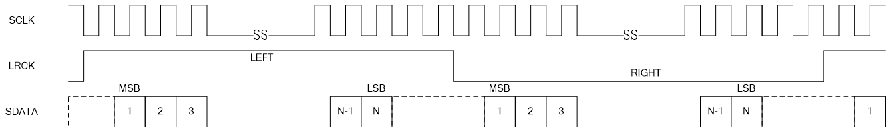
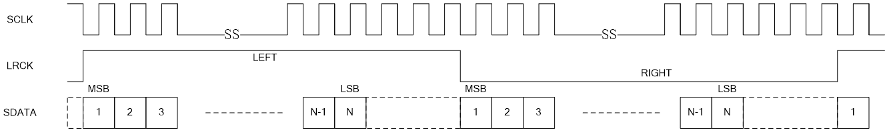
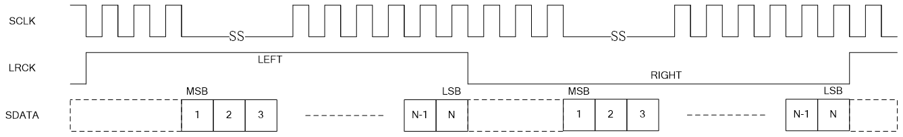
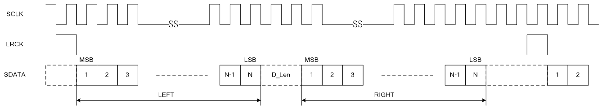

# I2S APIs[](#i2s-apis "永久链接至标题")


重要

The I2S API v1.0 is the lastest stable I2S APIs. All new applications should use I2S API v1.0.


## I2S Interface[](#i2s-interface "永久链接至标题")

The BK I2S Driver supports following sample rates:

> - 8K
> - 12K
> - 16K
> - 24K
> - 32K
> - 48K
> - 96K
> - 8.0182K
> - 11.025K
> - 22.050K
> - 44.1K
> - 88.2K

The BK I2S Driver supports following work modes:

> - I2S (Philips)
>   :   在此工作模式下信号传输时序图如 `图1` 所示:
> - Left Justified
>   :   在此工作模式下信号传输时序图如 `图2` 所示:
> - Right Justified
>   :   在此工作模式下信号传输时序图如 `图3` 所示:
> - Short Frame Sync
>   :   在此工作模式下信号传输时序图如 `图4` 所示:
> - Long Frame Sync
>   :   在此工作模式下信号传输时序图如 `图5` 所示:
> - Normal 2B+D
>   :   在此工作模式下信号传输时序图如 `图6和图7` 所示:
> - Delay 2B+D
>   :   在此工作模式下信号传输时序图如 `图8和图9` 所示:



Figure 1. Philips mode time sequence diagram[](#id2 "永久链接至图片")



Figure 2. Left Justified mode time sequence diagram[](#id3 "永久链接至图片")



Figure 3. Right Justified mode time sequence diagram[](#id4 "永久链接至图片")


Figure 4. Short Frame Sync mode time sequence diagram[](#id5 "永久链接至图片")


Figure 5. Long Frame Sync mode time sequence diagram[](#id6 "永久链接至图片")


Figure 6. Normal 2B+D mode time sequence diagram[](#id7 "永久链接至图片")


Figure 7. Normal 2B+D mode time sequence diagram[](#id8 "永久链接至图片")


Figure 8. Delay 2B+D mode time sequence diagram[](#id9 "永久链接至图片")



Figure 9. Delay 2B+D mode time sequence diagram[](#id10 "永久链接至图片")

Each function can be operated independently. However both function share the same resources, only one function can exit and work at a time.


## I2S API Categories[](#i2s-api-categories "永久链接至标题")

Most of I2S APIs can be categoried as:

> - I2S APIs
>
>   The common APIs are prefixed with bk_i2s, e.g. bk_i2s_driver_init() etc.

I2S APIs:
:   - [`bk_i2s_driver_init()`](#_CPPv418bk_i2s_driver_initv "bk_i2s_driver_init") - init i2s module driver

    - [`bk_i2s_driver_deinit()`](#_CPPv420bk_i2s_driver_deinitv "bk_i2s_driver_deinit") - deinit i2s module driver

    - [`bk_i2s_init()`](#_CPPv411bk_i2s_init19i2s_gpio_group_id_tPK12i2s_config_t "bk_i2s_init") - init i2s module

    - [`bk_i2s_deinit()`](#_CPPv413bk_i2s_deinitv "bk_i2s_deinit") - deinit i2s module

    - [`bk_i2s_get_read_ready()`](#_CPPv421bk_i2s_get_read_readyP8uint32_t "bk_i2s_get_read_ready") - get the i2s Rx fifo status

    - [`bk_i2s_get_write_ready()`](#_CPPv422bk_i2s_get_write_readyP8uint32_t "bk_i2s_get_write_ready") - get the i2s Tx fifo status

    - [`bk_i2s_enable()`](#_CPPv413bk_i2s_enable8i2s_en_t "bk_i2s_enable") - enable i2s

    - [`bk_i2s_int_enable()`](#_CPPv417bk_i2s_int_enable12i2s_isr_id_t8uint32_t "bk_i2s_int_enable") - config i2s interrupt

    - [`bk_i2s_set_role()`](#_CPPv415bk_i2s_set_role10i2s_role_t "bk_i2s_set_role") - config i2s work role

    - [`bk_i2s_set_work_mode()`](#_CPPv420bk_i2s_set_work_mode15i2s_work_mode_t "bk_i2s_set_work_mode") - config i2s work mode

    - [`bk_i2s_set_lrck_invert()`](#_CPPv422bk_i2s_set_lrck_invert20i2s_lrck_invert_en_t "bk_i2s_set_lrck_invert") - config i2s lrck invert

    - [`bk_i2s_set_sck_invert()`](#_CPPv421bk_i2s_set_sck_invert19i2s_sck_invert_en_t "bk_i2s_set_sck_invert") - config i2s sck invert

    - [`bk_i2s_set_lsb_first()`](#_CPPv420bk_i2s_set_lsb_first18i2s_lsb_first_en_t "bk_i2s_set_lsb_first") - config i2s lsb first

    - [`bk_i2s_set_sync_len()`](#_CPPv419bk_i2s_set_sync_len8uint32_t "bk_i2s_set_sync_len") - config i2s sync length

    - [`bk_i2s_set_data_len()`](#_CPPv419bk_i2s_set_data_len8uint32_t "bk_i2s_set_data_len") - config i2s data length

    - [`bk_i2s_set_pcm_dlen()`](#_CPPv419bk_i2s_set_pcm_dlen8uint32_t "bk_i2s_set_pcm_dlen") - config i2s pcm D length of 2B+D

    - [`bk_i2s_set_store_mode()`](#_CPPv421bk_i2s_set_store_mode22i2s_lrcom_store_mode_t "bk_i2s_set_store_mode") - config i2s store mode

    - [`bk_i2s_clear_rxfifo()`](#_CPPv419bk_i2s_clear_rxfifov "bk_i2s_clear_rxfifo") - clear i2s rx fifo

    - [`bk_i2s_clear_txfifo()`](#_CPPv419bk_i2s_clear_txfifov "bk_i2s_clear_txfifo") - clear i2s tx fifo

    - [`bk_i2s_set_txint_level()`](#_CPPv422bk_i2s_set_txint_level17i2s_txint_level_t "bk_i2s_set_txint_level") - config i2s tx interrupt level

    - [`bk_i2s_set_rxint_level()`](#_CPPv422bk_i2s_set_rxint_level17i2s_rxint_level_t "bk_i2s_set_rxint_level") - config i2s rx interrupt level

    - [`bk_i2s_write_data()`](#_CPPv417bk_i2s_write_data8uint32_tP8uint32_t8uint32_t "bk_i2s_write_data") - write data to i2s tx fifo

    - [`bk_i2s_read_data()`](#_CPPv416bk_i2s_read_dataP8uint32_t8uint32_t "bk_i2s_read_data") - read data from i2s rx fifo

    - [`bk_i2s_get_data_addr()`](#_CPPv420bk_i2s_get_data_addr16i2s_channel_id_tP8uint32_t "bk_i2s_get_data_addr") - get i2s data address

    - [`bk_i2s_set_samp_rate()`](#_CPPv420bk_i2s_set_samp_rate15i2s_samp_rate_t "bk_i2s_set_samp_rate") - config i2s sample rate

    - [`bk_i2s_register_i2s_isr()`](#_CPPv423bk_i2s_register_i2s_isr12i2s_isr_id_t9i2s_isr_tPv "bk_i2s_register_i2s_isr") - register i2s isr

    - [`bk_i2s_chl_init()`](#_CPPv415bk_i2s_chl_init16i2s_channel_id_t15i2s_txrx_type_t8uint32_t18i2s_data_handle_cbPP17RingBufferContext "bk_i2s_chl_init") - i2s channel init

    - [`bk_i2s_chl_deinit()`](#_CPPv417bk_i2s_chl_deinit16i2s_channel_id_t15i2s_txrx_type_t "bk_i2s_chl_deinit") - i2s channel deinit

    - [`bk_i2s_start()`](#_CPPv412bk_i2s_startv "bk_i2s_start") - start i2s transfer

    - [`bk_i2s_stop()`](#_CPPv411bk_i2s_stopv "bk_i2s_stop") - stop i2s transfer


## API Reference[](#api-reference "永久链接至标题")


### Header File[](#header-file "永久链接至标题")


- [i2s.h](http://192.168.0.46/gerrit/plugins/gitiles/iot/wcn/projects/+/refs/heads/armino_main/components/i2s.h "http://192.168.0.46/gerrit/plugins/gitiles/iot/wcn/projects/+/refs/heads/armino_main/components/i2s.h")


### Functions[](#functions "永久链接至标题")

[bk_err_t](../system/os.md#_CPPv48bk_err_t "bk_err_t") bk_i2s_driver_init(void)[](#_CPPv418bk_i2s_driver_initv "永久链接至目标")
:   Init i2s module driver.

    This API init i2s driver :


    - Power on clock

    - config apll clock

    - enable interrupts

    返回
    :   - BK_OK: succeed

        - others: other errors.

[bk_err_t](../system/os.md#_CPPv48bk_err_t "bk_err_t") bk_i2s_driver_deinit(void)[](#_CPPv420bk_i2s_driver_deinitv "永久链接至目标")
:   Deinit i2s module driver.

    This API deinit i2s driver :


    - Power down clock

    - reconfig apll clock to defailt value

    - disable interrupts

    返回
    :   - BK_OK: succeed

        - others: other errors.

[bk_err_t](../system/os.md#_CPPv48bk_err_t "bk_err_t") bk_i2s_init([i2s_gpio_group_id_t](#_CPPv419i2s_gpio_group_id_t "i2s_gpio_group_id_t") id, const [i2s_config_t](#_CPPv412i2s_config_t "i2s_config_t") *config)[](#_CPPv411bk_i2s_init19i2s_gpio_group_id_tPK12i2s_config_t "永久链接至目标")
:   Init i2s module.

    This API init the i2s module:


    - Init gpios i2s used

    - Configure the i2s parameters

    Usage example:

    ```
    //init i2s driver
    bk_i2s_driver_init();

    //init i2s configure
    i2s_config_t i2s_config;
    i2s_config.i2s_en = I2S_DISABLE;
    i2s_config.role = I2S_ROLE_MASTER;
    i2s_config.work_mode = I2S_WORK_MODE_I2S;
    i2s_config.lrck_invert = I2S_LRCK_INVERT_DISABLE;
    i2s_config.sck_invert = I2S_SCK_INVERT_DISABLE;
    i2s_config.lsb_first_en = I2S_LSB_FIRST_DISABLE;
    i2s_config.sync_length = 0;
    i2s_config.data_length = 15;
    i2s_config.pcm_dlength = 0;
    i2s_config.sample_ratio = 0;
    i2s_config.sck_ratio = 0;
    i2s_config.parallel_en = I2S_PARALLEL_DISABLE;
    i2s_config.store_mode = I2S_LRCOM_STORE_16R16L;
    i2s_config.sck_ratio_h4b = 0;
    i2s_config.sample_ratio_h2b = 0;
    i2s_config.txint_level = I2S_TXINT_LEVEL_1;
    i2s_config.rxint_level = I2S_RXINT_LEVEL_1;
    bk_i2s_init(I2S_GPIO_GROUP_0, &i2s_config);
    CLI_LOGI("init i2s driver and config successful \r\n");
    ```

    参数
    :   - **id** – gpio config “GPIO6, GPIO7, GPIO8, GPIO9”/”GPIO40, GPIO41, GPIO42, GPIO43”

        - **config** – i2s parameters include work role, work mode and so on

    返回
    :   - BK_OK: succeed

        - BK_ERR_I2S_PARAM: config is NULL

        - BK_ERR_I2S_NOT_INIT: i2s driver is not init

        - others: other errors.

[bk_err_t](../system/os.md#_CPPv48bk_err_t "bk_err_t") bk_i2s_deinit(void)[](#_CPPv413bk_i2s_deinitv "永久链接至目标")
:   Deinit i2s module.

    This API deinit the i2s module:


    - reconfig i2s parameters to default value

    返回
    :   - BK_OK: succeed

        - others: other errors.

[bk_err_t](../system/os.md#_CPPv48bk_err_t "bk_err_t") bk_i2s_get_read_ready(uint32_t *read_flag)[](#_CPPv421bk_i2s_get_read_readyP8uint32_t "永久链接至目标")
:   Get the i2s Rx fifo status.

    This API get the i2s Rx fifo status that check whether the fifo data can be read

    参数
    :   **read_flag** – save Rx fifo status

    返回
    :   - BK_OK: succeed

        - BK_ERR_I2S_NOT_INIT: i2s driver is not init

        - others: other errors.

[bk_err_t](../system/os.md#_CPPv48bk_err_t "bk_err_t") bk_i2s_get_write_ready(uint32_t *write_flag)[](#_CPPv422bk_i2s_get_write_readyP8uint32_t "永久链接至目标")
:   Get the i2s Tx fifo status.

    This API get the i2s Tx fifo status that check whether the fifo data can be write

    参数
    :   **read_flag** – save Tx fifo status

    返回
    :   - BK_OK: succeed

        - BK_ERR_I2S_NOT_INIT: i2s driver is not init

        - others: other errors.

[bk_err_t](../system/os.md#_CPPv48bk_err_t "bk_err_t") bk_i2s_enable([i2s_en_t](#_CPPv48i2s_en_t "i2s_en_t") en_value)[](#_CPPv413bk_i2s_enable8i2s_en_t "永久链接至目标")
:   Enable i2s.

    This API enable i2s

    参数
    :   **en_value** – disable/enable i2s

    返回
    :   - BK_OK: succeed

        - BK_ERR_AUD_NOT_INIT: i2s driver is not init

        - others: other errors.

[bk_err_t](../system/os.md#_CPPv48bk_err_t "bk_err_t") bk_i2s_int_enable([i2s_isr_id_t](#_CPPv412i2s_isr_id_t "i2s_isr_id_t") int_id, uint32_t value)[](#_CPPv417bk_i2s_int_enable12i2s_isr_id_t8uint32_t "永久链接至目标")
:   Config i2s interrupt.

    This API config i2s interrupt

    参数
    :   - **int_id** – interrupt id

        - **value** – 0:disable 1:enable

    返回
    :   - BK_OK: succeed

        - BK_ERR_AUD_NOT_INIT: i2s driver is not init

        - others: other errors.

[bk_err_t](../system/os.md#_CPPv48bk_err_t "bk_err_t") bk_i2s_set_role([i2s_role_t](#_CPPv410i2s_role_t "i2s_role_t") role)[](#_CPPv415bk_i2s_set_role10i2s_role_t "永久链接至目标")
:   Config i2s work role.

    This API config i2s work role

    参数
    :   **role** – work role slave/master

    返回
    :   - BK_OK: succeed

        - BK_ERR_AUD_NOT_INIT: i2s driver is not init

        - others: other errors.

[bk_err_t](../system/os.md#_CPPv48bk_err_t "bk_err_t") bk_i2s_set_work_mode([i2s_work_mode_t](#_CPPv415i2s_work_mode_t "i2s_work_mode_t") work_mode)[](#_CPPv420bk_i2s_set_work_mode15i2s_work_mode_t "永久链接至目标")
:   Config i2s work mode.

    This API config i2s work mode

    参数
    :   **work_mode** – i2s work mode

    返回
    :   - BK_OK: succeed

        - BK_ERR_AUD_NOT_INIT: i2s driver is not init

        - others: other errors.

[bk_err_t](../system/os.md#_CPPv48bk_err_t "bk_err_t") bk_i2s_set_lrck_invert([i2s_lrck_invert_en_t](#_CPPv420i2s_lrck_invert_en_t "i2s_lrck_invert_en_t") lrckrp)[](#_CPPv422bk_i2s_set_lrck_invert20i2s_lrck_invert_en_t "永久链接至目标")
:   Config i2s lrck invert.

    This API config i2s lrck invert

    参数
    :   **lrckrp** – i2s lrck invert enable/disable

    返回
    :   - BK_OK: succeed

        - BK_ERR_AUD_NOT_INIT: i2s driver is not init

        - others: other errors.

[bk_err_t](../system/os.md#_CPPv48bk_err_t "bk_err_t") bk_i2s_set_sck_invert([i2s_sck_invert_en_t](#_CPPv419i2s_sck_invert_en_t "i2s_sck_invert_en_t") sck_invert)[](#_CPPv421bk_i2s_set_sck_invert19i2s_sck_invert_en_t "永久链接至目标")
:   Config i2s sck invert.

    This API config i2s sck invert

    参数
    :   **sck_invert** – i2s sck invert enable/disable

    返回
    :   - BK_OK: succeed

        - BK_ERR_AUD_NOT_INIT: i2s driver is not init

        - others: other errors.

[bk_err_t](../system/os.md#_CPPv48bk_err_t "bk_err_t") bk_i2s_set_lsb_first([i2s_lsb_first_en_t](#_CPPv418i2s_lsb_first_en_t "i2s_lsb_first_en_t") lsb_first)[](#_CPPv420bk_i2s_set_lsb_first18i2s_lsb_first_en_t "永久链接至目标")
:   Config i2s lsb first.

    This API config i2s lsb first

    参数
    :   **lsb_first** – i2s lsb first enable/disable

    返回
    :   - BK_OK: succeed

        - BK_ERR_AUD_NOT_INIT: i2s driver is not init

        - others: other errors.

[bk_err_t](../system/os.md#_CPPv48bk_err_t "bk_err_t") bk_i2s_set_sync_len(uint32_t sync_len)[](#_CPPv419bk_i2s_set_sync_len8uint32_t "永久链接至目标")
:   Config i2s sync length.

    This API config i2s sync length

    参数
    :   **sync_len** – i2s sync length

    返回
    :   - BK_OK: succeed

        - BK_ERR_AUD_NOT_INIT: i2s driver is not init

        - others: other errors.

[bk_err_t](../system/os.md#_CPPv48bk_err_t "bk_err_t") bk_i2s_set_data_len(uint32_t data_len)[](#_CPPv419bk_i2s_set_data_len8uint32_t "永久链接至目标")
:   Config i2s data length.

    This API config i2s data length

    参数
    :   **data_len** – i2s data length

    返回
    :   - BK_OK: succeed

        - BK_ERR_AUD_NOT_INIT: i2s driver is not init

        - others: other errors.

[bk_err_t](../system/os.md#_CPPv48bk_err_t "bk_err_t") bk_i2s_set_pcm_dlen(uint32_t pcm_dlen)[](#_CPPv419bk_i2s_set_pcm_dlen8uint32_t "永久链接至目标")
:   Config i2s pcm D length of 2B+D.

    This API config i2s pcm D length of 2B+D

    参数
    :   **pcm_dlen** – pcm D length

    返回
    :   - BK_OK: succeed

        - BK_ERR_AUD_NOT_INIT: i2s driver is not init

        - others: other errors.

[bk_err_t](../system/os.md#_CPPv48bk_err_t "bk_err_t") bk_i2s_set_store_mode([i2s_lrcom_store_mode_t](#_CPPv422i2s_lrcom_store_mode_t "i2s_lrcom_store_mode_t") store_mode)[](#_CPPv421bk_i2s_set_store_mode22i2s_lrcom_store_mode_t "永久链接至目标")
:   Config i2s store mode.

    This API config i2s store mode


    **Attention**
    :   1. LRLR mode: left and right channel data are written alternately in chronological order(L->R->L->R->……)

        2. 16R16L mode: left and right channel data are written to FIFO in 32 bits, in which the lower 16 bits correspond to the left channel and the higher 16 bits correspond to the right channel({R,L}->{R,L}->……)

    参数
    :   **store_mode** – lrcom store mode LRLR/16R16L

    返回
    :   - BK_OK: succeed

        - BK_ERR_AUD_NOT_INIT: i2s driver is not init

        - others: other errors.

[bk_err_t](../system/os.md#_CPPv48bk_err_t "bk_err_t") bk_i2s_clear_rxfifo(void)[](#_CPPv419bk_i2s_clear_rxfifov "永久链接至目标")
:   clear i2s rx fifo

    This API clear i2s rx fifo

    返回
    :   - BK_OK: succeed

        - BK_ERR_AUD_NOT_INIT: i2s driver is not init

        - others: other errors.

[bk_err_t](../system/os.md#_CPPv48bk_err_t "bk_err_t") bk_i2s_clear_txfifo(void)[](#_CPPv419bk_i2s_clear_txfifov "永久链接至目标")
:   clear i2s tx fifo

    This API clear i2s tx fifo

    返回
    :   - BK_OK: succeed

        - BK_ERR_AUD_NOT_INIT: i2s driver is not init

        - others: other errors.

[bk_err_t](../system/os.md#_CPPv48bk_err_t "bk_err_t") bk_i2s_set_txint_level([i2s_txint_level_t](#_CPPv417i2s_txint_level_t "i2s_txint_level_t") txint_level)[](#_CPPv422bk_i2s_set_txint_level17i2s_txint_level_t "永久链接至目标")
:   config i2s tx interrupt level

    This API config i2s tx interrupt level

    参数
    :   **txint_level** – tx interrupt trigger level

    返回
    :   - BK_OK: succeed

        - BK_ERR_AUD_NOT_INIT: i2s driver is not init

        - others: other errors.

[bk_err_t](../system/os.md#_CPPv48bk_err_t "bk_err_t") bk_i2s_set_rxint_level([i2s_rxint_level_t](#_CPPv417i2s_rxint_level_t "i2s_rxint_level_t") rxint_level)[](#_CPPv422bk_i2s_set_rxint_level17i2s_rxint_level_t "永久链接至目标")
:   config i2s rx interrupt level

    This API config i2s rx interrupt level

    参数
    :   **rxint_level** – rx interrupt trigger level

    返回
    :   - BK_OK: succeed

        - BK_ERR_AUD_NOT_INIT: i2s driver is not init

        - others: other errors.

[bk_err_t](../system/os.md#_CPPv48bk_err_t "bk_err_t") bk_i2s_write_data(uint32_t channel_id, uint32_t *data_buf, uint32_t data_len)[](#_CPPv417bk_i2s_write_data8uint32_tP8uint32_t8uint32_t "永久链接至目标")
:   write data to i2s tx fifo

    This API write data to i2s tx fifo

    Usage example:

    ```
    //init i2s driver
    bk_i2s_driver_init();

    //init i2s configure
    i2s_config.i2s_en = I2S_DISABLE;
    i2s_config.role = I2S_ROLE_MASTER;
    i2s_config.work_mode = I2S_WORK_MODE_I2S;
    i2s_config.lrck_invert = I2S_LRCK_INVERT_DISABLE;
    i2s_config.sck_invert = I2S_SCK_INVERT_DISABLE;
    i2s_config.lsb_first_en = I2S_LSB_FIRST_DISABLE;
    i2s_config.sync_length = 0;
    i2s_config.data_length = 15;
    i2s_config.pcm_dlength = 0;
    i2s_config.sample_ratio = 0;
    i2s_config.sck_ratio = 0;
    i2s_config.parallel_en = I2S_PARALLEL_DISABLE;
    i2s_config.store_mode = I2S_LRCOM_STORE_16R16L;
    i2s_config.sck_ratio_h4b = 0;
    i2s_config.sample_ratio_h2b = 0;
    i2s_config.txint_level = I2S_TXINT_LEVEL_1;
    i2s_config.rxint_level = I2S_RXINT_LEVEL_1;
    bk_i2s_init(I2S_GPIO_GROUP_0, &i2s_config);
    CLI_LOGI("init i2s driver and config successful \r\n");

    //set sample and bitclk ratio
    rate.datawidth = i2s_rate_table[i].datawidth;
    rate.samp_rate = i2s_rate_table[i].samp_rate;
    bk_i2s_set_ratio(&rate);

    //enable i2s
    bk_i2s_enable(I2S_ENABLE);
    CLI_LOGI("enable i2s successful \r\n");

    bk_i2s_get_write_ready(&write_flag);
    if (write_flag)
        bk_i2s_write_data(1, &data_buf_rl, 1);
    ```

    Usage example:

    ```
    //init i2s driver
    bk_i2s_driver_init();

    //init i2s configure
    i2s_config_t i2s_config;
    i2s_config.i2s_en = I2S_DISABLE;
    i2s_config.role = I2S_ROLE_MASTER;
    i2s_config.work_mode = I2S_WORK_MODE_I2S;
    i2s_config.lrck_invert = I2S_LRCK_INVERT_DISABLE;
    i2s_config.sck_invert = I2S_SCK_INVERT_DISABLE;
    i2s_config.lsb_first_en = I2S_LSB_FIRST_DISABLE;
    i2s_config.sync_length = 0;
    i2s_config.data_length = 15;
    i2s_config.pcm_dlength = 0;
    i2s_config.sample_ratio = 0;
    i2s_config.sck_ratio = 0;
    i2s_config.parallel_en = I2S_PARALLEL_DISABLE;
    i2s_config.store_mode = I2S_LRCOM_STORE_16R16L;
    i2s_config.sck_ratio_h4b = 0;
    i2s_config.sample_ratio_h2b = 0;
    i2s_config.txint_level = I2S_TXINT_LEVEL_1;
    i2s_config.rxint_level = I2S_RXINT_LEVEL_1;
    bk_i2s_init(I2S_GPIO_GROUP_0, &i2s_config);
    CLI_LOGI("init i2s driver and config successful \r\n");

    //set sample and bitclk ratio
    rate.datawidth = i2s_rate_table[i].datawidth;
    rate.samp_rate = i2s_rate_table[i].samp_rate;
    bk_i2s_set_ratio(&rate);

    //enable i2s
    bk_i2s_enable(I2S_ENABLE);
    CLI_LOGI("enable i2s successful \r\n");

    //get write ready status and write data
    bk_i2s_get_write_ready(&write_flag);
    if (write_flag)
        bk_i2s_write_data(1, &data_buf_rl, 1);
    ```

    参数
    :   - **channel_id** – i2s channel 1/2/3/4

        - **data_buf** – data to write

        - **data_len** – data length to write

    返回
    :   - BK_OK: succeed

        - BK_ERR_AUD_NOT_INIT: i2s driver is not init

        - others: other errors.

[bk_err_t](../system/os.md#_CPPv48bk_err_t "bk_err_t") bk_i2s_read_data(uint32_t *data_buf, uint32_t data_len)[](#_CPPv416bk_i2s_read_dataP8uint32_t8uint32_t "永久链接至目标")
:   read data from i2s rx fifo

    This API read data from i2s rx fifo

    Usage example:

    ```
    //init i2s driver
    bk_i2s_driver_init();

    //init i2s configure
    i2s_config_t i2s_config;
    i2s_config.i2s_en = I2S_DISABLE;
    i2s_config.role = I2S_ROLE_MASTER;
    i2s_config.work_mode = I2S_WORK_MODE_I2S;
    i2s_config.lrck_invert = I2S_LRCK_INVERT_DISABLE;
    i2s_config.sck_invert = I2S_SCK_INVERT_DISABLE;
    i2s_config.lsb_first_en = I2S_LSB_FIRST_DISABLE;
    i2s_config.sync_length = 0;
    i2s_config.data_length = 15;
    i2s_config.pcm_dlength = 0;
    i2s_config.sample_ratio = 0;
    i2s_config.sck_ratio = 0;
    i2s_config.parallel_en = I2S_PARALLEL_DISABLE;
    i2s_config.store_mode = I2S_LRCOM_STORE_16R16L;
    i2s_config.sck_ratio_h4b = 0;
    i2s_config.sample_ratio_h2b = 0;
    i2s_config.txint_level = I2S_TXINT_LEVEL_1;
    i2s_config.rxint_level = I2S_RXINT_LEVEL_1;
    bk_i2s_init(I2S_GPIO_GROUP_0, &i2s_config);
    CLI_LOGI("init i2s driver and config successful \r\n");

    //set sample and bitclk ratio
    rate.datawidth = i2s_rate_table[i].datawidth;
    rate.samp_rate = i2s_rate_table[i].samp_rate;
    bk_i2s_set_ratio(&rate);

    //enable i2s
    bk_i2s_enable(I2S_ENABLE);
    CLI_LOGI("enable i2s successful \r\n");

    //get read ready status and read data
    bk_i2s_get_read_ready(&read_flag);
    if (read_flag)
        bk_i2s_read_data(&data_buf, 1);
    ```

    参数
    :   - **data_buf** – save data read from rx fifo

        - **data_len, :** – data length to read

    返回
    :   - BK_OK: succeed

        - BK_ERR_AUD_NOT_INIT: i2s driver is not init

        - others: other errors.

[bk_err_t](../system/os.md#_CPPv48bk_err_t "bk_err_t") bk_i2s_get_data_addr([i2s_channel_id_t](#_CPPv416i2s_channel_id_t "i2s_channel_id_t") chl_id, uint32_t *i2s_data_addr)[](#_CPPv420bk_i2s_get_data_addr16i2s_channel_id_tP8uint32_t "永久链接至目标")
:   get i2s data address

    This API get i2s data address

    参数
    :   **i2s_data_addr** – save i2s data address

    返回
    :   - BK_OK: succeed

        - BK_ERR_AUD_NOT_INIT: i2s driver is not init

        - others: other errors.

[bk_err_t](../system/os.md#_CPPv48bk_err_t "bk_err_t") bk_i2s_set_samp_rate([i2s_samp_rate_t](#_CPPv415i2s_samp_rate_t "i2s_samp_rate_t") samp_rate)[](#_CPPv420bk_i2s_set_samp_rate15i2s_samp_rate_t "永久链接至目标")
:   config i2s sample rate

    This API config i2s sample rate

    参数
    :   **rate** – sample rate and data width

    返回
    :   - BK_OK: succeed

        - BK_ERR_AUD_NOT_INIT: i2s driver is not init

        - others: other errors.

[bk_err_t](../system/os.md#_CPPv48bk_err_t "bk_err_t") bk_i2s_register_i2s_isr([i2s_isr_id_t](#_CPPv412i2s_isr_id_t "i2s_isr_id_t") isr_id, [i2s_isr_t](#_CPPv49i2s_isr_t "i2s_isr_t") isr, void *param)[](#_CPPv423bk_i2s_register_i2s_isr12i2s_isr_id_t9i2s_isr_tPv "永久链接至目标")
:   register i2s isr

    This API config register i2s isr

    Usage example:

    ```
    void cli_i2s_master_txudf_isr(void *param)
    {
        CLI_LOGI("enter cli_i2s_txudf_isr \r\n");
    }

    //register isr
    bk_i2s_register_i2s_isr(I2S_ISR_CHL1_TXUDF, cli_i2s_master_txudf_isr, NULL);
    CLI_LOGI("register i2s isr successful \r\n");

    //enable i2s rxovf interrupt
    bk_i2s_int_enable(I2S_ISR_CHL1_TXUDF, I2S_INT_ENABLE);
    CLI_LOGI("enable i2s interrupt successful \r\n");
    ```

    参数
    :   - **isr_id** – i2s isr id

        - **isr** – isr function

        - **param** – isr parameters

    返回
    :   - BK_OK: succeed

        - BK_ERR_AUD_NOT_INIT: i2s driver is not init

        - BK_ERR_I2S_ISR_ID: i2s isr id is invalid

        - others: other errors.

[bk_err_t](../system/os.md#_CPPv48bk_err_t "bk_err_t") bk_i2s_chl_init([i2s_channel_id_t](#_CPPv416i2s_channel_id_t "i2s_channel_id_t") chl, [i2s_txrx_type_t](#_CPPv415i2s_txrx_type_t "i2s_txrx_type_t") type, uint32_t buff_size, [i2s_data_handle_cb](#_CPPv418i2s_data_handle_cb "i2s_data_handle_cb") data_handle_cb, RingBufferContext **rb)[](#_CPPv415bk_i2s_chl_init16i2s_channel_id_t15i2s_txrx_type_t8uint32_t18i2s_data_handle_cbPP17RingBufferContext "永久链接至目标")
:   init i2s channel to send or receive data by dma

    This API config dma to carry i2s data

    参数
    :   **chl** – i2s channel Tx or Rx config the size(byte) of ring buffer to send or receive data the callback called by dma finish isr when dma carry “buff_size/2” data complete save RingBufferContext, and send or receive data use it

    返回
    :   - BK_OK: succeed

        - BK_ERR_AUD_NOT_INIT: i2s driver is not init

        - others: other errors.

[bk_err_t](../system/os.md#_CPPv48bk_err_t "bk_err_t") bk_i2s_chl_deinit([i2s_channel_id_t](#_CPPv416i2s_channel_id_t "i2s_channel_id_t") chl, [i2s_txrx_type_t](#_CPPv415i2s_txrx_type_t "i2s_txrx_type_t") type)[](#_CPPv417bk_i2s_chl_deinit16i2s_channel_id_t15i2s_txrx_type_t "永久链接至目标")
:   deinit i2s channel

    This API config dma to carry i2s data

    参数
    :   **chl** – i2s channel Tx or Rx config

    返回
    :   - BK_OK: succeed

        - BK_ERR_AUD_NOT_INIT: i2s driver is not init

        - others: other errors.

[bk_err_t](../system/os.md#_CPPv48bk_err_t "bk_err_t") bk_i2s_start(void)[](#_CPPv412bk_i2s_startv "永久链接至目标")
:   start i2s

    This API start dma and i2s to send and receive data

    Usage example:

    ```
    static RingBufferContext *ch1_tx_rb;

    //channel 1 tx callback
    static int ch1_tx_data_handle_cb(uint32_t size)
    {
        ring_buffer_write(ch1_tx_rb, ch1_temp, size);
        return size;
    }

    i2s_config_t i2s_config = DEFAULT_I2S_CONFIG();
    //init i2s driver
    bk_i2s_driver_init();
    //init and config i2s
    bk_i2s_init(I2S_GPIO_GROUP_0, &i2s_config);
    bk_i2s_chl_init(I2S_CHANNEL_1, I2S_TXRX_TYPE_TX, 640, ch1_tx_data_handle_cb, &ch1_tx_rb);
    uint8_t *temp_data = (uint8_t *)os_malloc(640);
    os_memset(temp_data, 0x00, 640);
    size = ring_buffer_write(ch1_tx_rb, temp_data, 640);
    os_printf("ring_buffer_write, size: %d \n", size);
    os_free(temp_data);
    bk_i2s_start();
    ```

    返回
    :   - BK_OK: succeed

        - BK_ERR_AUD_NOT_INIT: i2s driver is not init

        - BK_ERR_I2S_ISR_ID: i2s isr id is invalid

        - others: other errors.

[bk_err_t](../system/os.md#_CPPv48bk_err_t "bk_err_t") bk_i2s_stop(void)[](#_CPPv411bk_i2s_stopv "永久链接至目标")
:   stop i2s

    This API stop i2s and dma to carry i2s data

    Usage example:

    ```
    bk_i2s_stop();
    bk_i2s_chl_deinit(I2S_CHANNEL_1, I2S_TXRX_TYPE_TX);
    bk_i2s_deinit();
    bk_i2s_driver_deinit();
    ```

    返回
    :   - BK_OK: succeed

        - BK_ERR_AUD_NOT_INIT: i2s driver is not init

        - others: other errors.


## API Typedefs[](#api-typedefs "永久链接至标题")


### Header File[](#id1 "永久链接至标题")


- [i2s_types.h](http://192.168.0.46/gerrit/plugins/gitiles/iot/wcn/projects/+/refs/heads/armino_main/components/i2s_types.h "http://192.168.0.46/gerrit/plugins/gitiles/iot/wcn/projects/+/refs/heads/armino_main/components/i2s_types.h")


### Structures[](#structures "永久链接至标题")

struct i2s_int_config_t[](#_CPPv416i2s_int_config_t "永久链接至目标")

struct i2s_config_t[](#_CPPv412i2s_config_t "永久链接至目标")


### Macros[](#macros "永久链接至标题")

BK_ERR_I2S_NOT_INIT[](#c.BK_ERR_I2S_NOT_INIT "永久链接至目标")
:   I2S driver not init

BK_ERR_I2S_PARAM[](#c.BK_ERR_I2S_PARAM "永久链接至目标")
:   I2S parameter invalid

BK_ERR_I2S_ISR_ID[](#c.BK_ERR_I2S_ISR_ID "永久链接至目标")
:   I2S isr id invalid

DEFAULT_I2S_CONFIG()[](#c.DEFAULT_I2S_CONFIG "永久链接至目标")

DEFAULT_PCM_CONFIG()[](#c.DEFAULT_PCM_CONFIG "永久链接至目标")

DEFAULT_TDM_CONFIG()[](#c.DEFAULT_TDM_CONFIG "永久链接至目标")

DEFAULT_2BD_CONFIG()[](#c.DEFAULT_2BD_CONFIG "永久链接至目标")


### Type Definitions[](#type-definitions "永久链接至标题")

typedef void (*i2s_isr_t)(void *param)[](#_CPPv49i2s_isr_t "永久链接至目标")

typedef int (*i2s_data_handle_cb)(uint32_t size)[](#_CPPv418i2s_data_handle_cb "永久链接至目标")


### Enumerations[](#enumerations "永久链接至标题")

enum i2s_gpio_group_id_t[](#_CPPv419i2s_gpio_group_id_t "永久链接至目标")
:   *Values:*

    enumerator I2S_GPIO_GROUP_0[](#_CPPv4N19i2s_gpio_group_id_t16I2S_GPIO_GROUP_0E "永久链接至目标")
    :   I2S gpio group 0: GPIO6, GPIO7, GPIO8, GPIO9

    enumerator I2S_GPIO_GROUP_1[](#_CPPv4N19i2s_gpio_group_id_t16I2S_GPIO_GROUP_1E "永久链接至目标")
    :   I2S gpio group 1: GPIO40, GPIO41, GPIO42, GPIO43

    enumerator I2S_GPIO_GROUP_MAX[](#_CPPv4N19i2s_gpio_group_id_t18I2S_GPIO_GROUP_MAXE "永久链接至目标")

enum i2s_isr_id_t[](#_CPPv412i2s_isr_id_t "永久链接至目标")
:   *Values:*

    enumerator I2S_ISR_CHL1_TXUDF[](#_CPPv4N12i2s_isr_id_t18I2S_ISR_CHL1_TXUDFE "永久链接至目标")
    :   I2S channel1 tx_udf interrupt

    enumerator I2S_ISR_CHL1_RXOVF[](#_CPPv4N12i2s_isr_id_t18I2S_ISR_CHL1_RXOVFE "永久链接至目标")
    :   I2S channel1 rx_ovf interrupt

    enumerator I2S_ISR_CHL1_TXINT[](#_CPPv4N12i2s_isr_id_t18I2S_ISR_CHL1_TXINTE "永久链接至目标")
    :   I2S channel1 tx interrupt

    enumerator I2S_ISR_CHL1_RXINT[](#_CPPv4N12i2s_isr_id_t18I2S_ISR_CHL1_RXINTE "永久链接至目标")
    :   I2S channel1 rx interrupt

    enumerator I2S_ISR_CHL2_TXUDF[](#_CPPv4N12i2s_isr_id_t18I2S_ISR_CHL2_TXUDFE "永久链接至目标")
    :   I2S channel2 tx_udf interrupt

    enumerator I2S_ISR_CHL2_RXOVF[](#_CPPv4N12i2s_isr_id_t18I2S_ISR_CHL2_RXOVFE "永久链接至目标")
    :   I2S channel2 rx_ovf interrupt

    enumerator I2S_ISR_CHL2_TXINT[](#_CPPv4N12i2s_isr_id_t18I2S_ISR_CHL2_TXINTE "永久链接至目标")
    :   I2S channel2 tx interrupt

    enumerator I2S_ISR_CHL2_RXINT[](#_CPPv4N12i2s_isr_id_t18I2S_ISR_CHL2_RXINTE "永久链接至目标")
    :   I2S channel2 rx interrupt

    enumerator I2S_ISR_CHL3_TXUDF[](#_CPPv4N12i2s_isr_id_t18I2S_ISR_CHL3_TXUDFE "永久链接至目标")
    :   I2S channel3 tx_udf interrupt

    enumerator I2S_ISR_CHL3_RXOVF[](#_CPPv4N12i2s_isr_id_t18I2S_ISR_CHL3_RXOVFE "永久链接至目标")
    :   I2S channel3 rx_ovf interrupt

    enumerator I2S_ISR_CHL3_TXINT[](#_CPPv4N12i2s_isr_id_t18I2S_ISR_CHL3_TXINTE "永久链接至目标")
    :   I2S channel3 tx interrupt

    enumerator I2S_ISR_CHL3_RXINT[](#_CPPv4N12i2s_isr_id_t18I2S_ISR_CHL3_RXINTE "永久链接至目标")
    :   I2S channel3 rx interrupt

    enumerator I2S_ISR_MAX[](#_CPPv4N12i2s_isr_id_t11I2S_ISR_MAXE "永久链接至目标")

enum i2s_en_t[](#_CPPv48i2s_en_t "永久链接至目标")
:   *Values:*

    enumerator I2S_DISABLE[](#_CPPv4N8i2s_en_t11I2S_DISABLEE "永久链接至目标")
    :   I2S disable

    enumerator I2S_ENABLE[](#_CPPv4N8i2s_en_t10I2S_ENABLEE "永久链接至目标")
    :   I2S enable

    enumerator I2S_EN_MAX[](#_CPPv4N8i2s_en_t10I2S_EN_MAXE "永久链接至目标")

enum i2s_role_t[](#_CPPv410i2s_role_t "永久链接至目标")
:   *Values:*

    enumerator I2S_ROLE_SLAVE[](#_CPPv4N10i2s_role_t14I2S_ROLE_SLAVEE "永久链接至目标")
    :   I2S role: slave

    enumerator I2S_ROLE_MASTER[](#_CPPv4N10i2s_role_t15I2S_ROLE_MASTERE "永久链接至目标")
    :   I2S role: master

    enumerator I2S_ROLE_MAX[](#_CPPv4N10i2s_role_t12I2S_ROLE_MAXE "永久链接至目标")

enum i2s_work_mode_t[](#_CPPv415i2s_work_mode_t "永久链接至目标")
:   *Values:*

    enumerator I2S_WORK_MODE_I2S[](#_CPPv4N15i2s_work_mode_t17I2S_WORK_MODE_I2SE "永久链接至目标")
    :   I2S work mode: I2S (Philips)

    enumerator I2S_WORK_MODE_LEFTJUST[](#_CPPv4N15i2s_work_mode_t22I2S_WORK_MODE_LEFTJUSTE "永久链接至目标")
    :   I2S work mode: Left Justified

    enumerator I2S_WORK_MODE_RIGHTJUST[](#_CPPv4N15i2s_work_mode_t23I2S_WORK_MODE_RIGHTJUSTE "永久链接至目标")
    :   I2S work mode: Right Justified

    enumerator I2S_WORK_MODE_RSVD[](#_CPPv4N15i2s_work_mode_t18I2S_WORK_MODE_RSVDE "永久链接至目标")
    :   I2S work mode: reserved for future use

    enumerator I2S_WORK_MODE_SHORTFAMSYNC[](#_CPPv4N15i2s_work_mode_t26I2S_WORK_MODE_SHORTFAMSYNCE "永久链接至目标")
    :   I2S work mode: Short Frame Sync

    enumerator I2S_WORK_MODE_LONGFAMSYNC[](#_CPPv4N15i2s_work_mode_t25I2S_WORK_MODE_LONGFAMSYNCE "永久链接至目标")
    :   I2S work mode: Long Frame Sync

    enumerator I2S_WORK_MODE_NORMAL2BD[](#_CPPv4N15i2s_work_mode_t23I2S_WORK_MODE_NORMAL2BDE "永久链接至目标")
    :   I2S work mode: Normal 2B+D

    enumerator I2S_WORK_MODE_DELAY2BD[](#_CPPv4N15i2s_work_mode_t22I2S_WORK_MODE_DELAY2BDE "永久链接至目标")
    :   I2S work mode: Delay 2B+D

    enumerator I2S_WORK_MODE_MAX[](#_CPPv4N15i2s_work_mode_t17I2S_WORK_MODE_MAXE "永久链接至目标")

enum i2s_lrck_invert_en_t[](#_CPPv420i2s_lrck_invert_en_t "永久链接至目标")
:   *Values:*

    enumerator I2S_LRCK_INVERT_DISABLE[](#_CPPv4N20i2s_lrck_invert_en_t23I2S_LRCK_INVERT_DISABLEE "永久链接至目标")
    :   I2S lrck invert disable

    enumerator I2S_LRCK_INVERT_ENABLE[](#_CPPv4N20i2s_lrck_invert_en_t22I2S_LRCK_INVERT_ENABLEE "永久链接至目标")
    :   I2S lrck invert enable

    enumerator I2S_LRCK_INVERT_MAX[](#_CPPv4N20i2s_lrck_invert_en_t19I2S_LRCK_INVERT_MAXE "永久链接至目标")

enum i2s_sck_invert_en_t[](#_CPPv419i2s_sck_invert_en_t "永久链接至目标")
:   *Values:*

    enumerator I2S_SCK_INVERT_DISABLE[](#_CPPv4N19i2s_sck_invert_en_t22I2S_SCK_INVERT_DISABLEE "永久链接至目标")
    :   I2S sck invert disable

    enumerator I2S_SCK_INVERT_ENABLE[](#_CPPv4N19i2s_sck_invert_en_t21I2S_SCK_INVERT_ENABLEE "永久链接至目标")
    :   I2S sck invert enable

    enumerator I2S_SCK_INVERT_MAX[](#_CPPv4N19i2s_sck_invert_en_t18I2S_SCK_INVERT_MAXE "永久链接至目标")

enum i2s_lsb_first_en_t[](#_CPPv418i2s_lsb_first_en_t "永久链接至目标")
:   *Values:*

    enumerator I2S_LSB_FIRST_DISABLE[](#_CPPv4N18i2s_lsb_first_en_t21I2S_LSB_FIRST_DISABLEE "永久链接至目标")
    :   I2S lsb first disable

    enumerator I2S_LSB_FIRST_ENABLE[](#_CPPv4N18i2s_lsb_first_en_t20I2S_LSB_FIRST_ENABLEE "永久链接至目标")
    :   I2S lsb first enable

    enumerator I2S_LSB_FIRST_EN_MAX[](#_CPPv4N18i2s_lsb_first_en_t20I2S_LSB_FIRST_EN_MAXE "永久链接至目标")

enum i2s_parallel_en_t[](#_CPPv417i2s_parallel_en_t "永久链接至目标")
:   *Values:*

    enumerator I2S_PARALLEL_DISABLE[](#_CPPv4N17i2s_parallel_en_t20I2S_PARALLEL_DISABLEE "永久链接至目标")
    :   I2S parallel disable

    enumerator I2S_PARALLEL_ENABLE[](#_CPPv4N17i2s_parallel_en_t19I2S_PARALLEL_ENABLEE "永久链接至目标")
    :   I2S parallel enable

    enumerator I2S_PARALLEL_EN_MAX[](#_CPPv4N17i2s_parallel_en_t19I2S_PARALLEL_EN_MAXE "永久链接至目标")

enum i2s_lrcom_store_mode_t[](#_CPPv422i2s_lrcom_store_mode_t "永久链接至目标")
:   *Values:*

    enumerator I2S_LRCOM_STORE_LRLR[](#_CPPv4N22i2s_lrcom_store_mode_t20I2S_LRCOM_STORE_LRLRE "永久链接至目标")
    :   I2S lrcom store mode: L->R->L->R

    enumerator I2S_LRCOM_STORE_16R16L[](#_CPPv4N22i2s_lrcom_store_mode_t22I2S_LRCOM_STORE_16R16LE "永久链接至目标")
    :   I2S lrcom store mode: {16bitR,16bitL}

    enumerator I2S_LRCOM_STORE_MODE_MAX[](#_CPPv4N22i2s_lrcom_store_mode_t24I2S_LRCOM_STORE_MODE_MAXE "永久链接至目标")

enum i2s_txint_level_t[](#_CPPv417i2s_txint_level_t "永久链接至目标")
:   *Values:*

    enumerator I2S_TXINT_LEVEL_1[](#_CPPv4N17i2s_txint_level_t17I2S_TXINT_LEVEL_1E "永久链接至目标")
    :   I2S tx_int level: 1

    enumerator I2S_TXINT_LEVEL_8[](#_CPPv4N17i2s_txint_level_t17I2S_TXINT_LEVEL_8E "永久链接至目标")
    :   I2S tx_int level: 8

    enumerator I2S_TXINT_LEVEL_16[](#_CPPv4N17i2s_txint_level_t18I2S_TXINT_LEVEL_16E "永久链接至目标")
    :   I2S tx_int level: 16

    enumerator I2S_TXINT_LEVEL_24[](#_CPPv4N17i2s_txint_level_t18I2S_TXINT_LEVEL_24E "永久链接至目标")
    :   I2S tx_int level: 24

    enumerator I2S_TXINT_LEVEL_MAX[](#_CPPv4N17i2s_txint_level_t19I2S_TXINT_LEVEL_MAXE "永久链接至目标")

enum i2s_rxint_level_t[](#_CPPv417i2s_rxint_level_t "永久链接至目标")
:   *Values:*

    enumerator I2S_RXINT_LEVEL_1[](#_CPPv4N17i2s_rxint_level_t17I2S_RXINT_LEVEL_1E "永久链接至目标")
    :   I2S rx_int level: 1

    enumerator I2S_RXINT_LEVEL_8[](#_CPPv4N17i2s_rxint_level_t17I2S_RXINT_LEVEL_8E "永久链接至目标")
    :   I2S rx_int level: 8

    enumerator I2S_RXINT_LEVEL_16[](#_CPPv4N17i2s_rxint_level_t18I2S_RXINT_LEVEL_16E "永久链接至目标")
    :   I2S rx_int level: 16

    enumerator I2S_RXINT_LEVEL_24[](#_CPPv4N17i2s_rxint_level_t18I2S_RXINT_LEVEL_24E "永久链接至目标")
    :   I2S rx_int level: 24

    enumerator I2S_RXINT_LEVEL_MAX[](#_CPPv4N17i2s_rxint_level_t19I2S_RXINT_LEVEL_MAXE "永久链接至目标")

enum i2s_int_en_t[](#_CPPv412i2s_int_en_t "永久链接至目标")
:   *Values:*

    enumerator I2S_INT_DISABLE[](#_CPPv4N12i2s_int_en_t15I2S_INT_DISABLEE "永久链接至目标")
    :   I2S interrupt disable

    enumerator I2S_INT_ENABLE[](#_CPPv4N12i2s_int_en_t14I2S_INT_ENABLEE "永久链接至目标")
    :   I2S interrupt enable

    enumerator I2S_INT_EN_MAX[](#_CPPv4N12i2s_int_en_t14I2S_INT_EN_MAXE "永久链接至目标")

enum i2s_channel_id_t[](#_CPPv416i2s_channel_id_t "永久链接至目标")
:   *Values:*

    enumerator I2S_CHANNEL_1[](#_CPPv4N16i2s_channel_id_t13I2S_CHANNEL_1E "永久链接至目标")
    :   I2S channel: 1

    enumerator I2S_CHANNEL_2[](#_CPPv4N16i2s_channel_id_t13I2S_CHANNEL_2E "永久链接至目标")
    :   I2S channel: 2

    enumerator I2S_CHANNEL_3[](#_CPPv4N16i2s_channel_id_t13I2S_CHANNEL_3E "永久链接至目标")
    :   I2S channel: 3

    enumerator I2S_CHANNEL_MAX[](#_CPPv4N16i2s_channel_id_t15I2S_CHANNEL_MAXE "永久链接至目标")

enum i2s_data_width_t[](#_CPPv416i2s_data_width_t "永久链接至目标")
:   *Values:*

    enumerator I2S_DATA_WIDTH_8[](#_CPPv4N16i2s_data_width_t16I2S_DATA_WIDTH_8E "永久链接至目标")
    :   I2S data width: 8

    enumerator I2S_DATA_WIDTH_16[](#_CPPv4N16i2s_data_width_t17I2S_DATA_WIDTH_16E "永久链接至目标")
    :   I2S data width: 16

    enumerator I2S_DATA_WIDTH_24[](#_CPPv4N16i2s_data_width_t17I2S_DATA_WIDTH_24E "永久链接至目标")
    :   I2S data width: 24

    enumerator I2S_DATA_WIDTH_32[](#_CPPv4N16i2s_data_width_t17I2S_DATA_WIDTH_32E "永久链接至目标")
    :   I2S data width: 32

enum i2s_samp_rate_t[](#_CPPv415i2s_samp_rate_t "永久链接至目标")
:   *Values:*

    enumerator I2S_SAMP_RATE_8000[](#_CPPv4N15i2s_samp_rate_t18I2S_SAMP_RATE_8000E "永久链接至目标")
    :   I2S sample rate: 8K

    enumerator I2S_SAMP_RATE_12000[](#_CPPv4N15i2s_samp_rate_t19I2S_SAMP_RATE_12000E "永久链接至目标")
    :   I2S sample rate: 12K

    enumerator I2S_SAMP_RATE_16000[](#_CPPv4N15i2s_samp_rate_t19I2S_SAMP_RATE_16000E "永久链接至目标")
    :   I2S sample rate: 16K

    enumerator I2S_SAMP_RATE_24000[](#_CPPv4N15i2s_samp_rate_t19I2S_SAMP_RATE_24000E "永久链接至目标")
    :   I2S sample rate: 24K

    enumerator I2S_SAMP_RATE_32000[](#_CPPv4N15i2s_samp_rate_t19I2S_SAMP_RATE_32000E "永久链接至目标")
    :   I2S sample rate: 32K

    enumerator I2S_SAMP_RATE_48000[](#_CPPv4N15i2s_samp_rate_t19I2S_SAMP_RATE_48000E "永久链接至目标")
    :   I2S sample rate: 48K

    enumerator I2S_SAMP_RATE_96000[](#_CPPv4N15i2s_samp_rate_t19I2S_SAMP_RATE_96000E "永久链接至目标")
    :   I2S sample rate: 96K

    enumerator I2S_SAMP_RATE_8018[](#_CPPv4N15i2s_samp_rate_t18I2S_SAMP_RATE_8018E "永久链接至目标")
    :   I2S sample rate: 8.0182K

    enumerator I2S_SAMP_RATE_11025[](#_CPPv4N15i2s_samp_rate_t19I2S_SAMP_RATE_11025E "永久链接至目标")
    :   I2S sample rate: 11.025K

    enumerator I2S_SAMP_RATE_22050[](#_CPPv4N15i2s_samp_rate_t19I2S_SAMP_RATE_22050E "永久链接至目标")
    :   I2S sample rate: 22.050K

    enumerator I2S_SAMP_RATE_44100[](#_CPPv4N15i2s_samp_rate_t19I2S_SAMP_RATE_44100E "永久链接至目标")
    :   I2S sample rate: 44.1K

    enumerator I2S_SAMP_RATE_88200[](#_CPPv4N15i2s_samp_rate_t19I2S_SAMP_RATE_88200E "永久链接至目标")
    :   I2S sample rate: 88.2K

    enumerator I2S_SAMP_RATE_MAX[](#_CPPv4N15i2s_samp_rate_t17I2S_SAMP_RATE_MAXE "永久链接至目标")

enum i2s_txrx_type_t[](#_CPPv415i2s_txrx_type_t "永久链接至目标")
:   *Values:*

    enumerator I2S_TXRX_TYPE_TX[](#_CPPv4N15i2s_txrx_type_t16I2S_TXRX_TYPE_TXE "永久链接至目标")

    enumerator I2S_TXRX_TYPE_RX[](#_CPPv4N15i2s_txrx_type_t16I2S_TXRX_TYPE_RXE "永久链接至目标")

    enumerator I2S_TXRX_TYPE_MAX[](#_CPPv4N15i2s_txrx_type_t17I2S_TXRX_TYPE_MAXE "永久链接至目标")
