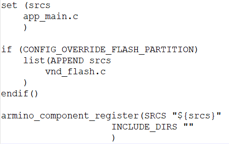
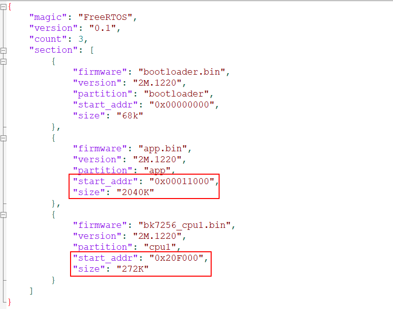
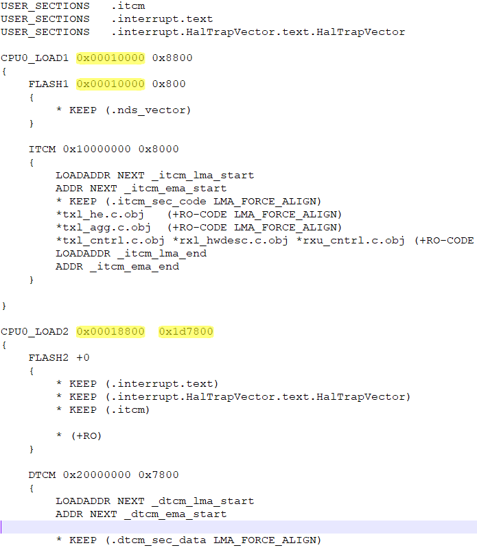
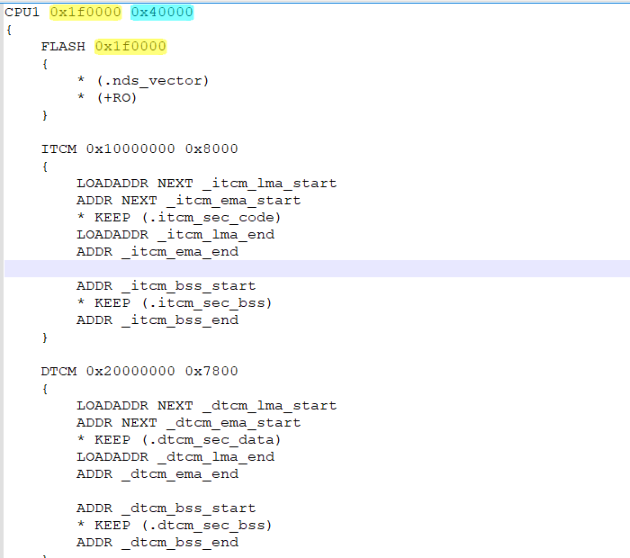
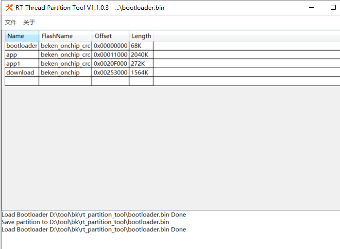

# 分区修改规范[](#id1 "永久链接至标题")

## 一．分区表制作(vnd_flash.c)[](#vnd-flash-c "永久链接至标题")

重要

- vnd_flash.c里的地址都是物理地址，即存放在 FLASH 中的实际起始地址和长度；

- 编译build文件夹下的app.bin，是app0的逻辑地址长度，需依据这个值去规划物理地址配多大；

- 1.拷贝并修改文件：
  flash物理总长度为4M，拷贝middleware/boards/bk7256/vnd_flash/vnd_flash.c到app工程根目录下，然后修改物理地址和长度。

图1分区表(partition)图示[](#id3 "永久链接至图片")

- 2.开启覆盖分区配置：

  修改projects/app/config/bk7256.config，增加以下配置：
  CONFIG_OVERRIDE_FLASH_PARTITION=y

- 3.cmakelist文件加入vnd_flash.c

图2 cmakelist修改图示[](#id4 "永久链接至图片")

## 二．打包脚本配置[](#id2 "永久链接至标题")

> 拷贝middleware/boards/bk7256/configuration.json到app工程根目录下，start_addr和size按照图1分区表中各分区大小修改即可（其中start_addr = partition_start_addr，size = partition_length）；

图3打包脚本配置图示[](#id5 "永久链接至图片")

## 三．链接脚本配置文件（sag）的制作[](#sag "永久链接至标题")

重要

- bk7256是双核，一般需配置bk7256_bsp.sag和bk7256_cp1_bsp.sag，但有些工程为了节省资源，未启用cpu1，如lvgl/widgets，这时只需配置cpu0的bk7256_bsp.sag；

- sag里的地址都是逻辑地址；

- 1.bk7256_bsp.sag修改：

  重要

  - 如果工程根目录下面存在bk7256_bsp.sag，则直接修改这个文件即可，不用拷贝middleware下的；

拷贝middleware/soc/bk7256/bk7256_bsp.sag到app工程根目录下，然后修改逻辑地址和长度，由图1分区表中Application0的partition_start_addr和partition_length计算得出；

图4链接脚本配置(bk7256_bsp.sag)图示[](#id6 "永久链接至图片")

备注

计算规则（前三步因bootloader长度固定，所以一直不会变化，只需修改第四步的长度即可）：
:   - bk7256_bsp.sag中CPU0_LOAD1的逻辑地址（cpu视角0x10000）= Application的partition_start_addr *32/34;

    - bk7256_bsp.sag中CPU0_LOAD1的length（cpu视角0x8800） = 0x8800;

    - bk7256_bsp.sag中CPU0_LOAD2的逻辑地址（cpu视角0x18800）= CPU0_LOAD1的逻辑地址 + 0x8800;

    - bk7256_bsp.sag中CPU0_LOAD2的length（cpu视角0x1D7800） = Application的partition_length*32/34 - 0x8800;

- 2.bk7256_cp1_bsp.sag修改：

  重要

  - 如果工程根目录下面存在bk7256_cp1_bsp.sag，则直接修改这个文件即可，不用拷贝middleware下的；

拷贝middleware/soc/bk7256_cp1/bk7256_cp1_bsp.sag到app工程根目录下，然后修改逻辑地址和长度，由图1分区表中Application1的partition_start_addr和partition_length计算得出；

图5链接脚本配置(bk7256_cp1_bsp.sag)图示[](#id7 "永久链接至图片")

备注

计算规则：
:   - bk7256_cp1_bsp.sag中CPU1的逻辑地址（cpu视角0x1f0000）= Application1的partition_start_addr *32/34;

    - bk7256_cp1_bsp.sag中CPU1的length（cpu视角0x40000） = Application1的partition_length*32/34;

## 四．修改cpu1核的偏移地址[](#cpu1 "永久链接至标题")

> 在projects/app/config/bk7256.config增加配置：CONFIG_SLAVE_CORE_OFFSET=2031616

备注

- CONFIG_SLAVE_CORE_OFFSET后面的地址是10进制，将bk7256_cp1_bsp.sag里的地址转换为十进制即可：0x1F0000 = 2031616;

- 如果将app1分区合入app0时，此步骤不需要修改，但需要屏蔽start_slave_core函数里的执行内容;

## 五．修改bootloader里的分区表[](#bootloader "永久链接至标题")

备注

- 当图1分区表(partition)中ota区域的起始地址没有变化，则此步骤不需要执行；

- 不管是否双核，配置表中一定要有 cpu1 的分区 app1 的存在。在不用 CPU1 的情况下，要把 app1 的分区长度设置为 0；

- 1.使用tools/env_tools/rt_partition_tool/rt_partition_tool.exe 工具修改插入新的bootloader的分区表见图6，简要步骤如下：

  - 打开rt_partition_tool.exe工具

  - 加载middleware/boards/bk7256/bootloader.bin（若bootloader中没有分区表则会提示添加会导入分区表）

  - 编辑/导入分区表

  - 保存分区表到bootloader.bin

  - 导出分区表到json文件以作备用

  - 步骤四中的bootloader.bin,然后替换middleware/boards/bk7256/bootloader.bin。

图6 rt_partition_tool图示[](#id8 "永久链接至图片")

- 2.详细步骤可自行参考文档tools/env_tools/rt_partition_tool/rt_partition_tool.pdf
