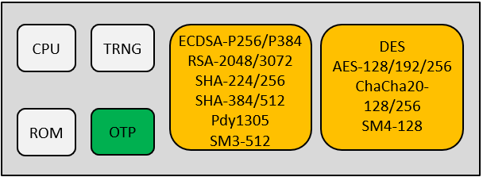

# 概述

物联网设备安全是一个十分重要的方面，为增强设备的安全性，BK7256的安全方案实现了secure boot、flash加解密、固件版本防回滚等功能，保证了固件（包括bootlaoder和app固件）的完整性、合法性和机密性。

> - secure boot采用ECDSA-384算法，保证了固件（包括bootlaoder和app固件）的完整性、合法性。逐级校验逻辑: bootROM强制从flash的起始地址对bootloader进行验签，验签通过后跳转到bootloader中执行；在bootloader中会对APP进行验签，验签通过后会跳转到APP中执行。secure boot功能通过eFuse开启，用户启用该功能后，系统将只能够运行指定私钥签名后固件。
> - flash加解密采用AES-XTS-256算法，保证了固件的机密性。解密过程由硬件自动完成，代码层无感。flash加解密功能通过eFuse开启，开启secure boot后该功能可选择是否启用。
> - 版本防回滚功能：防止固件回滚到有安全漏洞的低版本上。app支持256个版本管理，开启secure boot后该功能自动启用。

硬件资源：

## 1\. BK130

> BK7256具有硬件安全模块BK130，BK130内部的OTP和ROM允许安全存储密钥材料和其他安全数据，支持以下加密算法的硬件实现：
>
> - Crypto algorithm: DES, AES-128/192/256, ChaCha20-128/256, SM4-128
> - Public key accelerator: ECDSA-P256/P384, RSA-2048/3072
> - Hash algorithm: SHA-224/256, SHA-384/512, Poly1305, SM3-512
> - True random number generator (TRNG)
> - Supports secure storage
> - Supports secure boot

BK130 architecture

## 2.eFuse

> > eFuse共有32个字节，功能定义如下：
>
> - Byte 00\~10 ： unused
> - Byte 11\~29 ： Firmware usage
> - Byte 30 ： used for system control
> - Byte 31 ： used for system control

重要

eFuse大部分被固件和系统控制分配使用，未使用部分不提供给客户使用；非易失存储建议使用OTP bank0 。

### 控制字节Byte31的位定义：

> - Bit 7： 1:close the JTAG interface; 0:use the JTAG interface
> - Bit 6： reserve
> - Bit 5： 1: enable FLASH AES encryption; 0: turn off FLASH AES encryption
> - Bit 4： 1:read prohibition of bytes 0:15
> - Bit 3： 1:write prohibition of bytes 0:15
> - Bit 2： 1:write prohibition of bytes 16:23
> - Bit 1： 1:write prohibition of bytes 24:29
> - Bit 0： 1:EFUSE all 32 bytes writes are prohibited

### 控制字节Byte30的位定义：

> - Bit\[0\] : Security Boot enable. 0: disable, 1: enable.
> - Bit\[1\] : Security Boot printout control. 0: enable. 1: disable
> - Bit\[2\] : Fast boot. 0: deepsleep fast boot 1: deepsleep sb boot
> - Bit\[6:3\]: Analog control
> - Bit\[7\] : bootloader printout control. 0: disable. 1: enable(Default disable)

## 3.OTP：

> > OTP分为4个bank：
>
> - bank0 ： Reserved for user, 2k bytes
> - bank1 ： Firmware usage, For security, 2k bytes
> - bank2 ： Firmware usage, For security, 2k bytes
> - bank3 ： For bk130

重要

OTP bank0提供给客户使用，通过配置表进行配置后使用BKFIL工具写入，配置方法见 [bk\_OTP\_and\_eFuse\_usermenu](bk_OTP_and_eFuse_usermenu.md)

### bank0：

用户进行使用和管理

### bank1：

固件进行使用和管理

> bl version、app version、ecdsa public key在secure boot开启时有效。

| content | start address | allocate size(byte) | Description |
| --- | --- | --- | --- |
| reserve | 0x4B004800 | 16 | reserve |
| OTA aes key | 0x4B004810 | 40 | aes key used for OTA upgrade |
| OTA aes IV | 0x4B004838 | 40 | aes IV used for OTA upgrade |
| bl version | 0x4B004860 | 40 | used for bootloader anti rollback |
| app version | 0x4B004888 | 40 | used for app anti rollback |
| ecdsa public key | 0x4B0048B0 | 104 | public key for bootloader to verify the signature of app |
| reserve | 0x4B004918 |  | reserve |

### bank2：

当安全功能开启的时候，该bank只能由硬件访问，外部不可见。

| content | start address | allocate size(byte) | Description |
| --- | --- | --- | --- |
| ecdsa public key | 0x4B005000 | ecdsa384: 96 | public key for BOOT ROM to verify the signature of bootloader |
| AES256 key | 0x4B0057E0 | 32 | used for image encryption on flash |

### bank3：

bk130模块内部使用和管理

## OTP和eFuse的配置及读写方法：

OTP和eFuse均为一次性存储器件，建议使用BKFIL工具进行写入，配置及读写步骤见 [OTP和eFuse的配置及读写方法](bk_OTP_and_eFuse_usermenu.md)。
