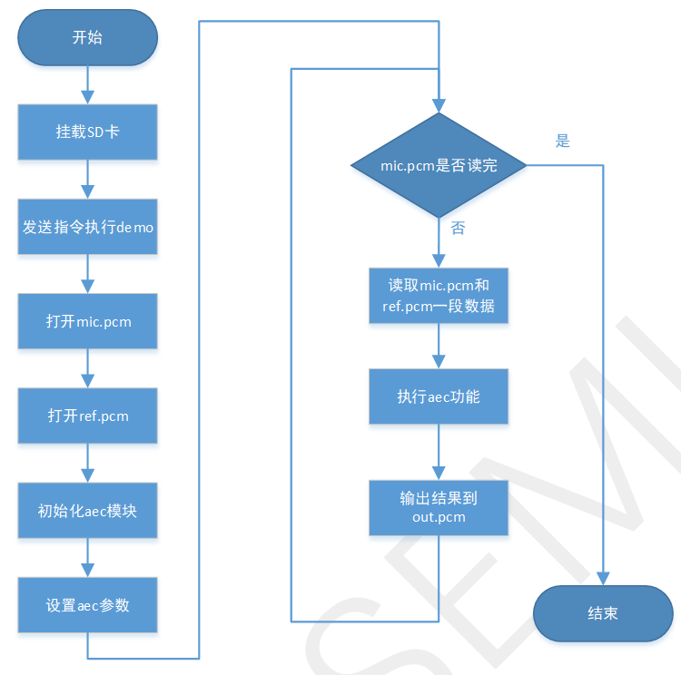

# AEC回声消除，向量测试demo

## 1 功能概述

> 回声消除库的主要作用是消除语音通话场景中的回声，确保高质量的语音通话，同时也有降噪和调节音量的功能。

## 2 代码路径

> demo路径: `\components\demos\media\audio\aec`
>
> AEC库API接口的详细说明请参考同网页: `/api-reference/multi_media/bk_aec.html`

## 3 cli命令简介

demo支持的命令如下表:

| Command | Description |
| --- | --- |
| aec\_test | 运行AEC向量测试demo |

demo运行依赖的宏配置:

| Name | Description | File | value |
| --- | --- | --- | --- |
| CONFIG\_AUDIO\_AEC | 配置AEC是否编译为库 | `\properties\soc\bk7256\bk7256.defconfig` | y |
| CONFIG\_AUDIO\_TEST | 配置demo是否生效 | `\middleware\soc\bk7256\bk7256.defconfig` | y |

demo运行依赖的库和驱动:
:   - libaec.a AEC回声消除库
    - SD SDcard及文件系统驱动

## 4 演示介绍

demo执行的步骤如下:

> 1.准备测试需要的音频文件
> :   - 将demo路径下提供的需要回声消除降噪的mic原始音频文件 `mic.pcm` 和对应的参考信号 `ref.pcm` 文件保存在TF卡根目录
>
> 2.挂载TF卡
> :   - Uart发送AT指令 `fatfstest M 1` 挂载TF卡
>
> 3.执行测试
> :   - Uart发送AT指令 `aec_test` 执行测试，并输出回声消除后的音频文件 `out.pcm`

执行测试指令，case的工作流程如下图所示：

Figure 1\. aec demo flow chart

## 5 详细配置及说明

重要

注意事项:
:   - 1.AEC算法需要buffer约二十多kByte，初始化前需要分配AECContext的内存;
    - 2.算法参数的调节使用 `aec_ctrl` 接口。
