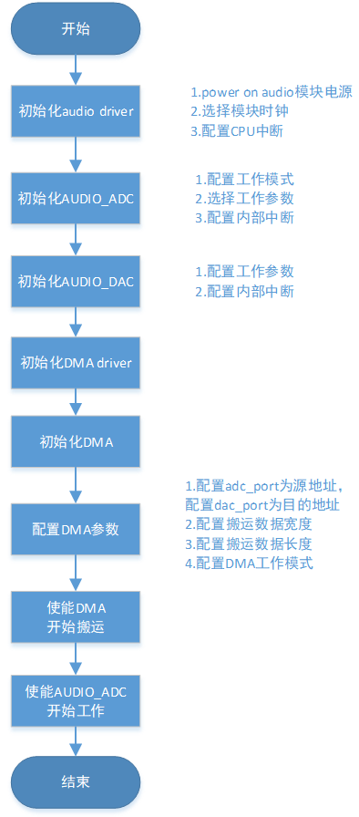

# ADC/DAC软件回环demo

## 1、功能概述

> AUDIO模块的ADC/DAC软件回环demo主要功能是: 将音频采样(AUDIO\_ADC)的音频数据通过DMA搬运至音频播放(AUDIO\_DAC)进行播放。

## 2、代码路径

> demo路径: `\components\demos\media\audio\aud`
>
> AUDIO ADC/DAC API接口的详细说明请参考同网页: `/api-reference/multi_media/bk_aud.html`

## 3、cli命令简介

demo支持的命令如下表:

| Command | Description |
| --- | --- |
| aud\_adc\_mcp\_test {start\|stop} | cpu搬运mic数据至dac |
| aud\_dtmf\_mcp\_test {start\|stop} | cpu搬运dtmf数据至dac |
| aud\_adc\_dma\_test {start\|stop} | DMA搬运mic数据至dac |
| aud\_adc\_loop\_test {start\|stop} | mic数据至dac硬回环 |
| aud\_dtmf\_loop\_test {start\|stop} | dtmf数据至dac硬回环 |

demo运行依赖的宏配置:

| Name | Description | File | value |
| --- | --- | --- | --- |
| CONFIG\_AUDIO | 配置audio功能 | `\middleware\soc\bk7256_cp1\bk7256_cp1.defconfig` | y |
| CONFIG\_AUDIO\_RISCV\_IP\_V1\_0 | 配置audio功能 | `\middleware\soc\bk7256_cp1\bk7256_cp1.defconfig` | y |
| CONFIG\_AUDIO\_TEST | 配置demo使能 | `\middleware\soc\bk7256_cp1\bk7256_cp1.defconfig` | y |

demo运行依赖的库和驱动:
:   - DMA DMA驱动
    - AUD audio模块驱动

## 4、演示介绍

demo执行的步骤如下:

> 1.执行测试
> :   - Uart发送AT指令 `cpu1 aud_adc_dma_test start` 执行测试
>
> 2.验证功能
> :   - 连接耳机可以听到板载mic采集到的音频
>
> 3.停止测试
> :   - Uart发送AT指令 `cpu1 aud_adc_dma_test stop` 停止测试

备注

- 其他demo可根据cli支持的命令表按照上述步骤发送相应的命令即可进行开始或者停止测试。

执行测试指令，case的工作流程如下图所示：

Figure 1\. adc to dac demo flow chart

## 5、详细配置及说明

- AUDIO\_ADC性能

  AUDIO\_ADC支持DTMF和ADC两种工作模式:
  :   - DTMF工作模式 直接数字混频生成数字音频信号，不需要mic采样
      - ADC工作模式 对mic输入信号进行ADC采样，最多支持2路mic的同时采样

  AUDIO\_ADC支持的采样率Fs(bps):

  > - 8K
  > - 16K
  > - 44.1K
  > - 48K

重要

- 1.ADC工作模式支持DMA搬运mic采样结果
- 2.DTMF工作模式不支持DMA搬运混频结果, 只能cpu搬运混频结果
- 3.ADC模式和DTMF模式同一时间仅支持一种
