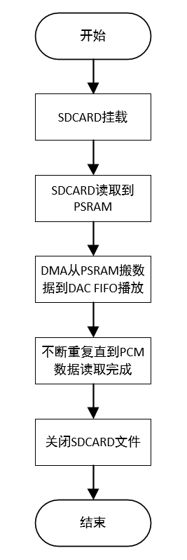

# DAC TF卡播放PCM数据demo

## 1、功能概述

> 从TF卡中读取指定的PCM音乐文件并通过DAC进行播放。

## 2、代码路径

> demo路径: `\components\demos\media\audio\aud_intf\demo\aud_intf_demo.c`
>
> Aud\_Intf API接口的详细说明请参考同网页: `/api-reference/multi_media/bk_aud_intf.html`

## 3、cli命令简介

demo支持的命令如下表:

| Command | Description |
| --- | --- |
| aud\_intf\_play\_test {init\|start\|pause\|stop\|deinit} xx.pcm | 播放xx.pcm文件 |

demo运行依赖的宏配置:

| Name | Description | File | value |
| --- | --- | --- | --- |
| CONFIG\_AUDIO | 配置audio功能 | `\middleware\soc\bk7256\bk7256.defconfig` | y |
| CONFIG\_AUDIO\_RISCV\_IP\_V1\_0 | 配置audio ip | `\middleware\soc\bk7256\bk7256.defconfig` | y |
| CONFIG\_AUD\_INTF | 配置aud\_intf使能 | `\middleware\soc\bk7256\bk7256.defconfig` | y |
| CONFIG\_AUD\_INTF\_VER\_NEW | 配置aud\_intf版本使能 | `\middleware\soc\bk7256\bk7256.defconfig` | y |
| CONFIG\_AUD\_INTF\_TEST | 配置demo使能 | `\middleware\soc\bk7256\bk7256.defconfig` | y |
| CONFIG\_AUDIO\_TRANSFER | 配置语音传输使能 | `\middleware\soc\bk7256\bk7256.defconfig` | y |
| CONFIG\_AUD\_TRAS\_MODE\_CPU0 | 配置语音传输模式 | `\middleware\soc\bk7256\bk7256.defconfig` | y |

demo运行依赖的库和驱动:
:   - DMA DMA驱动
    - AUD audio模块驱动
    - Sdcard 模块驱动

## 4、演示介绍

demo执行的步骤如下:

> 1.存放待播放的PCM音频文件到TF卡中
> :   - 将pcm格式的文件拷贝到TF卡中，并将汉字文件名改成拼音或者数字
>
> 2.挂载TF卡
> :   - Uart发送AT指令 `fatfstest M 1` 挂载TF卡
>
> 3.准备播放
> :   - Uart发送AT指令 `aud_intf_play_test init xx.pcm` 初始化播放
>
> 4.开始播放
> :   - Uart发送AT指令 `aud_intf_play_test start xx.pcm` 开始播放
>
> 5.暂停播放
> :   - Uart发送AT指令 `aud_intf_play_test pause xx.pcm` 暂停播放
>
> 6.恢复播放
> :   - Uart发送AT指令 `aud_intf_play_test start xx.pcm` 恢复播放
>
> 7.停止播放
> :   - Uart发送AT指令 `aud_intf_play_test stop xx.pcm` 停止播放
>
> 8.结束播放
> :   - Uart发送AT指令 `aud_intf_play_test deinit xx.pcm` 结束播放, 关闭pcm文件, 注销播放通路

执行测试指令，case的工作流程如下图所示：

Figure 1\. tf pcm to dac demo flow chart

## 5、详细配置及说明

备注

- 1.音频文件名需修改为字符型，汉字无效;
- 2.当前demo设置DAC采样率为8K;
