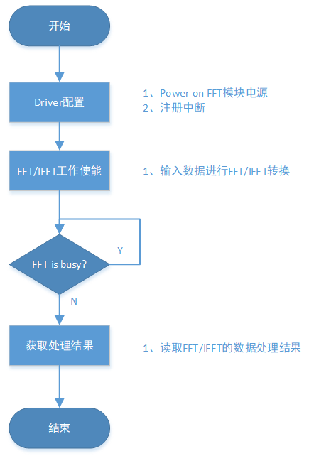

# FFT demo

## 1 功能概述

> FFT demo主要包含FFT和IFFT功能测试，可对数字信号进行时域和频域间的转换，主要用于音频图像等数字信号的滤波处理。

## 2 代码路径

> demo路径: `\components\demos\media\audio\fft`
>
> FFT模块API接口的详细说明请参考同网页: `/api-reference/multi_media/bk_fft.html`

### 3 cli命令简介

demo支持的命令如下表:

| Command | Description |
| --- | --- |
| cpu1 fft\_fft\_test {start\|stop} | 运行fft测试demo |
| cpu1 fft\_ifft\_test {start\|stop} | 运行ifft测试demo |

demo运行依赖的宏配置:

| Name | Description | File | value |
| --- | --- | --- | --- |
| CONFIG\_FFT | 配置FFT功能使能 | `\properties\soc\bk7256_cp1\bk7256_cp1.defconfig` | y |
| CONFIG\_FFT\_TEST | 配置demo是否生效 | `\properties\soc\bk7256_cp1\bk7256_cp1.defconfig` | y |

demo运行依赖的库和驱动:
:   - FFT fft驱动

## 4 演示介绍

demo执行的步骤如下:

> 1.执行fft测试
> :   - Uart发送AT指令 `cpu1 fft_fft_test start` 执行fft功能测试
>
> 2.停止fft测试
> :   - Uart发送AT指令 `cpu1 fft_fft_test stop` 停止执行fft功能测试
>
> 3.执行ifft测试
> :   - Uart发送AT指令 `cpu1 fft_ifft_test start` 执行ifft功能测试
>
> 4.停止ifft测试
> :   - Uart发送AT指令 `cpu1 fft_ifft_test stop` 停止执行ifft功能测试

执行测试指令，case的工作流程如下图所示:

Figure 1\. fft demo flow chart

## 5 详细配置及说明

重要

注意事项:
:   - 1.FFT和IFFT功能同一时间只能选择其中一个执行;
