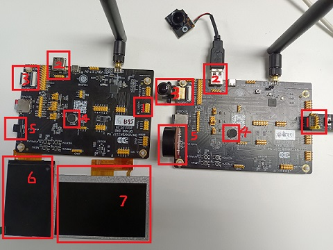

# MEDIA\_TRA

## 1 功能概述

> 多媒体互传功能，两块板子之间音频双向传输、视频是一块采集视频图像，另一块负责接收并显示到LCD屏幕上

## 2 代码路径

> demo路径：`project/av_client/main/av_client_main.c`, `project/av_server/main/av_server_main.c`, `components/demos/media/doorbell`, `components/demos/media/av_demo`

## 3 cli命令简介

> demo支持的命令如下表：
>
> | Command | Param | Description |
> | --- | --- | --- |
> | doorbell udp\_c \[param1\] \[param2\]  \[param3\] \[param4\] | param1:camera\_type | set the camera type used |
> | param2:camera\_ppi | set the camera output resolution |
> | param3:LCD ppi | LCD screen support resolution |
> | param4:LCD name | LCD screen name |
> | doorbell udp\_s \[param1\] \[param2\] | param3:LCD ppi | LCD screen support resolution |
> | param4:LCD name | LCD screen name |
> | av\_udp\_test param | param:current chip role | udp transfer play client or server |
>
> demo运行依赖的宏配置：
>
> | NAME | Description | File | value |
> | --- | --- | --- | --- |
> | CONFIG\_DOORBELL | support DOORBELL | `middleware\soc\bk7256\bk7256.defconfig` | y |
> | CONFIG\_JPEG\_ENCODE | suport hw jpeg ecoder | `middleware\soc\bk7256\bk7256.defconfig` | y |
> | CONFIG\_CAMERA | suport use dvp camera | `middleware\soc\bk7256\bk7256.defconfig` | y |
> | CONFIG\_CAMERA\_USE\_I2C1 | suport use I2C1 | `middleware\soc\bk7256\bk7256.defconfig` | y |
> | CONFIG\_AUDIO | support audio function | `middleware\soc\bk7256\bk7256.defconfig` | y |
> | CONFIG\_LCD | support LCD function | `middleware\soc\bk7256\bk7256.defconfig` | y |
> | CONFIG\_USB\_UVC | support UVC camera | `middleware\soc\bk7256\bk7256.defconfig` | y |
> | CONFIG\_AV\_DEMO | support av transfer | `middleware\soc\bk7256\bk7256.defconfig` | y |

## 4 演示介绍

> demo执行的步骤如下：
>
> 1、准备好dvp摄像头或者UVC摄像头，LCD屏幕(rgb或者8080)，speak，连接配置方式如下图1所示
>
> 2、编译两个版本：
> :   - make bk7256 PROJECT\=av\_client
>     - make bk7256 PROJECT\=av\_server
>
> 3、烧录与运行
>
> > 因为视频是单向的，一个板子负责采集图像，并通过UDP发送到另一个板子，另一个板子接收到图像数据，解码并显示到LCD屏幕上。
> > 所以，插摄像头负责采集的板子，烧录av\_client编译的版本，带有LCD屏幕的烧录av\_server编译的版本，上电后自动运行。
>
> 4、图一的说明
> :   - 1：串口供电
>     - 2：USB\&UVC摄像头接口
>     - 3：DVP摄像头接口
>     - 4：MIC采集
>     - 5：speak接口
>     - 6：320\*480 8080屏幕
>     - 7：480\*272 RGB屏幕

Figure 1\. av transfer demo

备注

针对这种运行案例的方法，默认使用的是UVC(640\*480的分辨率)，LCD默认使用(480\*272分辨率)。

## 5 cli命令的使用

> 上面的demo演示是需要编译两个版本，且已经集成好了，不需要输入任何的命令，默认上电就会运行双向对讲的功能。
> 当前也支持客户自己发命令来实现双向对讲的功能，编译的版本：make bk7256；
>
> 1、宏的定义
> :   - 针对BK7256的版本，库上默认将宏CONFIG\_AV\_DEMO关闭了，编译之前需要手动打开，然后进行编译；
>
> 2、板子的角色定义
> :   - ap ssid key channle:在接有屏幕的板子上起softap，自定义ssid，key和channel，如上图中56#B板
>     - sta ssid key:在接有摄像头的板子上起station，连接ap，如上图中122#B板
>
> 3、开启双向语音
> :   - 56#B：av\_udp\_test server
>     - 122#B：av\_udp\_test client
>
> 4、开启视频传输
> :   - 56#B：doorbell udp\_s 480X272
>
>       > 480X272是对应的LCD的分辨率
>     - 122#B：doorbell udp\_c uvc\|dvp 640X480
>
>       > uvc\|dvp：表示应用的摄像头类型，dvp或uvc，每次仅支持一种，如果不写，默认为dvp；
>       >
>       > 640X480：表示摄像头输出的分辨率，另外还支持其他分辨率，如果不写，默认为640X480；
