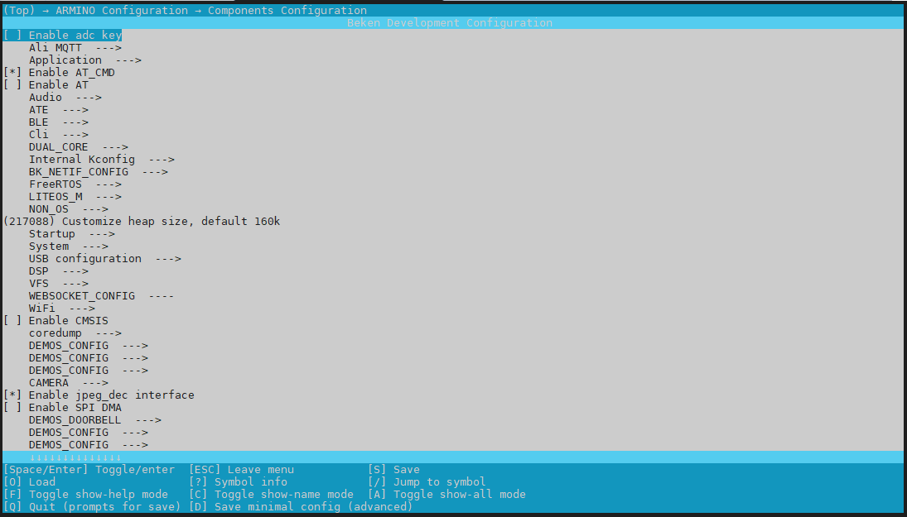
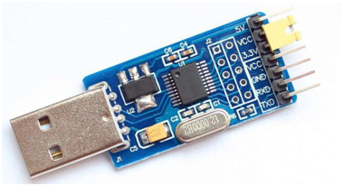
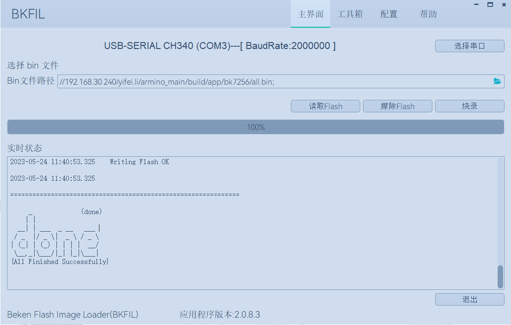

<a id="id1"></a>

# 快速入门

本文档以 BK7256 开发板为例，通过一个简单的示例项目向您展示

> - 如何构建Armino编译环境；
> - 以及如何配置 Armino 工程；
> - 如何编译、下载固件；

<a id="id2"></a>

## 准备工作

硬件：

> - BK7256 开发板
> - 串口烧录工具
> - 电脑（Windows 与 Ubuntu）

备注

Armino 仅支持在 Linux 平台编译，仅支持在 Windows 平台进行固件烧录。
因此，您需要两台电脑，一台 Linux 平台，一台 Windows 平台；
当然，您也可以只使用 Windows 平台，在 Windows 平台上安装 Linux 虚拟机。

软件：

> - RISCV工具链，用于编译 Armino RISCV版本；
> - 构建工具，包含 CMake；
> - Armino 源代码；
> - 串口烧录软件；

<a id="armino-sdk"></a>

## Armino SDK代码下载

您可从 gitlab 上下载 Armino:

```
mkdir -p ~/armino
cd ~/armino
git clone http://gitlab.bekencorp.com/wifi/armino.git
```

您也可从 github 上下载 Armino:

```
mkdir -p ~/armino
cd ~/armino
git clone https://github.com/bekencorp/armino.git
```

备注

从官网的gitlab下载的为最近的SDK代码，相关账号找项目上审核申请。

<a id="id3"></a>

## 构建编译环境

备注

Armino，当前支持Linux环境下编译，本章节将以Ubuntu 20.04 LTS版本为例，介绍整个编译环境的搭建。

<a id="id4"></a>

## 工具链安装

BK7256工具链下载路径如下：

> 工具链下载：
> <http://dl.bekencorp.com/tools/toolchain/>
> 在此目录下获取最新版本，如：toolchain\_v5.2.1.tgz

工具包下载后，通过如下操作命令解压至 /opt/risc-v目录下:

```
$ sudo tar -zxvf toolchain_v5.2.1.tgz -C /
```

备注

工具链默认路径在middleware/soc/bk7256/bk7256.defconfig文件中定义，客户可自行配置:

```
CONFIG_TOOLCHAIN_PATH="/opt/risc-v/nds32le-elf-mculib-v5/bin"
```

工具链也可支持相对路径配置，如工具链放在sdk目录下:

```
CONFIG_TOOLCHAIN_PATH="toolchain_v5.2.1/nds32le-elf-mculib-v5/bin"
```

<a id="id5"></a>

## 程序编译依赖库安装

在终端输入下述命令安装 python3，CMake，Ninja， Crypto以及依赖库:

```
sudo dpkg --add-architecture i386
sudo apt-get update
sudo apt-get install build-essential cmake python3 python3-pip doxygen ninja-build libc6:i386 libstdc++6:i386 libncurses5-dev lib32z1 -y
sudo pip3 install pycrypto click
```

<a id="id6"></a>

## 文档编译依赖库安装

在终端上输入如下命令安装文档编译所需要的 python 依赖:

```
sudo pip3 install sphinx_rtd_theme future breathe blockdiag sphinxcontrib-seqdiag sphinxcontrib-actdiag sphinxcontrib-nwdiag sphinxcontrib.blockdiag
```

设置Python默认版本:

```
sudo ln -s /usr/bin/python3 /usr/bin/python
```

<a id="id7"></a>

## 编译工程

在终端下输入下述命令编译 Armino 默认工程，PROJECT为可选参数，默认为app，默认工程为启动 WiFi，BLE，初始化常见驱动，并启动 Armino 默认 Cli 程序:

```
cd ~/armino
make bk7256
```

- BK7256为双CPU核系统，默认配置为双核，编译BK7256平台CPU0系统，会自动编译CPU1和CPU0，并将CPU0，CPU1系统一起打包
- BK7256平台默认工程使用的是FreeRTOS V10.4系统:

  ```
  components/os_source/freertos_v10
  ```
- BK7256平台支持鸿蒙OS V3.0.1系统，可编译harmony工程:

  ```
  cd ~/armino
  make bk7256 PROJECT=harmony
  ```
- 当然您也可以编译任何其他 armino/projects 下的工程，命令如下:

  ```
  cd ~/armino
  make bk7256 PROJECT=examples/get-started/hello_world
  ```

<a id="id8"></a>

## 配置工程

- 您可以通过 menuconfig 来更改 Armino 默认配置项，以bk7256为例进行操作说明

  > - 终端键入命令,其中ARMINO\_SOC用于指定芯片:
  >
  >   ```
  >   cd ~/armino
  >   make menuconfig ARMINO_SOC=bk7256
  >   ```
  > - menuconfig配置界面呈现如下图:
  >   :   <a id="id13"></a>
  >       
  >
  >
  >       Menuconfig
  > - 通过上下键选择，并按回车键进入组件配置项的目录：
  >   (Top)–\>ARMINO Configuration–\>Components Configuration
  > - 配置当前目录所罗列的组件配置项，并按”S”键保存
  > - 保存后，从menuconfig配置界面配置的差异配置项将更新到工程配置文件projects/app/config/bk7256.config中
  > - 终端输入命令，编译工程bk7256:
  >
  >   ```
  >   cd ~/armino
  >   make bk7256
  >   ```
  > - 编译时将以工程配置文件 Override 芯片配置文件 Override 默认配置的优先级进行差异化配置
  >   如： bk7256.config \>\> bk7256.defconfig \>\> KConfig
- 您也可以手动直接通过工程配置文件来进行差异化配置:

  ```
  工程配置文件 Override 芯片配置文件 Override 默认配置
  如： bk7256.config >> bk7256.defconfig >> KConfig
  + 工程配置文件示例：
      projects/app/config/bk7256.config
      projects/harmony/config/bk7256.config
      projects/customization/bk7256_config1/config/bk7256.config
  + 芯片配置文件示例：
      middleware/soc/bk7256/bk7256.defconfig
  + KConfig配置文件示例：
      middleware/arch/riscv/Kconfig
      components/bk_cli/Kconfig
  ```
- 重要的配置说明
  :   - 操作系统配置为FreeRTOS V10:

        ```
        #
        # FreeRTOS
        #
        CONFIG_FREERTOS=y
        # CONFIG_LITEOS_M is not set
        CONFIG_FREERTOS_V9=n
        CONFIG_FREERTOS_V10=y
        ```
      - 操作系统配置为鸿蒙OS:

        ```
        # LITEOS_M
        CONFIG_LITEOS_M_V3=y
        CONFIG_LITEOS_M_BK=y

        # FreeRTOS
        CONFIG_FREERTOS=n
        CONFIG_FREERTOS_V9=n
        CONFIG_FREERTOS_V10=n
        ```
- 系列芯片宏的使用与差异

  > - 宏CONFIG\_SOC\_BK7256XX 表示BK7256系列:
  >
  >   ```
  >   属于BK7235/BK7237/BK7256公共芯片宏，CPU1也需要定义该宏
  >           配置方式：CONFIG_SOC_BK7256XX=y
  >   ```
  > - 区分同系列芯片的宏(不用于区分其他芯片):
  >
  >   ```
  >   CONFIG_SOC_BK7256, CPU1需要定义该宏和CONFIG_SLAVE_CORE组合区分BK7256_CPU1
  >   配置方式：CONFIG_SOC_BK7256=y
  >   ```
  > - 字符串系列芯片的宏(用于编译阶段区分其他芯片):
  >
  >   ```
  >   CPU0/CPU1有区分：
  >           CPU0写法：CONFIG_SOC_STR="bk7256"
  >           CPU1写法：CONFIG_SOC_STR="bk7256_cp1"
  >   ```
  > - 双核CPU0,CPU1相关宏区分(用于代码区分):
  >
  >   ```
  >   CONFIG_DUAL_CORE            #双核功能
  >   CONFIG_MASTER_CORE          #依赖于CONFIG_DUAL_CORE，CPU0与CPU1的区别
  >   CONFIG_SLAVE_CORE           #依赖于CONFIG_DUAL_CORE，CPU0与CPU1的区别
  >   单核：上面的三个宏都不定义
  >   ```
- 模块选择CPUx执行

  > - 因为是双核AMP系统架构，CPU0和CPU1的软件独立编译，但SDK是一套，所以CPU0和CPU1的的部分功能差异需要使用宏区分。
  >   比如TRNG随机数控制器只有一份，使用双核配置时，应用程序需要互斥配置在哪一个系统(CPU0 or CPU1)中执行。
  >   假设CPU0需要使用TRNG，而CPU1不需要使用，则bk7256.defconfig中的CONFIG\_TRNG\=y，而bk7256\_cp1.defconfig中配置为CONFIG\_TRNG\=n。
  >   在软件代码中，使用CONFIG\_TRNG宏隔离调用，防止部分公共代码文件(CPU0和CPU1代码相同部分)在CPU1上编译报错。
  > - 示例如下:
  >
  >   ```
  >   #if CONFIG_TRNG             #使用模块功能开关宏隔离代码
  >   #include "driver/trng.h"
  >   #endif
  >   ...
  >   #if CONFIG_TRNG             #使用模块功能开关宏隔离代码
  >   bk_rand();
  >   #endif
  >   ```

<a id="id9"></a>

## 新建工程

默认工程为projects/app，新建工程可参考projects/harmony工程

<a id="id10"></a>

## 烧录代码

在 Windows 平台上， Armino 目前支持 UART 烧录。

<a id="id11"></a>

### 通过串口烧录

备注

Armino支持UART烧录，推荐使用 CH340 串口工具小板进行下载。

串口烧录工具如下图所示:

<a id="id14"></a>



UART

烧录工具获取：

> <http://dl.bekencorp.com/tools/flash/>
> 在此目录下获取最新版本，如：BEKEN\_BKFIL\_V2.1.4.0\_20231011.zip

bk\_writer.exe 界面及相关配置如下图所示：

<a id="id15"></a>



bkwriter GUI

烧录串口UART1，点击\`\`烧录\`\`进行版本烧录, 烧录完成之后掉电重启设备。

<a id="logcommand-line"></a>

## 串口Log及Command Line

- 目前BK7256平台，串口Log及Command Line命令输入在UART1口；可通过help命令查看支持命令列表；
- CPU1的Log也通过CPU0的UART1串口输出，CPU1的Log带“cpu1”标记；
- CPU1的Command Line可通过CPU0的UART1执行，如:

  ```
  cpu1 help //输出cpu1的命令列表
  cpu1 time //输出cpu1的当前运行时间
  ```

<a id="id12"></a>

## 编译选项及链接选项

> - BK7256平台，默认编译选项”-mstrict-align”，链接选项”-Wl,–defsym,memcpy\=memcpy\_ss”
> - 若单独编译lib库，需要增加编译选项”-mstrict-align”
> - 若不使用平台的链接命令，如编译鸿蒙系统，对于Andes v5.1.1工具链，需要增加链接选项”-Wl,–defsym,memcpy\=memcpy\_ss”
