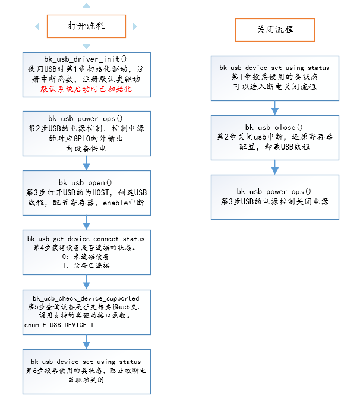
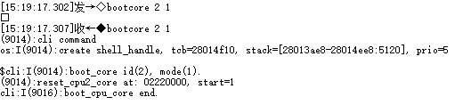
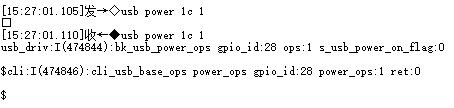
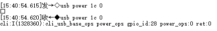

# USB

- [USB Host UVC\+UAC](usb/bk_usbh_uvc_uac.md)

## USB 简介

USB（Universal Serial Bus）是一种通用的总线标准，用于连接主机和外设设备。USB 主机可以通过 USB 接口与 USB 设备连接，实现数据传输、电源供给等功能。

USB IF（USB Implementers Forum）是 USB 标准的制定者，它制定了 USB 标准，包括 USB 1.1、USB 2.0、USB 3.0 等，定义了 USB 接口的物理层、数据链路层、传输层、会话层、表示层等协议，以及 USB 设备类（Device Class）标准，常见的设备类包括 HID（Human Interface Device，人机接口设备）、MSC（Mass Storage Class，大容量存储设备）、CDC（Communication Device Class，通信设备）、Audio、Video 等。

博通BK7258芯片支持各种各样的 USB 应用，包括 USB 多媒体类应用，USB 通信类应用，USB 存储类应用，USB 人机交互类应用等。

## USB 基本使用

USB open/close

## USB 测试示例

注：BK7258 USB 默认运行在CPU2，使用默认avdk调试需要连接UART2协助输入命令测试，依赖CLI命令打开编译后调试。 测试目标：USB模块开关正常，枚举正常，解析正常，断开/连接等状态记录正常。

作为HOST 识别枚举Video\+Audio融合设备为例，输入命令和LOG信息如下图所示：

1、在默认串口输入 bootcore 2 1 启动CPU2 ，log如下

CLI Boot CPU2

2、uart2 串口输入usb power 1c 1，log如下

CLI USB PowerON

3、uart2 串口输入usb open\_host，枚举成功log如下

CLI USB Open Host

4、uart2 串口输入usb check\_dev 0(是否支持video)/usb check\_dev 1(是否支持mic)/usb check\_dev 2(是否支持speaker)，支持需要的类设备log如下

CLI USB Check video/mic/speaker

5、uart2 串口输入usb close,log如下

CLI USB Close

6、uart2 串口输入usb power 1c 0,log如下

CLI USB PowerDown

## USB API Status

| API | BK7258\_cp2 |
| --- | --- |
| [`bk_usb_driver_init()`](#_CPPv418bk_usb_driver_initv "bk_usb_driver_init") | Y |
| [`bk_usb_driver_deinit()`](#_CPPv420bk_usb_driver_deinitv "bk_usb_driver_deinit") | Y |
| [`bk_usb_power_ops()`](#_CPPv416bk_usb_power_ops8uint32_tb "bk_usb_power_ops") | Y |
| [`bk_usb_open()`](#_CPPv411bk_usb_open8uint32_t "bk_usb_open") | Y |
| [`bk_usb_close()`](#_CPPv412bk_usb_closev "bk_usb_close") | Y |
| [`bk_usb_control_transfer_init()`](#_CPPv428bk_usb_control_transfer_initv "bk_usb_control_transfer_init") | Y |
| [`bk_usb_control_transfer_deinit()`](#_CPPv430bk_usb_control_transfer_deinitv "bk_usb_control_transfer_deinit") | Y |
| [`bk_usb_control_transfer()`](#_CPPv423bk_usb_control_transferP20s_usb_device_requestP26s_usb_transfer_buffer_info "bk_usb_control_transfer") | Y |
| [`bk_usb_device_set_using_status()`](#_CPPv430bk_usb_device_set_using_statusb14E_USB_DEVICE_T "bk_usb_device_set_using_status") | Y |
| [`bk_usb_get_device_connect_status()`](#_CPPv432bk_usb_get_device_connect_statusv "bk_usb_get_device_connect_status") | Y |
| [`bk_usb_check_device_supported()`](#_CPPv429bk_usb_check_device_supported14E_USB_DEVICE_T "bk_usb_check_device_supported") | Y |

## USB Port Number

| Capability | BK7258\_cp1 | BK7258\_cp2 |
| --- | --- | --- |
| Port Number | 1 | 1 |

## USB Pin and GPIO Map

| USB Pin | BK7258\_cp1 | BK7258\_cp2 |
| --- | --- | --- |
| USB DP | 12 | 12 |
| USB DN | 13 | 13 |
| USB power | 28 | 28 |

## USB API Reference

### Header File

- [usb.h](https://docs.bekencorp.com/arminodoc/bk_idk/bk7258/zh_CN/v2.0.1/_header_files/include/components/usb.h)

### Functions

    [bk\_err\_t](../system/os.md#_CPPv48bk_err_t "bk_err_t") bk\_usb\_driver\_init(void)
:   USB Driver initialization.

    Register the adaptation layer and pass the function pointers used by the closed source library. Register the current USB Class type to be supported, and it can be uninstalled and reinitialized during execution. But be sure to do so before calling other interfaces.

    - Configure Interrupt handling function registration
    - Configure Class Driver Registration

    This API should be called before any other USB APIs.

    返回
    :   - BK\_OK: succeed
        - others: other errors.

    [bk\_err\_t](../system/os.md#_CPPv48bk_err_t "bk_err_t") bk\_usb\_driver\_deinit(void)
:   USB Driver uninstallation.

    Turn off the USB main interrupt switch Unregister Total Interrupt Handling Function Unregistered Class Driver

    This API should be called after any other USB APIs.

    返回
    :   - BK\_OK: succeed
        - others: other errors.

    [bk\_err\_t](../system/os.md#_CPPv48bk_err_t "bk_err_t") bk\_usb\_power\_ops(uint32\_t gpio\_id, bool ops)
:   Pin controlled USB Vbus.

    This API controls VBUS for USB:

    - Determine whether to output voltage through the high and low levels of a GPIO output parameter: gpio\_id Select the corresponding pin number ops Choose to power on or off
    - Configure whether USB is power on

    When the fusion device is working, if there is a device voting for use, it cannot be directly turned off.

    返回
    :   - BK\_OK: succeed
        - others: other errors.

    [bk\_err\_t](../system/os.md#_CPPv48bk_err_t "bk_err_t") bk\_usb\_open(uint32\_t usb\_mode)
:   open the USB

    This API configure the resoure common to USB:

    - Select the identity as host or slave parameter: usb\_mode USB\_HOST\_MODE \= 0 USB\_DEVICE\_MODE \= 1
    - Configure USB common clock
    - Configure USB common registers

    This API should be called before any other USB APIs.

    返回
    :   - BK\_OK: succeed
        - others: other errors.

    [bk\_err\_t](../system/os.md#_CPPv48bk_err_t "bk_err_t") bk\_usb\_close(void)
:   close the USB

    This API release USB resources:

    - Restore register
    - Turn off the power and clock

    This API should be called after any other USB APIs.

    返回
    :   - BK\_OK: succeed
        - others: other errors.

    [bk\_err\_t](../system/os.md#_CPPv48bk_err_t "bk_err_t") bk\_usb\_control\_transfer\_init(void)
:   Initializes the control transfer request resource.

    返回
    :   - BK\_OK: succeed
        - others: other errors.

    [bk\_err\_t](../system/os.md#_CPPv48bk_err_t "bk_err_t") bk\_usb\_control\_transfer\_deinit(void)
:   Unmount control transfer to release resource.

    返回
    :   - BK\_OK: succeed
        - others: other errors.

    [bk\_err\_t](../system/os.md#_CPPv48bk_err_t "bk_err_t") bk\_usb\_control\_transfer([s\_usb\_device\_request](#_CPPv420s_usb_device_request "s_usb_device_request") \*pSetup, [s\_usb\_transfer\_buffer\_info](#_CPPv426s_usb_transfer_buffer_info "s_usb_transfer_buffer_info") \*buffer\_info)
:   Control command and data interface fucntion to be passed.

    This API is used to send commands and transfer data:

    - Two parameters pSetup/buffer\_info.
    - [s\_usb\_device\_request](#structs__usb__device__request): The command format is specified by the USB protocol
    - [s\_usb\_transfer\_buffer\_info](#structs__usb__transfer__buffer__info): Buffer informataion for sending and receiving data.

      example: Reference UVC\_OTA demo

    返回
    :   - BK\_OK: succeed
        - others: other errors.

    void bk\_usb\_device\_set\_using\_status(bool use\_or\_no, [E\_USB\_DEVICE\_T](#_CPPv414E_USB_DEVICE_T "E_USB_DEVICE_T") dev)
:   A voting function is currently in use.

    This API requires two parameters to be filled in for voting to prevent it from being closed parameter: use\_or\_no TRUE USBING FALSE NOT used dev USB\_UVC\_DEVICE USB\_UAC\_MIC\_DEVICE USB\_UAC\_SPEAKER\_DEVICE USB\_MSD\_DEVICE USB\_OTA\_DEVICE USB\_USER\_CHECK\_DEVICE

    返回
    :   - BK\_OK: succeed
        - others: other errors.

    bool bk\_usb\_get\_device\_connect\_status(void)
:   Obtain whether there is currently a device connection.

    返回
    :   - TRUE: connect
        - FALSE: disconnect

    [bk\_err\_t](../system/os.md#_CPPv48bk_err_t "bk_err_t") bk\_usb\_check\_device\_supported([E\_USB\_DEVICE\_T](#_CPPv414E_USB_DEVICE_T "E_USB_DEVICE_T") usb\_dev)
:   Check if the corresponding device class is supported.

    返回
    :   - BK\_OK: succeed
        - others: other errors.

    [bk\_err\_t](../system/os.md#_CPPv48bk_err_t "bk_err_t") bk\_usb\_get\_device\_descriptor(struct [usb\_device\_descriptor\_t](#_CPPv423usb_device_descriptor_t "usb_device_descriptor_t") \*dev\_descriptor)
:   Obtain device descriptor.

    dev\_descriptor: uint8\_t bLength; Descriptor size in bytes \= 18 uint8\_t bDescriptorType; DEVICE descriptor type \= 1 uint16\_t bcdUSB; USB spec in BCD, e.g. 0x0200 uint8\_t bDeviceClass; Class code, if 0 see interface uint8\_t bDeviceSubClass; Sub-Class code, 0 if class \= 0 uint8\_t bDeviceProtocol; Protocol, if 0 see interface uint8\_t bMaxPacketSize0; Endpoint 0 max. size uint16\_t idVendor; Vendor ID per USB-IF uint16\_t idProduct; Product ID per manufacture uint16\_t bcdDevice; Device release \# in BCD uint8\_t iManufacturer; Index to manufacturer string uint8\_t iProduct; Index to product string uint8\_t iSerialNumber; Index to serial number string uint8\_t bNumConfigurations; Number of possible configurations

    void bk\_usb\_mailbox\_sw\_master\_init(void)
:   Initialize the USB master mailbox software.

    void bk\_usb\_mailbox\_sw\_slave\_init(void)
:   Initialize the USB slave mailbox software.

    void bk\_usb\_mailbox\_sw\_master\_deinit(void)
:   Uninstall the USB master mailbox software.

    void bk\_usb\_mailbox\_sw\_slave\_deinit(void)
:   Uninstall the USB slave mailbox software.

## USB API Typedefs

### Header File

- [usb\_types.h](https://docs.bekencorp.com/arminodoc/bk_idk/bk7258/zh_CN/v2.0.1/_header_files/include/components/usb_types.h)

### Structures

    struct usb\_device\_descriptor\_t

    struct usb\_configuration\_descriptor\_t

    struct usb\_interface\_association\_descriptor\_t

    struct usb\_interface\_descriptor\_t

    struct usb\_audio\_endpoint\_general\_descriptor\_t

    struct s\_bk\_usb\_endpoint\_descriptor

    struct bk\_uvc\_format\_index

    struct bk\_uvc\_frame

    struct bk\_uvc\_all\_frame

    struct bk\_uvc\_device\_brief\_info\_t

    struct bk\_uvc\_config\_t

    struct audio\_packet\_t

    struct audio\_packet\_control\_t

    struct bk\_uac\_ring\_buffer\_t

    struct bk\_uac\_device\_brief\_info\_t

    struct bk\_uac\_mic\_config\_t

    struct bk\_uac\_spk\_config\_t

    struct bk\_uac\_config\_t

    struct bk\_uvc\_uac\_app\_callback

    struct s\_usb\_device\_request

    struct s\_usb\_transfer\_buffer\_info

### Macros

 BK\_ERR\_USB\_NOT\_POWER
:   USB vbus poweron, etc

 BK\_ERR\_USB\_NOT\_OPEN
:   USB dose not turn on clock and power, etc

 BK\_ERR\_USB\_NOT\_CLOSE
:   USB dose not turn off clock and power, etc

 BK\_ERR\_USB\_NOT\_CONNECT
:   USB device not connected

 BK\_ERR\_USB\_OPERATION\_NULL\_POINTER
:   USB Operated with null pointer

 BK\_ERR\_USB\_UVC\_NOT\_START
:   UVC Transfer not started

 BK\_ERR\_USB\_UVC\_NOT\_STOP
:   UVC Transfer not stopped

 BK\_ERR\_USB\_UVC\_NOT\_PAUSE
:   UVC Transfer not paused

 BK\_ERR\_USB\_UVC\_GET\_PARAMETER\_FAILED
:   UVC The command to obtain parameters did not respond

 BK\_ERR\_USB\_UVC\_SET\_PARAMETER\_FAILED
:   UVC Configuration parameter command did not respond

 BK\_ERR\_USB\_UVC\_SET\_INTERFACE\_FAILED
:   UVC The set port command did not respond

 BK\_ERR\_USB\_UVC\_NOSUPPORT\_ATTRIBUTE
:   UVC The attribute configuration is not supported

 BK\_ERR\_USB\_UAC\_NOT\_START
:   UAC Transfer not started

 BK\_ERR\_USB\_UAC\_NOT\_STOP
:   UAC Transfer not stopped

 BK\_ERR\_USB\_UAC\_NOT\_PAUSE
:   UAC Transfer not paused

 BK\_ERR\_USB\_UAC\_GET\_PARAMETER\_FAILED
:   UAC The command to obtain parameters did not respond

 BK\_ERR\_USB\_UAC\_SET\_PARAMETER\_FAILED
:   UAC Configuration parameter command did not respond

 BK\_ERR\_USB\_UAC\_SET\_INTERFACE\_FAILED
:   UAC The set port command did not respond

 BK\_ERR\_USB\_UAC\_NOSUPPORT\_ATTRIBUTE
:   UAC The attribute configuration is not supported

 BK\_USB\_ENDPOINT\_XFERTYPE\_MASK

### Type Definitions

    typedef void (\*control\_irpcomplete)(void\*, void\*)

### Enumerations

   enum E\_USB\_MODE
:   *Values:*

    

       enumerator USB\_HOST\_MODE

    

       enumerator USB\_DEVICE\_MODE

   enum E\_USB\_CONNECTION\_STATUS
:   *Values:*

    

       enumerator USB\_DEVICE\_DISCONNECT

    

       enumerator USB\_DEVICE\_CONNECT

   enum E\_FRAME\_RATE\_ID
:   *Values:*

    

       enumerator FPS\_60

    

       enumerator FPS\_30

    

       enumerator FPS\_25

    

       enumerator FPS\_20

    

       enumerator FPS\_15

    

       enumerator FPS\_10

    

       enumerator FPS\_5

   enum E\_USB\_DEVICE\_T
:   *Values:*

    

       enumerator USB\_UVC\_DEVICE

    

       enumerator USB\_UAC\_MIC\_DEVICE

    

       enumerator USB\_UAC\_SPEAKER\_DEVICE

    

       enumerator USB\_MSD\_DEVICE

    

       enumerator USB\_OTA\_DEVICE

    

       enumerator USB\_USER\_CHECK\_DEVICE

    

       enumerator USB\_CDC\_DEVICE

    

       enumerator USB\_DEVICE\_MAX

   enum E\_USB\_ENDPOINT\_TRANSFER\_MODE\_T
:   *Values:*

    

       enumerator USB\_ENDPOINT\_CONTROL\_TRANSFER

    

       enumerator USB\_ENDPOINT\_ISOCH\_TRANSFER

    

       enumerator USB\_ENDPOINT\_BULK\_TRANSFER

    

       enumerator USB\_ENDPOINT\_INT\_TRANSFER

    

       enumerator USB\_ENDPOINT\_INVALID\_TRANSFER

   enum bk\_usb\_drv\_op\_t
:   *Values:*

    

       enumerator USB\_DRV\_IDLE

    

       enumerator USB\_DRV\_EXIT

    

       enumerator USB\_POWER\_OPS

    

       enumerator USB\_DRV\_USB\_INIT

    

       enumerator USB\_DRV\_USB\_DEINIT

    

       enumerator USB\_DRV\_SET\_DEV\_USE

    

       enumerator USB\_DRV\_USB\_OPEN

    

       enumerator USB\_DRV\_USB\_CLOSE

    

       enumerator USB\_DRV\_CONNECT\_HANDLE

    

       enumerator USB\_DRV\_DISCONNECT\_HANDLE

    

       enumerator USB\_DRV\_GET\_DEV\_CONNECT\_STATUS

    

       enumerator USB\_DRV\_CHECK\_DEV\_SUPPORT

    

       enumerator USB\_DRV\_PRASE\_DESCRIPTOR

    

       enumerator USB\_DRV\_INIT\_CONTROL\_TRANS

    

       enumerator USB\_DRV\_DEINIT\_CONTROL\_TRANS

    

       enumerator USB\_DRV\_CONTROL\_TRANSFER

    

       enumerator USB\_DRV\_UVC\_REGISTER\_CONNECT\_CB

    

       enumerator USB\_DRV\_UVC\_REGISTER\_DISCONNECT\_CB

    

       enumerator USB\_DRV\_UVC\_GET\_PARAM

    

       enumerator USB\_DRV\_UVC\_SET\_PARAM

    

       enumerator USB\_DRV\_UVC\_REGISTER\_TRANSFER\_OPS

    

       enumerator USB\_DRV\_UVC\_TRANSFER\_BUFFER\_MALLOC

    

       enumerator USB\_DRV\_UVC\_TRANSFER\_BUFFER\_PUSH

    

       enumerator USB\_DRV\_UVC\_TRANSFER\_BUFFER\_POP

    

       enumerator USB\_DRV\_UVC\_TRANSFER\_BUFFER\_FREE

    

       enumerator USB\_DRV\_VIDEO\_OPEN\_PIPE

    

       enumerator USB\_DRV\_VIDEO\_CLOSE\_PIPE

    

       enumerator USB\_DRV\_VIDEO\_START

    

       enumerator USB\_DRV\_VIDEO\_STOP

    

       enumerator USB\_DRV\_VIDEO\_RX

    

       enumerator USB\_DRV\_VIDEO\_RXED

    

       enumerator USB\_DRV\_UAC\_REGISTER\_CONNECT\_CB

    

       enumerator USB\_DRV\_UAC\_REGISTER\_DISCONNECT\_CB

    

       enumerator USB\_DRV\_UAC\_GET\_PARAM

    

       enumerator USB\_DRV\_UAC\_SET\_PARAM

    

       enumerator USB\_DRV\_UAC\_REGISTER\_TRANSFER\_OPS

    

       enumerator USB\_DRV\_UAC\_TRANSFER\_BUFFER\_MALLOC

    

       enumerator USB\_DRV\_UAC\_TRANSFER\_BUFFER\_PUSH

    

       enumerator USB\_DRV\_UAC\_TRANSFER\_BUFFER\_POP

    

       enumerator USB\_DRV\_UAC\_TRANSFER\_BUFFER\_FREE

    

       enumerator USB\_DRV\_AUDIO\_OPEN\_PIPE

    

       enumerator USB\_DRV\_AUDIO\_CLOSE\_PIPE

    

       enumerator USB\_DRV\_AUDIO\_MIC\_START

    

       enumerator USB\_DRV\_AUDIO\_MIC\_STOP

    

       enumerator USB\_DRV\_AUDIO\_SPK\_START

    

       enumerator USB\_DRV\_AUDIO\_SPK\_STOP

    

       enumerator USB\_DRV\_AUDIO\_RX

    

       enumerator USB\_DRV\_AUDIO\_RXED

    

       enumerator USB\_DRV\_AUDIO\_TX

    

       enumerator USB\_DRV\_AUDIO\_TXED

    

       enumerator USB\_DRV\_UVC\_TRANSFER\_DUAL\_BUFFER\_MALLOC

    

       enumerator USB\_DRV\_UVC\_TRANSFER\_DUAL\_BUFFER\_PUSH

    

       enumerator USB\_DRV\_UVC\_TRANSFER\_DUAL\_BUFFER\_POP

    

       enumerator USB\_DRV\_UVC\_TRANSFER\_DUAL\_BUFFER\_FREE

    

       enumerator USB\_DRV\_VIDEO\_DUAL\_START

    

       enumerator USB\_DRV\_VIDEO\_DUAL\_STOP

    

       enumerator USB\_DRV\_VIDEO\_DUAL\_RX

    

       enumerator USB\_DRV\_VIDEO\_DUAL\_RXED

   enum E\_USB\_ATTRIBUTE\_OP
:   *Values:*

    

       enumerator USB\_ATTRIBUTE\_RC\_UNDEFINED

    

       enumerator USB\_ATTRIBUTE\_SET\_CUR

    

       enumerator USB\_ATTRIBUTE\_GET\_CUR

    

       enumerator USB\_ATTRIBUTE\_GET\_MIN

    

       enumerator USB\_ATTRIBUTE\_GET\_MAX

    

       enumerator USB\_ATTRIBUTE\_GET\_RES

    

       enumerator USB\_ATTRIBUTE\_GET\_LEN

    

       enumerator USB\_ATTRIBUTE\_GET\_INFO

    

       enumerator USB\_ATTRIBUTE\_GET\_DEF

   enum E\_UVC\_ATTRIBUTE\_T
:   *Values:*

    

       enumerator UVC\_ATTRIBUTE\_CONTROL\_UNDEFINED

    

       enumerator UVC\_ATTRIBUTE\_BACKLIGHT\_COMPENSATION

    

       enumerator UVC\_ATTRIBUTE\_BRIGHTNESS

    

       enumerator UVC\_ATTRIBUTE\_CONTRAST

    

       enumerator UVC\_ATTRIBUTE\_GAIN

    

       enumerator UVC\_ATTRIBUTE\_POWER\_LINE\_FREQUENCY

    

       enumerator UVC\_ATTRIBUTE\_HUE

    

       enumerator UVC\_ATTRIBUTE\_SATURATION

    

       enumerator UVC\_ATTRIBUTE\_SHARPNESS

    

       enumerator UVC\_ATTRIBUTE\_GAMMA

    

       enumerator UVC\_ATTRIBUTE\_WHITE\_BALANCE\_TEMPERATURE

    

       enumerator UVC\_ATTRIBUTE\_WHITE\_BALANCE\_TEMPERATURE\_AUTO

    

       enumerator UVC\_ATTRIBUTE\_WHITE\_BALANCE\_COMPONENT

    

       enumerator UVC\_ATTRIBUTE\_WHITE\_BALANCE\_COMPONENT\_AUTO

    

       enumerator UVC\_ATTRIBUTE\_DIGITAL\_MULTIPLIER

    

       enumerator UVC\_ATTRIBUTE\_DIGITAL\_MULTIPLIER\_LIMIT

    

       enumerator UVC\_ATTRIBUTE\_HUE\_AUTO

    

       enumerator UVC\_ATTRIBUTE\_ANALOG\_VIDEO\_STANDARD

    

       enumerator UVC\_ATTRIBUTE\_ANALOG\_LOCK\_STATUS

    

       enumerator UVC\_ATTRIBUTE\_NUM

   enum E\_UAC\_ATTRIBUTE\_T
:   *Values:*

    

       enumerator UAC\_ATTRIBUTE\_UNDEF

    

       enumerator UAC\_ATTRIBUTE\_MUTE

    

       enumerator UAC\_ATTRIBUTE\_VOLUME

    

       enumerator UAC\_ATTRIBUTE\_BASS

    

       enumerator UAC\_ATTRIBUTE\_MID

    

       enumerator UAC\_ATTRIBUTE\_TREBLE

    

       enumerator UAC\_ATTRIBUTE\_GRAPHIC\_EQUALIZER

    

       enumerator UAC\_ATTRIBUTE\_AUTOMATIC\_GAIN

    

       enumerator UAC\_ATTRIBUTE\_DEALY

    

       enumerator UAC\_ATTRIBUTE\_BASS\_BOOST

    

       enumerator UAC\_ATTRIBUTE\_LOUDNESS

    

       enumerator UAC\_ATTRIBUTE\_INP\_GAIN

    

       enumerator UAC\_ATTRIBUTE\_INP\_GAIN\_PAD

    

       enumerator UAC\_ATTRIBUTE\_PHASE\_INVERT

    

       enumerator UAC\_ATTRIBUTE\_UNDERFLOW

    

       enumerator UAC\_ATTRIBUTE\_OVERFLOW

    

       enumerator UAC\_ATTRIBUTE\_LATENCY

    

       enumerator UAC\_ATTRIBUTE\_NUM
