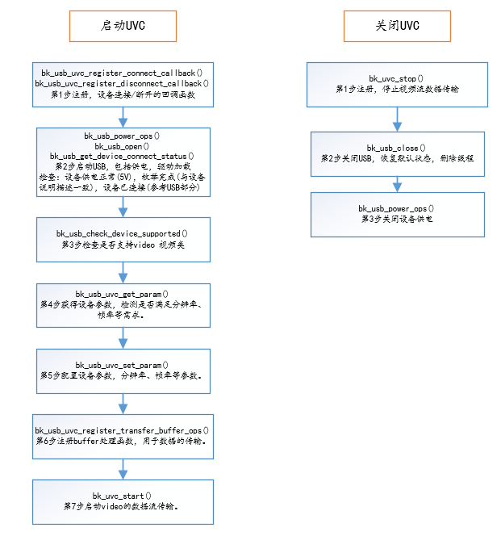
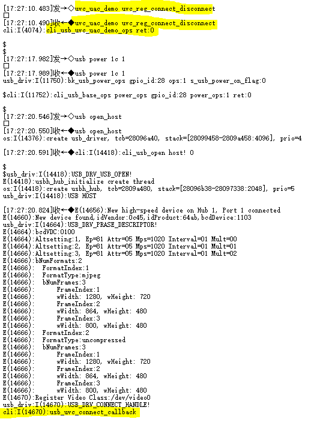
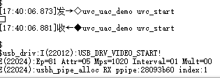
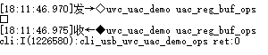
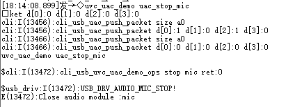
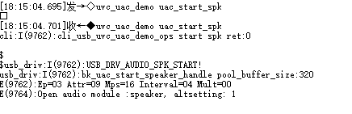
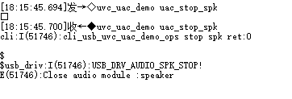

# USB Host UVC\+UAC

uvc\_uac\_api\_common是BK7258的 USB UVC \+ UAC 主机驱动程序，支持从 USB 设备读取/写入/控制多媒体流。当前最多同时支持 1 路摄像头 \+ 1 路麦克风 \+ 1 路播放器数据流。
具体的综合使用示例，请参考avdk多媒体代码，谢谢。

## UVC 主机驱动基本使用流程

UVC start/stop

## UVC 主机驱动CLI测试示例

注：BK7258 USB 默认运行在CPU2，使用默认avdk调试需要连接UART2协助输入命令测试。 测试目标：UVC 获得参数正常，设置参数正常，Buffer管理正常，启动传输正常，关闭传输正常。

作为HOST 运行Video设备为例，输入命令和LOG信息如下图所示：

UVC Connect/Disconnect

UVC Get Param

UVC Set Param

注：根据获得参数来设置参数，设置最大包长1024字节，分辨率1280X720 索引1，帧率30fps，视频数据格式索引1(实例中1为MJPG)。

UVC Register Buffer ops

注：代码参考视频多媒体，buffer管理部分。

UVC Start

UVC Stop

## UAC 主机驱动基本使用流程

UAC start/stop

## UAC 主机驱动CLI测试示例

注：BK7258 USB 默认运行在CPU2，使用默认avdk调试需要连接UART2协助输入命令测试。 测试目标：UVC 获得参数正常，设置参数正常，Buffer管理正常，启动传输正常，关闭传输正常。

作为HOST 运行Video\+Audio融合设备为例，输入命令和LOG信息如下图所示：

UAC Connect/Disconnect

UAC Get Param

UAC Set Param

注：根据获得参数来设置参数，设置采样率，音频格式。

UAC Register Buffer ops

注：代码参考音频多媒体，buffer管理部分。

UAC MIC Start

UAC MIC Stop

UAC SPK Start

UAC SPK Stop

## USB UVC UAC Reference

### Header File

- [uvc\_uac\_api\_common.h](https://docs.bekencorp.com/arminodoc/bk_idk/bk7258/zh_CN/v2.0.1/_header_files/include/components/uvc_uac_api_common.h)

### Functions

    [bk\_err\_t](../../system/os.md#_CPPv48bk_err_t "bk_err_t") bk\_uvc\_uac\_register\_callback([bk\_uvc\_uac\_app\_callback](../bk_usb.md#_CPPv423bk_uvc_uac_app_callback "bk_uvc_uac_app_callback") \*uvc\_uac\_all\_cb)
:   Registering the callback function for UVC and UAC fusion devices.

    Register the corresponding callback function based on the structure, and be sure to fill in the specific type to facilitate the management of the callback function parameter: uvc\_uac\_all\_cb E\_USB\_DEVICE\_T dev; FUNCPTR uvc\_uac\_connect\_cb; FUNCPTR uvc\_uac\_disconnect\_cb;

    返回
    :   - BK\_OK: succeed
        - others: other errors.

    [bk\_err\_t](../../system/os.md#_CPPv48bk_err_t "bk_err_t") bk\_usb\_uvc\_register\_connect\_callback(void \*param)
:   UVC connect the callback function registration function registration.

    This API connect the callback:

    - parameter is the registered callback function.
    - The callback function needs to be defined.

    Notify the registered callback function when the device is connected.

    返回
    :   - BK\_OK: succeed
        - others: other errors.

    [bk\_err\_t](../../system/os.md#_CPPv48bk_err_t "bk_err_t") bk\_usb\_uvc\_register\_disconnect\_callback(void \*param)
:   UVC disconnect the callback function registration function registration.

    This API disconnect the callback:

    - parameter is the registered callback function.
    - The callback function needs to be defined.

    Notify the registered callback function when the device is disconnected.

    返回
    :   - BK\_OK: succeed
        - others: other errors.

    [bk\_err\_t](../../system/os.md#_CPPv48bk_err_t "bk_err_t") bk\_usb\_uvc\_get\_param([bk\_uvc\_device\_brief\_info\_t](../bk_usb.md#_CPPv426bk_uvc_device_brief_info_t "bk_uvc_device_brief_info_t") \*uvc\_device\_info)
:   Obtain UVC relate parameters.

    Including basic parameters,VID PID FORMAT FRAME EndPoint

    parameter: uvc\_device\_info uint16\_t vendor\_id; uint16\_t product\_id; [bk\_uvc\_format\_index](../bk_usb.md#structbk__uvc__format__index) format\_index; [bk\_uvc\_all\_frame](../bk_usb.md#structbk__uvc__all__frame) all\_frame; uint32\_t endpoints\_num; struct [s\_bk\_usb\_endpoint\_descriptor](../bk_usb.md#structs__bk__usb__endpoint__descriptor) \*ep\_desc;

    返回
    :   - BK\_OK: succeed
        - others: other errors.

    [bk\_err\_t](../../system/os.md#_CPPv48bk_err_t "bk_err_t") bk\_usb\_uvc\_set\_param([bk\_uvc\_config\_t](../bk_usb.md#_CPPv415bk_uvc_config_t "bk_uvc_config_t") \*uvc\_config)
:   Configure the basic parameters for starting UVC.

    Execute the command according to the configured parameters, please fill in the parameters correctly. Prevent parameter requirements that cannot be executed

    parameter: uvc\_config uint16\_t vendor\_id; uint16\_t product\_id; uint16\_t width; uint16\_t height; uint32\_t fps; uint16\_t frame\_index; uint16\_t format\_index; struct [s\_bk\_usb\_endpoint\_descriptor](../bk_usb.md#structs__bk__usb__endpoint__descriptor) \*ep\_desc;

    返回
    :   - BK\_OK: succeed
        - others: other errors.

    [bk\_err\_t](../../system/os.md#_CPPv48bk_err_t "bk_err_t") bk\_usb\_uvc\_register\_transfer\_buffer\_ops(void \*ops)
:   Start UVC stream transmission.

    Execute the command according to the configured parameters, please fill in the parameters correctly. Prevent parameter requirements that cannot be executed

    This API means that the data needs to transfer and needs to be copied.

    返回
    :   - BK\_OK: succeed
        - others: other errors.

    [bk\_err\_t](../../system/os.md#_CPPv48bk_err_t "bk_err_t") bk\_uvc\_start(void)
:   Start UVC stream transmission.

    USB video camera data transfer starts:

    - configure the required configuration parameters
    - Send video stream data transfer instructions

    This API means that the data starts to transfer and needs to transfer and needs to be copied.

    返回
    :   - BK\_OK: succeed
        - others: other errors.

    [bk\_err\_t](../../system/os.md#_CPPv48bk_err_t "bk_err_t") bk\_uvc\_dual\_start(void)

    [bk\_err\_t](../../system/os.md#_CPPv48bk_err_t "bk_err_t") bk\_uvc\_stop(void)
:   Stop UVC stream transmission.

    USB video camera data transfer stops:

    - Send the video stream data stop transmission command

    There will be no more data flow after execution.

    返回
    :   - BK\_OK: succeed
        - others: other errors.

    [bk\_err\_t](../../system/os.md#_CPPv48bk_err_t "bk_err_t") bk\_uvc\_dual\_stop(void)

    [bk\_err\_t](../../system/os.md#_CPPv48bk_err_t "bk_err_t") bk\_usb\_uvc\_check\_support\_attribute(uint32\_t attribute)
:   Check whether the attribute configuration is supported.

    After connecting the UVC device, determine whether the attribute operation is supported by calling this API:

    - The Parameters has enumeration variable A planning, please fill in the attribute parameter correctly.
    - attribute: Processing Unit Control Selectors;

    Choose to call this API.

    返回
    :   - BK\_OK: succeed
        - others: other errors.

    [bk\_err\_t](../../system/os.md#_CPPv48bk_err_t "bk_err_t") bk\_usb\_uvc\_attribute\_op([E\_USB\_ATTRIBUTE\_OP](../bk_usb.md#_CPPv418E_USB_ATTRIBUTE_OP "E_USB_ATTRIBUTE_OP") ops, uint32\_t attribute, uint32\_t \*param)
:   Set camera attributes values.

    This API set/get camera attributes values:

    - Three parameters ops/attributes/values.
    - ops: E\_USB\_ATTRIBUTE\_OP
    - attributes: Processing Unit Control Selectors
    - param: Incoming parameter pointer

      example: Reference cli\_usb.c
    - Valid values needs to be viewed in camera.

    Choose to call this API.

    返回
    :   - BK\_OK: succeed
        - others: other errors.

    [bk\_err\_t](../../system/os.md#_CPPv48bk_err_t "bk_err_t") bk\_usb\_uac\_register\_connect\_callback(void \*param)
:   UAC connect the callback function registration function registration.

    This API disconnect the callback:

    - parameter is the registered callback function.
    - The callback function needs to be defined.

    Notify the registered callback function when the device is connected.

    返回
    :   - BK\_OK: succeed
        - others: other errors.

    [bk\_err\_t](../../system/os.md#_CPPv48bk_err_t "bk_err_t") bk\_usb\_uac\_register\_disconnect\_callback(void \*param)
:   UAC disconnect the callback function registration function registration.

    This API disconnect the callback:

    - parameter is the registered callback function.
    - The callback function needs to be defined.

    Notify the registered callback function when the device is disconnected.

    返回
    :   - BK\_OK: succeed
        - others: other errors.

    [bk\_err\_t](../../system/os.md#_CPPv48bk_err_t "bk_err_t") bk\_usb\_uac\_get\_param([bk\_uac\_device\_brief\_info\_t](../bk_usb.md#_CPPv426bk_uac_device_brief_info_t "bk_uac_device_brief_info_t") \*uac\_device\_info)
:   Obtain UAC relate parameters.

    Including basic parameters,VID PID mic\_samples\_frequence spk\_samples\_frequence

    parameter: uac\_device\_info uint16\_t vendor\_id; uint16\_t product\_id; uint16\_t mic\_format\_tag; uint8\_t mic\_samples\_frequence\_num; uint8\_t \*mic\_samples\_frequence; struct audio\_ep\_descriptor \*mic\_ep\_desc; uint16\_t spk\_format\_tag; uint8\_t spk\_samples\_frequence\_num; uint8\_t \*spk\_samples\_frequence; struct audio\_ep\_descriptor \*spk\_ep\_desc;

    返回
    :   - BK\_OK: succeed
        - others: other errors.

    [bk\_err\_t](../../system/os.md#_CPPv48bk_err_t "bk_err_t") bk\_usb\_uac\_set\_param([bk\_uac\_config\_t](../bk_usb.md#_CPPv415bk_uac_config_t "bk_uac_config_t") \*uac\_config)
:   Configure the basic parameters for starting UAC.

    Execute the command according to the configured parameters, please fill in the parameters correctly. Prevent parameter requirements that cannot be executed

    parameter: uac\_config uint16\_t vendor\_id; uint16\_t product\_id; uint16\_t mic\_format\_tag; uint32\_t mic\_samples\_frequence; struct audio\_ep\_descriptor \*mic\_ep\_desc; uint16\_t spk\_format\_tag; uint32\_t spk\_samples\_frequence; struct audio\_ep\_descriptor \*spk\_ep\_desc;

    返回
    :   - BK\_OK: succeed
        - others: other errors.

    [bk\_err\_t](../../system/os.md#_CPPv48bk_err_t "bk_err_t") bk\_usb\_uac\_set\_mic\_param([bk\_uac\_mic\_config\_t](../bk_usb.md#_CPPv419bk_uac_mic_config_t "bk_uac_mic_config_t") \*uac\_mic\_config)
:   Configure the basic parameters for starting Mic.

    Execute the command according to the configured parameters, please fill in the parameters correctly. Prevent parameter requirements that cannot be executed

    parameter: uac\_mic\_config uint16\_t mic\_format\_tag; uint32\_t mic\_samples\_frequence; struct audio\_ep\_descriptor \*mic\_ep\_desc;

    返回
    :   - BK\_OK: succeed
        - others: other errors.

    [bk\_err\_t](../../system/os.md#_CPPv48bk_err_t "bk_err_t") bk\_usb\_uac\_set\_spk\_param([bk\_uac\_spk\_config\_t](../bk_usb.md#_CPPv419bk_uac_spk_config_t "bk_uac_spk_config_t") \*uac\_spk\_config)
:   Configure the basic parameters for starting Speaker.

    Execute the command according to the configured parameters, please fill in the parameters correctly. Prevent parameter requirements that cannot be executed

    parameter: uac\_spk\_config uint16\_t spk\_format\_tag; uint32\_t spk\_samples\_frequence; struct audio\_ep\_descriptor \*spk\_ep\_desc;

    返回
    :   - BK\_OK: succeed
        - others: other errors.

    [bk\_err\_t](../../system/os.md#_CPPv48bk_err_t "bk_err_t") bk\_usb\_uac\_register\_transfer\_buffer\_ops(void \*ops)
:   Start UVC stream transmission.

    Execute the command according to the configured parameters, please fill in the parameters correctly. Prevent parameter requirements that cannot be executed

    This API means that the data needs to transfer and needs to be copied.

    返回
    :   - BK\_OK: succeed
        - others: other errors.

    [bk\_err\_t](../../system/os.md#_CPPv48bk_err_t "bk_err_t") bk\_uac\_start\_mic(void)
:   Start UAC mic stream transmission.

    USB audio data transfer starts:

    - configure the required configuration parameters
    - Send audio stream data transfer instructions

    This API means that the data starts to transfer and needs to transfer and needs to be copied.

    返回
    :   - BK\_OK: succeed
        - others: other errors.

    [bk\_err\_t](../../system/os.md#_CPPv48bk_err_t "bk_err_t") bk\_uac\_stop\_mic(void)
:   Stop UAC mic stream transmission.

    USB audio data transfer stops:

    - Send the video stream data stop transmission command

    There will be no more data flow after execution.

    返回
    :   - BK\_OK: succeed
        - others: other errors.

    [bk\_err\_t](../../system/os.md#_CPPv48bk_err_t "bk_err_t") bk\_uac\_start\_speaker(void)
:   Start UAC speaker stream transmission.

    USB audio data transfer starts:

    - configure the required configuration parameters
    - Send audio stream data transfer instructions

    This API means that the data starts to transfer and needs to transfer and needs to be copied.

    返回
    :   - BK\_OK: succeed
        - others: other errors.

    [bk\_err\_t](../../system/os.md#_CPPv48bk_err_t "bk_err_t") bk\_uac\_stop\_speaker(void)
:   Stop UAC speaker stream transmission.

    USB audio data transfer stops:

    - Send the video stream data stop transmission command

    There will be no more data flow after execution.

    返回
    :   - BK\_OK: succeed
        - others: other errors.

    [bk\_err\_t](../../system/os.md#_CPPv48bk_err_t "bk_err_t") bk\_usb\_uac\_check\_support\_attribute(uint32\_t attribute)
:   Check whether the attribute configuration is supported.

    After connecting the UAC device, determine whether the attribute operation is supported by calling this API:

    - The Parameters has enumeration variable A planning, please fill in the attribute parameter correctly.
    - attribute: Feature Unit Control Bits;

    Choose to call this API.

    返回
    :   - BK\_OK: succeed
        - others: other errors.

    [bk\_err\_t](../../system/os.md#_CPPv48bk_err_t "bk_err_t") bk\_usb\_uac\_attribute\_op([E\_USB\_ATTRIBUTE\_OP](../bk_usb.md#_CPPv418E_USB_ATTRIBUTE_OP "E_USB_ATTRIBUTE_OP") ops, uint32\_t attribute, uint32\_t \*param)
:   Set camera attributes values.

    This API set/get camera attributes values:

    - Three parameters ops/attributes/values.
    - ops: E\_USB\_ATTRIBUTE\_OP
    - attributes: Feature Unit Control Bits
    - param: Incoming parameter pointer

      example: Reference cli\_usb.c
    - Valid values needs to be viewed in camera.

    Choose to call this API.

    返回
    :   - BK\_OK: succeed
        - others: other errors.
