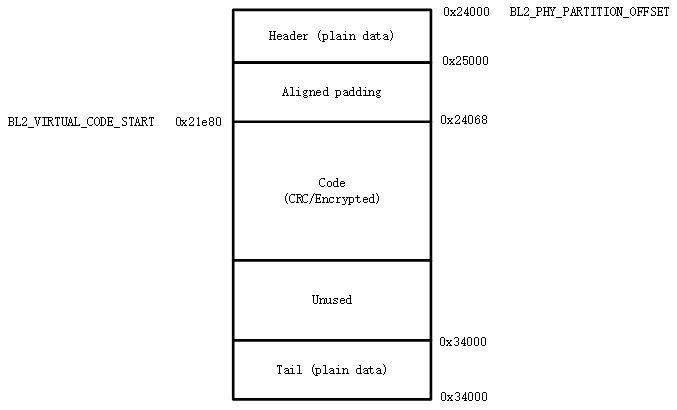

<a id="bk-config-partitions"></a>

<a id="id1"></a>

# 分区配置

备注

本节中 BL1 特指固化在芯片中的 BootROM,\`BL2\` 特指 Bootloader,即 mcuboot。

<a id="id2"></a>

## 分区表

FLASH 分区表为 CSV 文件,下面为一个配置示例:

| Name | Offset | Size | Execute | Read | Write |
| --- | --- | --- | --- | --- | --- |
| bl2 |  | 128k | TRUE | TRUE |  |
| primary\_cpu0\_app |  | 128k | TRUE | TRUE |  |
| secondary\_cpu0\_app |  | 128k | TRUE | TRUE |  |
| sys\_rf | 0x3fe000 | 4k |  | TRUE |  |
| sys\_net |  | 4k |  | TRUE |  |

<a id="bk-config-partitions-table"></a>

分区表固定为六列:

> - `Name` \- 必选项,表示分区名字。
>
>   - **分区名必须唯一**。构建系统会依据分区名字来生成一组宏,只有分区名字唯一才能确保生成宏不会重复定义。
>   - **升级方式:ref:\`升级策略 \<\_bk\_config\_ota\_strategy\>\`使用 SWAP 或者 XIP 时,代码分区名格式必须为 一组 primary\_binname 和 secondary\_binname,两者需要 binname 对应且大小相同。** 其中:
>
>     - primary 前缀表示 OTA 升级时对应的主分区（在 XIP 升级时,对应 A 分区）。
>     - secondary 前缀表示 OTA 升级时对应的次分区（在 XIP 升级时,对应 B 分区）,当 secondary 分区不存在时表示该 BIN 不可升级。
>     - binname 表示分区中放置的二进制文件名字,例如,primary\_cpu0\_app 分区中放置的二进制文件为 cpu0\_app.bin。
>   - **升级方式使用 OVERWRITE 时,代码分区名格式为 primary\_binname ,且需要包含名为 ota 的分区。**
>     \- primary 前缀表示存放可执行文件的区域,是该代码运行的分区。
>     \- ota分区是存放用于升级的文件的区域,所有带有primary\_前缀分区中的二进制文件会被压缩,并且通过OTA下载存放在该分区中。
>   - 保留分区,保留分区为 Armino 已用着特定用途的分区:
>
>     - primary\_cpu0\_app 与 secondary\_cpu0\_app \- 构建 app.bin 时会使用这两个分区生成的宏进行链接。
>     - bl2 \- 构建 bl2.bin 时会使用到这两个分区生成的宏进行链接。
>     - primary\_tfm\_s 与 secondary\_tfm\_s \- 构建 tfm\_s.bin 时会使用到这两个分区生成的宏进行链接。
>     - primary\_tfm\_ns 与 secondary\_tfm\_ns \- 构建 tfm\_ns.bin 时会使用到这两个分区生成的宏进行链接。
>     - primary\_all 与 secondary\_all \- 构建系统生成的虚拟分区,用于将多个分区合并成一个分区之后进行整体加签。
>     - sys\_ps,sys\_its, sys\_otp\_nv \- 这三个分区均为 tfm\_s.bin 中的特有分区,当 primary\_tfm\_s 分区存在时,这个三分区必须存在。
>     - sys\_rf,sys\_net \- Armino 中特有分区,RF 校准,Wi-Fi/TCPIP 会用到这两个分区。当 primary\_cpu0\_app 存在时,这两个分区必须存在。
>     - bl1\_control, manifest \- 安全启动相关分区。
> - `Offset` \- 可选项。表示分区在 FLASH 的物理偏移量。
>
>   - 未配置 offset 时,\`\`offset\`\` 取值为上一个分区结束地址。首分区未配置时,\`\`offset\`\` 为 0。
>   - 允许相邻两个分区地址之间存在空洞,但不允许出现重叠。
>   - 一般不建议配置 offset,除非要在特定的,不连续的位置放置一个分区时,才需要配置 offset。
>   - offset 对齐需求:
>
>     - 任何分区必须 4K 对齐。
>     - S/NS 交界处相邻的两个分区必须 68K 对齐,否则 MPC 配置时会出现一个 S/NS block 横跨两个分区现象。
> - `Size` \- 必选项。表示分区大小,单位 k/K 表示 Kbytes,m/M 表示 Mbytes,通常建议 4K 对齐。
> - `Execute` \- 可选项。分区可执行权限,通常代码分区需配置为 TRUE,数据分区配置为 FALSE。不配置时,表示不可执行。
> - `Read` \- 可选项。分区可读权限,不配置时,表不可读。
> - `Write` \- 可选项。分区可写权限,不配置时,表不可写。

<a id="id3"></a>

## 分区配置

<a id="bk-config-partitions-legacyboot"></a>

<a id="id4"></a>

### 下载模式分区配置

在下载模式下,最小分区配置表如下:

| Name | Offset | Size | Execute | Read | Write |
| --- | --- | --- | --- | --- | --- |
| bl2 |  | 128k | TRUE | TRUE |  |
| primary\_cpu0\_app |  | 1024k | TRUE | TRUE |  |
| secondary\_cpu0\_app |  | 1024k | TRUE | TRUE |  |
| sys\_rf | 0x3fe000 | 4k |  | TRUE |  |
| sys\_net |  | 4k |  | TRUE |  |

其中前三个分区放在 FLASH 首部,后两个分区放在 FLASH 尾部。各分区用途如下:

> - `bl2` \- Bootloader 分区。
> - `primary_cpu0_app` \- CPU0 上运行代码分区,即 cpu0\_app.bin。
> - `secondary_cpu0_app` \- OTA 分区,用于升级 cpu0\_app.bin。

<a id="bk-config-partitions-legacyboot-config"></a>

通常,您可按下述步骤进行配置与扩充:

> - 调整尾部分区偏移 \- 依据 FLASH 实际大小调整尾部分区 `Offset`。例如,如果使用的是 8MB FLASH,则 sys\_rf 的偏移调整为 0x7fe000。
> - 调整首部各分区大小 \- 依据实际生成的二进制大小,调整各分区的 `Size`。
> - 增加用户分区 \- 一般建议在首部与尾部分区之间增加您的分区。

<a id="bk-config-partitions-secureboot"></a>

<a id="id5"></a>

### 安全启动分区配置

在安全启动模式下,最小分区配置表如下:

| Name | Offset | Size | Execute | Read | Write |
| --- | --- | --- | --- | --- | --- |
| bl1\_control |  | 12k | TRUE | TRUE |  |
| manifest |  | 4k |  | TRUE |  |
| bl2 |  | 128k | TRUE | TRUE |  |
| primary\_tfm\_s |  | 512k | TRUE | TRUE |  |
| primary\_cpu0\_app |  | 2304k | TRUE | TRUE |  |
| secondary\_tfm\_s |  | 512k | TRUE | TRUE |  |
| secondary\_cpu0\_app |  | 2304k | TRUE | TRUE |  |
| sys\_ps | 0x7e4000 | 32k |  | TRUE |  |
| sys\_its |  | 32k |  | TRUE |  |
| sys\_otp\_nv |  | 8k |  | TRUE |  |
| sys\_rf |  | 4k |  | TRUE |  |
| sys\_net |  | 4k |  | TRUE |  |

其中前九个分区放在 FLASH 首部,后五个分区放在 FLASH 尾部。各分区用途如下:

> - `bl1_control` \- 用于 BL1 控制,包括硬件重启时跳转地址配置,OTP 模拟,BL1 调试等。
> - `manifest` \- 对 `bl2` 的加签信息放在这个分区,系统上电后,BL1 会依据这个分区的内容对 `bl2` 进行验签,验签通过才跳转到 BL2。
> - `bl2` \- BL2 二进制文件,其加签信息放在 `manifest`。
> - `primary_tfm_s` \- Primary TFM\_S 二进制文件。
> - `primary_cpu0_app` \- Primary CPU0 APP 二进制文件。
> - `secondary_tfm_s` \- Secondary TFM\_S 二进制文件。
> - `secondary_cpu0_app` \- Secondary CPU0 APP 二进制文件。
> - `sys_ps`,\`\`sys\_its\`\`, `sys_otp_nv` \- TFM\_S 中安全存储相关的分区。
> - `sys_rf`,\`\`sys\_net\`\` \- Armino RF 校准,Wi-Fi/TCPIP 配置相关分区。

同样地,如果使用OVERWRITE升级策略:

| Name | Offset | Size | Execute | Read | Write |
| --- | --- | --- | --- | --- | --- |
| bl1\_control |  | 12k | TRUE | TRUE |  |
| manifest |  | 4k |  | TRUE |  |
| bl2 |  | 128k | TRUE | TRUE |  |
| primary\_tfm\_s |  | 512k | TRUE | TRUE |  |
| primary\_cpu0\_app |  | 2304k | TRUE | TRUE |  |
| ota |  | 1024k |  | TRUE |  |
| sys\_ps | 0x7e4000 | 32k |  | TRUE |  |
| sys\_its |  | 32k |  | TRUE |  |
| sys\_otp\_nv |  | 8k |  | TRUE |  |
| sys\_rf |  | 4k |  | TRUE |  |
| sys\_net |  | 4k |  | TRUE |  |

通常,您可按 [下载模式分区配置与扩充](#bk-config-partitions-legacyboot-config) 类似的方法配置与扩充安全启动分区。

<a id="id6"></a>

### 用户自定义分区配置

在量产版本中分区配置中,建议您参考 [下载模式分区配置](#bk-config-partitions-legacyboot) 与 [安全启动模式分区配置](#bk-config-partitions-secureboot)
来配置您的分区表。但在开发阶段,您可能想完全重新定义自己的分区表,例如,不跑 Bootloader,不支持 OTA 等。您可参考本节中的示例来定制化
自己的分区表。

<a id="id7"></a>

#### 简化分区表

下载模式下,只跑 cpu0\_app.bin:

| Name | Offset | Size | Execute | Read | Write |
| --- | --- | --- | --- | --- | --- |
| primary\_cpu0\_app |  | 1024k | TRUE | TRUE |  |
| sys\_rf | 0x3fe000 | 4k |  | TRUE |  |
| sys\_net |  | 4k |  | TRUE |  |

在下载模式下,跑 bl2.bin 与 cpu0\_app.bin,但不需要 OTA:

| Name | Offset | Size | Execute | Read | Write |
| --- | --- | --- | --- | --- | --- |
| bl2 |  | 128k | TRUE | TRUE |  |
| primary\_cpu0\_app |  | 1024k | TRUE | TRUE |  |
| sys\_rf | 0x3fe000 | 4k |  | TRUE |  |
| sys\_net |  | 4k |  | TRUE |  |

在安全启动模式下,只跑 cpu0\_app.bin:

| Name | Offset | Size | Execute | Read | Write |
| --- | --- | --- | --- | --- | --- |
| bl1\_control |  | 12k | TRUE | TRUE |  |
| manifest |  | 4k | TRUE | TRUE |  |
| bl2 |  | 128k | TRUE | TRUE |  |
| primary\_cpu0\_app |  | 2304k | TRUE | TRUE |  |
| sys\_rf | 0x3fe000 | 4k |  | TRUE |  |
| sys\_net |  | 4k |  | TRUE |  |

<a id="bin"></a>

#### 运行自己的 BIN

以下载模式为例,如果您想增加两个可升级的 BIN: test1.bin 与 test2.bin,则分区表配置如下:

| Name | Offset | Size | Execute | Read | Write |
| --- | --- | --- | --- | --- | --- |
| bl2 |  | 128k | TRUE | TRUE |  |
| primary\_cpu0\_app |  | 1024k | TRUE | TRUE |  |
| `primary_test1` |  | 32k | TRUE | TRUE |  |
| `primary_test2` |  | 32k | TRUE | TRUE |  |
| secondary\_cpu0\_app |  | 1024k | TRUE | TRUE |  |
| `secondary_test1` |  | 1024k | TRUE | TRUE |  |
| `secondary_test2` |  | 1024k | TRUE | TRUE |  |
| sys\_rf | 0x3fe000 | 4k |  | TRUE |  |
| sys\_net |  | 4k |  | TRUE |  |

或者使用OVERWRITE升级策略:

| Name | Offset | Size | Execute | Read | Write |
| --- | --- | --- | --- | --- | --- |
| bl2 |  | 128k | TRUE | TRUE |  |
| primary\_cpu0\_app |  | 1024k | TRUE | TRUE |  |
| `primary_test1` |  | 32k | TRUE | TRUE |  |
| `primary_test2` |  | 32k | TRUE | TRUE |  |
| ota |  | 512k |  | TRUE |  |
| sys\_rf | 0x3fe000 | 4k |  | TRUE |  |
| sys\_net |  | 4k |  | TRUE |  |

<a id="id8"></a>

## 分区生成宏

Armino 构建时,构建系统会依据分区表生成 partitions\_gen.h,本节介绍代码生成规则。

<a id="id9"></a>

### 数据分区宏生成

分区表中分区,均会在 partitions\_gen.h 中生成一组宏。对于数据或者系统分区,仅生成分区偏移及大小,
以 ``` sys rf` 与 ``sys net ``` 为例:

```
#define CONFIG_SYS_RF_PHY_PARTITION_OFFSET            0x3fe000
#define CONFIG_SYS_RF_PHY_PARTITION_SIZE              0x1000

#define CONFIG_SYS_NET_PHY_PARTITION_OFFSET           0x3ff000
#define CONFIG_SYS_NET_PHY_PARTITION_SIZE             0x1000
```

<a id="id10"></a>

### 代码分区

包含 BIN 的代码分区除了要生成数据分区中的分区偏移与大小外,还要生成用于构建 BIN 使用的链接地址。
以 primary\_bl2 分区为例,partitions\_gen.h 中会生成宏如下:

```
#define CONFIG_PRIMARY_BL2_PHY_PARTITION_OFFSET       0x24000
#define CONFIG_PRIMARY_BL2_PHY_PARTITION_SIZE         0x10000
#define CONFIG_PRIMARY_BL2_PHY_CODE_START             0x24068
#define CONFIG_PRIMARY_BL2_VIRTUAL_PARTITION_SIZE     0xf0e0
#define CONFIG_PRIMARY_BL2_VIRTUAL_CODE_START         0x21e80
#define CONFIG_PRIMARY_BL2_VIRTUAL_CODE_SIZE          0xf060
```

这些宏被用在 bl2.bin 的链接,bl2 及 OTA 源代码中。

BL2 分区图示如下:



生成宏计算方式:

> - `CONFIG_PRIMARY_BL2_PHY_PARTITION_OFFSET` \- 分区的起始物理地址为 0x24000,由 partitions 定义。
> - `CONFIG_PRIMARY_BL2_PHY_CODE_START` \- 自动计算生成,为 0x21e80,会加 CRC。
>
>   - 偏移 0x24000 处即可放置代码,但需要考虑对齐:
>
>     - CRC 对齐,对齐后物理地址为 ((0x24000 \+ 33)/34)\*34 \= 0x24002, 虚拟地址为 0x21e20。
>     - CPU 向量对齐,支持 128B 对齐, ((0x21e20 \+ 127)/128)\*128 \= 0x21e80,相应的物理地址为: 0x24068。
> - `CONFIG_PRIMARY_BL2_VIRTUAL_CODE_SIZE` \- 自动计算生成,为 0xf060
>
>   - 对齐浪费空间为 0x24068 \- 0x24000 \= 0x68,剩余: 0x10000 \- 0x68 \= 0xff98
>   - 再减 34B 保护字节: 0xff98 \- 34 \= 0xff76
>   - 转虚拟长度: (0xff76/34)\*32 \= 0xf060

重要

从上述计算可知,并非整个代码分区都能用来放置代码,因为要考虑 CRC 与 CPU vector 对齐。对于使用 BL2
进行验签的分区还要去掉头尾各 4K 空间（用于放置加签信息）。如果编译了同来的 bin 大小为 bin\_size,
建议 partition size 至少要配置: (bin\_size/32)x34 \+ hdr\_size \+ tail\_size \+ 128 \+ 34 \+ unused\_size。
其中 unused\_size 为预留给未来 bin 增长的空间。在这个基础之后再做 4K 对齐。
