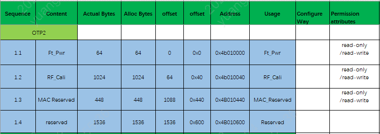
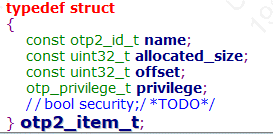
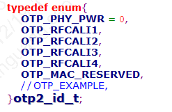
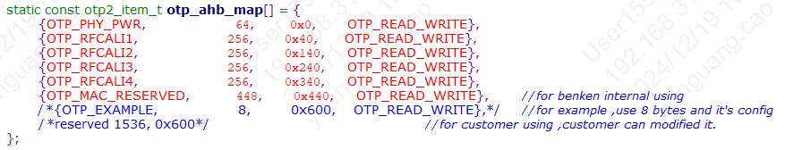

# 非安全版本OTP使用介绍

## OTP

### 一、概述

OTP的详细概述，详情请参考 [OTP/EFUSE配置](bk_config_otp_efuse.md#bk-config-otp-efuse)。

备注

其中，客户可使用的OTP区域仅有OTP2的存储空间，且操作存储地址区间是\[0x4B010600—-0x4B010C00\]，大小是1.5k字节空间。

#### OTP2的使用布局

#### OTP2 Side

OTP2:可读可编程的OTP2区域，0x000\~0x2FF被分为767个小分区。其存储地址区间是\[0x4B010000—-0x4B010C00\]每个分区都可以通过改变LOCK OTP2 CELL来更改权限：读写-\>只读-\>不可访问。

重要

其中，前1.5k字节大小空间已被BEKEN内部使用，其存储地址区间是\[0x4B010000—-0x4B010600\],客户不予使用; 客户可操作的存储地址区间是\[0x4B010600—-0x4B010C00\]，大小是1.5k字节空间。

### 二、Otp2的驱动使用介绍

- 1）首先，otp2的驱动代码路径在bk\_idk/middleware/driver/otp/otp\_driver\_v1\_1.c；
- 2）客户如果想使用otp2，需要配置结构体数组中otp\_ahb\_map\[\]的{ name, allocated\_size , offset , privilege }即可；
- 3）其中，name字段，需要在枚举结构otp2\_id\_t中按顺序增加相应的字段即可；
- 3）配置好上述的配置之后，可以使用cli命令进行测试, 相关的测试代码路径是：bk\_idk/component/bk\_cl/cli\_otp.c (例如 测试命令是otp\_ahb read item size)

备注

操作写otp2某个区域之前，最好将该区域读出来确认一下，确认该otp区域是否已经被使用过。（otp原始值是0）

#### 结构体数组otp\_ahb\_map配置介绍

- 1）结构体数组otp\_ahb\_map的结构体如下：具体路径是bk\_idk/middleware/driver/otp/otp\_driver.h

备注

- name：访问区域的item\_id,后续操作该区域可根据该item\_id进行访问d\_size的大小，即所需要分配的字节大小空间；
- allocated\_size：分配的字节大小空间
- offset：相对基地址的偏移量
- privilege：设定访问区域的权限

- 2）otp2\_id\_t中按顺序增加相应的name字段即可；具体路径是include/driver/otp\_types.h

- 3）目前，otp2的使用区域情况如下：具体路径是bk\_idk/middleware/driver/otp/otp\_driver\_v1\_1.c

备注

- 以name\=OTP\_EXAMPLE举例介绍如何配置otp2，
- 首先，在otp2\_id\_t结构中中增加自行定义的name字段，如OTP\_EXAMPLE；
- 其次，配置allocated\_size的大小，即所需要分配的字节大小空间；（十进制大小）
- offset大小等于（前一个name字段的allocated\_size \+ 前一个字段的offset） （十六进制）
